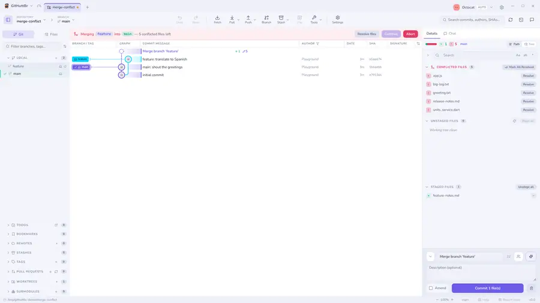
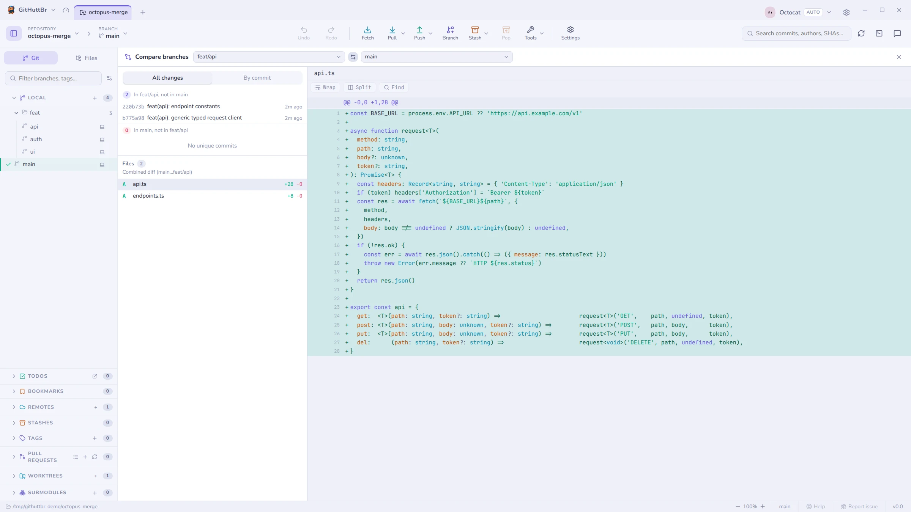
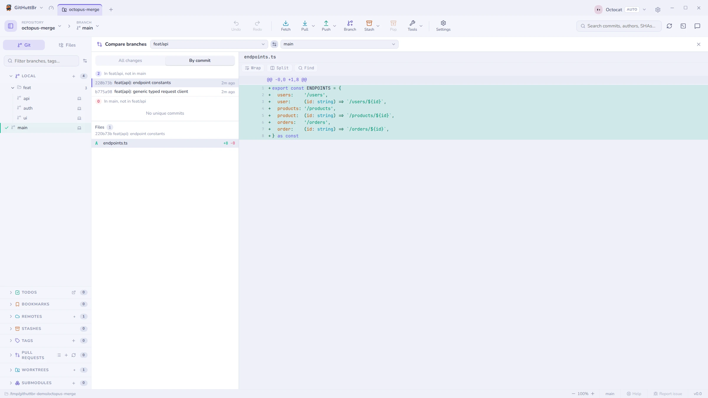
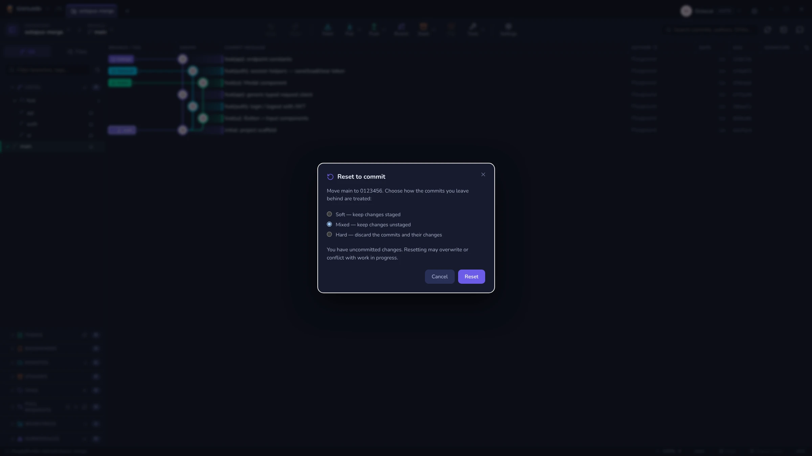

# Mergen & rebasen

## Vanuit de zijbalk

Rechtsklik een branch voor **Mergen in huidige** of **Rebasen op** — of
**Mergen met opties…** wanneer de gewone merge juist degene is die steeds
misgaat; zie [merge-opties](merge-options.md).

## Sleep de ene ref op de andere

Het snelste gebaar in de app: pak een branch op en laat hem op een andere vallen.
GitHuttBr opent een klein menu met wat die drop zou kunnen betekenen, en doet niets
tot jij kiest.

Het werkt op **beide** plekken waar refs getoond worden — de branch-, remote- en
tagrijen in de zijbalk, en de gekleurde **ref-badges in de grafiek** zelf. Sleep
ertussen in elke combinatie; het doel licht op zolang je erboven zweeft.

| Drop | Betekent |
|------|----------|
| **{target} fast-forwarden naar {source}** | Zet het doel zonder checkout bij op de bron — alleen als het doel een lokale branch achter de bron is en niet hier of in een andere [worktree](worktrees.md) is uitgecheckt |
| **Merge {bron} → {doel}** | Checkt het doel uit en merget de bron erin |
| **Rebase {bron} op {doel}** | Speelt de commits van de bron bovenop het doel opnieuw af |
| **Interactieve rebase van {source} op {target}…** | Opent de planner voor [interactieve rebase](rebase.md) — als de bron de uitgecheckte branch is |
| **{source} pushen naar {target}** | Pusht de bron naar de remote-branch van het doel (`origin/main`) — nooit geforceerd, dus de remote weigert alles behalve een fast-forward; vraagt eerst en doet dezelfde geheimencontroles als elke push |
| **{source} resetten naar {target}…** | Opent het resetvenster — soft, mixed of hard, met wat elk behoudt — als de bron de uitgecheckte branch is |
| **Pull request {source} → {target} aanmaken…** | Opent het [pull request](hosting.md)-formulier met beide branches — als de remote bij een ondersteunde host staat |
| **{source} pushen en pull request naar {target} starten…** | Vervangt *Pull request aanmaken* als de bron nog niet op de remote staat: pusht hem en opent dan het formulier |
| **Vergelijken** | Opent de [vergelijking](#twee-willekeurige-refs-vergelijken) — verandert niets |

**Het menu biedt alleen wat git kan.** Mergen commit op het doel, dus het doel
moet een lokale branch zijn — je kunt niet in een tag of een remote-tracking ref
mergen. Rebasen herschrijft de bron, dus de bron moet een lokale branch zijn.
Laat een tag op een remote branch vallen en het enige dat je krijgt is
*Vergelijken*, want dat is werkelijk alles wat er is.

Rebasen vraagt eerst om bevestiging: het geeft elke opnieuw afgespeelde commit
een nieuwe hash, wat een force push betekent als de branch al gepubliceerd is.
Pushen vraagt ook: iedereen die het doel pullt krijgt de commits, en een push
kun je vanuit GitHuttBr niet ongedaan maken. Mergen vraagt niets — het voegt alleen
toe. Mergen en rebasen draai je terug met één keer **Ongedaan maken**.

## Een commit op een branch slepen

Sleep een commitregel uit de grafiek naar het label van een **lokale branch**:

| Losgelaten op | Biedt |
|---------------|-------|
| De uitgecheckte branch | **Cherry-pick** van de commit hierheen; **Reset** van de branch ernaar (het reset-venster, dat zegt wat elke modus behoudt) |
| Een andere lokale branch | **Uitchecken en cherry-picken**; **De branch verplaatsen** naar de commit (`git branch -f`) |

Een branch verplaatsen vraagt eerst om bevestiging: commits die alleen die branch
bereikte, staan daarna op geen enkele branch meer. Ongedaan maken zet de branch
terug. Remote-trackingbranches en tags accepteren geen commit, omdat git ze zo
niet verplaatst, en een branch die al naar de commit wijst biedt niets. Dezelfde
sleepbeweging naar de AI-chat voegt de commit nog steeds als context toe.

## Mergen

Fast-forward waar mogelijk, of een merge-commit afdwingen wanneer je de topologie
wilt vastleggen. Conflicteert het, dan land je in [de oplosser](conflicts.md).

## Twee willekeurige refs vergelijken

Zie wat een branch zou meebrengen, of wat hij mist, voordat je hem merget. Kies
een vergelijkingsref en een basis — branch, tag of ruwe SHA, met een wisselknop
— en de vergelijking opent in het middenpaneel, in plaats van de graaf, met de
commits die alleen aan elke kant staan.

| Modus | Toont |
|------|-------|
| **Alle wijzigingen** | Alles wat de vergelijkingsref toevoegt sinds hij de basis verliet, als één gecombineerde diff. |
| **Per commit** | Eén commit tegelijk. Klik op een commit in een van beide lijsten om alleen zijn wijzigingen te zien — ook vanuit *Alle wijzigingen*. |

De gewijzigde bestanden staan links met hun toegevoegde en verwijderde regels,
en alleen het gekozen bestand wordt getekend, zodat een enorme vergelijking
scrolt als een kleine. **PR maken…** geeft de commits door aan een nieuwe pull
request; <kbd>Esc</kbd> of de sluitknop gaat terug naar de graaf.

Beperkingen: een mergecommit wordt getoond tegenover zijn eerste ouder, en een
binair bestand staat in de lijst zonder tekstdiff. Staat de conflictoplosser of
de commit-editor open, sluit die dan eerst — de vergelijking zou erachter
openen.

Bereikbaar via de zijbalk (vergelijken met de huidige branch), door een branch
op een andere te slepen, het menu Gereedschap, de conflict- en teamradar, of
<kbd>⌘K</kbd>.

## Cherry-picken, reverten, resetten

Cherry-picken en reverten wonen in het contextmenu van de grafiek, zoals altijd
al. **Reset** is één item — **Resetten naar commit…** — in plaats van drie kale
soft/mixed/hard-items die elkaar tegenspraken.

Aanpassen, ongedaan maken en resetten staan bovenaan het menu voor één commit en
blijven **zichtbaar wanneer ze onveilig zijn**: ze worden uitgeschakeld, met een
tooltip die zegt waarom. Ongedaan maken is alleen voor een niet-gepushte HEAD;
aanpassen mag ook op een gepubliceerde HEAD, maar waarschuwt dat er een force
push nodig zal zijn. Resetten reikt alleen tot lokale voorouders plus de eerste
gepubliceerde commit — niet tot willekeurige oudere geschiedenis.

De resetdialoog maakt de modus expliciet:

| Modus | Resultaat |
|------|--------|
| **Soft** | Houd de wijzigingen gestaged |
| **Mixed** | Houd de wijzigingen unstaged |
| **Hard** | Gooi de commits en hun wijzigingen weg |

Hard is nooit vooraf geselecteerd. Een vuile werkboom krijgt een extra
waarschuwing, omdat resetten werk in uitvoering kan overschrijven of ermee kan
conflicteren. **Bekijken op GitHub** staat bij de kopieeracties en opent alleen
voor gepubliceerde commits op een github.com-remote.

Selecteer eerst meerdere commits en cherry-pick past de hele selectie toe, op
volgorde.

## Voor je iets merget

De [conflictradar](conflict-radar.md) scant elke branch tegen een basis en
vertelt je welke gaan vechten, zonder iets uit te checken.

**Zie ook:** [Interactieve rebase](rebase.md) · [Gestapelde branches](stacks.md) · [Conflictradar](conflict-radar.md)
