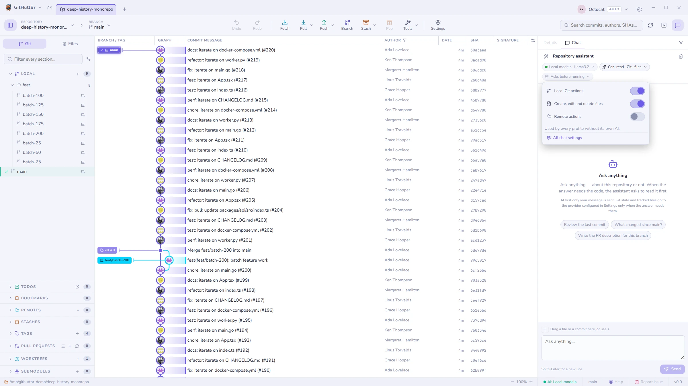
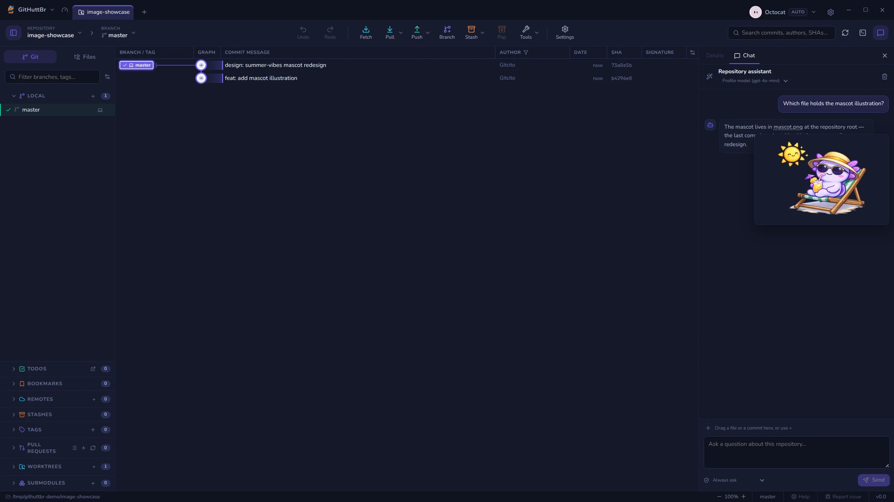

# Repository-chat

Sommige vragen zijn sneller gesteld dan opgezocht. *Waar gebeurt het vernieuwen
van het token echt? Wat veranderde deze commit, in één zin? Waarom bestaat dit
bestand?* De repository-chat beantwoordt dat voor de geopende repository en laat
de regels zien waarop het antwoord rust.

Het is ook gewoon een AI-chat. Een begroeting, een algemene
programmeervraag of wat dan ook krijgt een direct antwoord van het model, zonder
de repository te lezen — hij kijkt alleen naar bestanden als de vraag erover
gaat.

Hij deelt de rechterkolom met **Details**: de tabbladen bovenaan wisselen ertussen,
zodat de graaf zijn selectie niet kwijtraakt als je iets vraagt.

## Wat hij leest

Hij werkt zoals elke chat: **wat verstuurd wordt is je bericht**, met daarnaast
alleen de naam en de branch van de repository — geen Git-toestand, geen
bestandslijst, geen bestandsinhoud — en het antwoord komt terug als platte
tekst. Een begroeting of een vraag die niet over de repository gaat, wordt
meteen beantwoord, in één aanroep, en niets uit de repository verlaat je
machine.

**Wanneer de repository erbij komt.** Die wordt in drie gevallen voor het model
geopend:

| Je… | Wat er gebeurt |
|------|--------------|
| Noemt een gevolgd bestand (`config.json`, `src/app.ts`) | Dat bestand wordt gelezen voordat het model antwoordt |
| Zegt het met zoveel woorden — ‘deze repository’, ‘mijn wijzigingen’, ‘niet gecommit’, ‘huidige branch’ | De Git-toestand en de lijst met gevolgde bestanden worden meegestuurd |
| Vraagt iets waarvoor het model besluit dat het die nodig heeft | Het antwoordt met één regel `@repo`, en de app opent de repository ervoor |

Vanaf daar vraagt het model om wat het verder nodig heeft in plaats van te
raden: exacte paden uit de lijst, letterlijke zoekopdrachten of commit-hashes
uit de recente historie. De app leest die en stelt de vraag opnieuw met wat ze
opleverden. Dat gebeurt hooguit vier keer — elke ronde is weer een modelaanroep
waar je op wacht — en in de laatste moet het antwoorden met wat het heeft. Deze
antwoorden citeren de fragmenten die ze gebruikten, en een verzonnen bestand of
regel is een validatiefout, geen aannemelijk klinkend antwoord.

Terwijl je wacht, zegt de regel onder je bericht wat er gebeurt: **Aan het
nadenken…** terwijl het model werkt, **Bestanden lezen (N)…** of **Repository
doorzoeken…** alleen terwijl de app echt leest waar het om vroeg.

| Wel | Niet |
|---|---|
| Gevolgde bestanden, zoals ze in je werkmap staan | Niet-gevolgde bestanden |
| Diffs in en buiten de stage van gevolgde bestanden | Alles wat een ignore-regel raakt, ook als het gevolgd wordt |
| Branch, voor/achter en de lijst gewijzigde paden | [Bestanden die op geheimen lijken](security.md), binaries, gegenereerde paden |

Omdat hij de werkmap leest, kun je over niet-vastgelegde wijzigingen praten. Het
betekent ook dat die wijzigingen je machine verlaten: de provider die je bij
[AI-functies](ai.md) instelde, krijgt ze.

Eén nuance: met [actievoorstellen](#acties-uitvoeren-vanuit-de-chat)
ingeschakeld gaan de **namen** van niet-gevolgde bestanden mee in de
repositorystatus — "stage het nieuwe bestand" heeft ze nodig — maar hun inhoud
wordt nog steeds nooit gelezen.

## Context vastzetten

Het model bepaalt wat het leest. Vastzetten overrulet dat: wat vastzit wordt
**eerst** gelezen en krijgt het grootste deel van het contextbudget.

Vier manieren, allemaal naar dezelfde rij chips boven het invoerveld:

| Doe dit | Levert op |
|---|---|
| Klik op een voorgestelde chip | Het bestand in de viewer, of de commit die in de graaf geselecteerd is |
| Sleep een rij uit het tabblad **Bestanden** | Dat bestand |
| Sleep een rij uit de **commitgraaf** | Die commit — het bericht en de diff als hunks |
| **+** → *Kies een bestand…*, of sleep uit Finder/Verkenner | Elk bestand op schijf, ook buiten de repository |

Chips blijven vastzitten voor vervolgvragen; de `×` haalt er één weg, en het
wissen van het gesprek alle. Acht is het maximum.

Een vastgezette commit levert zijn bericht en maximaal twaalf diff-hunks. Hunks
op een uitgesloten pad vallen uit die diff, niet de hele commit.

## Instellingen

**Instellingen → AI → Repository-chat** — op de algemene AI, of op de eigen AI
van een profiel als het die heeft (de balk **Bewerken** kiest welke, zie [Eén AI
voor elk profiel](ai.md#één-ai-voor-elk-profiel)):

| Instelling | Doet |
|---|---|
| **Vragen stellen over de repository** | Uit verwijdert het tabblad, de knop en het doel van de sneltoets. De rest van de AI blijft werken |
| **De repository lezen** | Bestanden, geschiedenis en diffs, om je te antwoorden. Bestanden die op geheimen lijken, worden nooit gelezen |
| **Alleen vastgelegde inhoud** | Antwoordt vanuit de laatste commit in plaats van je werkmap: niet-vastgelegde bewerkingen verlaten de machine nooit |
| **Lokale Git-acties** | Stagen, committen, branch, stash, merge en meer, voorgesteld op een kaart die je controleert. Uit: de chat antwoordt alleen |
| **Bestanden maken, bewerken en verwijderen** | Exacte bewerkingen, nieuwe bestanden, vervangingen en verwijderingen, elk met zijn diff op de kaart. Vereist lokale Git-acties. Standaard uit. Vervangt *Alleen-lezenmodus voor bestanden* met de betekenis omgedraaid: hier aan is die modus uit, en een opgeslagen instelling leest hetzelfde als voorheen |
| **Als de AI een actie voorstelt** | De goedkeuringsmodus — zie [Goedkeuringsmodi](#goedkeuringsmodi). Destructieve acties vragen hoe dan ook bevestiging |
| **Externe acties** | Standaard uit. Aan voegt fetch, pull, push, een pull request openen en een stack indienen toe |

Boven de lijst vat één zin samen wat de AI met deze instellingen nu mag. Hij beschrijft de instellingen, niet het model: een voorstel wordt nog steeds gecontroleerd en geweigerd als het een regel breekt.

Staat AI helemaal uit, dan verdwijnt de chat mee — geen paneel dat een antwoord
aanbiedt dat niemand kan geven.

Welke provider en welk model de chat beantwoorden, stel je in op de pagina **AI**,
onder **Model per taak** — zie [AI-functies](ai.md#model-per-taak).

### De pillen in de kop

Onder de titel van het paneel zeggen drie pillen wat de chat met je volgende
bericht gaat doen, en elk ervan verandert dat zonder de Instellingen te openen:

| Pil | Toont | Klik om |
|---|---|---|
| **Account · model** | Wie antwoordt, met een stip voor de staat van het account — klaar, reageert niet, geen sleutel of nog niet gecontroleerd | Een ander model te kiezen uit een menu gegroepeerd per account, of terug te gaan naar het model van het profiel. Dezelfde instelling als **Model per taak → Chat** |
| **Mag: …** | Wat de chat mag — *lezen*, plus *Git*, *bestanden* en *remote* als die aan staan | **Lokale Git-acties**, **Bestanden maken, bewerken en verwijderen** en **Externe acties** om te zetten, of **Alle chatinstellingen** te openen |
| **Goedkeuring** | *Vraagt vóór uitvoeren*, *Voert veilige acties uit* of *Voert alle acties uit* | Een van de drie goedkeuringsmodi (hieronder) te kiezen. Verborgen zolang lokale Git-acties uit staan, omdat er niets wordt voorgesteld |

Het zijn dezelfde instellingen als **Instellingen → AI → Repository-chat**,
opgeslagen op dezelfde AI, dus de twee spreken elkaar nooit tegen. Eén vraag
naar een sterker model sturen is één klik en verstoort de rest van de app niet.
De statusstip komt uit de modellijst die het paneel toch al ophaalde — hij doet
nooit een eigen verzoek, dus *Niet gecontroleerd* betekent alleen dat nog niets
het account heeft bewezen.

De toverstafknop naast de paneeltitel opent de **AI-configuratiewizard** — een
begeleide flow die assistentconfiguratiebestanden (instructies, agents, hooks)
voor deze repository genereert. Zie [AI-functies](ai.md).

## Werken met berichten

Berichten zijn gewone tekst. Selecteer een willekeurig deel en kopieer het, of
klik met de rechtermuisknop op een ballon: **Kopiëren** neemt de selectie,
**Bericht kopiëren** het hele bericht — een antwoord wordt gekopieerd als zijn
Markdown-bron — en als de klik op een link viel, neemt **Link kopiëren** het
adres.

Links openen in je standaardbrowser, nooit binnen GitHuttBr — Markdown-links in
antwoorden en gewone `https://`-adressen in je eigen berichten.

Wanneer een bericht een afbeelding noemt — een repositorypad zoals
`docs/logo.png`, of een URL die eindigt op een afbeeldingsextensie — toont
zweven boven de vermelding een kleine voorvertoning. Repositorypaden worden uit
je werkboom gelezen; een vermelding die niet naar een leesbare afbeelding
leidt, toont gewoon niets.

## Acties uitvoeren vanuit de chat

Vraag om een verandering in plaats van een feit — *stage de
markdown-bestanden, commit dit als fix, zet de buildoutput op de ignorelijst* —
en het antwoord komt met een **actiekaart**. Een leeg gesprek begint met **Vraag wat je wilt** en drie suggesties — *Bekijk de laatste commit*, *Wat is er veranderd sinds main?* (met de naam van de standaardbranch van de repository als die er is) en *Schrijf de PR-beschrijving voor deze branch*. Erop klikken vult het invoerveld en verstuurt niets, zodat je het eerst kunt bewerken. De kaart
somt de concrete stappen op die de
assistent wil zetten, één rij per actie, met de knoppen **Uitvoeren** en
**Afwijzen**. Niets op de kaart is al gebeurd; het model kan alleen
voorstellen, en elk voorstel wordt tegen de werkmap gecontroleerd voordat jij
het ziet — een actie die een niet-bestaand bestand noemt, wordt afgewezen, niet
getoond.

Repository-chat kan exacte bewerkingen, het aanmaken of volledig vervangen van
bestanden en verwijderen voorstellen, gevolgd door Git-acties: ignore-patronen,
stagen, unstagen, committen, stashen, weggooien, branch, wisselen, tag en —
omdat de branchlijst en de recente commits worden getoond — merge, rebase,
revert en cherry-pick. GitHuttBr berekent de uitklapbare diff lokaal. Bestaande
bestanden moeten uit gelezen bewijs komen; onveilige, geheime, genegeerde,
gegenereerde, binaire, verouderde, te grote en via symlink bereikte doelen
worden geweigerd. Reset, historie herschrijven, branches verwijderen en elke
force-operatie blijven in hun eigen scherm.

**Tekst uit het gesprek kan een bestand worden.** Vraag om een tekst en daarna
*maak het bestand aan*: het vorige antwoord is de inhoud, en noem je geen
bestandsnaam, dan kiest de assistent er een en toont die op de kaart. Met
bestandsacties aan krijgt het model te horen dat het kan schrijven, dus een
eerder antwoord dat beweerde geen toegang te hebben wordt niet herhaald. Mislukt
het gestructureerde antwoord toch, dan zegt het antwoord dat de wijziging deze
keer niet kon worden voorbereid en dat het verzoek opnieuw sturen het nogmaals
probeert; het beweert nooit dat het bestand is geschreven.

Een merge of rebase kan op een conflict stranden. Dan stopt de run daar, markeert
de kaart die regel als mislukt en houdt het aantal al uitgevoerde acties bij, en
neemt de conflictbanner het over, net als bij dezelfde operatie vanuit de
werkbalk.

De hele bestandsbatch wordt voor de eerste schrijfactie opnieuw gecontroleerd en
bij een fout teruggedraaid. Voor een commit controleert GitHuttBr ook of er iets is
gestaged. De kaart markeert voltooide, mislukte en overgeslagen acties en bewaart
gedeeltelijke resultaten. Daarna vat een afzonderlijke aanroep zonder acties het
werkelijke resultaat samen.

**Hij kan ook `.githuttbr.json` schrijven.** De chat krijgt de vorm van het
[eigen configuratiebestand van de repository](repo-config.md), dus *voeg
ticketlinks toe voor JIRA-1234* of *bescherm de release-branches* wordt een
bestandsactie tegen het echte schema in plaats van plausibel ogende sleutels die
de loader zou weigeren. Bestandsacties moeten aanstaan — dezelfde schakelaar
voor de alleen-lezen modus.

**Regels die om een plaatje vragen, krijgen er een.** Eén regel samenvatting
volstaat voor "stage twee bestanden" en bij lange na niet voor "open vier pull
requests op een stack": regels die vorm beschrijven, tekenen die vorm — de
branch die een push publiceert en hoever die voorloopt, de twee refs van een
merge of rebase, de commits die een revert of cherry-pick met hun onderwerp zou
herhalen, de pull request zoals die eruit komt te zien, en een stack als ladder
met de basis van elk niveau en wat het indienen daar zou doen: openen, herrichten
of laten staan.

### Acties die de machine verlaten

Ophalen, pullen, pushen, een pull request openen en een stack indienen staan
**standaard uit**, achter **Externe acties**. Werk
publiceren verdient een bewuste keuze, en met de instelling uit hoort het model
niet eens dat die acties bestaan: het kan er geen voorstellen en geweigerd
worden — de fout die mensen leert dingen ongelezen aan te zetten.

Met de instelling aan:

| Actie | Doet |
|---|---|
| **Ophalen** / **Pullen** | Dezelfde fetch en pull als in de werkbalk; de pull-modus (merge, alleen fast-forward, rebase) hoort bij het voorstel |
| **Pushen** | Publiceert één branch naar één remote. **Nooit geforceerd**: een force push zit niet in het vocabulaire van een voorstel en kan dus niet worden voorgesteld |
| **PR openen** | Opent één pull request, concept of niet, tegen de origin van de repository. De kaart bewaart de link |
| **Stack indienen** | De volledige [stacked-PR-indiening](stacks.md): elk niveau pushen, per niveau een pull request openen of herrichten, de navigatiesectie schrijven, de GitHub-stack registreren |

Een voorgestelde push doorloopt eerst dezelfde waarborgen als die van de
werkbalk: de bevestiging voor beschermde branches, de waarschuwing over het
publiceren van [bestanden die op inloggegevens lijken](security.md) en de
pre-push-checklist van de repository. Dat zijn dialogen, dus ze worden beantwoord
voordat het plan start, niet van binnenuit.

### Een plan ongedaan maken

Een plan wordt als geheel goedgekeurd en dus als geheel teruggedraaid. Vóór de
eerste actie die iets kan wijzigen legt GitHuttBr vast waar de branch stond en
maakt het een momentopname van de werkboom; de afgeronde kaart biedt dan **Plan
ongedaan maken**. Dat zet de branch terug naar die commit en herstelt de boom,
waarmee alles wat het plan opleverde vervalt — dus wordt eerst bevestigd, met de
commit erbij. Geopende pull requests blijven open: een remote kan een lokale
momentopname niet terughalen.

Met **Alle acties automatisch uitvoeren** wordt een geldige bestandswijziging
meteen uitgevoerd en legt de kaart de voltooide actie vast:

Met **Altijd vragen** blijft dezelfde soort wijziging openstaan tot je
**Uitvoeren** of **Afwijzen** kiest:

### Goedkeuringsmodi

De goedkeuringspil in de kop van het paneel (ook in **Instellingen → AI →
Repository-chat**) bepaalt hoe een kaart loopt — voor elk profiel op dezelfde
AI:

| Modus | Voert uit |
|---|---|
| **Altijd vragen** | Niets totdat je op de kaart op **Uitvoeren** drukt |
| **Veilige acties automatisch uitvoeren** | Voorstellen die alleen uit omkeerbaar huishoudwerk bestaan — stage, unstage, ignore, branch, tag — lopen bij aankomst; al het andere wacht op de knop |
| **Alle acties automatisch uitvoeren** | Elk voorstel loopt bij aankomst, behalve destructieve |

Een voorstel dat **niet-vastgelegde wijzigingen zou weggooien, vraagt altijd
eerst**, in elke modus, en de bevestiging noemt de bestanden die verloren
zouden gaan. De kaart meldt wat er echt gebeurde — hoeveel acties liepen, of de
fout die ze stopte — en de assistent hoort de uitkomst, zodat een vervolgvraag
weet of zijn plan is uitgevoerd of afgewezen.

### Fouten oplossen met de assistent

Wanneer een git-operatie mislukt en AI-chat beschikbaar is, krijgt de fouttoast
een sparkle-knop: die opent de chat met de fout in het invoerveld geplakt,
zodat "waarom mislukte dit en wat nu" één klik is. Het concept is bewerkbaar —
er wordt niets verstuurd tot je op Verzenden drukt.

## Wat hij weigert

- **Bestanden die op geheimen lijken worden nooit gelezen**, vastgezet of niet:
  de chip komt terug als overgeslagen, met reden. Vastzetten omzeilt het
  [maskeren van geheimen](security.md) niet.
- **Binaries en bestanden groter dan 512 KB** van buiten de repository worden op
  dezelfde manier overgeslagen. Binnen gelden de gewone regels.
- **Een vraag krijgt geen voorstellen.** Acties worden het model alleen
  aangeboden wanneer je bericht vraagt om iets te doen — "commit de gestagede
  bestanden", "faça um stash", "maak de branch aan". Vragen wat de versie is, of
  wat een commit is, kan nooit terugkomen met een plan om uit te voeren. Een
  kort antwoord dat aandringt op het verzoek vlak ervoor — "ja", "ik heb je
  toegang gegeven" — telt als dat verzoek; een vraag of een bedankje niet.
- **Hij schrijft nooit uit zichzelf.** Het model heeft geen gereedschap, alleen
  tekst: een verandering komt als voorstelkaart, loopt alleen onder
  [jouw goedkeuringsregels](#goedkeuringsmodi), en een destructieve stap vraagt
  altijd bevestiging. Met **Git-acties voorstellen in de chat** uit stelt hij
  niet eens voor.
- **Gesprekken leven alleen in het geheugen.** Elke repository houdt zijn eigen
  draad; GitHuttBr afsluiten gooit ze weg.
- **Kleine lokale modellen zijn zwakker in vragen over de repository.** Gemeten
  met een 3B-model: algemene vragen beantwoordt het even goed als in zijn eigen
  terminal, maar het vraagt misschien niet om de repository wanneer het zou
  moeten, en een lang antwoord opgebouwd uit bestanden kan afgekapt terugkomen.
  Het bestand noemen, of ‘deze repository’ zeggen, laat de app hem hoe dan ook
  openen. Een model van 7B of groter doet het merkbaar beter.

## Openen

| Toetsen | Doet |
|---|---|
| De tekstballonknop in de werkbalk | Toont of verbergt het tabblad Chat |
| <kbd>⌘⌥B</kbd> / <kbd>Ctrl+Alt+B</kbd> | Toont of verbergt het hele rechterpaneel |
| <kbd>Enter</kbd> | Verstuurt het bericht |
| <kbd>Shift+Enter</kbd> | Voegt een nieuwe regel in |

Zie [Toetsenbord & sneltoetsen](keyboard.md) voor de rest, inclusief het
opnieuw toewijzen van de paneelschakelaars.

**Zie ook:** [AI-functies](ai.md) · [Beveiliging & geheimen](security.md) ·
[Repo-wiki](repo-wiki.md)
