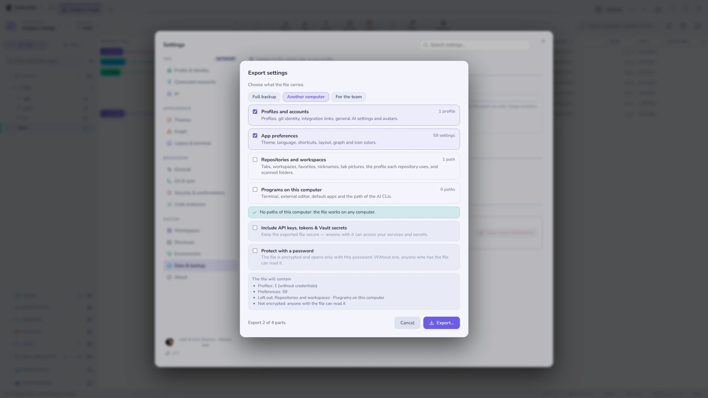

# Beveiliging & geheimen

GitHuttBr heeft **geen backend**. De enige netwerkoproepen gaan naar je Git-host
en, als je dat aanzet, naar je AI-provider.

## De pagina Beveiliging & bevestigingen

**Instellingen → Beveiliging & bevestigingen** begint met wat nu geldt, in één strook: of geheimen gemaskeerd zijn, of de sleutelhanger van het systeem in gebruik is en of een force push eerst vraagt — met *aanzetten wordt aangeraden* zolang dat niet zo is. De strook meldt alleen; de schakelaars staan eronder.

| Blok | Wat erin staat |
|---|---|
| **Vragen voor iets gevaarlijks** | **Bevestigen vóór een force push**, de drempel voor grote bestanden en een regel die niet uit kan: verwerpen, hard reset en een beschermde branch verwijderen vragen altijd, en elke bevestiging zegt wat er verloren zou gaan |
| **Privacy** | **Geheime waarden maskeren**, **Afbeeldingen van andere sites in reacties laden** en de [Kluis](vault.md) |
| **OS-keychain**, **SSH-sleutels** | Waar tokens bewaard worden en welke sleutels je agent heeft ([SSH-sleutels](ssh-keys.md)) |

De bevestiging voor force push stond vroeger onder Algemeen. Beschermde branches stel je per repository in, in de [instellingen](repo-settings.md) daarvan.

## Geheimen maskeren

Waarden in `.env*`, `*.pem`, `*.key`, `id_rsa`, `credentials.*` en consorten
worden getoond als `KEY=••••••` in de diff-, bestands- en blameweergave, zodat
een gedeeld scherm of een schermafbeelding ze niet kan laten lekken.
Apple-ondertekeningsmateriaal telt mee: `*.mobileprovision`,
`*.provisionprofile`, `*.p12` en de `*.p8`-sleutels van App Store Connect. Een
`*.cer` niet — een certificaat is per ontwerp openbaar.

Het is **alleen weergave**: het verandert het bestand nooit en verandert nooit
wat je staget. Een oogschakelaar onthult ze per weergave. `.env.example`,
`.sample` en `.template` worden als sjablonen behandeld, niet als geheimen.

## Bewakingen voor je schade aanricht

| Bewaking | Wanneer |
|---|---|
| **Geheimenbestand** | Iets committen dat op een credential lijkt — met een *Negeren & niet meer trackken* in één klik |
| **Groot bestand** | Een te grote blob committen (drempel in Instellingen → Beveiliging & bevestigingen) |
| **Buildrommel** | `xcuserdata/`, `DerivedData/` of een `.DS_Store` committen — met dezelfde *Negeren & niet meer trackken* in één klik |
| **Beschermde branch** | Rechtstreeks naar `main`/`master` committen, of er een force-pushen |
| **Getrackte geheimen** | Een repository pushen die een geheimenbestand *trackt* — één waarschuwing per sessie |

## Afbeeldingen in reacties

Reacties op pull requests en issues worden door anderen geschreven, en een afbeelding
erin is een verzoek dat je computer doet aan de site die de auteur koos. Die site
komt je IP-adres te weten en wanneer je de reactie leest — een trackingpixel heeft
niets meer nodig dan het recht om te reageren.

Daarom laadt de app uit zichzelf alleen afbeeldingen van de host zelf: op github.com
zijn bijlagen, `*.githubusercontent.com` (inclusief de proxy die GitHub in zijn eigen
weergave voor elke externe afbeelding zet) en zijn assets; op elke andere host zijn
eigen webadres, via https. Elke andere afbeelding toont een plaatshouder met haar
domein, en wordt pas opgevraagd als je erop klikt — die ene afbeelding, één keer. Het
verzoek stuurt nooit een `Referer`.

| Instelling | Wat ze doet |
|---|---|
| **Afbeeldingen van andere sites in reacties laden** (standaard uit) | Afbeeldingen van elke site laden zonder klik, zoals op de website van de host |

De beperkingen:

- **De host ziet je nog steeds.** Een afbeelding van de host zelf — en op GitHub elke
  afbeelding via zijn proxy — is een verzoek aan de host, die al weet dat dit account
  de pull request leest.
- **`raw.githubusercontent.com` en `gist.githubusercontent.com` laden zonder klik.**
  Iedereen kan daar een bestand neerzetten, dus de afbeelding is van hen — maar GitHub
  levert haar, en haar auteur ziet je IP-adres niet en ook niet wanneer je leest.
- **Privébijlagen van GitHub verlopen.** Hun ondertekende adres houdt een paar minuten
  stand; **Vernieuwen** op de pagina haalt er een terug die niet meer laadde.
- **Het voorbeeld van een reactievak** op die pagina’s volgt dezelfde regel: een
  geplakte link naar een externe afbeelding wordt niet geladen terwijl je schrijft.
- **Alleen de pull-request- en issuepagina.** Afbeeldingen in een Markdown-bestand van
  de repository, in releasenotes of in de wiki zijn inhoud van je eigen repository en
  laden zoals voorheen.
- **Een link is geen afbeelding.** Op een link in een reactie klikken opent hem in je
  browser, zoals elke link in de app.

Een reactie kan het venster ook niet vastzetten of laten crashen: een van meer dan
32.000 tekens, of een die zo is opgebouwd dat de Markdown-renderer er seconden mee
bezig is, wordt als platte tekst getoond. Hoe de rest van een reactie wordt beperkt,
staat bij [Pull requests](pull-requests.md#hoe-reacties-worden-getoond).

## De AppImage en paden die hem overleven

Een AppImage draait vanuit een map onder `/tmp` (`/tmp/.mount_…`) die alleen
bestaat zolang de app open is, bij elke start een andere naam krijgt en in een
map staat waarin elke lokale gebruiker kan schrijven. Tot en met 4.37.1 kon de
AppImage een pad binnen die map op twee plekken schrijven die hem overleven: de
`githuttbr`-link in `PATH` ([CLI](cli.md)) en de instelling
`diff.<name>.textconv` van een repository ([attributen](attributes.md)). Zodra
de app afsloot, kon een andere gebruiker op dezelfde machine de map opnieuw
aanmaken met een eigen programma, dat je volgende `githuttbr` of `git diff` dan
zou uitvoeren.

GitHuttBr weigert nu allebei onder een AppImage, waarschuwt bij het opstarten voor
een verouderde `githuttbr`-link (met een paletopdracht om hem te verwijderen) en
markeert een verouderde converter in het attributendialoogvenster met een knop
**Verwijderen**. Het ziet alleen de repository die je open hebt; om verouderde
converters elders te vinden, voer je
`git config --get-regexp 'diff\..*\.textconv'` uit in elke repository (en met
`--global`) en verwijder je elke regel onder `/tmp/.mount_`. Een machine met één
gebruiker loopt geen risico, maar de verouderde regels zijn nog steeds dood
gewicht.

## De OS-sleutelhanger

Tokens en [kluis](vault.md)-regels worden versleuteld met de sleutelhanger van je
besturingssysteem (Electron `safeStorage`), nooit met een sleutel in het
instellingenbestand.

**Er raakt niets de sleutelhanger tot jij het zegt.** Nog voor het eigen
toestemmingsvenster van het systeem kan verschijnen, legt GitHuttBr uit wat er
opgeslagen wordt, wat het niet kan (een app leest alleen ooit de regel terug die
het zelf aanmaakte — je andere wachtwoorden zijn onbereikbaar), en dat nee zeggen
prima is: tokens leven dan alleen in het geheugen voor die sessie, de kluis blijft
dicht, en je kunt het later aanzetten in **Instellingen → Beveiliging & bevestigingen →
OS-sleutelhanger**.

Een verse installatie doet **nul** aanroepen naar de sleutelhanger tot er
werkelijk iets opgeslagen moet worden.

**Na de update naar 4.59 op macOS** kan het systeem nog één keer vragen om het
onderdeel *GitHuttBr Safe Storage*: de bundle-id van de app is nu
`com.huttbr.git`, en de sleutelhanger vraagt opnieuw voor een app die hij niet
herkent. **Sta altijd toe** houdt de tokens; zie [bijwerken](upgrading.md).

Zolang hij uit staat, meldt het tokenveld bij Gekoppelde accounts dat — *Alleen bewaard tot je GitHuttBr afsluit: de OS-keychain staat uit.* — met een knop **Inschakelen** ernaast. Inschakelen, daar of hier, bewaart ook de tokens die je in deze sessie al hebt ingevoerd, dus je hoeft niets opnieuw te plakken.

Een token dat je **verwijdert** terwijl de sleutelhanger uit staat, is meteen
weg — het wordt nergens meer mee verstuurd —, maar alleen **voor deze sessie**:
de versleutelde opslag kan niet worden beschreven zolang de sleutelhanger uit
staat, en het wissen wordt in het geheugen bewaard, nooit in een bestand. Zet de
sleutelhanger weer aan voor je afsluit en de opgeslagen kopie wordt dan
verwijderd; sluit je eerst af, dan is het oude token bij de volgende start
terug. Tot die tijd blijft de melding om die reden staan. Wil je een opgeslagen
token in één stap definitief verwijderen, maak het dan leeg terwijl de
sleutelhanger aan staat.

Een leeg veld wist alleen wat GitHuttBr je liet zien. Staat de sleutelhanger vanaf
het begin uit, dan worden de opgeslagen tokens nooit ontsleuteld en nooit
getoond — de velden zijn leeg —, dus wordt alleen een token verwijderd dat je
daar intypt en weer leegmaakt; het opgeslagen token eronder is er nog zodra de
sleutelhanger aan staat.

Als het venster herlaadt of crasht terwijl de uitleg over de sleutelhanger op
het scherm staat, telt de vraag als onbeantwoord — niet als een nee — en wordt
ze opnieuw gesteld de volgende keer dat er een token moet worden opgeslagen.
Niets wacht op een vraag die niemand meer kan beantwoorden: de instellingen
laden weer normaal.

### Linux zonder sleutelhanger

Op Linux is de sleutelhanger een secret service — GNOME Keyring of KWallet. Als
er geen draait, „versleutelt” het systeem nog steeds, maar met een vast
wachtwoord dat op elke machine hetzelfde is: de tokens en sleutels zijn
door elkaar gehusseld, niet beschermd. Instellingen → Beveiliging & bevestigingen zegt het onder
de status van de sleutelhanger — *Er draait geen sleutelhanger…* — zodat het
woord *sleutelhanger* nooit staat voor bescherming die er niet is.

Zodat er niets nieuws belandt in een opslag die iedereen kan ontrafelen, wordt
een token dat je typt terwijl er geen sleutelhanger draait **alleen bewaard tot
je afsluit**. Het tokenveld zegt het — *Alleen bewaard tot je GitHuttBr afsluit:
er draait geen sleutelhanger…* — zonder knop om het opnieuw te proberen, want
opnieuw proberen helpt niet; alleen een sleutelhanger helpt. Een
instellingenbestand met inloggegevens importeren zegt hetzelfde voordat het ze
importeert. Eerder opgeslagen
tokens blijven leesbaar — je wordt er nooit van buitengesloten — en er een
wissen of vervangen haalt de oude waarde nog steeds van de schijf. Twee
beperkingen: de sleutel van de algemene AI wordt niet naar zijn gedeelde plek
verplaatst (elk profiel blijft zijn eigen lezen), en de kluis slaat nog steeds
op in de eenvoudige opslag, omdat die geen modus voor alleen de sessie heeft.
Installeer of ontgrendel een sleutelhanger en start GitHuttBr opnieuw om nieuwe
tokens weer op te slaan.

GitHuttBr gaat niet af op wat het systeem zegt over welke opslag het kreeg. Het telt de
opslag als basaal als het systeem hem zo noemt, als het hem helemaal niet kan
benoemen, en als wat het versleutelt terugkomt gemarkeerd met het vaste wachtwoord —
wat het systeem ook zei. Zo houdt een sleutelhanger die stil terugvalt nieuwe tokens
toch van de schijf.

Op een sleutelhanger die niet meer antwoordt, wordt niet eeuwig gewacht. Op Linux
telt, zodra de sleutelhanger in deze sessie één keer heeft geantwoord, een vraag die
hij 10 seconden onbeantwoord laat als *geen sleutelhanger*: een token dat je opslaat,
blijft tot je afsluit, en de kluis blijft dicht. De eerste vraag van een sessie — die
de eigen wachtwoordvraag van de sleutelhanger kan oproepen — en die direct na de
uitleg van GitHuttBr krijgen twee minuten, zodat het lezen van een dialoogvenster nooit
wordt afgekapt. Een halve minuut na zo’n time-out blijft het antwoord *geen
sleutelhanger* zonder opnieuw te vragen; daarna vraagt GitHuttBr opnieuw. macOS en
Windows antwoorden lokaal en krijgen nooit een time-out.

De grens geldt voor die ene vraag — *is er een sleutelhanger?* Op een sleutelhanger
die haar beantwoordt en daarna blijft hangen bij het versleutelen of ontsleutelen,
wordt nog steeds gewacht: instellingen opslaan, en de kluis, blijven bezig tot hij
antwoordt of GitHuttBr herstart.

### Als de opgeslagen tokens niet gelezen kunnen worden

Als je de sleutelhangervraag van het systeem wegklikt, de sleutelhanger
vergrendeld is of de tokenopslag door een andere kopie van GitHuttBr is
geschreven (een ontwikkelbuild, een opnieuw ondertekende), **kan GitHuttBr je
opgeslagen tokens niet lezen — en laat het ze ongemoeid**. Instellingen → Beveiliging & bevestigingen zegt *GitHuttBr kon je opgeslagen tokens niet lezen*, en een token dat
je intussen intypt wordt alleen voor de sessie bewaard (het veld zegt dat ook).
Het wordt nooit over de opslag geschreven die niet gelezen kon worden: dat zou
elk opgeslagen token vervangen door het token dat je net hebt ingetypt.

| Knop | Wat hij doet |
|--------|--------------|
| **Opnieuw proberen** | Leest de opslag opnieuw — het systeem vraagt nu misschien om de sleutelhanger. Zodra die leesbaar is, komen de intussen ingetypte tokens erbij. |
| **Nieuwe tokenopslag starten** | Vraagt eerst. GitHuttBr wacht niet langer op de oude opslag en begint een nieuwe met alleen de tokens van deze sessie. Het oude bestand blijft er 30 dagen naast staan als back-up en wordt daarna verwijderd. Voor een opslag die voorgoed weg is, niet voor een vraag die je hebt weggeklikt. |

## Instellingen importeren

**Instellingen → Gegevens & back-up → Importeren / exporteren** brengt instellingen, profielen en
thema's van de ene machine naar de andere. De standaardexport bevat **geen
tokens of API-sleutels**, en zo'n bestand importeren raakt de jouwe nooit aan —
een leeg token in het bestand betekent „niet in dit bestand”, niet „verwijder
de mijne”.

Importeren en exporteren openen de pagina **Gegevens & back-up**; wat onherroepelijk gewist kan worden — de lijst met recent geopende repository’s — staat apart eronder, onder **Gevarenzone**, en vraagt voordat het iets wist.

### Kiezen wat je exporteert

Een back-up en een bestand voor een collega zijn niet hetzelfde bestand. Een
back-up wil alles; een bestand voor een andere computer hoort geen mappen mee
te nemen die daar niet bestaan; een bestand voor het team hoort noch je
accounts noch je paden te bevatten. Daarom opent **Instellingen exporteren** een
dialoogvenster met dezelfde vier onderdelen die de import aanbiedt (de tabel
hieronder), elk met zijn grootte op deze computer, en schrijft het alleen de
onderdelen die je aanvinkt. Een weggelaten onderdeel staat helemaal niet in het
bestand — het later importeren laat dat onderdeel van de andere machine precies
zoals het is.

Drie snelkeuzes boven de onderdelen vinken de gebruikelijke combinaties aan.
Een vakje met de hand wijzigen laat de bijpassende snelkeuze oplichten, of geen:

| Snelkeuze | Onderdelen | Voor |
|----------|-------|-----|
| **Volledige back-up** | Alle vier | Deze computer herstellen, of een kopie ervan — hetzelfde bestand dat Exporteren schreef voordat er onderdelen waren |
| **Andere computer** | Profielen en accounts, App-voorkeuren | Je identiteit en smaak op een nieuwe machine, zonder de mappen en programma's van deze |
| **Voor het team** | App-voorkeuren | Een gedeeld thema, sneltoetsen en grafiekinstelling — niets persoonlijks, geen paden |

Onder de onderdelen zegt een melding of het bestand mappen of programma's van
deze computer noemt: amber met **Repository’s** of **Programma’s** aangevinkt
(de import op een andere machine vertaalt die paden of laat weg wat hij niet
vindt), groen zonder. **Profielen en accounts** zonder **Programma’s** laat ook
het pad van de AI-CLI's weg, die bij de profielen worden opgeslagen maar
programma's van deze machine noemen.

**Inloggegevens alleen met Profielen, en alleen als je erom vraagt.** Tokens en
API-sleutels horen bij profielen, dus **API-sleutels, tokens & kluisgeheimen
meenemen** is alleen beschikbaar met **Profielen en accounts** aangevinkt; vink
het onderdeel uit en de optie wordt meteen gewist. Met inloggegevens aangevinkt
raadt het dialoogvenster **Beveiligen met een wachtwoord** aan (hieronder), en
ze onversleuteld exporteren vraagt nog één keer.

Een vak onderaan somt op wat het bestand zal bevatten voordat je op
**Exporteren…** drukt: hoeveel profielen (met of zonder inloggegevens),
profielafbeeldingen, voorkeuren, repository- en programmapaden, of de
repositorynotities en wiki's en de kluis meegaan, welke onderdelen worden
weggelaten en of het bestand versleuteld is. Wat met welk onderdeel meereist:

| Extra | Gaat mee met | Voorwaarde |
|-------|-----------|-----------|
| Profielafbeeldingen | Profielen en accounts | Afbeeldingen die als afbeelding zijn gekozen |
| Kluisgeheimen | Profielen en accounts | Alleen met de optie voor inloggegevens |
| Repositorynotities en wiki's | Repository’s en workspaces | Altijd met het onderdeel |

Grenzen: de onderdelen zijn de hele eenheid — losse profielen, losse
repositories of losse voorkeuren kies je niet. **Programma’s** zonder
**Profielen** neemt de terminal, de editor en de standaardapps mee, maar niet de
paden van de AI-CLI's (die zitten in de profielen). Het manifest telt
vermeldingen; de paden zelf toont het niet. En een bestand zonder een onderdeel
kan het niet teruggeven: een **Voor het team**-bestand terugzetten zet alleen de
voorkeuren terug.

### Kiezen wat je importeert

Een instellingenbestand bevat twee soorten dingen: wat *jou* volgt (profielen,
thema, sneltoetsen) en wat alleen zin heeft op de machine die het schreef (de
mappen waar je repositories staan, het pad van je terminal). Alles toepassen op
een nieuwe computer vult de zijbalk met tabbladen die nergens heen wijzen. Dus
nadat je het bestand kiest (en het wachtwoord typt, als het er een heeft),
vraagt een venster welke onderdelen je wilt meenemen. Er wordt niets toegepast
tot je op **Importeren** drukt; **Annuleren** laat alles zoals het was.

| Onderdeel | Wat het bevat |
|------|-----------------|
| **Profielen en accounts** | Profielen, Git-identiteit, integratiekoppelingen, de algemene AI-instellingen en profielafbeeldingen — en de inloggegevens en de [kluis](vault.md), als het bestand die heeft |
| **App-voorkeuren** | Thema, taal, sneltoetsen, indeling, de kleuren van de graaf en de pictogrammen |
| **Repository’s en workspaces** | Tabbladen, workspaces, favorieten, bijnamen, tabbladafbeeldingen, welk profiel elke repository gebruikt, gescande mappen, en de notities en wiki's per repository |
| **Programma’s op deze computer** | Terminal, externe editor, standaardapps en het pad van de AI-CLI's |

Elk onderdeel toont hoeveel items het bestand ervoor heeft. Een onderdeel dat je
niet aanvinkt blijft precies zoals het op deze machine is.

**Profielen worden samengevoegd met de jouwe.** Een bestand van een andere
computer heeft zelden elk profiel dat deze heeft — een account dat op de
Linux-laptop is toegevoegd, een klantprofiel dat alleen op de Mac bestaat. Dus
**Profielen en accounts** voegt de profielen uit het bestand toe aan de jouwe in
plaats van de lijst te vervangen. Voor je importeert, toont het onderdeel elk
profiel en wat ermee gebeurt:

| Label | Betekenis |
|-----|---------|
| **Bijgewerkt** | Het profiel staat in beide: identiteit, AI en afbeelding uit het bestand vervangen de jouwe, en de servers ervan worden aan de jouwe toegevoegd |
| **Nieuw** | Alleen het bestand heeft het: toegevoegd na de jouwe |
| **Blijft** | Alleen deze computer heeft het: blijft precies zoals het is |

Twee profielen zijn „hetzelfde” als ze een id delen — het eerste profiel van
elke installatie doet dat. Als geen id overeenkomt, telt de naam (zonder op
hoofdletters en omringende spaties te letten), en het profiel houdt **de id van
deze computer**: de repositories die eraan gekoppeld zijn, het actieve profiel,
de opgeslagen inloggegevens en de afbeelding blijven eraan vast. Welk profiel actief
is, verandert niet, en de **algemene AI** ook niet: de engine en het model waarmee
deze computer antwoordt, blijven van hem.

**Alles vervangen** is er nog steeds, voor een back-up die je precies terug wilt
zoals hij was: alleen de profielen uit het bestand blijven over, en die welke
alleen deze computer heeft staan doorgestreept als **Verwijderd**. Op
**Importeren** drukken vraagt dan nog één keer, met hun namen — ze verdwijnen
met hun opgeslagen inloggegevens en afbeelding, en dat kan niet ongedaan worden. Met
**Alles vervangen** wordt het actieve profiel uit het bestand het actieve, en vervangt de
algemene AI uit het bestand die van deze computer.

Beperkingen: overeenkomen gaat alleen op id of exacte naam — een profiel dat aan
één kant hernoemd is telt als nieuw, en je houdt ze allebei. Een gekoppeld
profiel neemt de velden uit het bestand over, met drie uitzonderingen zodat
niets verloren gaat wat alleen deze computer heeft: de GitHub Enterprise-,
GitLab- en Bitbucket-servers worden aan de jouwe **toegevoegd** (bij een server
die beide hebben wint het item uit het bestand); een token dat het bestand leeg
meebrengt houdt het jouwe — maar alleen voor dezelfde instantie, zodat een token
nooit naar een andere Forgejo, een andere GitLab-uitgever of een andere
Azure-organisatie gaat; en de logins die van de credential helper van deze
machine komen blijven van deze machine.

**De standaardkeuzes zijn een gok op basis van je schijf.** Voordat het venster
verschijnt, controleert GitHuttBr of de repositorymappen uit het bestand hier
bestaan. Bestaat er geen enkele, dan komt het bestand van een andere computer:
**Repository’s** en **Programma’s** beginnen niet aangevinkt, elk met de
reden — de paden van de programma's staan erbij, zodat je ziet dat ze ergens
anders thuishoren. Bestaan ze wel, dan is het dezelfde computer (een
teruggezette back-up, bijvoorbeeld), begint alles aangevinkt en zegt een groene
notitie dat. Een bestand zonder enige repository wordt beoordeeld op de paden
van zijn programma's: **Programma’s** begint alleen aangevinkt als elk daarvan
hier bestaat.

Als de controle zelf mislukt, wordt er niets gegokt: **Repository’s** en
**Programma’s** beginnen niet aangevinkt zonder oordeel, een knop **Opnieuw
controleren** vraagt het de schijf nog eens, en **Repository’s** kan pas
geïmporteerd worden als een controle lukt. De andere onderdelen wel.

**Paden vertalen.** Vink **Repository’s** aan bij een bestand waarvan de mappen
ontbreken en er opent een vak **Paden vertalen**. Links de map die de
repositories in het bestand gemeen hebben (`/home/you/code`); rechts waar die
map op deze computer staat, vooraf ingevuld vanuit je thuismap
(`/Users/you/code`). Beide zijn bewerkbaar — de gok kan fout zijn, en als
GitHuttBr geen gemeenschappelijke map vindt laat het beide leeg zodat jij ze
typt. Een balk telt terwijl je typt hoeveel repositories hier nu een map
hebben, met een paar ervan in een lijst — groen gevonden, rood nog ontbrekend.
De wissel neemt de bijnaam, tabbladafbeelding en het profiel van de repository
mee, en de notities, wiki's en kluisitems, zodat je niets opnieuw met de hand
hoeft in te stellen.

De voettekst vat het samen — *3 van 4 onderdelen importeren · 31 mappen*
(scanmappen en de laatste kloonmap tellen ook mee, daarom staat er mappen en
niet repositories) — en **Importeren** blijft uit tot er minstens één onderdeel
is aangevinkt.

**Importeren blijft ook uit als een vertaling niets vindt.** Met
**Repository’s** aangevinkt en geen enkele map gevonden onder het nieuwe
voorvoegsel zou importeren je repositories leeg achterlaten; verbeter de paden
of vink het onderdeel uit.

Beperkingen van de vertaling:

- Het is **één voorvoegsel verwisseld voor een ander**. Repositories die in het
  bestand onder een andere map staan, of hier anders zijn ingedeeld, worden niet
  gevonden; er is geen koppeling per repository.
- Met een vertaling actief worden **alleen de repositories geïmporteerd die dan
  een map hebben**. De rest blijft buiten — niet toegevoegd als kapotte
  tabbladen — en het venster zegt je hoeveel.
- Programma's worden nooit vertaald: `/usr/bin/code` heeft geen betrouwbare
  tegenhanger op een ander systeem. Laat dat onderdeel uitgevinkt en kies ze in
  Instellingen.
- Een van beide voorvoegsels leegmaken importeert de paden zoals het bestand ze
  heeft.

**Tijdens het importeren** kan het venster niet weggeklikt worden. Als een
latere stap mislukt — de repositorynotities, de kluis, de profielafbeeldingen — blijft
het venster open, noemt het de stap, en gaat **Import voortzetten** daar verder
zonder de eerdere stappen opnieuw te schrijven.

### Inloggegevens in het bestand

Een bestand dat met de optie aangevinkt is geëxporteerd bevat inloggegevens.
Profielen samenvoegen **voegt** ze altijd **toe**: die uit het bestand komen
onder het bijbehorende profiel, ter vervanging van die voor hetzelfde account,
en alle andere opgeslagen inloggegevens blijven — ze wissen zou in strijd zijn
met het behouden van je profielen. Met de profielen op **Alles vervangen** toont
zo'n bestand ook de keuze, direct onder **Profielen en accounts**:

| Keuze | Je opgeslagen inloggegevens |
|--------|------------------------|
| **Toevoegen aan de mijne** | Die uit het bestand worden toegevoegd, ter vervanging van die voor hetzelfde account; alle andere blijven |
| **Alles vervangen** | Worden precies die uit het bestand — elk opgeslagen token en elke API-sleutel die het bestand niet heeft, wordt verwijderd |

De keuze geldt samen met de profielen: met **Profielen en accounts** niet
aangevinkt worden er geen inloggegevens geïmporteerd of verwijderd. Een bestand
dat zonder de optie is geëxporteerd heeft er geen te bieden, wat je ook
aanvinkt. **Alles vervangen** vraagt nog één keer als je op **Importeren**
drukt, met de mededeling dat elk opgeslagen token en elke API-sleutel die het
bestand niet heeft, verwijderd wordt; **Annuleren** daar laat het venster zoals
het was.

**Alles vervangen heeft de sleutelhanger nodig.** Met de sleutelhanger uit of
niet beschikbaar zouden de oude tokens in de versleutelde opslag blijven en bij
de volgende start terugkomen, dus weigert GitHuttBr: het zegt dat, en er wordt
niets geïmporteerd. Hetzelfde geldt zolang de opgeslagen tokens niet gelezen
kunnen worden (zie hierboven): ze zouden terugkomen zodra dat wel kon. **Toevoegen aan de
mijne** werkt nog steeds, en houdt de tokens uit het bestand voor de sessie.

**De beperking:** inloggegevens horen bij een profiel. Een profiel dat de import
verwijdert, neemt zijn opgeslagen tokens mee, wat je ook kiest.

### Een export met een wachtwoord beveiligen

Een export met de inloggegevens aangevinkt is voor wie het bestand vindt net zo
veel waard als de tokens zelf — een gesynchroniseerde map, een vergeten
USB-stick, een bijlage. **Beveiligen met een wachtwoord**, in het
exportdialoogvenster, versleutelt het bestand met dezelfde versleuteling als
[Veilig delen](secure-share.md) (een met scrypt afgeleide sleutel en
AES-256-GCM), zodat niets erin — zelfs niet of het inloggegevens bevat — zonder
het wachtwoord te lezen is.

Het is optioneel, met of zonder het vinkje voor inloggegevens, en het wachtwoord
heeft geen minimale lengte. Je typt het twee keer en vinkt aan dat je begrijpt
dat het niet te herstellen is; het importeren van het bestand vraagt erom — in
een dialoogvenster in Instellingen, binnen de welkomststap bij de eerste start —
en een verkeerd wachtwoord wordt opnieuw gevraagd.

| | Zonder wachtwoord | Met wachtwoord |
|---|---|---|
| **Wie het kan lezen** | Iedereen die het bestand heeft | Alleen wie het wachtwoord heeft |
| **Een gewijzigde byte** | Gelezen zoals hij is | Geweigerd, net als een verkeerd wachtwoord |
| **Opent in** | Elke versie | Versies die het versleutelde formaat kennen |

**Er is geen herstel.** Het wachtwoord wordt nergens bewaard — niet in het
bestand, niet op deze machine — en er is geen server om het aan te vragen. Ben
je het kwijt, dan is het bestand verloren; exporteer opnieuw vanaf een machine
die de instellingen nog heeft.

Grenzen: een oudere versie kan een versleutelde export niet openen, en weet dat
ook niet — ze meldt de instellingen als geïmporteerd en verandert niets.
Importeer een beveiligd bestand met een versie die om het wachtwoord vraagt. Een
kort wachtwoord blijft zwak tegenover iemand die het bestand en tijd om te raden
heeft; de scrypt-sleutel maakt elke poging traag, niet onmogelijk. Het wachtwoord
beschermt het bestand, niet de draaiende app: de inloggegevens worden in het
geheugen ontsleuteld terwijl ze voor de export worden verzameld, zoals altijd.

## Het instellingenbestand

Het instellingenbestand en de versleutelde tokenopslag worden in één keer
geschreven: naar een nieuw bestand ernaast dat alleen de eigenaar kan lezen, dat
daarna wordt omgewisseld, zodat een crash of twee gelijktijdige opslagacties
nooit een half bestand achterlaten. Is het instellingenbestand een symbolische
link naar elders (een dotfiles-repository), dan gaat het schrijven naar het doel
van de link en blijft de link staan. GitHuttBr vervangt de link nooit. Een link
die wijst naar een bestand dat nog niet bestaat, wordt doorgeschreven en maakt
dat bestand aan — zolang de map ervan bestaat. Ontbreekt de map ook, dan mislukt
het opslaan, met één melding die dat zegt: de link en waar hij naar wijst
blijven onaangeroerd, en wijzigingen in de tussentijd blijven alleen bestaan tot
GitHuttBr sluit. Zet de map terug, of laat de link naar iets wijzen dat bestaat,
en de volgende keer opslaan lukt.

Platte-teksttokens die een oudere versie in het instellingenbestand heeft
achtergelaten, gaan bij opslaan nooit verloren: ze blijven in het bestand tot
GitHuttBr ze in de versleutelde opslag laadt (Instellingen openen doet dat), tenzij
je er zelf een wist.

Maar twee dingen schrijven ze: het opslaan van je instellingen, en GitHuttBr dat
ze laadt (bij het opstarten, of als Instellingen opent) — dan wordt een oud
platte-teksttoken naar de versleutelde opslag verplaatst, of een serveradres
met een wachtwoord erin opgeschoond. Een opvraging waar niemand om vroeg — een
fetch die zijn token opzoekt, een AI-aanroep die zijn sleutel zoekt, een
profielafbeelding — leest alleen, en kan dus nooit over een opslag heen vallen.
Opslaan wordt ook geweigerd tot de instellingen minstens één keer zijn geladen:
daarvoor heeft de app alleen standaardwaarden.

**De prijs op een oude installatie** die nog platte-teksttokens in het
instellingenbestand heeft: tot Instellingen één keer wordt geopend (of de app
herstart en ze laadt), ontsleutelt elke opvraging die een token nodig heeft de
opslag opnieuw, en profielafbeeldingen die een opgeslagen token nodig hebben
wachten. Een opvraging verplaatst niets, dus een token dat je intussen wist,
blijft gewist.

Een bestand dat bestaat maar niet te parsen is (een handmatige bewerking die
misging, een beschadigde schijf) wordt **nooit** vervangen door de
standaardwaarden: GitHuttBr zegt dat het bestand beschadigd is en start niet
verder — geen sneltoets of menuopdracht kan er vanaf dat scherm overheen
opslaan.

Je kunt `githuttbr-settings.json` in de gegevensmap repareren en op
**Opnieuw proberen** drukken, of op **Beschadigd bestand opzij zetten en opnieuw
beginnen** drukken: het bestand wordt hernoemd naar
`githuttbr-settings.json.corrupt-<date>` (nooit verwijderd, dus je kunt er nog
iets uit terughalen), er wordt een kopie van de versleutelde tokenopslag naast
bewaard, en GitHuttBr start zoals bij de eerste keer, met een melding waar het
bestand is gebleven. Bij een instellingenbestand via een symbolische link wordt
het doel van de link hernoemd, zodat de beschadigde kopie in je dotfiles blijft,
naast het nieuwe instellingenbestand dat de eerste opslag dan via de link
schrijft. De kopie wordt eerst gemaakt: kan die niet worden geschreven, dan
wordt er niets verplaatst, en het scherm zegt dat en toont de gegevensmap om na
te kijken, want opnieuw beginnen zonder de kopie zou het eerste token dat je
opslaat de tokens van de oude profielen laten verwijderen. Los op wat het
schrijven in de map verhindert (rechten, een volle schijf) en druk op
**Opnieuw proberen**.

Raakt het bestand beschadigd terwijl GitHuttBr draait (eronder met de hand
bewerkt), dan stopt het opslaan en zegt GitHuttBr dat één keer: instellingen
kunnen tot een herstart niet worden opgeslagen, en wijzigingen in de
tussentijd gaan verloren.

Een bestand dat er is maar even niet te *lezen* is — een ander programma, zoals
een virusscanner, houdt het vast — wordt ongeveer twee seconden opnieuw
geprobeerd. Mislukt het nog steeds, of mislukt het laden om een andere reden,
dan zegt GitHuttBr dat het niet kon starten, dat het bestand niet is gewijzigd, en
biedt het **Opnieuw proberen** aan; het noemt het bestand niet beschadigd.

### Bekende grenzen

Ze vragen ongewone omstandigheden, en staan hier zodat niemand erdoor verrast
wordt:

- **Een heel oude installatie met tokens nog in het instellingenbestand.** Als
  de sleutelhanger wordt uitgezet nadat de opgeslagen tokens zijn ontgrendeld,
  of geweigerd terwijl een AI-sleutel nog in het oude platte-tekstformaat is
  opgeslagen, kan die platte-tekstkopie bij de volgende opslag verloren gaan en
  is het token na een herstart weg. Open na het upgraden vanaf zo'n build één
  keer Instellingen met de sleutelhanger aan, en de tokens gaan voorgoed naar
  de versleutelde opslag.
- **Een opslag en een mislukte herlaadactie die elkaar in hetzelfde venster
  kruisen.** Een token dat is ingetypt in een opslag die een daarna mislukte
  herlaadactie inhaalt, kan vanuit dat venster niet worden gewist tot
  Instellingen opnieuw laadt; open Instellingen opnieuw en wis het.
- **Een instellingenbestand via een symbolische link waarvan de map ontbreekt.**
  De tokenopslag wordt geschreven voordat het instellingenbestand mislukt, dus
  lopen de twee uit de pas tot de map terug is. Zet hem terug (koppel de schijf,
  kloon de dotfiles) en sla opnieuw op.

## Het token van een profiel terwijl Git draait

Wanneer een [profiel](profiles.md) een clone, fetch, pull of push met zijn token
aanmeldt, komt het token op geen van de plekken waar een ander programma het zou
kunnen lezen: niet in `.git/config`, niet op de opdrachtregel (elke lokale
gebruiker kan de proceslijst lezen) en niet in de **omgeving** van het
git-commando — die elke hook, filter en LFS-proces erft dat git start, samen met
elk npm-pakket dat een husky- of lefthook-script uitvoert.

In plaats daarvan opent GitHuttBr voor elke bewerking een eigen privé-eindpunt —
een socket in een map waar alleen jouw gebruiker in kan (een named pipe met een
willekeurige naam op Windows) — en registreert het een credential helper voor
die ene server. Als git om een login vraagt, maakt de helper verbinding, bewijst
met een willekeurige code die alleen daarvoor is gemaakt dat hij bij deze
bewerking hoort, zegt naar welke host en repository git vraagt, en ontvangt de
login. Het eindpunt beantwoordt elk verzoek van de bewerking — git kan meer dan
eens vragen, voor LFS, na een redirect, voor elk proces dat het start — en wordt
gesloten en verwijderd als git stopt. Een hook die zijn omgeving dumpt, vindt de
code, niet het token.

Wat het nog steeds niet kan:

- **Een hook kan nog steeds vragen terwijl de bewerking loopt.** Die code staat
  in de omgeving van git, omdat de helper een programma is dat git start en git
  elk programma dat het start dezelfde omgeving geeft. Een hook die het protocol
  van de helper spreekt, kan met de code om de login vragen tot git stopt — zo
  krijgt de `pre-push`-hook van git-lfs er precies een. Het is een veel kleinere
  opening dan een token in een variabele — niets leest het per ongeluk, een dump
  of crashrapport toont alleen een code die nutteloos is zodra git stopt —, maar
  het is een opening.
- **Het antwoordt alleen voor de server waarvoor het is geopend.** Het eindpunt
  weigert elke andere host, een onversleuteld `http`-verzoek, een pad buiten de
  basis van de server en een server die daaronder genest is (een Data Center op
  `/bitbucket` naast een GitLab in de root) — zelfs met de juiste code. Een push
  naar meerdere URL's krijgt één eindpunt per server, elk met alleen de login
  van die server. Onder een server met een andere erin genest wordt ook een pad
  geweigerd dat de proxy van de geneste server naar zichzelf zou kunnen routeren:
  elke `;` erin (Tomcat laat `;params` vallen), een segment dat op een punt
  eindigt, en de naam van de geneste basis met andere hoofdletters of als
  voorvoegsel (`/Bitbucket/`, `/bitbucketx/`) — zodat ook een groep op de
  buitenste server waarvan de naam begint met het pad van de geneste server
  diens token niet krijgt.
- **Een uitzondering overleeft geen redirect aan de kant van de server zelf.**
  De controle gaat over het pad waar git naar vraagt. Als de buitenste server
  zelf een verzoek omleidt naar het pad van de geneste server, of een proxy het
  daarheen herschrijft nadat git zijn login heeft gestuurd, kan geen enkele
  client dat zien.
- **Een via `git -c` geërfde login wordt opzijgezet.** Een credential helper (of
  een `include` die er een zou kunnen toevoegen) die wordt doorgegeven in
  `GIT_CONFIG_PARAMETERS` — de app gestart vanuit een git-alias, of door een
  andere git — wordt voor de bewerking verwijderd, zodat hij nooit het token van
  het profiel aangeboden krijgt om op te slaan, en nooit namens niemand wordt
  gevraagd. Elke andere geërfde `-c`-instelling blijft behouden.
- **Een serveradres moet zo geschreven zijn als git het leest.** GitHuttBr
  benoemt de server volgens de standaard-URL-regels, git volgens zijn eigen: een
  geïnternationaliseerde naam (`bücher.example`), een numerieke verkorting
  (`127.1`, `0x7f.0.0.1`), een gecomprimeerd of gemapt IPv6-adres of een
  gecodeerd teken in de host zijn voor elk een andere server. Met een profiel in
  het spel wordt zo'n adres met een melding geweigerd in plaats van het aan de
  eigen login van de machine over te laten. Hoofdletters en een expliciete
  standaardpoort (`:443`) zijn prima.
- **Git ouder dan 2.26** koppelde een credential-regel alleen aan het exacte
  adres, niet aan alles onder de basis van een server. Als de app namens niemand
  vraagt, schakelt ze de helpers dan voor die ene opdracht uit voor de hele host;
  inloggen met een token vereist sowieso git 2.31.
- **Draai geen hooks die je niet vertrouwt**, ook niet met een aangemeld
  profiel. Een repository die je net hebt gekloond, kan hooks meebrengen via
  hulpmiddelen als husky, die ze bij `npm install` installeren; git voert uit wat
  er in `.git/hooks` staat, vanuit GitHuttBr net zo goed als vanuit een terminal,
  en een hook kan veel ergere dingen doen dan een token lezen.
- **Beperk de reikwijdte van het token.** Een token dat alleen kan schrijven naar
  de repositories waaraan je werkt, is veel minder waard voor wie het in handen
  krijgt.
- **SSH-remotes worden niet geraakt** — er komt geen token aan te pas; de
  [SSH-agent](ssh-keys.md) antwoordt in plaats daarvan.

## Veilig delen

[Veilig delen](secure-share.md) exporteert instellingen, kluisregels of hele
workspaces als een **versleutelde bundel** — geheimen gaan alleen mee wanneer jij
het vakje aanvinkt.

## Een probleem melden

**Probleem melden** bij een fout opent een vooraf ingevuld GitHub-issue — en
het openen stuurt de tekst al naar GitHub, voordat je kiest om het te plaatsen.
Daarom wordt het bericht eerst opgeschoond: een inloggegeven dat in een URL is
geschreven, tokens, je thuismap (en daarmee je gebruikersnaam), privéservers en
repositorypaden, de naam van het profiel waaraan een repository gekoppeld is,
e-mail- en IP-adressen worden vervangen. Publieke hosts zoals `github.com`
blijven staan, net als bestandsnamen en de eigen melding van git.

**De grens:** een servernaam die los in een zin staat, wordt herkend aan zijn
vorm — met punten, in kleine letters. Een host van één woord (`gitserver`) wordt
alleen opgemerkt in de meldingen die GitHuttBr zelf schrijft, en een server onder
een topleveldomein dat gespeld wordt als een bestandsextensie (`.sh`, `.md`)
blijft staan als bestandsnaam. Lees het issue toch na voordat je het plaatst:
het opschonen herkent bekende vormen, niet alles wat privé is.

## Wat op schijf blijft

Het instellingenbestand, het bewerkingslogboek, de avatarcache en de
versleutelde tokenopslag zijn alleen leesbaar voor jouw account (op macOS en
Linux). Bij een serveradres dat met een `user:password@` of een `?token=` erin
is opgeslagen — uit een import of een oudere versie — wordt dat deel verwijderd
wanneer het wordt gelezen, geïmporteerd of opgeslagen. De avatarcache voor
commits slaat geen e-mailadressen op, alleen hashes met een zout per
installatie.

Elk van deze bestanden wordt in één keer geschreven: naar een nieuw bestand
ernaast, dat daarna wordt omgewisseld, zodat een crash of twee gelijktijdige
opslagacties nooit een half bestand achterlaten — dat GitHuttBr anders als
onleesbaar zou moeten behandelen. Een back-up van de tokenopslag wordt alleen
vroeg verwijderd als elk token erin ook in de huidige opslag staat; elke andere
back-up wordt 30 dagen bewaard.

## Linux-pakketten: de sandbox en AppArmor

De sandbox van Chromium heeft onbevoorrechte user namespaces nodig. Ubuntu
24.04 en later weigeren die aan elk programma zonder een AppArmor-profiel dat ze
toestaat, en de twee Linux-pakketten gaan daar verschillend mee om:

| Pakket | Wat er gebeurt |
|---------|--------------|
| `.deb` | Installeert `/etc/apparmor.d/githuttbr`, een profiel voor `/opt/GitHuttBr/githuttbr` dat user namespaces toestaat. De app draait in de sandbox. |
| AppImage | Heeft geen profiel. Het startprogramma probeert `unshare -Ur true`, en als dat mislukt start het de app met `--no-sandbox` — op Ubuntu 24.04+ is dat bij elke start. GitHuttBr schrijft dan een waarschuwing naar zijn console-uitvoer. |

Om de AppImage in de sandbox te draaien, installeer je in plaats daarvan het
`.deb`, of geef je de AppImage een eigen AppArmor-profiel dat `userns` toestaat
(of, voor de hele machine, `sysctl kernel.apparmor_restrict_unprivileged_userns=0`,
wat de beperking voor alles uitschakelt).

**De grens van het `.deb`-profiel.** Het is `flags=(unconfined)` met `userns`
toegestaan, en het hangt aan het pad van het uitvoerbare bestand. Datzelfde
uitvoerbare bestand draait ook als gewone Node wanneer het wordt gestart met
`ELECTRON_RUN_AS_NODE=1` — zo werken de `githuttbr`-opdracht, de meegeleverde
diff-converter en de credential helper van GitHuttBr, dus die schakelaar kan niet
uit zonder ze te breken. Samen betekent dat: elk lokaal programma kan het
uitvoerbare bestand van GitHuttBr gebruiken als een Node-interpreter die user
namespaces mag aanmaken — hetzelfde soort gat als de bekende omwegen rond de
Ubuntu-beperking via andere programma's met een profiel. Het geeft niemand meer
dan de rechten van zijn eigen account; het verzwakt een
kernelhardingslaag die Ubuntu er bovenop legt. AppArmor kan de twee modi van één
uitvoerbaar bestand niet uit elkaar houden, dus een nauwer profiel is niet
mogelijk zolang de CLI het deelt; een apart hulpprogramma voor de CLI staat op
de roadmap. Beheerders die dit liever niet hebben, kunnen een deny-regel
toevoegen in `/etc/apparmor.d/local/githuttbr`, ten koste van de sandbox.

**Zie ook:** [Kluis](vault.md) · [Veilig delen](secure-share.md)
