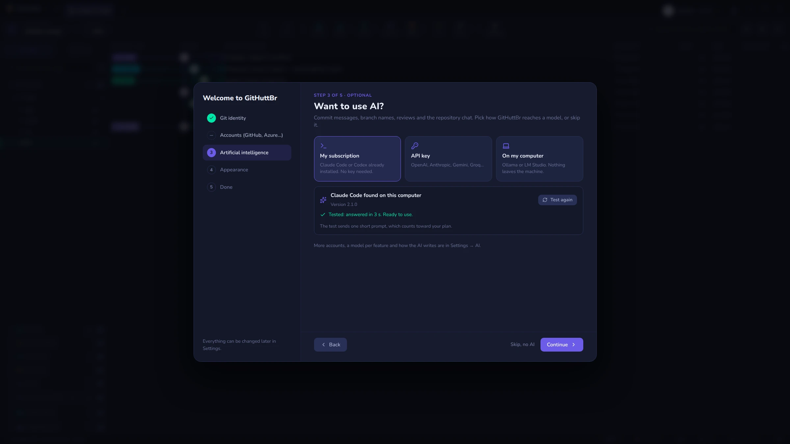

# Pierwsze uruchomienie

Przy pierwszym uruchomieniu krótki kreator pyta o tych kilka rzeczy, które zmieniają działanie GitHuttBr od pierwszego commita: kim jesteś w Gicie, gdzie hostujesz repozytoria, czy chcesz używać AI i jak ma wyglądać aplikacja. Każdy krok można zostawić pusty, a wszystko, co ustawia, można później zmienić w **Ustawieniach**.

## Ekran powitalny

Przed krokami ekran powitalny proponuje **zaimportowanie pliku ustawień** z innego komputera. Klucze i tokeny są z niego usuwane, chyba że zaznaczysz pole, by je zachować, a eksport chroniony hasłem prosi o hasło na miejscu. Import stosuje plik i zamyka kreatora — zobacz [Bezpieczeństwo i sekrety](security.md), co zawiera eksport.

## Kroki

Lewa kolumna pokazuje kroki. Zielony znaczek oznacza krok wypełniony, kreska krok pominięty, a podświetlony wiersz to miejsce, w którym jesteś.

| Krok | Co ustawia | Gdzie zmienić później |
|---|---|---|
| Tożsamość Git | Nazwę profilu oraz imię i email w commitach | Ustawienia → Profil i tożsamość |
| Konta | Tokeny GitHub, GitLab, Azure DevOps, Bitbucket, Forgejo i własnych serwerów oraz aplikację dla **Otwórz za pomocą…** | Ustawienia → Połączone konta; aplikacja w Ustawienia → Git i synchronizacja |
| Sztuczna inteligencja | Jedno konto AI, ustawione jako używane | Ustawienia → AI |
| Wygląd | Motyw i tryb jasny, ciemny lub automatyczny | Ustawienia → Motywy |
| Gotowe | Nic nowego — podsumowanie ustawień | — |

**Na razie pomiń** zamyka kreatora na każdym kroku i zachowuje to, co już wpisałeś.

## Krok AI

AI jest opcjonalna. Wybierz jedną z trzech kart albo **Pomiń, bez AI**, co wyłącza AI,
dopóki nie skonfigurujesz jej w [Ustawienia → AI](ai.md):

| Karta | Czego używa | Czego potrzebuje |
|---|---|---|
| Moja subskrypcja | Claude Code lub Codex, zalogowane w Twoim planie | Zainstalowanego i zalogowanego CLI |
| Klucz API | OpenAI, Anthropic, Gemini, Groq, OpenRouter lub Mistral | Klucza od dostawcy |
| Na moim komputerze | Ollama lub LM Studio, lokalnie — nic nie opuszcza komputera | Uruchomionego serwera |

Gdy na tym komputerze jest Claude Code lub Codex, karta subskrypcji podaje który i jego wersję, a wybranie karty go testuje: jeden krótki prompt, potem **Przetestowano: odpowiedź w N s. Gotowe do użycia.** Jeśli nie ma żadnego albo CLI nie jest zalogowane, karta pokazuje tę samą konfigurację połączenia co [Ustawienia → AI](ai.md).

Przy kluczu API lub lokalnym serwerze **Dalej** testuje połączenie, pobierając listę modeli dostawcy, i zapisuje tylko konto, które odpowiedziało.

Krok zapisuje zwykłe konto AI, tak jak robią to Ustawienia, oznaczone **W użyciu**: otwórz Ustawienia → AI i tam jest — do zmiany nazwy, użycia tylko w niektórych funkcjach lub usunięcia. Wiele kont, model dla każdej funkcji i sposób pisania AI ustawia się tam, nie w kreatorze.

## Ograniczenia

- **Test subskrypcji kosztuje jeden prompt.** Wlicza się do Twojego planu jak każde zapytanie. Uruchamia się tylko po wybraniu karty lub kliknięciu **Testuj ponownie**.
- **Wykrywane są tylko Claude Code i Codex.** Gemini CLI i Devin odpowiadają jako zwykłe konta CLI, które dodajesz w Ustawienia → AI.
- **Lokalny serwer musi już działać.** Kreator nie uruchamia Ollamy ani LM Studio i nie pobiera modeli.
- **Kreator działa raz.** Po zamknięciu wszystko, co ustawił, jest w Ustawieniach; nie da się go otworzyć ponownie.
