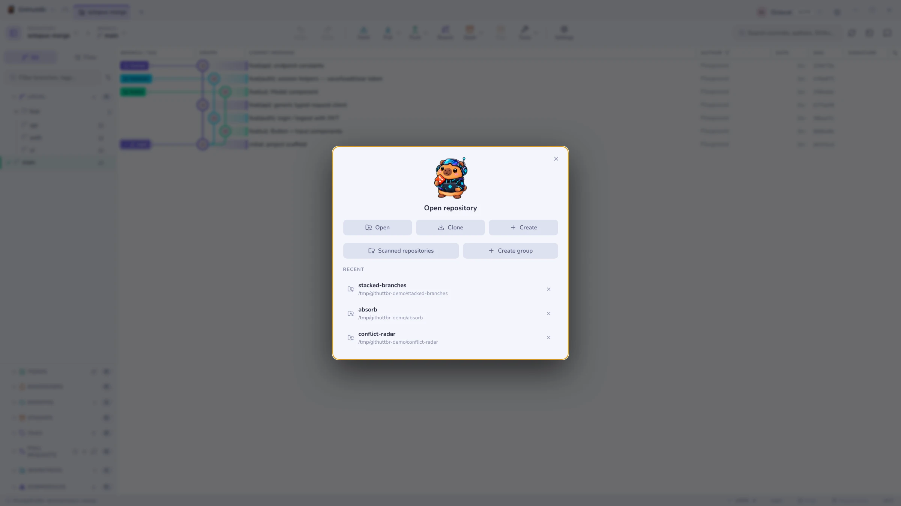

# Pierwsze kroki

GitHuttBr otwiera katalog i pokazuje jego historię. Nic nie zostaje zapisane do
twojego repozytorium, dopóki o to nie poprosisz.

## Otwórz repozytorium

- **Przeciągnij katalog** na okno albo użyj **Otwórz repozytorium** na ekranie
  powitalnym. Okno wyboru przyjmuje kilka katalogów naraz: zaznacz je
  ⌘-kliknięciem lub Shift-kliknięciem, a każdy otworzy się we własnej karcie
  (albo dołączy do grupy, z której je otworzyłeś). Przy zaznaczeniu kilku
  katalogów repozytorium, które jest już otwarte, albo katalog, który nie jest
  repozytorium Gita, zostaje pominięty i wymieniony w komunikacie, żeby
  pozostałe i tak się otworzyły. Okno wyboru w macOS nie potrafi z góry
  wyszarzyć otwartych repozytoriów: Electron nie udostępnia haka panelu dla
  poszczególnych katalogów, więc sprawdzenie następuje po kliknięciu Otwórz.
- **Zeskanowane repozytoria**, pod trzema przyciskami, wymieniają każde
  repozytorium w katalogach, które GitHuttBr ma skanować — zaznacz kilka i otwórz
  je naraz albo kliknij dwukrotnie jedno. Tam też dodajesz i usuwasz te
  katalogi. Zobacz [Repozytoria](repositories.md#zeskanowane-repozytoria).
- **Kliknąłeś nie to?** Sklonuj, Utwórz, Utwórz grupę i Zeskanowane
  repozytoria, otwarte z Otwórz repozytorium, mają obok tytułu strzałkę
  **Wstecz**, która do niego wraca.
- **Sklonuj** je z adresu URL lub prosto z hostingu — zobacz
  [klonowanie](cloning.md), żeby poznać opcje, dzięki którym ogromne
  repozytorium klonuje się szybko.
- Z terminala `githuttbr .` otwiera bieżący katalog w działającej aplikacji —
  zobacz [wiersz poleceń](cli.md).
- Pojedynczy katalog, który nie jest jeszcze repozytorium Gita, też się otworzy —
  aplikacja zaproponuje jego zainicjowanie.

## Trzy panele

| Panel | Co zawiera |
|---|---|
| Lewy | Gałęzie, zdalne repozytoria, tagi, stashe, worktree — oraz zakładkę **Pliki** z drzewem roboczym |
| Środkowy | Graf commitów i to, co z niego wybierzesz |
| Prawy | Kompozytor commita albo szczegóły zaznaczonego commita |

## Jak znaleźć całą resztę

Dwie drogi, prowadzące w te same miejsca:

- **`⌘K`** (`Ctrl+K`) — paleta poleceń. Wpisz, czego szukasz; skacze też do
  gałęzi, commitów i plików.
- **Narzędzia** na pasku — ten sam zestaw działający na repozytorium, tyle że
  jako menu, z długim ogonem zwiniętym w grupy, żeby dało się to czytać.

Gdy okno się zwęża, pasek akcji przestaje walczyć o miejsce: przyciski, które już się nie mieszczą, zwijają się do menu **Więcej** na jego końcu — w kolejności paska i z własnymi podmenu. Poszerz okno, a wrócą na swoje miejsce.

Wszystko, co da się osiągnąć jedną drogą, da się osiągnąć i drugą — nie ma więc
niczego, co znajdą wyłącznie użytkownicy zaawansowani.

## Twój pierwszy commit

1. Zmień plik. Pojawi się w sekcji **Poza przechowalnią**.
2. Dodaj go do przechowalni — cały plik, pojedynczy hunk albo
   [pojedyncze linie](staging.md).
3. Napisz wiadomość i naciśnij **Commit**.

Cała reszta GitHuttBr jest opcjonalna.

