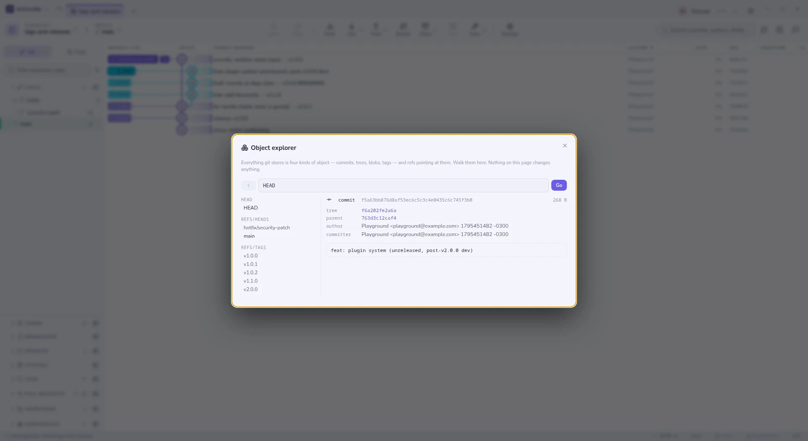

# Eksplorator obiektów

Git ma opinię skomplikowanego. Prawie cała bierze się z tego, że nigdy nie widać
modelu: **cztery rodzaje obiektów i wskaźniki**. Kiedy raz klikniesz commit,
wylądujesz na jego drzewie i odkryjesz, że twój plik *jest* blobem, któremu
nazwę nadało drzewo, porcelana przestaje być magią.

`⌘K` → **Eksplorator obiektów**. Nic na tej stronie nie potrafi zmienić ani
jednego bajtu — każde wywołanie za nią jest odczytem.

## Cztery obiekty

| Obiekt | Jest | Wie |
|--------|----|-------|
| **blob** | *Zawartością* pliku | Niczym. Ani swojej nazwy, ani ścieżki, ani historii |
| **tree** | Spisem katalogu | Nazwy, tryby i sha każdego dziecka: bloba albo drzewa |
| **commit** | Jedną migawką | Swoje drzewo, swoich rodziców, autora, commitera, wiadomość |
| **tag** | Tagiem anotowanym | Obiekt, na który wskazuje, tagującego, wiadomość |

Zaskoczeniem dla większości ludzi jest pierwszy wiersz. **Blob nie ma nazwy.**
Dwa pliki o identycznej treści, gdziekolwiek w twojej historii, to ten sam blob,
przechowany raz. Nazwa mieszka w drzewie, które na niego wskazuje — i dlatego
git śledzi treść, a nie pliki, i dlatego zmiany nazw są wykrywane, a nie
zapisywane.

**Referencja** — `refs/heads/main`, `refs/tags/v1.0`, `HEAD` — to zwykły plik
zawierający sha. I to jest całe „gałęzie są tanie".

## Chodzenie po tym

Lewa kolumna pokazuje każdą referencję, pogrupowaną tak jak grupuje git: HEAD
(z `→ main`, gdy jest na gałęzi), Gałęzie, Tagi i Zdalne, każda grupa z liczbą.
Zdalne startują zwinięte. Kwadratowy znacznik to referencja do commita, okrągły
zielony — tag **z adnotacją**. Filtr zawęża wszystkie grupy naraz. Kliknij
referencję, by trafić na obiekt, który nazywa; ten wiersz pozostaje podświetlony,
dopóki od niego idziesz.

Stamtąd wszystko jest drzwiami:

- **Commit** pokazuje, na co **wskazuje** — swoje drzewo główne z liczbą
  elementów i każdego rodzica z tematem — potem autora i committera (*ten sam
  co autor*, gdy się zgadzają) oraz wiadomość.
- **Drzewo** to tabela nazwy, trybu, obiektu i rozmiaru, najpierw foldery. Każdy
  tryb jest opisany słowami: *plik*, *wykonywalny*, *folder*, *dowiązanie*,
  *submoduł*. Folder mówi, ile ma elementów; dowiązanie — dokąd wskazuje.
- **Blob** pokazuje tekst z numerami wierszy (przy dużych tylko początek) albo
  mówi wprost, że jest binarny. Gdy dojdziesz do niego przez drzewo, pasek mówi,
  jak się tam nazywa — *Nazwany src/app.ts w commicie 07c6f3d, tryb 100644
  (zwykły plik)* — z linkiem do historii pliku.
- **Tag z adnotacją** wskazuje na obiekt, który nazywa, i zapisuje autora tagu.

### Ścieżka

Pas pod polem rewizji to przebyta **ścieżka**:
`gałąź main → commit 07c6f3d → korzeń → src/ → app.ts`. Drzewo commita to
**korzeń**; plik lub folder dostaje nazwę klikniętego wiersza. Kliknij dowolny
element, by do niego wrócić. Wpisanie rewizji, wybór referencji lub jednego z
przykładów obok **Otwórz** zaczyna nową ścieżkę.

**Wstecz** i **Dalej** przechodzą przez wszystko, co otworzyłeś, jak w
przeglądarce: po cofnięciu Dalej prowadzi z powrotem, dopóki stamtąd nie
otworzysz czegoś nowego. Pole rewizji podąża za drogą, więc `main:src/app.ts`
zawsze jest gotowe do skopiowania.

### Kolory

Każdy rodzaj zachowuje jeden kolor wszędzie, gdzie się pojawia — plakietka,
element ścieżki, karta, wiersz: commit w kolorze akcentu motywu, drzewo w jego
żółtym, blob na niebiesko, tag i referencja na zielono. Pod nagłówkiem obiektu
jedno zdanie mówi, czym ten rodzaj *jest*.

### Gdzie jesteś w modelu

Pasek u dołu panelu to łańcuch gita — **ref → commit → tree → blob**, z **tag**
między ref a commit przy tagu z adnotacją — a rodzaj na ekranie świeci jako
*jesteś tutaj*.

## Wpisywanie rewizji

Pole przyjmuje wszystko, co przyjmuje `git rev-parse` — i tutaj to przestaje być
przeglądarką, a zaczyna być sposobem na naukę:

| Wpisz to | Żeby dostać |
|-----------|--------|
| `HEAD` | Bieżący commit |
| `HEAD~3` | Trzy commity wstecz |
| `HEAD^{tree}` | Drzewo tego commita, obrane |
| `HEAD:src/app.ts` | Blob dla tej ścieżki, wprost |
| `v1.0^{}` | To, na co wskazuje tag anotowany, zamiast samego obiektu taga |
| `a1b2c3d` | Dowolny obiekt, po sha — skróty działają |

Cyfry trybu w spisie drzewa warto znać: `100644` to plik, `100755` plik
wykonywalny, `040000` poddrzewo, `120000` dowiązanie symboliczne, `160000`
gitlink podmodułu — a ten ostatni to całość tego, co podmoduł przechowuje.

## Ograniczenia warte wiedzy

- **Tylko do odczytu, celowo.** Nie ma tu czym pisać. Tworzenie obiektów ręcznie
  to ćwiczenie z `git hash-object` i należy do terminala.
- **Duże bloby są ucinane** po pierwszych 200 KB — dość, żeby zobaczyć, co to
  jest, i za mało, żeby zawiesić okno.
- **Rozmiary to rozmiar treści obiektu** tak, jak raportuje go
  `git cat-file -s`, a nie to, ile kosztuje on na dysku po spakowaniu. Po tamto
  sięgnij do [konserwacji](maintenance.md).
- **Obiekty nieosiągalne to wciąż obiekty.** Wklej sha z raportu wiszących
  obiektów `git fsck`, a się otworzy — i to często najszybszy sposób, żeby
  zobaczyć, co zawierał zgubiony commit, zanim zdecydujesz, czy go odzyskać.
- **Wiersz submodułu się nie otwiera.** Jego gitlink nazywa commit innego
  repozytorium, którego to nie ma.
- **Liczby i cele dowiązań mają limit.** Drzewo z ponad 300 podfolderami pokazuje
  je bez liczby elementów, a tylko pierwsze 50 dowiązań pokazuje swój cel.
- **Ścieżka kończy się z oknem.** Zamknij je, a następne zacznie od gałęzi HEAD.

Zobacz też: [Graf](graph.md) · [Konserwacja repozytorium](maintenance.md) ·
[Odzyskiwanie](recovery.md)
