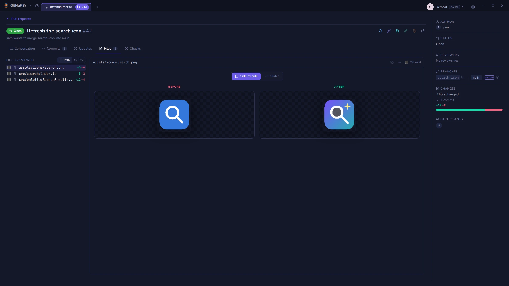

# Strona pull requestów

Ruchliwe repozytorium ma naraz dwadzieścia otwartych pull requestów. Panel boczny
je wymienia, ale jedna linijka na każdy mówi niewiele: czyj jest który, które
czekają na ciebie, które zrobiły się czerwone. Żeby się dowiedzieć, trzeba było
otwierać każdy, czytać, wracać, otwierać następny. **Strona pull requestów**
odpowiada na te pytania na jednym ekranie, a gdy otworzysz pull request,
**‹ ›** przeniosą cię do następnego z tej samej listy bez wracania.

## Jak ją otworzyć

- **Ikona listy** w nagłówku **PULL REQUESTY** panelu bocznego (*Zobacz wszystkie
  pull requesty*).
- *Pull requesty…* w palecie poleceń (⌘K) albo **Narzędzia → Pull requesty…**.

Podobnie jak wiki i [przebiegi CI](ci-runs.md), strona otwiera się w karcie
repozytorium.

## Zakładki

| Zakładka | Co zawiera |
|---|---|
| **Otwarte** | Wszystkie otwarte pull requesty, łącznie ze szkicami |
| **Szkice** | Tylko otwarte oznaczone jako szkic |
| **Scalone** | Scalone pull requesty, wczytywane przy pierwszym otwarciu zakładki |
| **Zamknięte** | Zamknięte bez scalenia (odrzucone, porzucone), wczytywane razem ze Scalonymi |

Liczniki przy Otwartych i Szkicach pochodzą z listy, którą panel boczny już ma.
O Scalone i Zamknięte aplikacja pyta dopiero, gdy otworzysz jedną z nich, i raz
na sesję; **Odśwież** pyta ponownie.

## Filtry

| Filtr | Zostawia |
|---|---|
| **Szukaj** | Pull requesty, których tytuł, opis, gałęzie lub numer zawierają każde wpisane słowo. `#482` albo `482` znajduje ten numer; dopasowania są podświetlone w tytule |
| **Autor** | Jednego autora — każdy z liczbą swoich PR w tej zakładce. **Ja** jest na początku |
| **Recenzent** | Jednego poproszonego recenzenta albo **Proszą mnie o recenzję** |
| **Gałąź docelowa** | Pull requesty do tej gałęzi |
| **Moje** | Skrót dla *Autor: Ja* |
| **Czekają na moją recenzję** | Skrót dla *Recenzent: proszą mnie o recenzję* |
| **CI nie przechodzi** | Pull requesty, których testy na headzie nie przeszły |

Linijka pod filtrami mówi, ile pull requestów z zakładki jest widocznych i które
filtry są włączone, z **wyczyść filtry**, by usunąć wszystkie.

Filtry są pamiętane dla każdego repozytorium **dopóki aplikacja działa** — wyjdź
ze strony, wróć, są takie, jak je zostawiłeś. Celowo nie są zapisywane między
uruchomieniami: filtr „moje, CI nie przechodzi” przywrócony po cichu tydzień
później ukryłby pull requesty, których nie prosiłeś ukrywać.

### Kim jest „ja”

„Ja” to konto, którym wywołania tego repozytorium logują się na hostingu —
profil, z którym repozytorium jest [powiązane](profiles.md), a w przeciwnym razie
aktywny — ustalone u samego hostingu. Gdy token nie potrafi powiedzieć, czyj
jest (brak zakresu użytkownika), albo nie ma tokenu, **Ja**, **Moje** i **Czekają
na moją recenzję** nie są oferowane.

## Lista

| Kolumna | Co pokazuje |
|---|---|
| **#** | Numer z ikoną: otwarty, szkic, scalony lub zamknięty |
| **Tytuł** | Tytuł, plakietkę *szkic* i kogo nadal poproszono o recenzję — w kolorze akcentu, gdy chodzi o ciebie |
| **Autor** | Obrazek z hostingu, jeśli go podaje, w przeciwnym razie inicjał, oraz **ty** przy twoich |
| **Gałęzie** | Źródło → cel |
| **Testy** | Zbiorczy stan testów heada — `6/6`, `1 błędnych`, `2 w toku`; najedź, by zobaczyć liczby |
| **Zmieniono** | Jak dawno ostatnio się zmienił; najedź, by zobaczyć datę |

Wiersze są posortowane według ostatniej aktywności. Kliknięcie otwiera własną
stronę pull requesta ([Hosting i pull requesty](hosting.md)). Na hostingu bez
takiej strony wiersz otwiera pull request w przeglądarce.

W [checkoucie forka](hosting.md#twoje-pull-requesty-w-repozytorium-nadrzędnym-forka) wymienione są też twoje pull requesty w
repozytorium nadrzędnym, oznaczone *w owner/repo*.

## Przechodzenie listy z poziomu pull requesta

Pull request otwarty ze strony pokazuje pasek nad swoim tytułem:

- **← Pull requesty** wraca do listy, z filtrami takimi, jak je zostawiłeś.
- **‹ k z n ›** przechodzi do poprzedniego lub następnego pull requesta z listy,
  z której go otworzyłeś — przefiltrowanej, w jej kolejności, takiej jak w chwili
  kliknięcia. Podpowiedzi podają pull request, do którego prowadzi każda
  strzałka.
- **Alt+← / Alt+→** robią to samo z klawiatury. Można je zmienić w **Ustawienia →
  Skróty**. Ustępują, gdy kursor jest w polu tekstowym (gdzie Option+← przeskakuje
  o słowo) i gdy terminal ma fokus.

Przejście podmienia stronę w miejscu, więc przejrzenie dziesięciu pull requestów
nie zostawia dziesięciu ikon na karcie; otwarcie innego wiersza z listy również
ją podmienia.

Pull request otwarty **z dowolnego innego miejsca** — z panelu bocznego, z
powiadomienia — przechodzi przez otwarte pull requesty repozytorium w domyślnej
kolejności strony (Otwarte, bez filtrów). Taki, którego nie ma też na tej liście,
na przykład scalony poziom stosu, pokazuje tylko drogę powrotną do listy.

## Przejście do gałęzi pull requesta

Żeby pracować nad pull requestem, potrzebujesz jego gałęzi w checkoucie — a w
repozytorium z tysiącami gałęzi znalezienie jej po nazwie na liście gałęzi to
najwolniejsza część. Na stronie pull requesta pole **Gałęzie** robi to za ciebie:

- **Nazwa gałęzi jest linkiem.** Kliknięcie robi checkout tej gałęzi i przenosi
  cię do grafu repozytorium, na czubek gałęzi. Strona pull requesta zostaje
  otwarta na karcie.
- **Gałąź, która istnieje tylko na serwerze**, jest najpierw pobierana — tylko ta
  jedna gałąź, nie cały remote — i wyciągana jako gałąź lokalna, która ją śledzi.
  Na gałąź, którą masz już lokalnie, następuje przełączenie bez zmian — nie jest
  aktualizowana, więc zrób pull, gdy chcesz najnowszych commitów pull requesta.
- **Gałąź, na której już jesteś**, jest zamiast tego oznaczona jako *bieżąca*.
  Nic nie jest wyciągane.
- **Przycisk kopiowania** obok każdej nazwy kopiuje ją do schowka.
- **Cofnij** (⌘Z) wraca na gałąź, na której byłeś, i usuwa gałąź lokalną
  utworzoną przez checkout — chyba że od tego czasu coś na niej zacommitowałeś;
  wtedy zostaje nietknięta.

Nagłówek ma te same dwa ruchy jako przyciski: **Przejdź do gałęzi źródłowej** i
**Przejdź do gałęzi docelowej**. Działają też dla gałęzi, na której już jesteś —
po prostu przenoszą cię do repozytorium. Z włączonymi [kolorami ikon](themes.md#kolory-ikon) każdy przycisk w nagłówku ma własny: odśwież niebieski, recenzja AI fioletowy, podgląd turkusowy, gałąź źródłowa zielony, gałąź docelowa pomarańczowy (otwórz w przeglądarce zostaje szary).

Nic nie jest sprawdzane, dopóki nie klikniesz: otwarcie pull requesta nie czyta
ani nie pobiera żadnej gałęzi.

Czego to nie robi:

- **Gałąź źródłowa forka** jest w innym repozytorium, więc nie ma linku (przycisk
  kopiowania zostaje). **Podejrzyj pull requesta lokalnie…**, oferowane tuż pod
  nią, to sposób na uruchomienie go tutaj. Gałąź docelowa nadal jest linkiem.
- **Brak pasującego remote.** Gałąź jest szukana na remote, którego URL to
  repozytorium pull requesta. Gdy żaden skonfigurowany remote tam nie wskazuje,
  link nic nie robi, a jego podpowiedź mówi dlaczego.
- **Usunięta gałąź.** Scalony pull request często zabrał ze sobą swoją gałąź;
  fetch mówi wtedy, że gałąź już nie istnieje na remote, a ty zostajesz przy pull
  requeście.
- **Lokalne zmiany.** Checkout nie jest destrukcyjny, więc nie ma potwierdzenia —
  a git odmawia checkoutu, gdy twoje niezacommitowane zmiany zostałyby
  nadpisane. Błąd podaje, które pliki; zacommituj je lub odłóż do stasha i kliknij
  ponownie.
- **To okno.** Checkout odbywa się w katalogu roboczym tego repozytorium. Gdy
  gałąź jest już wyciągnięta w innym [worktree](worktrees.md), zamiast tego
  otwiera się karta tego worktree.

## Commity

Panel boczny mówił, ile commitów ma pull request, nigdy które. Recenzowanie po
jednym commicie — tak, jak większość pull requestów powinna być czytana —
odsyłało cię do przeglądarki. Zakładka **Commity**, między Rozmową a Aktualizacjami, je
wymienia:

- **Najstarsze najpierw**, w kolejności, w jakiej się nakładają, pogrupowane pod
  dniem, w którym je napisano. Commit wciągnięty rebase’em poza kolejnością dat
  zaczyna własny dzień, zamiast zostać przesunięty.
- Każdy wiersz ma obrazek autora (jeśli hosting go podaje), temat, autora, jak
  dawno temu i krótki SHA. Plakietka **merge** oznacza commit z dwoma rodzicami,
  jeśli hosting to podaje.
- **▸** obok commita, który ma coś więcej niż temat, pokazuje resztę jego opisu.
- **Kopiuj** umieszcza pełny SHA w schowku; **Otwórz w przeglądarce** otwiera
  commit na hostingu — w pull requeście, jeśli hosting ma taką stronę (GitHub,
  GitLab, Bitbucket Data Center), a w przeciwnym razie na stronie commita w
  repozytorium.

**Kliknij wiersz** — albo dojdź do niego Tabem i naciśnij Enter — żeby otworzyć
commit w aplikacji, jak zrobiłoby to kliknięcie w grafie: widok repozytorium, ten
commit zaznaczony, jego szczegóły otwarte. To działa, gdy ten klon **ma** commit.
Gdy go nie ma, wiersz to mówi, zamiast po cichu zawieść, i proponuje:

- **Pobierz gałąź PR, aby go zobaczyć** — ten sam fetch jednej gałęzi co przy
  [przejściu do gałęzi](#przejście-do-gałęzi-pull-requesta), bez checkoutu. Jeśli commit przyszedł razem z
  nią, otwiera się; jeśli nie (force push go od tego czasu przepisał), mówi to
  powiadomienie.
- **Pobierz commity pull requesta**, przy pull requeście z **forka**. Jego gałąź jest
  w innym repozytorium, ale większość hostingów odzwierciedla head pull requesta w
  repozytorium docelowym pod osobnym refem — `refs/pull/N/head` (GitHub, GitHub
  Enterprise Server, Forgejo), `refs/merge-requests/N/head` (GitLab),
  `refs/pull-requests/N/from` (Bitbucket Data Center). Aplikacja pobiera ten jeden
  ref, bez tagów, do własnego refu, `refs/githuttbr/pr/<remote>/N`, i commit otwiera
  się jak każdy inny: graf rysuje ten head jako tor bez etykiety. Ponowne pobranie
  przesuwa ref na head w jego ówczesnym stanie. Jeśli force push od tego czasu
  pominął commit, mówi to powiadomienie.
- **Otwórz w przeglądarce**, gdy pobieranie nie wchodzi w grę.

Lista jest wczytywana przy pierwszym otwarciu zakładki, nie razem ze stroną, i
ponownie przy każdym **Odśwież**. Dopóki nie dotrze, licznik zakładki to ten, który
hosting podał dla pull requesta. Scalone i zamknięte pull requesty wymieniają swoje
commity tak samo.

Czego to nie robi:

- **Najwyżej 250 commitów.** Sam GitHub nie wymienia ich dla pull requesta więcej
  niż 250; aplikacja zatrzymuje się na tej samej liczbie na każdym hostingu i mówi
  *host ma ich więcej*, gdy tak jest, z linkiem do pull requesta na hostingu. Które
  250 to będą, zależy od kolejności, w jakiej hosting je wymienia — aplikacja
  zostawia pierwsze wymienione, a linijka nad listą mówi które:

  | Hosting | Dłuższy pull request pokazuje |
  |---|---|
  | GitHub | **Pierwsze** 250 (własny limit GitHuba) |
  | GitLab, Azure DevOps, Bitbucket Data Center, bitbucket.org | **250 najnowszych** |
  | Forgejo | Ten koniec, który serwer wymienia najpierw; jego kolejność nie jest udokumentowana |
- **Head forka tam, gdzie hosting go nie odzwierciedla.** Azure DevOps publikuje tylko
  wynik scalenia, nigdy własny head pull requesta, a bitbucket.org żadnego z nich:
  tam wiersz proponuje tylko przeglądarkę. Na innym hostingu, który okaże się go nie
  odzwierciedlać, mówi to fetch. **Podejrzyj pull requesta lokalnie…** sprowadza wynik
  scalenia z Azure, jeśli tego potrzebujesz.
- **Pobrane heady zostają.** `refs/githuttbr/pr/…` nie jest gałęzią: nie ma czego
  wyciągać ani pushować, fetch z prune go nie rusza, a git zachowuje jego commity. Nic
  go też nie usuwa — ani zamknięcie strony, ani
  [sprzątanie gałęzi](branch-cleanup.md). Żeby się ich pozbyć, usuń refy ręcznie:
  `git for-each-ref refs/githuttbr/pr` je wymienia, a `git update-ref -d <ref>` usuwa
  jeden.
- **Zdalne repozytorium, którego nazwa zawiera `/`**, nie może być częścią nazwy tego
  refu, więc fetch jest tam odrzucany.
- **Usunięta gałąź.** Scalony pull request często zabrał ze sobą swoją gałąź: fetch
  to mówi. bitbucket.org nie wymienia żadnych commitów, gdy gałęzi źródłowej już nie
  ma.
- **Scalenia squash.** Commity pull requesta scalonego przez squash nigdy nie
  trafiły do gałęzi docelowej, więc po usunięciu jego gałęzi są już tylko na
  hostingu.
- **Autorzy** są nazywani tak, jak nazywają ich commity. GitLab, Azure DevOps i
  Bitbucket Data Center nie dają obrazka bez logowania, którego obrazek nie może
  wysłać, więc te wiersze pokazują inicjał.
- **Długie opisy na Azure DevOps** mogą być przycięte: lista Azure obcina opis
  commita, a aplikacja pokazuje to, co dostaje.
- Pull requesty z **bitbucket.org** otwierają się w przeglądarce — aplikacja nie ma
  jeszcze dla nich strony —, więc do tej zakładki się tam nie dochodzi, choć
  aplikacja potrafi odczytać listę.

## Aktualizacje

Pull request, który recenzowałeś w poniedziałek, do czwartku poszedł dalej. Zakładka
Commity pokazuje, gdzie jest teraz, a nie co się od tego czasu stało: które commity
przyszły z którym pushem, czy ktoś zrobił force push i przepisał to, co już
przeczytałeś, i jak wygląda kod *w porównaniu z wersją, którą widziałeś*. Zakładka
**Aktualizacje**, między Commitami a Plikami, na to odpowiada — tak jak własna zakładka
Updates w Azure DevOps.

Wymienia każdy push do pull requesta, **od najnowszego**:

- **Aktualizacja 1 — otwarcie** to push, z którym otwarto pull request; każdy
  późniejszy push dostaje kolejny numer.
- Każda pokazuje **kiedy**, **kto zrobił push** (gdy hosting to podaje) i **dodane
  commity** — krótki SHA, temat, autor. Gdy hosting zgłasza commity, które push zdjął
  z gałęzi, są wymienione pod **Usunięte commity**, przekreślone.
- Force push lub rebase jest oznaczony jako **historia przepisana**: commity, które
  przeczytałeś, mogły zniknąć, a wymienione mogą być nowymi kopiami starej pracy. W
  Azure DevOps push, który przeniósł pull request na inną gałąź docelową, jest
  oznaczony jako **zmieniony cel**.

### Co się zmieniło w jednej aktualizacji

**Pokaż zmiany w tej aktualizacji** otwiera zakładkę Pliki tylko dla tego pusha:
diff od heada poprzedniej aktualizacji do tego — albo, dla Aktualizacji 1, od gałęzi
docelowej, względem której ją otwarto, gdy hosting wskazuje ten punkt (Azure DevOps,
GitLab). To samo drzewo plików i ta sama przeglądarka, z banerem — *Zmiany w:
Aktualizacja 3 (względem: Aktualizacja 2)* — i **Pokaż wszystkie zmiany**, by wrócić
do całego pull requesta.

Diff zawsze powstaje **w tym klonie**, gdy się da: `git diff` między dwoma headami,
dokładny i bez pytania hostingu. Gdy brakuje któregoś z headów, aplikacja najpierw
pobiera oba **po identyfikatorach commitów** ze zdalnego repozytorium pull requesta —
nie zapisuje się żadna gałąź, tag ani ref; head zastąpiony przez force push nie leży
już na żadnej gałęzi, ale większość hostingów wciąż serwuje go po identyfikatorze — i
porównuje tutaj. Dopiero gdy to pobranie zawiedzie, pyta się hostingu:

| Hosting | Porównanie hostingu |
|---|---|
| Azure DevOps | Zmiany iteracji z `$compareTo` — między dwoma pushami |
| GitLab | Porównanie repozytorium, prosto od jednego heada do drugiego |
| Bitbucket Data Center | Porównanie repozytorium — **od wspólnej bazy** dwóch headów |
| GitHub | API porównania (`base...head`) — **od wspólnej bazy** dwóch headów |
| Forgejo / Gitea | Brak: ich API nie ma diffa między dwoma commitami |

Od wspólnej bazy diff przepisania nie jest tym, co zrobił push: tego, co usunął, nie
widać, a zmiany, które gałąź docelowa dostała od tego czasu, mogą wyglądać jak zmiany
pull requesta. Baner to mówi — *Porównano od wspólnej bazy: tego, co ten push usunął,
nie widać.* — gdy aktualizacja z przepisaną historią została tak porównana. Gdy nic
nie działa, baner to mówi i proponuje pobrać gałąź (albo, z forka, head pull
requesta) i porównać tutaj.

Komentarze do wierszy należą do diffa całego pull requesta, więc gdy pokazana jest
jedna aktualizacja, przy wierszu nie ma **+**; baner to mówi. Zaznaczanie pliku jako
przejrzanego działa jak zwykle — oznacza plik w pull requeście.

### Nowe od twojej ostatniej wizyty

Aktualizacje wypchnięte od twojego ostatniego otwarcia zakładki mają plakietkę
**Nowa**, a sama zakładka mówi, ile ich jest: *Aktualizacje 5 · nowe: 2*. Otwarcie
zakładki oznacza je jako przejrzane (plakietki zostają, dopóki na niej jesteś, żebyś
widział, które były nowe); gdy **Odśwież** przyniesie kolejne przy otwartej zakładce,
**Oznacz jako przejrzane** je czyści. Samo otwarcie strony pull requesta niczego nie
oznacza. Przy pierwszym otwarciu zakładki Aktualizacje danego pull requesta nic nie
jest nowe — nie ma wcześniejszej wizyty do porównania.

Aktualizacje są wczytywane razem ze stroną, dla tego licznika, i ponownie przy
**Odśwież** — nie po każdym komentarzu czy recenzji, którą publikujesz.

To, co przejrzano, jest trzymane tylko na tym komputerze, osobno dla repozytorium i
pull requesta, i nigdy nie trafia na hosting.

### Według hostingu

| Hosting | Skąd pochodzą aktualizacje | Kto zrobił push | Usunięte commity | Wykrywanie przepisania |
|---|---|---|---|---|
| Azure DevOps | **Iteracje** pull requesta — własny zapis każdego pusha w Azure | Tak | Nie (nie są zgłaszane) | Tak: `forcePush` / `rebase` |
| GitLab | **Wersje diffa** merge requesta; commity każdej wersji wyliczone z jej heada | Nie (wersje nikogo nie wskazują) | Tak | Tak: wcześniejszy head, do którego nie da się już dojść |
| Bitbucket Data Center | Aktywność pull requesta: **OPENED** i każde **RESCOPED**, które przesunęło gałąź źródłową | Tak | Tak, z sumami hostingu | Tak: rescope, który usunął commity |
| GitHub | **Wywnioskowane** z commitów i force pushy na osi czasu — zob. niżej | Tylko force pushe | Nie | Tak: zdarzenie force push |
| Forgejo / Gitea | Wpisy **push** na osi czasu, pierwszy zapisany razem z samym pull requestem | Tak | Nie | Tak: wpis force push |
| bitbucket.org | Niedostępne | — | — | — |

**GitHub nie zapisuje zwykłego pusha** — tylko force pushe —, więc aktualizacje są
**wywnioskowane z czasów commitów**. Aktualizacja to ciąg commitów budujących jeden
na drugim, między force pushami; commit, który nie buduje na poprzednim albo przychodzi
ponad dziesięć minut po nim, zaczyna następną. Commit utworzony po otwarciu pull
requesta nie mógł być w otwarciu. Push commitów zrobionych w odstępie godziny pojawia
się więc **podzielony** na dwa, a dwa pushe w odstępie kilku minut jako **jeden**;
zakładka mówi, że grupowanie jest przybliżone. Nowe commity rebase’u, które oś czasu
może wymieniać tuż przed jego force pushem, liczą się do tego force pusha. Heady
przed i po force pushu są dokładne, więc jego **Pokaż zmiany** też.

### Ograniczenia

- **Limity.** Wymienianych jest 100 najnowszych aktualizacji. Oś czasu GitHuba jest
  czytana od najnowszego końca, do 500 elementów; aktywność Bitbucket Data Center
  (również od najnowszej) do 1000; wersje i commity GitLaba do 300 każde; oś czasu
  Forgejo do 500 wpisów, najnowsze, gdy jest dłuższa. Gdy limit odetnie **otwarcie**,
  numery nie są już numerami hostingu: zakładka to mówi i liczy wstecz od najnowszej
  (*Najnowsza aktualizacja*, *Aktualizacja, 2 przed najnowszą*).
- **Azure DevOps** nie zgłasza usuniętych commitów; zamiast tego oznaczany jest force
  push lub rebase. Iteracja, której listę commitów Azure przycina, jest czytana
  osobno (do 500 commitów), a aktualizacja mówi, gdy wciąż jest niepełna.
- **GitLab** nie podaje, kto zrobił push. Wersja, której head został wypchnięty
  przepisaniem, jest czytana osobno, żeby znaleźć jej commity — dla dziesięciu
  najnowszych takich wersji —, raz na sesję: wersje nigdy się nie zmieniają.
- **Forgejo i Gitea** nie wymieniają commitów dla force pusha — tylko jego dwa heady,
  i to właśnie porównuje **Pokaż zmiany** —, a po force pushu nic nie mówi, co
  zawierało otwarcie, więc zostaje ono puste, chyba że serwer zapisał push samego
  otwarcia. Ich API nie ma diffa między dwoma commitami, więc to porównanie wymaga obu
  commitów w tym klonie. Serwer bez API osi czasu pokazuje wszystkie commity w jednej
  aktualizacji.
- **Pobieranie po identyfikatorze** wymaga hostingu, który serwuje commit po jego
  identyfikatorze. GitHub robi to dla każdego commita, który jeszcze ma; inny hosting
  albo zwykły serwer git może odmówić takiego, na który nie wskazuje żadna gałąź —
  wtedy używane jest porównanie hostingu. Pobrane commity leżą w tym klonie bez refu,
  a git z czasem je sprząta.
- **Porównanie Bitbucket Data Center** czyta strukturalny diff serwera i rysuje go
  jako diff unified; bardzo duże pliki mogą wrócić przycięte.
- Przepisany head może na dobre **zniknąć z hostingu** (Azure i GitLab go trzymają;
  inne mogą go sprzątnąć). Wtedy żadna strona nie może porównać, a baner to mówi.
- Pull requesty z **bitbucket.org** otwierają się w przeglądarce i nie mają zakładki
  Aktualizacje.

## Czytanie plików

Pull request z dwustoma plikami trudno czytać jako dwieście pełnych ścieżek. Lista w
zakładce **Pliki** ma ten sam przełącznik **Ścieżki / Drzewo** co panel commita, a
wybór obowiązuje w całej aplikacji. W widoku **Drzewo** pliki leżą pod swoimi
folderami (łańcuch taki jak `src/main/ipc` to jeden wiersz), a każdy folder pokazuje
zsumowane **+/−** i ile jego plików jest przejrzanych (*3/5*). Pole wyboru folderu
oznacza jako przejrzany każdy plik w środku albo czyści wszystkie; zaznaczenia są
trzymane tylko na tym komputerze i nigdy nie trafiają na hosting. Zaznaczenie
pamięta wersję diffa pliku: gdy push zmieni przejrzany plik, znów jest on
nieprzejrzany, z żółtą kropką (*Zmieniony od czasu przejrzenia*). Plik bez diffa
(binarny, zbyt duży) jest porównywany tylko po stanie i liczbie wierszy. Plik z rozmowami recenzji pokazuje obok liczbę w dymku (foldery sumują swoje), więc pliki z komentarzami wyróżniają się na długiej liście; nieaktualne rozmowy też się liczą. Kliknij
folder albo naciśnij na nim ←/→, żeby go zwinąć; ↑/↓ (lub j/k) przechodzą przez pliki
na ekranie i otwierają każdy diff. Zwinięte foldery są pamiętane dla każdego pull
requesta do zamknięcia aplikacji, a plik otwarty w jednym z nich rozwija drogę do
siebie. Drzewo jest posortowane po nazwie, a nie w kolejności, w jakiej hosting
wymienia pliki.

**Obrazy.** Obraz, który pull request dodaje, usuwa lub zmienia (png, jpg, gif,
webp, bmp, ico, avif, svg), nie ma diffa tekstowego do czytania, więc zakładka
pokazuje zamiast niego obraz — ten sam widok co dla commita: nowy, stary albo przed i
po obok siebie oraz jako suwak. Obraz o zmienionej nazwie porównuje starą ścieżkę w
bazie z nową w headzie; w diffie jednej aktualizacji — dwa heady tej aktualizacji.
Bajty pochodzą z tego klonu, gdy ma on commity, co jest darmowe i szybkie, a w
przeciwnym razie z hostingu, z profilem repozytorium. Ograniczenia: obraz powyżej 32
MB nie ma podglądu; komentarze do wierszy nie dotyczą obrazu (SVG zachowuje swój diff
tekstowy i jego komentarze pod spodem); obraz trzymany w **Git LFS** jest czytany z
hostingu, bo klon ma tylko jego wskaźnik — GitLab, Azure DevOps i Forgejo go
rozwiązują, a API GitHuba daje sam wskaźnik, więc tam zakładka odsyła cię na hosting;
gdy hosting nie podaje bazy scalenia (sięga wtedy po czubek gałęzi docelowej), notatka
mówi, że „przed” może zawierać późniejsze zmiany w gałęzi docelowej; a gdy ani klon,
ani hosting nie mogą dać bajtów, zakładka to mówi i proponuje pobrać gałąź pull
requesta albo otworzyć go na hostingu.

**Ścieżki i twój edytor.** Pasek nad diffem ma przycisk kopiowania ścieżki pliku i
menu **⋯**; kliknięcie prawym przyciskiem pliku lub folderu na liście otwiera to samo
menu. Kopiuje ono ścieżkę, starą ścieżkę pliku o zmienionej nazwie albo ścieżkę
folderu; otwiera też plik w twoim [edytorze](editor.md) (lub innej aplikacji) albo
pokazuje go w menedżerze plików. Te dwie akcje działają na **twojej kopii roboczej**, a
nie na wersji z pull requesta: są aktywne tylko dla pliku, który w niej istnieje
(plik, który PR usuwa, albo którego twoja gałąź nie ma, mówi dlaczego), a gdy
wyciągnięta gałąź nie jest gałęzią PR, menu mówi, którą gałąź byś otworzył.

**Powrót.** Zostaw pull request dla repozytorium, innej karty albo następnego PR, a
po powrocie będzie tam, gdzie go zostawiłeś: ta sama zakładka, ten sam otwarty plik,
to samo przewinięcie i każdy niewysłany tekst — komentarz, odpowiedź, komentarz do
wiersza, edycja. Trwa to, dopóki nie zamkniesz pull requesta albo nie wyjdziesz z
aplikacji; jest trzymane tylko w pamięci, dla 50 ostatnich pull requestów (powyżej
tego najstarsze miejsce jest porzucane, a tekst, który w nim był, przechodzi na
następną stronę pull requesta, którą otworzysz). Zamknięcie PR z niewysłanym tekstem
najpierw pyta. Jeśli odświeżenie wykaże, że miejsca szkicu już nie ma — rozmowy, na
którą odpowiadał, komentarza, który edytował, pliku, przy którym był —, tekst nie
przepada: czeka na górze strony, aż go skopiujesz albo odrzucisz.

### Skąd pochodzi diff

Recenzja jest tak dobra, jak diff, który czyta. API hostingu nie jest do tego dobrym
źródłem: Azure DevOps nie wysyła żadnego diffa, tylko listę plików, i każdy trzeba
pobrać dwa razy i porównać; GitHub zatrzymuje się na 3000 plików i pomija patch
dużego pliku; GitLab oznacza duży diff jako *zbyt duży* i nic nie wysyła. Dlatego
zakładka Pliki czyta **najpierw ten klon**, na każdym hostingu:

1. Pyta hosting o dwa commity pull requesta — gdzie się zaczyna i jego head. Azure
   DevOps, GitLab i Forgejo podają bazę scalenia; Bitbucket Data Center podaje bazę
   diffa, do którego kotwiczą się jego komentarze do wierszy; GitHub podaje tylko
   gałąź docelową, której bazę scalenia z headem wylicza się wtedy tutaj (albo, bez
   commitów, przez porównanie GitHuba). Podgląd obrazów używa tych samych dwóch
   commitów.
2. Gdy oba są tutaj, `git diff` między nimi daje każdy plik, bez limitu ich liczby. To
   te same dwa commity, które porównuje strona samego hostingu, więc numer wiersza tu
   jest numerem wiersza tam, a komentarz do wiersza trafia tam, gdzie go umieścisz.
3. Gdy ich tu nie ma, są pobierane **po identyfikatorach** ze zdalnego repozytorium
   pull requesta — tylko obiekty, żadna gałąź nie jest tworzona ani przesuwana —, raz,
   przy otwarciu strony (i ponownie przy Odśwież), z *Pobieranie commitów pull
   requesta…* nad listą w międzyczasie. Serwer, który nie wydaje commita po
   identyfikatorze (niektóre Azure DevOps i zwykłe serwery git), jest po cichu
   pomijany.
4. Dopiero wtedy używane jest API hostingu, a plik, dla którego nie daje ono diffa,
   mówi dlaczego, zamiast udawać pusty (niżej).

Plik wczytany później — otwarty, gdy był *jeszcze niewczytany*, albo po **Spróbuj
ponownie** — dołącza do listy jak pozostałe: ta sama przeglądarka i komentarze do
wierszy na nim.

W Azure DevOps droga przez API czyta pierwsze sto plików przy otwarciu zakładki, po
trzy naraz i w sumie w ciągu minuty, a resztę, gdy otwierasz każdy z nich. Ograniczone
zapytanie wstrzymuje wszystkie odczyty do czasu, o który prosi serwer; to, które mimo
to zawiedzie, mówi o tym, z powodem. To, czy plik jest tekstem, ustala się na podstawie
jego bajtów, a nie flagi *binary* Azure — którą ustawia też dla plików UTF-16 i dla
części tekstu spoza ASCII. Gdy hosting wymienia mniej plików, niż ma pull request
(GitHub zatrzymuje się na 3000), mówi to linijka nad listą.

### Gdy plik nie pokazuje diffa

| Co mówi | Dlaczego | Co możesz zrobić |
|---|---|---|
| **Binarny** | Jego bajty nie są tekstem: obraz, archiwum. UTF-16 i stary tekst jednobajtowy są rozpoznawane jako tekst. | Otworzyć go na hostingu. |
| **Zbyt duży, by go pokazać** | Ponad 20 000 zmienionych wierszy lub 8 MB diffa, albo wersja powyżej 4 MB. Jego **+/−** jest mimo to liczone, gdy klon go odczytał. | Otworzyć go na hostingu. |
| **Jeszcze niewczytany** | Poza tym, co zachowuje jeden odczyt (około 150 000 wierszy diffów), albo, przez API Azure DevOps, poza pierwszymi stu plikami lub minutą. | Wczytuje się, gdy go otworzysz; **Wczytaj diff**, jeśli nie. |
| **Nie udało się wczytać** | Odczyt zawiódł — powód jest pokazany pod spodem. | **Spróbuj ponownie**. |
| **Hosting go pominął** | API hostingu nie wysłało diffa, a ten klon nie ma commitów pull requesta. | **Pobierz pull request, by zobaczyć go lokalnie** — commity po identyfikatorze albo head pull requesta z forka —, potem diff powstaje tutaj. |
| **Zmieniła się tylko nazwa lub tryb** | Zmiana nazwy lub uprawnień: zawartość jest ta sama. | Nie ma czego recenzować w zawartości. |
| **Zmieniło się kodowanie** | Ten sam tekst zapisany inaczej: dodany lub usunięty znacznik kolejności bajtów, UTF-16 zamienione na UTF-8. | Sprawdzić, czy zmiana jest zamierzona — niektóre narzędzia na to reagują. |

Na liście plik, którego diff nie został odczytany — jeszcze niewczytany, nie udało się
wczytać, pominięty przez hosting — pokazuje **—** zamiast **+0 −0**, co czytałoby się
jak „nic się nie zmieniło”. Plik binarny i sama zmiana nazwy pokazują swoje prawdziwe
**+0 −0**, a gdy hosting i tak liczy wiersze (GitHub to robi, nawet dla patcha, który
pomija), liczby są pokazywane.

## Komentowanie wiersza

Odpowiadać na wątek recenzji dało się tu już wcześniej; zaczynać nowego nie, więc
prawdziwa recenzja wciąż odsyłała cię do przeglądarki. W zakładce **Pliki** pull
requesta każdy wiersz diffa przyjmuje własny komentarz:

- **Najedź na wiersz** i naciśnij **+**, który pojawia się nad jego numerem, albo
  **kliknij sam wiersz** (kliknięcie kończące zaznaczenie tekstu albo podwójne
  kliknięcie zaznaczające słowo się nie liczy — to czytanie). Menu prawego
  przycisku — lub klawisz menu kontekstowego — też ma *Skomentuj wiersz N*.
- **Pod tym wierszem** otwiera się pole. Napisz, potem **Skomentuj** — albo
  ⌘/Ctrl+Enter. **Anuluj** je zamyka; **Esc** też, pytając najpierw, jeśli coś już
  wpisano. Tak czy inaczej fokus wraca na ten wiersz.
- Po powodzeniu nowy wątek pojawia się **pod swoim wierszem** oraz w wątkach
  recenzji zakładki Rozmowa, gdzie zobaczą go wszyscy inni.

Strona, po której ląduje komentarz, wynika z wiersza:

| Wiersz | Zakotwiczony w |
|---|---|
| **Dodany** (zielony) | Nowej wersji pliku, pod jej nowym numerem |
| **Usunięty** (czerwony) | Starej wersji, pod jej starym numerem |
| **Niezmieniony** | Nowej wersji (GitLab dostaje oba numery, bo tego wymaga) |

Istniejące wątki również są rysowane pod swoimi wierszami, z polem odpowiedzi tam,
gdzie hosting pozwala aplikacji odpowiadać w wątku (Forgejo nie). Wątek trafia na
wiersz tylko wtedy, gdy hosting mówi, że nadal należy do pokazanego diffa; wszystko
inne zostaje w zakładce Rozmowa, zamiast lądować na zgadniętym wierszu:

| Hosting | Wątek napisany przed ostatnim pushem |
|---|---|
| GitHub | Nieaktualny, gdy jego wiersz się zmienił: tylko Rozmowa |
| GitLab | Napisany do starszego heada: tylko Rozmowa |
| Azure DevOps | Azure przenosi go tam, gdzie jest teraz jego wiersz |
| Bitbucket Data Center | Osierocony, gdy jego wiersza już nie ma: tylko Rozmowa |
| Forgejo | Forgejo nie mówi, że komentarz jest nieaktualny, więc jest rysowany pod zapisanym numerem wiersza — po pushu w tym wierszu może być teraz inny kod |

Komentarz do wiersza spoza pokazanych hunków jest na każdym hostingu tylko w
zakładce Rozmowa.

Komentarz wpisany i niewysłany zostaje przy pull requeście, tak jak tekst głównego pola
komentarza: **‹ ›**, Alt+strzałki albo inna karta zostawiają go tam, gdzie jest, i wraca
do swojego wiersza, gdy wrócisz (zob. *Powrót* wyżej). Przejrzenie innego pliku go
zachowuje; żeby zacząć komentarz w innym wierszu, wyślij lub anuluj pierwszy.

Czego to nie robi:

- **Jeden wiersz, wysłany od razu.** Nie ma zakresu wierszy, oczekującej recenzji, w
  której zbiera się komentarze do późniejszego wysłania, ani proponowanych zmian.
  Każdy komentarz jest publikowany w chwili wysłania, jako osobny wątek (na Forgejo
  jako recenzja z tym jednym komentarzem, bo Forgejo nie ma wywołania dla
  pojedynczego komentarza).
- **Diff, który oglądasz.** Zakładka Pliki pamięta, przy którym commicie (na Azure
  DevOps: przy której iteracji) wczytano jej diff, i komentarz jest wysyłany
  względem niego. Gdy pull request od tego czasu poszedł dalej — push, nowa baza
  scalenia —, komentarz nie trafia na wiersz, który ma teraz ten numer: zostaje
  odrzucony z komunikatem *pull request zmienił się od załadowania tego diffa*, a
  **Odśwież** pokazuje nowy diff. Na GitHubie komentarz jest zamiast tego
  publikowany względem commita, który czytałeś, a GitHub oznacza go jako
  nieaktualny, jeśli ten wiersz się zmienił. Wiersz, którego hosting nadal nie
  przyjmuje, jest odrzucany jako leżący poza diffem.
- **Odrzucony.** Bez uprawnienia do komentowania (token tylko do odczytu, konto,
  któremu repozytorium nie pozwala komentować) hosting odmawia, a komunikat podaje,
  że to jest powód.
- Pull requesty z **bitbucket.org** otwierają się w przeglądarce — aplikacja nie ma
  jeszcze dla nich strony —, więc komentarz do wiersza nadal dodaje się tam na
  stronie.
- **Plik bez diffa** (binarny albo zbyt duży, by hosting go dołączył) nie ma
  wierszy do skomentowania.

## Pisanie komentarzy

Każde pole na stronie — komentarz na dole, odpowiedź w wątku, komentarz do wiersza
— to ten sam edytor Markdown: zakładki **Pisz / Podgląd**, pasek formatowania ze
skrótami GitHuba, listy, które ciągną się po Enterze, i podpowiadanie po **@** /
**#** spośród osób i pull requestów, które są już na ekranie. Pole odpowiedzi
pokazuje swoje narzędzia, gdy w nie klikniesz, i wysyła przez ⌘/Ctrl+Enter, bo
Enter zaczyna teraz nowy wiersz. [Pisanie komentarzy](writing-comments.md) opisuje
szczegóły i ograniczenia.

## Jak pokazywane są komentarze

Ludzie piszą komentarze w Markdownie, więc komentarz pokazany jako zwykły tekst jest
pełen `**`, `- [ ]` i ogrodzeń kodu. Opis, rozmowa i wątki recenzji (w zakładkach
Rozmowa i Pliki) są rysowane jako Markdown: nagłówki, listy i listy zadań, tabele,
cytaty, bloki kodu podświetlane w języku, który podaje ogrodzenie, linki i obrazy.
Strona issue rysuje swój tekst tak samo. `#123`, `AB#123`, `!123` i `@user` w tekście
nadal stają się linkami, z [kartą](#czego-dotyczy-123-lub-ab123) tam, gdzie ją miały.

Skąd pochodzi rysunek:

| Hosting | Renderuje |
|---|---|
| GitHub, GitHub Enterprise Server | Sam GitHub (`body_html`): wzmianki i odwołania są linkowane jak na stronie, obrazy idą przez proxy obrazów GitHuba, a prywatne załączniki niosą swój podpisany adres |
| GitLab, Forgejo, Azure DevOps, Bitbucket Data Center | Aplikacja, z Markdownu komentarza. Względny link wskazuje do repozytorium; na GitLabie `/uploads/…` wskazuje do projektu, tak jak robi to GitLab |

Komentarz to treść innych ludzi, więc to, co może zawierać, jest wąskie, i węższe niż
dla twoich własnych plików: jawna lista tagów, linki i obrazy tylko przez `https:`,
`http:` lub `mailto:`, bez skryptów, ramek, formularzy, SVG ani stylów inline, i linki,
które nigdy nie otwierają się w aplikacji (idą do przeglądarki). Pole wyboru na liście
zadań jest pokazane, ale nie da się go kliknąć: zaznaczenie go tutaj niczego by nie
zmieniło na hostingu.

**Obrazy z innych witryn czekają na kliknięcie.** Wczytanie obrazu to zapytanie,
które witryna za nim może obserwować, z twoim adresem IP i chwilą, w której czytasz
komentarz — każdy, kto może komentować, może tam umieścić piksel śledzący. Dlatego
same z siebie wczytują się tylko obrazy z samego hostingu: na github.com jego
załączniki, `*.githubusercontent.com` (łącznie z jego proxy obrazów) i jego zasoby; na
każdym innym hostingu jego własny adres. Każdy inny obraz pokazuje *Obraz z
example.net — kliknij, aby wczytać*, a kliknięcie wczytuje ten jeden obraz.
**Ustawienia → Bezpieczeństwo → Wczytuj obrazy z innych witryn w komentarzach**
wyłącza to; zob. [Bezpieczeństwo](security.md#obrazy-w-komentarzach).

**Podgląd pokazuje to, co zostanie opublikowane.** Na tej stronie i na stronie issue
zakładka **Podgląd** każdego pola komentarza rysuje tekst tak samo: ten sam profil, te
same złamania wierszy, te same wstrzymane obrazy — wklejony link do zewnętrznego obrazu
nie wczytuje go, gdy piszesz. Okna nowego pull requesta i nowego issue zachowują
zwykły podgląd Markdownu aplikacji.

**Zbyt długie lub zbyt zawiłe pokazuje się jako tekst.** Markdown jest renderowany w
oknie aplikacji, a niektóre teksty kosztują przy renderowaniu dużo więcej, niż
sugeruje ich rozmiar. Komentarz dłuższy niż **32 000 znaków** albo zbudowany tak, by
zablokować renderer (tysiące niesparowanych `_` lub `*` w jednym akapicie albo ponad 32
poziomy `>` lub znaczników list w jednym wierszu), jest pokazywany jako zwykły tekst z
linkami, pod *Długi komentarz pokazany jako zwykły tekst.* albo *Komentarz pokazany
jako zwykły tekst: zbyt złożony, by go tu wyrenderować.* Komentarz, którego mimo to
nie da się wyrenderować, sam wraca do tego samego: reszta strony pozostaje nietknięta.

Czego to nie robi:

- **Edycja pokazuje tekst tak, jak go napisano.** **Edytuj** nadal otwiera Markdown,
  a zapisaną edycję rysuje aplikacja, dopóki strona nie przeczyta ponownie pull
  requesta (na GitHubie potem rysuje ją GitHub).
- **Prywatne załączniki GitHuba wygasają.** GitHub podpisuje adres prywatnego obrazu
  na kilka minut; ten, który przestaje się wczytywać po dłuższym otwarciu strony,
  wraca po **Odśwież**.
- **Względny obraz na GitHubie**, który aplikacja rysuje sama (odpowiedź wysłana z
  aplikacji, zanim strona ją ponownie przeczyta), jest szukany pod adresem repozytorium
  na github.com, co nie musi być miejscem, w którym umieściłby go GitHub.
- **Filmy** w komentarzu GitHuba pokazują się jako link do pliku, a nie odtwarzacz.
- **Rozszerzeń dostępnych tylko w GitHubie**, gdy aplikacja rysuje sama (na innych
  hostingach), nie ma: bez skrótów emoji, bez diagramów Mermaid, bez stylu dla
  ostrzeżeń, a wzory zostają tekstem.
- **Kod jest podświetlany tylko wtedy, gdy ogrodzenie podaje język.** Zgadywanie
  języka oznaczałoby puszczanie każdej gramatyki przez każdy blok strony.
- **Opisy commitów** w zakładce Commity zostają zwykłym tekstem: git nie renderuje
  Markdownu, a hostingi też nie.

## Edytowanie i usuwanie twoich komentarzy

Literówka w już wysłanym komentarzu albo uwaga, która przestała być aktualna,
oznaczała kiedyś wycieczkę do przeglądarki. Twoje komentarze mają teraz **Edytuj**
(ołówek) i **Usuń** (kosz) na końcu nagłówka: komentarze w rozmowie, komentarze w
wątkach recenzji i odpowiedzi, w zakładkach Rozmowa i Pliki. Strona issue też je ma,
dla swoich komentarzy na GitHubie i Forgejo.

O tym, co jest „twoje”, decyduje sama strona, która przy każdym wczytaniu pyta
hosting, jako kto logują się wywołania tego repozytorium (jego powiązany profil, a
nie akurat aktywny). Większość hostingów podaje autora po loginie, porównywanym bez
rozróżniania wielkości liter. Azure DevOps podaje autorów po nazwie wyświetlanej, którą mogą dzielić dwie osoby,
więc tam nigdy nie porównuje nazw: komentarz jest twój, gdy id jego autora zgadza się
z id konta, **albo** unikalna nazwa autora (nazwa konta, zwykle adres e-mail) zgadza
się z nazwą konta, bez rozróżniania wielkości liter. Każde z nich należy do jednej
osoby; drugie obejmuje id autora, które nie jest tym, które podaje połączenie. Gdy
nie da się porównać żadnego z nich, żaden komentarz nie pokazuje akcji. Gdy
aplikacja nie potrafi ustalić, kim jesteś (token bez zakresu użytkownika albo
hosting nie odpowiedział), też żaden komentarz ich nie pokazuje; **Odśwież** pyta
ponownie. Decyzja i tak należy do hostingu: konto, któremu nie pozwala zmienić
komentarza, zostaje odrzucone, a komunikat to mówi.

- **Edytuj** otwiera komentarz w miejscu, w tym samym edytorze Markdown, z tekstem
  takim, jak go napisano. **Zapisz** (lub ⌘/Ctrl+Enter) go wysyła; **Anuluj** albo
  **Esc** go zamyka, pytając najpierw, jeśli coś zmieniłeś. Usuwane są tylko puste
  wiersze wokół tekstu: wcięty kod i końcowe złamanie wiersza z dwóch spacji
  zostają, jak je wpisano. Nowy tekst pojawia się od razu, a strona ponownie czyta
  pull request. Na stronie pull requesta niezapisana edycja zostaje przy pull requeście, gdy
  przechodzisz dalej przez **‹ ›** albo zmieniasz kartę, a zamknięcie pull requesta
  najpierw pyta. Strona issue niczego nie zachowuje: nic tam nie pyta przed zamknięciem
  jej karty.
- **Usuń** zawsze najpierw pyta, a pytanie mówi, co się stanie: serwer usuwa
  komentarz dla wszystkich i nie da się tego cofnąć. Nie ma wpisu cofania, bo nic go
  nie przywróci.

Usunięcie **pierwszego komentarza wątku**, który ma odpowiedzi (wątek recenzji albo
komentarz w rozmowie, na który inni odpowiedzieli), działa różnie zależnie od
hostingu, a potwierdzenie mówi, jak. Dwa z tych przypadków nie są opisane przez
hosting, i to też jest powiedziane:

| Hosting | Pierwszy komentarz wątku z odpowiedziami |
|---|---|
| GitHub | Odpowiedzi powinny zostać; dokumentacja GitHuba tego nie mówi. Wątek zachowuje pole odpowiedzi: gdy nie ma już pierwszego komentarza, odpowiedź trafia do samego wątku przez API GraphQL GitHuba, odnalezionego dzięki odpowiedzi, która wciąż w nim jest. Jeśli to się nie uda (stary Enterprise Server, token odrzucany przez GraphQL, wątek, w którym według GitHuba to konto nie może odpowiadać), wątek proponuje zamiast tego **Odpowiedz w GitHub**. Jeśli masz na GitHubie recenzję w toku, GitHub może dołączyć do niej odpowiedź: powiadomienie wtedy to mówi, i nikt nie widzi odpowiedzi, dopóki nie wyślesz tam tej recenzji |
| GitLab | Znika tylko ta notatka; wątek i jego odpowiedzi zostają |
| Azure DevOps | Powinien zostać oznaczony jako usunięty i ukryty, z zachowaniem wątku i odpowiedzi; dokumentacja Azure tego nie mówi |
| Bitbucket Data Center | Odmowa: Data Center nie usuwa komentarza, który ma odpowiedzi. Najpierw usuń odpowiedzi albo zamiast tego go edytuj |

Niektóre hostingi oznaczają komentarz jako **edytowany**. Tylko Azure DevOps
przechowuje datę dla samego tekstu; na GitHubie, Bitbucket Data Center i Forgejo
aplikacja porównuje, kiedy komentarz utworzono i kiedy ostatnio zaktualizowano, więc
tam oznaczenie jest przybliżeniem (może je ustawić wszystko inne, co dotknie
komentarza). Data w GitLabie zmienia się też przy rozwiązaniu wątku, więc nie jest
używana.

Czego to nie robi:

- **Komentarzy recenzji na Forgejo** (komentarzy do wiersza) nie da się edytować przez
  jego API, a tylko niektóre wersje potrafią je usuwać, więc nie pokazują żadnej z
  tych akcji: zmień je na stronie. Komentarze w rozmowie działają jak gdzie indziej.
- **Ktoś go w międzyczasie zmienił.** Bitbucket Data Center sprawdza wersję
  komentarza: edycja lub usunięcie komentarza zmienionego od wczytania strony jest
  odrzucane, a **Odśwież** pokazuje aktualny. Pozostałe hostingi przyjmują ostatni
  zapis.
- **Nie znaleziono**: gdy hosting nie znajduje komentarza, komunikat mówi, że mógł
  zostać usunięty albo że to konto go nie widzi, a strona ponownie czyta pull
  request. Otwarta edycja komentarza, którego już nie ma, jest porzucana.
- Pull requesty z **bitbucket.org** otwierają się w przeglądarce, więc nie ma jeszcze
  strony, na której można edytować ich komentarze, choć aplikacja potrafi wykonać to
  wywołanie.
- **Opis** pull requesta i podsumowania jego recenzji nie są komentarzami i nie są tu
  edytowane.

## Czego dotyczy `#123` lub `AB#123`

Commit z napisem *fixes AB#4821* albo komentarz *zob. #312* podaje ci numer, a nie
to, czego dotyczył. Żeby się dowiedzieć, trzeba było go otworzyć. Teraz
**wskazanie odwołania** — albo dojście do niego Tabem — otwiera małą kartę z tym, co
mówi o nim hosting:

- ikonę jego rodzaju i odwołanie tak, jak je zapisano;
- jego **tytuł**;
- jego **stan** (otwarty, zamknięty, scalony — na Azure DevOps własny stan work
  itemu, np. *Active* albo *Resolved*);
- na Azure DevOps **typ work itemu** (Bug, User Story, Task…).

Karty są na stronie pull requesta (opis, komentarze, wątki recenzji i pełny opis
commita w zakładce **Commity**), na stronie issue i w temacie w panelu szczegółów
commita. W zakładce **Commity** na Azure DevOps każdy work item w temacie commita
(`AB#123` albo `#123`, tam to ten sam element) pokazuje też obok swój tytuł, na
szaro. Na Azure DevOps `!123` prowadzi do tego pull requesta, bez karty.

| Odwołanie | Hosting | Czytane z |
|---|---|---|
| `AB#123`, oraz `#123` w repozytorium Azure | Azure DevOps | Work itemy, do 200 w jednym zapytaniu |
| `#123` | GitHub, GitHub Enterprise Server | Issues i pull requesty, do 50 w jednym zapytaniu GraphQL; jedno zapytanie REST na każde, gdy GraphQL zawiedzie |
| `#123` / `!123` | GitLab | Issues / merge requesty, jedno zapytanie na rodzaj |
| `#123` | Forgejo | Issues (także pull requesty), jedno zapytanie na każde, po dwa naraz |

`#123` liczy się tylko jako osobne słowo: `org/repo#123` (inne repozytorium),
`&#39;`, kolor taki jak `#123abc` i `#issuecomment-…` w linku zostają nietknięte.

Nic nie jest pobierane, dopóki karta się nie otworzy. Wtedy odwołanie, na którym
jesteś, i najbliższe mu na stronie, jeszcze nieznane, idą jednym wywołaniem, więc
następna karta zwykle jest natychmiast. Odpowiedzi są trzymane w pamięci, dopóki
aplikacja działa, nigdy na dysku, przez pięć minut; potem dalej są pokazywane i
czytane ponownie przy następnym najechaniu. Są trzymane osobno dla każdego profilu:
wywołanie idzie jako profil, z którym repozytorium jest [powiązane](profiles.md), a
inny profil może widzieć inne elementy.

Ile to kosztuje:

- **GitHub** czyta do **50** w jednym zapytaniu, przez swoje API GraphQL — to, na
  którym jesteś, i najbliższych sąsiadów. Gdy GraphQL zawiedzie z innego powodu niż
  limit zapytań (stary Enterprise Server, token, który odrzuca), aplikacja przechodzi
  na API REST, które czyta jedno issue na zapytanie: wtedy pyta tylko o pierwsze
  **10**, jedno po drugim, jak GitHub wymaga od aplikacji; reszta zostaje nieznana, a
  późniejsze najechanie o nią zapyta.
- **Forgejo** nie potrafi czytać kilku issues w jednym zapytaniu, więc każda karta
  kosztuje jedno: najechanie prosi o najwyżej **10**, po dwa naraz.
- Na GitHubie i Forgejo pierwsza odpowiedź mówiąca *zwolnij* (429, 403, własny błąd
  limitu GraphQL, limit wtórny albo odpowiedź, która zużyła ostatnie zapytanie limitu)
  zatrzymuje resztę — GitHub nie przechodzi wtedy na REST — a o te odwołania nie pyta
  się ponownie przez pięć minut.
- **Azure DevOps** czyta do 200 work itemów w jednym zapytaniu, a GitLab jedno
  zapytanie na rodzaj, więc tam cała strona idzie naraz.

Czego to nie robi:

- **Bitbucket** nie ma karty: aplikacja nie czyta tam issues, a link jak dotąd
  otwiera przeglądarkę.
- **Nie znaleziono albo brak dostępu.** Usunięte issue, work item w projekcie,
  którego to konto nie widzi, albo token Azure bez zakresu *Work Items (Read)*
  wyglądają tak samo: karta to mówi, a link nadal działa. Hosting, który ogranicza
  ruch, jest nieosiągalny albo nie ma konta w tym profilu, dostaje własny komunikat.
- **`AB#123` poza Azure DevOps** — w repozytorium GitHuba połączonym z Azure Boards —
  nie jest linkiem, więc nie ma karty: aplikacja nie wie, do jakiej organizacji
  należy.
- **Stan scalony na starszych GitHub Enterprise Server**, które nie podają, kiedy
  pull request scalono: wygląda jak zamknięty.
- Wiersze commitów **w grafie** nie pokazują kart.

## Ograniczenia

- **Otwarte pull requesty to lista z panelu bocznego.** GitHub, GitLab i
  bitbucket.org czytają pierwsze 30; repozytorium z większą liczbą pokazuje tylko
  te, a licznik Otwartych brzmi **30+**. Azure DevOps, Bitbucket Data Center i
  Forgejo czytają wszystkie.
- **Scalone i zamknięte mają limit**, a zakładka pokazuje **+**, gdy hosting ma
  ich więcej (jego strona wymienia wszystkie):

  | Hosting | Co jest czytane |
  |---|---|
  | GitHub, bitbucket.org, Forgejo | 100 ostatnio zaktualizowanych, scalone i zamknięte **razem** |
  | GitLab | 100 ostatnio zaktualizowanych z każdej grupy |
  | Bitbucket Data Center | Po 100 z każdej grupy w kolejności *newest* serwera — jego API nie mówi, czy chodzi o otwarcie, czy aktualizację |
  | Azure DevOps | Po 100 z każdej grupy spośród zakończonych w **ostatnim roku**; jego API nie podaje kolejności, więc powyżej setki o tym, które trafią, decyduje serwer |

  Ich testy nie są czytane — CI zakończonego pull requesta niczego nie rozstrzyga,
  a kosztowałoby jedno zapytanie na wiersz — więc **CI nie przechodzi** nie działa
  w tych zakładkach (jego przycisk jest tam ukryty).
- **Brak konta**: bez tokenu, który sięga hostingu, Scalone i Zamknięte mówią to,
  zamiast pokazywać pustą listę (GitHub nadal może odczytać repozytorium
  publiczne).
- **Testy**: GitHub i Bitbucket Data Center podają je w liście. GitLab, Azure
  DevOps i Forgejo są pytane raz na head przy otwarciu strony, przez ten sam
  cache co plakietki CI w grafie. bitbucket.org ich nie ma.
- **Recenzenci**: GitHub, GitLab, Forgejo, Bitbucket Data Center i Azure DevOps
  podają, kogo nadal poproszono (Azure: osoba, która nie zagłosowała; zespół jest
  pomijany). Lista bitbucket.org tego nie mówi, więc filtr Recenzent jest tam
  pusty.
- **Wyszukiwanie w opisie** działa tam, gdzie lista hostingu zawiera opis;
  bitbucket.org może go pomijać, i wtedy przeszukiwane są tylko tytuły, gałęzie i
  numery.
- **„Ja” na bitbucket.org i Azure DevOps** jest dopasowywane po nazwie
  wyświetlanej, bo tak ich listy nazywają autora.
- **Zmieniono na Azure DevOps** to moment otwarcia (lub zamknięcia) pull
  requesta: jego lista nie ma czasu ostatniej aktywności.
- Przechodzenie jest pamiętane, dopóki aplikacja działa; po ponownym
  uruchomieniu pull request otwarty z listy przechodzi zamiast tego przez otwarte
  pull requesty.
- **Czytanie plików może zrobić fetch — raz.** Gdy commitów pull requesta nie ma w tym
  klonie, strona pobiera je po identyfikatorze z jego zdalnego repozytorium przy
  otwarciu i ponownie przy **Odśwież** — nigdy po komentarzu, recenzji czy scaleniu, i
  najwyżej raz na wersję pull requesta w sesji (nieudana próba czeka na Odśwież).
  Zapisuje tylko obiekty: żadnej gałęzi i nie `FETCH_HEAD`, więc „pobrano … temu” na
  pasku narzędzi się nie zmienia. Poddaje się po 20 sekundach albo gdy transfer pełznie
  poniżej 1 KB/s przez 15, i nigdy nie pyta o hasło: monit gita jest wyłączony, a Git
  Credential Manager dostaje polecenie, by nie otwierał okna logowania, więc zdalne
  repozytorium, które by go potrzebowało, przechodzi na API. Zdalne repozytorium ssh
  używa twoich ustawień ssh takich, jakie są. Płytki lub częściowy klon, któremu brakuje
  obiektów, przechodzi na API hostingu.
- **Powyżej limitów** plik jest wymieniany z liczbami i bez diffa: 20 000 zmienionych
  wierszy lub 8 MB diffa odczytanego z klonu, 4 MB na wersję odczytaną z Azure DevOps.
  Jeden odczyt zachowuje około 150 000 wierszy lub 48 MB diffów; pliki po nich są
  **jeszcze niewczytane** i są czytane przy otwarciu.
- **Pliki UTF-16**, które git nazywa binarnymi, są czytane ponownie jako tekst, do 50
  na pull request i 2 MB na wersję; powyżej tego pokazują się jako binarne.
- **Zmiany nazw** są wykrywane tak, jak wykrywa je `git diff -M` (domyślnie 50%
  podobieństwa), co może trochę różnić się od dopasowania samego hostingu.
- **Azure DevOps przez API** czyta swoje pierwsze sto plików w sumie w ciągu minuty;
  pliki pozostałe po upływie minuty są **jeszcze niewczytane**. Ograniczona odpowiedź
  wstrzymuje wszystkie odczyty do Retry-After serwera. Pull request z ponad 20 000
  zmian jest wymieniany do tego miejsca, a zakładka to mówi.
