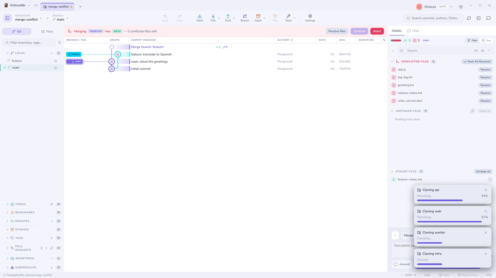

# Clonagem

**Novo repositório → Clonar**, ou `⌘K` → *Clonar*. Cole uma URL, ou entre no
GitHub, GitLab, Bitbucket ou Azure DevOps e escolha entre os seus próprios
repositórios — o token do [perfil](profiles.md) escolhido é usado para o clone e
depois descartado, nunca escrito no `.git/config`.

Escolha uma pasta-mãe e um nome; a linha abaixo dos campos mostra exatamente onde
o repositório vai parar. Uma pasta que já existe é recusada em vez de receber o
clone por cima.

## Vários repositórios de uma vez

Configurar uma máquina nova, ou baixar todos os serviços de um time, antes
significava abrir este diálogo uma vez por repositório. Numa aba de host, marque
a caixa de cada repositório que você quer, ou use **Selecionar todos os
exibidos** para levar tudo o que o filtro encontra. Clicar numa linha (não na
caixa) continua escolhendo só aquele.

Com mais de um marcado, o diálogo clona todos na mesma pasta-mãe, cada um numa
pasta com o nome do repositório. Os caminhos aparecem listados antes de você
começar. Se dois tiverem o mesmo nome (`org-a/app` e `org-b/app`), os dois
recebem o dono no nome da pasta (`org-a-app`, `org-b-app`) em vez de disputar a
mesma pasta.

O lote vai direto para a bandeja no canto. Três clones rodam ao mesmo tempo e o
resto espera como *Na fila*; cada um tem o seu próprio cancelar. Cada
repositório abre numa aba assim que termina.

Limites:
- **Branch para checkout** fica oculto num lote: um nome de branch não significa
  nada entre repositórios diferentes, então cada um recebe a sua branch padrão.
  As outras opções de Avançado (parcial, raso, branch única, submódulos) valem
  para todos.
- A seleção múltipla só funciona nas abas de host. A aba URL aceita uma URL só.
- Uma falha não para as outras. Um repositório cuja pasta já existe falha com o
  seu próprio erro e o resto segue em frente.

## Avançado — estreitando o clone

Tudo em **Avançado** vem desligado: deixe como está e você recebe um clone
comum e completo. Essas opções ganham seu lugar em repositórios onde "completo"
significa vinte minutos e vários gigabytes.

| Opção | O que o git faz | O que custa |
|--------|---------------|---------------|
| **Clone parcial** | `--filter=blob:none` | Histórico completo, sem conteúdo de arquivo. Os blobs chegam sob demanda, então abrir um arquivo antigo exige rede. |
| **Clone raso** | `--depth=N` | Só os N commits mais recentes existem. Blame, log, bisect e range-diff param no corte. |
| **Somente uma branch** | `--single-branch` | As outras branches ficam no remote até você buscá-las. |
| **Clonar submódulos** | `--recurse-submodules` | Todo submódulo também é feito checkout — mais tempo agora, nenhum diretório faltando depois. |
| **Branch para checkout** | `--branch <name>` | Começa nessa branch em vez da padrão do remote. |

**Parcial antes de raso.** Um clone parcial mantém todos os commits — o
histórico continua pesquisável, e só o conteúdo dos arquivos é buscado
preguiçosamente. Um clone raso realmente descarta histórico: o `git log` termina
no corte e o blame não enxerga além dele. Se você está clonando um monorepo para
trabalhar nele, parcial costuma ser o que você quer.

O raso é reversível: `git fetch --unshallow` no [terminal](terminal.md) preenche
o histórico de volta.

### Escolhendo a branch

Digite um nome de branch, ou aperte **Listar branches** para perguntar ao remote
o que ele tem (`git ls-remote --heads`) e escolher num dropdown. Isso é uma ida e
volta na rede, feita só quando você aperta o botão — nada é consultado enquanto
você digita.

Se a listagem falhar — uma URL privada ainda sem token, um erro de digitação, sem
rede — o campo continua sendo uma caixa de texto simples e o próprio clone
reporta o erro real.

### Duas notas sobre as flags

- **`--depth` implica `--single-branch`.** Com um clone raso, deixar *Somente uma
  branch* desmarcado é o que pede as outras branches de volta
  (`--no-single-branch`), e é por isso que a dica embaixo dela muda.
- **Clonar uma pasta local** normalmente ignora o `--depth` por completo, porque o
  git faz hardlink do banco de objetos em vez de buscar. O Gitcito clona por uma
  URL `file://` quando você pede uma cópia rasa de um repositório local, então a
  profundidade que você pediu é a profundidade que você recebe.

## Progresso, segundo plano e cancelamento

A barra reporta o que o git reporta: contando, comprimindo, recebendo,
resolvendo, fazendo checkout. Uma etapa que não consegue informar um total mostra
uma barra indeterminada em vez de uma porcentagem falsa.

Um clone grande leva minutos, e um clique perdido fora do diálogo antes custava
tudo isso. Agora fechar o diálogo — **Executar em segundo plano**, `Esc`, o ✕ ou
um clique fora — só o esconde: o clone continua e vai para um pequeno cartão no
canto inferior, com a mesma barra de progresso. Você pode começar outro clone
enquanto isso; cada um ganha o seu cartão.

Escolheu o repositório errado? **Cancelar clone** no diálogo, ou o ✕ no cartão,
para o git e apaga a pasta escrita pela metade. Nada mais é tocado — a pasta não
existia antes de o clone começar, e isso é verificado logo no início. Um clone
cancelado não pode ser retomado; começar de novo começa do zero.

Quando termina, o novo repositório abre numa aba, fixado ao perfil com que você
clonou, esteja o diálogo ainda aberto ou não.

Os clones rodam dentro do app, então sair do Gitcito os interrompe. A saída não
espera a limpeza, então a pasta escrita pela metade pode ficar para trás — apague-a
antes de clonar ali de novo, já que o diálogo recusa uma pasta que existe.
