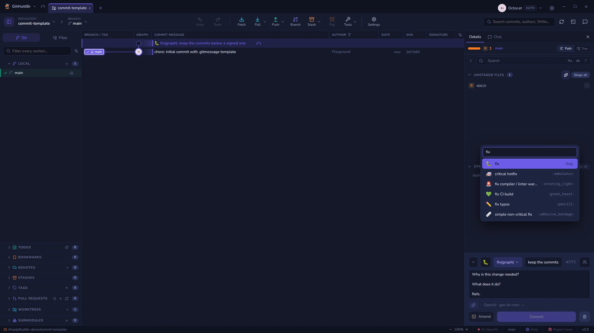

# Commitando

## Estilos de mensagem

Escolha um em **Configurações → IA → Mensagens de commit**, ou direto no
compositor; o compositor se adapta a ele. O estilo é da IA que o perfil usa — a
geral ou a própria do perfil.

| Estilo | Se parece com |
|---|---|
| **Conventional** | `feat(api)!: add rate limiting` — com um botão **tipo ▾** antes do assunto |
| **Gitmoji** | `✨ add rate limiting` — com um seletor de emoji |
| **Gitmoji + Convencional** | `✨ feat(api): add rate limiting` — seletor de emoji *e* botão **tipo ▾** |
| **Ticket** | `ABC-123: add rate limiting` — semeado a partir do nome da branch |
| **Simples** · **Auto** | O que você digitar; o Auto deixa a IA decidir o formato |
| **Homem das cavernas** · **Haicai** | Exatamente o que o nome sugere |

Com um estilo Conventional, o prefixo fica no botão **tipo ▾** à frente do
assunto (*feat(api)*, ou *tipo* enquanto não há nenhum) e o campo guarda só as
palavras depois dele; a mensagem continua recebendo o `feat(api): …` inteiro. O
botão lista os tipos, e **Sem tipo** tira o prefixo. Digitar o prefixo à mão
também funciona, e <kbd>Backspace</kbd> no início do campo mostra o prefixo como
texto de novo, para mudar o escopo; ele volta para o botão quando o campo perde o
foco.

### Gitmoji

O [Gitmoji](https://gitmoji.dev) coloca um emoji na frente do assunto para que o
histórico seja lido de relance: 🐛 correções, ✨ features, 🔥 remoções. Com
qualquer um dos estilos gitmoji, o botão de emoji fica ao lado do campo de
assunto. Ele abre **os 75 gitmojis oficiais**, com busca por emoji, por `:código:`
(o que quem usa o gitmoji-cli digita) ou pelo significado no seu idioma.

O **Gitmoji + Convencional** mantém tipo e emoji em sincronia. Escolha um tipo e
o emoji acompanha; troque o tipo e ele troca junto, a menos que você tenha
escolhido o emoji à mão (🚑️ num `fix`, por exemplo). Esse nunca é sobrescrito.

| Tipo | Emoji | Tipo | Emoji |
|---|---|---|---|
| `feat` | ✨ | `test` | ✅ |
| `fix` | 🐛 | `build` | 📦️ |
| `docs` | 📝 | `ci` | 👷 |
| `style` | 🎨 | `chore` | 🔧 |
| `refactor` | ♻️ | `revert` | ⏪️ |
| `perf` | ⚡️ | | |

A IA escreve no mesmo formato. Se o modelo esquecer o emoji ou responder com um
`:shortcode:`, o assunto é corrigido antes de chegar ao campo.

Commits feitos por outras ferramentas como `:sparkles: add login` são
**exibidos** como `✨ add login` no grafo, nos detalhes do commit e nas telas de
histórico.

Limites:

- O seletor sempre grava o emoji **unicode**, nunca um `:shortcode:`.
- Os shortcodes são convertidos só na exibição. O commit não é reescrito, e a
  busca no histórico casa com o texto como foi commitado.
- Só gitmojis contam: um assunto que começa com outro emoji fica como está.
- Um repositório cujo hook `commit-msg` roda o commitlint com o preset
  Conventional padrão rejeita um emoji no início. A regra é do hook, não do
  GitHuttBr: configure o commitlint para gitmoji ou use Conventional puro ali.

## Escrevendo a mensagem com IA

Com a IA ligada, o botão **✦** (*Gerar com IA* no hover) fica abaixo da
descrição. Ele lê o diff preparado (staged) e escreve o resumo e a descrição no
estilo acima. Ao lado, um seletor separado diz quem vai responder — *conta · modelo*, o par escolhido para mensagens de
commit em **Configurações → IA → Modelo por tarefa** — para que um modelo local
lento ou um caro nunca seja surpresa.

- **▾** ao lado do nome lista as contas salvas, cada uma com alguns dos seus
  modelos. A escolha vale **só para aquela geração**; as Configurações não
  mudam.
- Enquanto roda, o ✦ gira e a mesma linha mostra os segundos até ali e
  **Cancelar**, que interrompe a própria requisição, não só o indicador. O
  resumo e a descrição ficam só leitura enquanto isso, para a resposta não
  apagar o que você digitar. Depois de 30 segundos, o aviso global *está
  demorando mais que o esperado* ([IA](ai.md)) oferece continuar aguardando ou
  levar a mesma geração para outra conta pronta; **Gerar de novo** passa a usar
  essa conta.
- O texto novo **substitui** o que havia, e o antigo é guardado: **Desfazer** e
  **Gerar de novo** aparecem na mesma linha (no hover, *Gerado por conta ·
  modelo em 7 s*). Desfazer devolve o seu resumo e a sua descrição. Os dois
  somem assim que você edita o texto ou faz o commit.
- A descrição que você digitou, ou a que a IA escreveu, continua lá quando você
  troca de aba e volta, como o resumo — e **Desfazer** e **Gerar de novo**
  também, depois de uma geração.

[Editar commit](commit-edit.md) tem o mesmo botão, a partir do diff daquele
commit.

Limites:

- Só o diff preparado é enviado, cortado quando é muito grande — nunca mudanças
  não preparadas nem outros arquivos.
- Desfazer guarda um passo: o texto de antes da primeira geração seguida.
  Quando o Desfazer some, essa cópia some junto.
- Cancelar não devolve tokens que o provedor já gastou na requisição.
- A lista do ▾ mostra todas as contas salvas, inclusive uma ainda sem chave;
  escolhê-la falha com o erro daquela conta.

## Coisas que o compositor faz por você

- <kbd>↑</kbd> <kbd>↓</kbd> trazem de volta suas **mensagens recentes**.
- Um **seletor de coautores** adiciona trailers `Co-authored-by:` a partir dos
  próprios contribuidores do repositório.
- `commit.template` / `.gitmessage` **pré-preenchem** a mensagem, com as linhas de
  comentário removidas.
- Durante um merge, cherry-pick ou revert, a mensagem vem **pré-preenchida** do
  jeito que o git faria.
- Rascunhos **persistem** por repositório, então trocar de aba nunca perde uma
  mensagem.

## O linter

Uma verificação ao vivo e não bloqueante: comprimento do assunto, ponto final
sobrando, assunto não imperativo ou em minúsculas, linhas do corpo largas demais.
São dicas, nunca um portão — ele não vai impedir você de commitar. O comprimento
é o contador ao lado do assunto, lido contra o limite de 72 caracteres
(*56/72*): ele fica vermelho depois do limite, e a dica dele traz o conselho de
mirar em 50. As outras dicas aparecem abaixo da descrição.

## Amend

O amend reescreve o último commit com o que estiver preparado. O GitHuttBr mostra a
mensagem existente primeiro, então você está editando, não redigitando.

**Fazer amend no commit…** numa linha do grafo faz a mesma coisa para o HEAD:
carrega a mensagem completa, coloca o compositor em modo amend e o foca. Um HEAD
que já foi enviado ainda pode receber amend, mas o GitHuttBr avisa que atualizar o
remoto vai exigir um force push.

**Desfazer commit…** é o irmão para um HEAD não enviado: reset mixed para o pai,
mudanças da árvore de trabalho mantidas, mensagem restaurada no compositor. O
commit inicial tem um caminho dedicado que deixa uma branch não nascida em vez
de destruir os arquivos.

**Veja também:** [Staging](staging.md) · [Absorb](absorb.md) · [Gerador de changelog](changelog.md)
