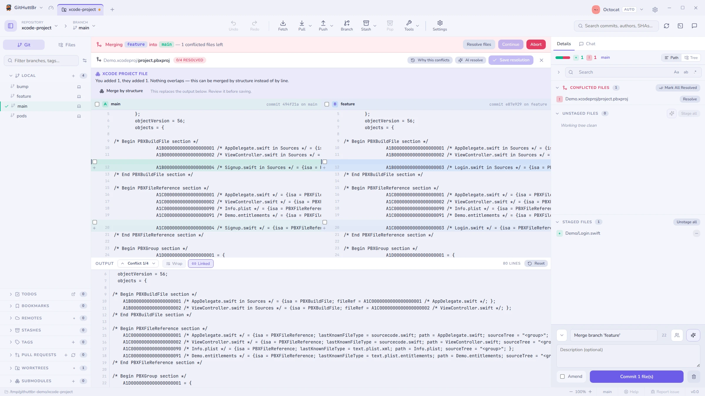

# Resolvendo conflitos

Quando um merge, rebase, cherry-pick ou revert para, o resolvedor transforma o
passo inteiro em uma tela só. A barra do topo diz **o que** parou e **entre o
que** — "Mesclando `feature` em `main`", não só "conflito" — e quanto já foi
feito: *2 de 5 arquivos resolvidos*, com os conflitos que ainda faltam somando
todos os arquivos.

## A faixa de arquivos

Logo abaixo da barra, um chip por arquivo em que este passo parou:

| Chip | Significa |
|---|---|
| Verde com ✓ | Resolvido — preparado, nada mais a decidir |
| Com contorno | O arquivo em que você está |
| Um número vermelho | Quantos blocos em conflito o arquivo ainda tem |
| Um rótulo | Um conflito sem texto para mesclar: *apagado de um lado*, *renomeado dos dois lados*, *adicionado de um lado* |

**Próximo arquivo →** pula para o próximo ainda aberto, e marcar um arquivo como
resolvido já leva você até lá. **Continuar** na barra fica desabilitado até todos
os chips ficarem verdes; **Abortar** pergunta antes e diz o que se perde.

O git esquece um arquivo no momento em que ele é preparado, então "resolvido" é o
que o GitHuttBr viu durante este passo, mais os arquivos que o git listou na
mensagem do merge. Um arquivo que você preparou num terminal antes de abrir o
resolvedor continua contando; depois de reiniciar o app no meio de um rebase, a
parte já resolvida daquele passo pode não contar.

## Por que isso conflita

**Por que isso conflita**, no cabeçalho do arquivo, lista por lado os commits que
tocaram neste arquivo desde que as branches se separaram — é o `git log --merge`,
que o git entrega desde sempre e ninguém encontra.

Os marcadores dizem o que colide. Isto diz quem mudou e por quê, que é geralmente
o que de fato decide a resolução. Nada ali significa que nenhum dos lados
commitou uma mudança exatamente neste caminho — a colisão veio de uma renomeação
ou de uma movimentação.

O cabeçalho também diz em qual conflito você está e de que tipo é o conflito do
arquivo, lido do próprio status do git: *os dois lados mudaram as mesmas linhas*,
*adicionado nos dois lados*.

## Os três painéis

| Painel | É |
|---|---|
| **Seu lado** | O lado em que você estava, encabeçado pelo commit mais recente desse lado que tocou no arquivo: sha, assunto, autor, há quanto tempo |
| **Base** | A versão de onde os dois lados partiram — o ancestral comum ou, num cherry-pick ou passo de rebase, o pai do commit sendo aplicado. As linhas que cada conflito substituiu ficam sombreadas |
| **Chegando** | O lado que está chegando, encabeçado do mesmo jeito |

**Mostrar a base**, no cabeçalho do resultado, esconde ou mostra o painel Base e
lembra a sua escolha. Fica apagado quando não há base — os dois lados adicionaram
o arquivo.

Todos os painéis são redimensionáveis, e o cabeçalho do resultado traz duas
alternâncias de visão:

| Alternância | O que faz |
|---|---|
| **Quebrar linha** | Quebra linhas longas dentro dos painéis laterais em vez de rolá-las. A visão em texto do resultado mantém uma fileira por linha — os marcadores laterais dela dependem disso — então ela sempre rola |
| **Vinculado** | Rola os painéis e o resultado juntos, na vertical e na horizontal. As contagens de linhas diferem, então a posição vertical é alinhada por proporção |

Quebrar linha começa desligado, Vinculado começa ligado, e os dois lembram o
próprio estado.

## O resultado

O resultado é o arquivo como ele vai ser gravado. Cada conflito fica no lugar
como um cartão com quatro respostas:

| Resposta | O que entra no arquivo |
|---|---|
| **Usar o seu** | As suas linhas, e só elas |
| **Usar o deles** | As linhas deles, e só elas |
| **Os dois** | As suas linhas, depois as deles |
| **Editar** | Os dois, abertos no editor de texto com o conflito selecionado, para quando a resposta é "os dois, mas ajustados" |

Um cartão ainda sem resposta mostra os dois lados, cada linha marcada *← seu* ou
*← deles*, para você decidir sem olhar para cima. **Arquivo todo: o seu | o
deles**, no cabeçalho do arquivo, responde todos os conflitos de uma vez.

**Editar como texto** troca o resultado por um editor simples, para digitar à
vontade. Depois que você digita, os cartões já não descrevem o que está ali, então
o texto fica até **Desfazer escolhas** voltar tudo ao começo.

O rodapé conta o que falta neste arquivo; **Marcar *arquivo* como resolvido**
grava o resultado e o prepara, e fica desabilitado até todo conflito ter resposta.

## Navegando

Abrir um arquivo leva você ao **primeiro conflito** dele, não ao topo do
arquivo. As setas ⌃ / ⌄ no cabeçalho do resultado — ou <kbd>Alt+↑</kbd> /
<kbd>Alt+↓</kbd> — percorrem os demais, rolando todos os painéis até cada um.

## Escolhendo por linha

Os painéis laterais continuam escolhendo por **linha** e por **bloco**, e a caixa
no cabeçalho deles pega o **lado inteiro** — para a resposta que nenhum cartão
oferece, como duas linhas suas e uma deles. As escolhas por linha aparecem nos
cartões na hora.

## Arquivos sem nada para mesclar

Alguns conflitos não têm linhas para comparar: um lado **apagou** um arquivo que o
outro mudou, ou os dois lados o **renomearam** para nomes diferentes. Três
painéis com um deles vazio não explicariam nada, então estes ganham um cartão — quem
fez o quê, com o commit, o autor e a idade de cada lado.

| Caso | Escolhas |
|---|---|
| Apagado de um lado | **Manter o arquivo** (com as mudanças que o outro lado fez), **Apagar o arquivo** (pergunta antes) e **Ver o que você mudou** — o diff a partir da base, para você saber o que apagar joga fora |
| Renomeado dos dois lados | **Manter** um nome, o outro, ou **os dois nomes** |

O git não registra ligação entre o original renomeado e os dois nomes novos, então
o cartão os associa pelo conteúdo. Quando não dá para saber — várias renomeações
de uma vez, com os arquivos mudados também — ele diz isso, e os nomes novos
aparecem como chips próprios.

## Concluindo

Quando o último arquivo é resolvido, o resolvedor não manda você procurar o
**Continuar**: um cartão resume como os conflitos foram respondidos, deixa editar
a mensagem do merge (já preenchida com a do git) e conclui dali mesmo.

- O resumo conta o que ele viu você escolher: do seu lado, do deles, os dois,
  editado à mão. Um arquivo resolvido fora do resolvedor conta como arquivo, não
  como resposta.
- Um passo de **rebase** mantém a mensagem do próprio commit reaplicado, então
  não há caixa de mensagem para ele.
- **Lembrar estas resoluções (rerere)** é o `rerere.enabled` do git, a mesma
  chave das Configurações. O git só lembra conflitos que viu acontecer, então
  ligar aqui vale a partir do próximo.
- **Revisar de novo** fecha o resolvedor sobre o resultado preparado.

## Desfazer

Toda resolução — um arquivo marcado como resolvido, um lado escolhido, um arquivo
mantido ou apagado, uma renomeação decidida — tem uma entrada de desfazer.
Desfazer devolve o conflito exatamente como o git o deixou: os marcadores, os dois
lados e a base no índice, o arquivo no disco. **Abortar** é a única coisa que não
dá para desfazer, e por isso pergunta.

## Assistência da IA

Com a IA ligada, **Resolver com IA** propõe um merge no resultado, como texto. Ela nunca
aplica nada por conta própria: você lê, edita e prepara. Veja
[Recursos de IA](ai.md).

## Arquivos de projeto do Xcode

`project.pbxproj` entra em conflito mais do que qualquer outro arquivo de um
repositório iOS, e quase nunca porque alguém discordou. É um único dicionário
plano de objetos com chaves hexadecimais de 24 dígitos, então adicionar um
arquivo escreve quatro entradas: um `PBXBuildFile`, um `PBXFileReference`, uma
linha nos `children` do grupo que o contém e uma na fase de build do target.
Duas pessoas adicionando um arquivo cada escrevem oito entradas que caem sobre
as mesmas poucas linhas. O git vê uma colisão; não há nada a resolver.

Quando o arquivo em conflito é um `project.pbxproj`, o resolvedor lê as três
versões como projetos em vez de texto e oferece **mesclar por estrutura**: casar
objetos por identificador, pegar toda adição dos dois lados, unir os arrays
`children` e `files` e parar no que de fato divergiu. A faixa acima dos painéis
diz o que cada lado adicionou e o que — se algo — sobra para você.

Como a proposta da IA, ela cai no resultado e não prepara nada. Você lê
antes de salvar.

### O que ela se recusa a fazer

**Nunca adivinha uma configuração que os dois mexeram.** Se você põe
`MARKETING_VERSION` em `1.1` e eles em `2.0`, isso é uma decisão, e aparece
nomeada na faixa — a configuração, o seu valor, o deles — em vez de resolvida
pelas suas costas. Um objeto que ela não conseguiu decidir mantém a *sua* versão
exata, para que uma mesclagem pela metade nunca chegue ao disco.

**Ela recusa o arquivo inteiro se qualquer uma das três versões não for
analisável.** Um `project.pbxproj` que o Xcode não consegue abrir custa mais que
uma mesclagem manual, então tudo que ela não puder ler com certeza continua um
conflito de texto comum, e ela diz isso.

**Ela não detecta dois identificadores cunhados para objetos diferentes.** Raro,
já que o Xcode os escolhe aleatoriamente — mas quando acontece, pegar qualquer um
dos lados descartaria em silêncio o arquivo de alguém, então é relatado em vez de
mesclado.

### Não use `merge=union`

O remédio que circula para isso é `*.pbxproj merge=union` no
[`.gitattributes`](attributes.md). Evite. A união funciona enquanto as únicas
mudanças forem adições independentes, e no instante em que duas pessoas editam a
mesma configuração de build ela emite as duas linhas e produz um arquivo que o
Xcode se recusa a abrir — justo no momento em que é menos provável que você esteja
lendo o diff com atenção. A mesclagem estrutural dá a mesma conveniência sem essa
falha.

## Lockfiles

`Podfile.lock`, `Package.resolved`, `yarn.lock` e seus primos registram um grafo
de dependências que o resolvedor de alguém já resolveu. Metade de uma solução
costurada à metade de outra é um grafo que ninguém resolveu: pode não instalar,
e se instalar, instala algo que nenhum dos dois branches testou.

Então, quando o arquivo em conflito é um lockfile, a faixa nomeia a ferramenta
que manda nele, oferece **Ficar com o nosso** e **Ficar com o deles** ali mesmo,
e te dá o comando que o regenera depois. Escolher um lado aqui não é um meio
termo — é o método inteiro, e a regeneração é o que o torna correto.

Os três painéis continuam disponíveis, porque de vez em quando você quer mesmo
ler o que mudou: um checksum que reconhece, uma versão que esperava. Editá-los à
mão é justamente do que isto tenta te dissuadir.

## Evitando conflitos antes deles acontecerem

O [radar de conflitos](conflict-radar.md) diz quais branches vão conflitar antes
de você fazer merge de qualquer uma delas.

## Deixando o git lembrar (rerere)

Faça rebase de uma branch de vida longa e você reencontra o mesmo conflito toda
vez. O `rerere` — *reuse recorded resolution* — é a resposta do git: ele memoriza
como você resolveu um conflito e repete essa resposta na próxima vez que o
conflito idêntico aparecer.

**Configurações → Git e sincronização → Lembrar resoluções de conflito.** Isso escreve
`rerere.enabled` no seu git config global, então a linha de comando se comporta do
mesmo jeito.

Quando o git respondeu por você, o resolvedor diz isso em vez de mostrar uma tela
vazia de "sem marcadores de conflito", e oferece **Esquecer esta resolução** — que
descarta a memória *e* traz o conflito de volta, para você resolver de outro jeito.

Duas coisas que vale saber:

- **Uma resolução repetida não é preparada** a menos que você ligue *Preparar
  automaticamente uma resolução repetida*. Deixe isso desligado: o sentido da
  pausa é que uma resposta memorizada pode estar errada para este merge em
  particular, e preparar sem olhar é como ela chega até um commit.

  É por isso que um arquivo repetido **continua em Arquivos em conflito**: o git
  escreveu o conteúdo, mas o índice ainda o mantém como não mesclado, e só o
  staging resolve isso. **Preparar como está** no resolvedor, ou **Marcar todos
  como resolvidos** na lista, é o que o move dali.
- **O rerere não entende todo conflito.** Conflitos de adicionar/adicionar e de
  apagar/modificar não geram preimage, então voltam sempre crus. A contagem nas
  Configurações é quantos ele realmente guarda, e **Esquecer tudo** esvazia.

**Veja também:** [Radar de conflitos](conflict-radar.md) · [Merge e rebase](merging.md)
