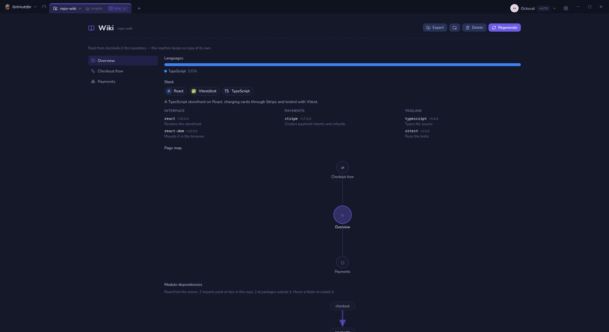

# Wiki do repo

Aponte para um repositório e ele escreve uma wiki curta explicando a base de código.

## O cartão do repo

- **Composição de linguagens** por bytes.
- **A stack** — frameworks mostrados como selos (Next, Angular, Electron,
  Tailwind, Django…).
- **Dependências** lidas direto dos seus manifestos (`package.json`, `Cargo.toml`,
  `go.mod`, `pyproject.toml`, `pubspec.yaml`, `Gemfile`…) e agrupadas por papel
  arquitetural. O andaime — stubs de tipos, loaders, plugins de lint — é filtrado
  antes, e só pacotes que o projeto de fato declara podem aparecer.
- **Um grafo de dependências entre módulos**, parseado a partir do código-fonte
  (JS/TS, Python, Go, Rust, Dart, Ruby, C/C++, PHP) e resolvido contra os próprios
  arquivos do repo, para que um import de pacote nunca vire uma aresta falsa.

## As páginas escritas

O GitHuttBr planeja um punhado de páginas a partir dos arquivos que o repositório
rastreia — documentação e manifestos primeiro, depois o que mais muda — e escreve
cada página a partir dos arquivos que ela cobre.

**Toda afirmação cita o arquivo de onde veio**, e uma alegação que nenhum arquivo
sustenta é rejeitada em vez de publicada. As páginas são escritas em paralelo e
guardadas de uma vez só, então uma execução que falha nunca substitui uma wiki boa.
Ele avisa quando a wiki foi escrita num commit mais antigo.

## Gerando em segundo plano

Escrever uma wiki leva um tempo — uma chamada ao modelo por página. A geração
pertence ao app, não à página: saia da wiki para outra aba ou repositório e ela
continua. Ao voltar, a página mostra em que ponto está (*Planejando…*, depois
cada página conforme fica pronta) com **Gerar** desabilitado, para que um
segundo clique não inicie uma segunda geração concorrente. O aviso *Wiki gerada*
chega onde você estiver.

**Cancelar** interrompe. Nada se perde: a wiki anterior só é substituída quando
todas as páginas estão escritas, então uma geração cancelada a deixa exatamente
como estava. Cancelar encerra o pedido em andamento — a chamada HTTP, ou o
processo da CLI numa conta CLI — mas o provedor ainda pode cobrar os tokens que
já tinha produzido.

Fechar a janela cancela a geração que ela iniciou.

## Exportar

**Exportar** escreve tudo em `docs/wiki/` como Markdown interligado — para poder
ser commitado, revisado num PR, e lido no seu host. A dica do botão diz a pasta
de destino.

O ícone de pasta ao lado escolhe **outra pasta** para este repositório —
qualquer pasta dentro dele, menos a raiz (onde o `README.md` da exportação
substituiria o do projeto) e `.git`. Escolher `docs/wiki` de novo volta ao
padrão. Exportar só substitui arquivos que ela mesma escreveu: se a pasta já tem
um `README.md` ou uma página de mesmo nome vinda de outro lugar, nada é gravado
e esses arquivos são citados.

### Uma wiki que já está no repositório

Quando esta máquina não tem uma wiki própria do repositório — ela foi gerada na
máquina de um colega, ou antes de uma reinstalação — a página lê a que está na
pasta da wiki, e avisa. Ela é julgada pelo commit carimbado nela: em dia naquele
commit, atrasada depois dele.

O que uma wiki lida da pasta não tem: o modelo que a escreveu, e nada de uma
exportação feita antes de esta versão gravar nela a stack e o tipo de cada
página — essas páginas aparecem como módulos simples, sem o cartão da stack. Uma
página editada à mão aparece editada, mas a lista de **Fontes** só guarda as
linhas ainda escritas do jeito que a exportação escreve. **Gerar de novo**
escreve uma nova, guardada nesta máquina, que passa a valer.

**Excluir** numa wiki lida da pasta a apaga do repositório, então pergunta
antes. Ele remove só os arquivos que a exportação escreveu — eles trazem a nota
*Generated by* — e deixa o resto da pasta. Arquivos commitados voltam com git;
os não commitados, não.

Arquivos com cara de segredo nunca são enviados.

**Veja também:** [Recursos de IA](ai.md)
