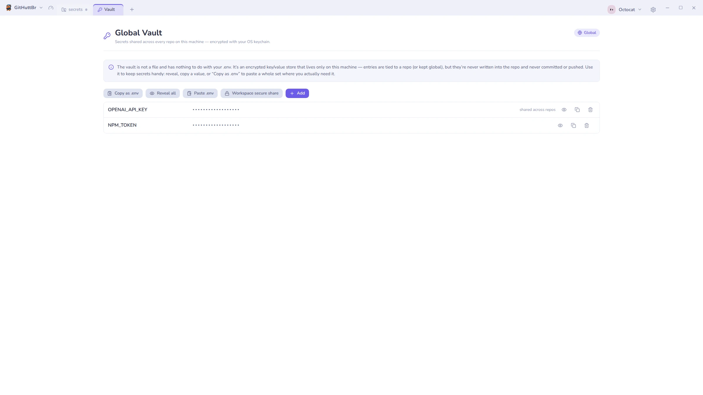

# Cofre

Os valores de `.env` de que um projeto precisa têm que morar em algum lugar. O cofre
é esse lugar, sem que eles acabem dentro do repositório.

- **Criptografado em repouso** com o keychain do seu sistema.
- **Dois escopos**: entradas presas a um repositório, e um conjunto **global** que
  você pode referenciar de qualquer lugar.
- **Não é um arquivo, e não tem nada a ver com o seu `.env`.** As entradas são
  *associadas* a um repositório mas nunca escritas dentro dele, nunca commitadas,
  nunca enviadas.
- **Nada nunca sai da sua máquina.** Sem sync, sem nuvem.

## Usando

Abra com <kbd>⌘⇧V</kbd>, pelo menu de ferramentas, pelas Configurações, ou pela
paleta de comandos. Alterne entre qualquer repositório conhecido, revele ou copie um
valor, ou faça **Copiar como .env** de um conjunto inteiro direto para a área de
transferência.

## Quando o cofre não pode ser lido

Se o chaveiro está bloqueado, você recusou o pedido dele, ou o cofre foi salvo
por outra cópia do Gitcito (um build de desenvolvimento, um reassinado), a página
diz *O Gitcito não conseguiu ler o seu cofre* — e **não mexe nele**. Nada pode
ser adicionado ou removido enquanto isso: salvar trocaria todos os segredos dele
pelo que você acabou de digitar.

| Botão | O que faz |
|-------|-----------|
| **Tentar de novo** | Lê o cofre de novo — desbloqueie o chaveiro antes. |
| **Criar um novo cofre** | Pergunta antes. O Gitcito deixa de esperar pelo cofre antigo e cria um vazio. O arquivo antigo fica ao lado como backup, com o nome `githuttbr-vault.enc.bak-<data>`, um por substituição, e o Gitcito nunca o apaga. Para um cofre perdido de vez, não para um pedido que você recusou. |

### Importações e exportações nunca o deixam de fora em silêncio

O mesmo vale quando o cofre nem pode ser aberto — o chaveiro está desligado, você
dispensou a pergunta dele, ou (no Linux) ele não respondeu a tempo: o cofre fica
*indisponível*, e a mensagem diz isso.

| Fluxo | O que acontece com o cofre ilegível ou indisponível |
|-------|------|
| Configurações → Exportar | Para antes de gravar o arquivo e diz por quê: um backup sem o cofre pareceria completo. |
| Configurações → Importar | As outras partes são importadas — configurações e notas dos repositórios antes do cofre, fotos de perfil depois — e o cofre é pulado e avisado no fim. |
| Importação no onboarding | O resto é importado; o cofre é avisado em seguida. |
| Exportação do [compartilhamento seguro](secure-share.md) | Recusada, com o motivo. |
| Importação do compartilhamento seguro | Recusada **antes de gravar qualquer arquivo do bundle**: o cofre é conferido primeiro e mesclado antes dos arquivos, para os arquivos nunca chegarem sem os segredos deles. |

As mensagens de exportação e importação oferecem abrir a página do Cofre, onde dá para tentar de novo ou criar um novo cofre.
O compartilhamento seguro mostra o motivo na própria janela — ao exportar, também embaixo da linha do cofre.

## Levando de uma máquina para outra

O [compartilhamento seguro](secure-share.md) consegue empacotar o cofre num bundle
criptografado — e só quando você pede explicitamente que os segredos sejam
incluídos.

**Veja também:** [Segurança e segredos](security.md) · [Compartilhamento seguro](secure-share.md)
