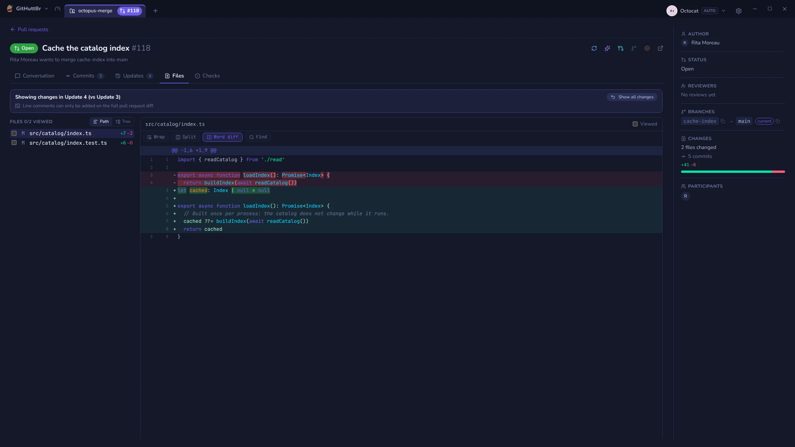

# Pull requests page

A busy repository has twenty pull requests open at once. The sidebar lists
them, but one line each says little: whose is which, which wait on you, which
went red. Finding out meant opening each one, reading it, going back, opening
the next. The **pull requests page** answers those questions on one screen, and
once you open a pull request, **‹ ›** take you to the next one of the same list
without going back.

## Opening it

- The **list icon** on the sidebar's **PULL REQUESTS** header (*See all pull
  requests*).
- *Pull requests…* in the command palette (⌘K), or **Tools → Pull requests…**.

Like the wiki and [CI runs](ci-runs.md), the page rides on the repository's tab.

## Tabs

| Tab | What it holds |
|---|---|
| **Open** | Every open pull request, drafts included |
| **Drafts** | Only the open ones marked as drafts |
| **Merged** | Merged pull requests, read when you first open the tab |
| **Closed** | Closed without merging (declined, abandoned), read with Merged |

The counts beside Open and Drafts come from the list the sidebar already holds.
Merged and Closed are asked for only when you open one of them, and once per
session; **Refresh** asks again.

## Filters

| Filter | Keeps |
|---|---|
| **Search** | Pull requests whose title, description, branches or number contain every word typed. `#482` or `482` finds that number; matches are highlighted in the title |
| **Author** | One author — each listed with how many it has in this tab. **Me** is first |
| **Reviewer** | One requested reviewer, or **Review requested from me** |
| **Target branch** | Pull requests into that branch |
| **Mine** | A shortcut for *Author: Me* |
| **Awaiting my review** | A shortcut for *Reviewer: review requested from me* |
| **CI failing** | Pull requests whose head's checks failed |

The line under the filters says how many of the tab's pull requests are shown
and which filters are on, with **clear filters** to drop them all.

Filters are kept per repository **while the app runs** — leave the page, come
back, they are as you left them. They are not saved across restarts on
purpose: a "mine, CI failing" filter brought back silently a week later would
hide pull requests you did not ask to hide.

### Who "me" is

"Me" is the account this repository's calls sign in as on the host — the
profile the repository is [bound to](profiles.md), else the active one — asked
of the host itself. When the token cannot say who it is (no user scope), or
there is no token, **Me**, **Mine** and **Awaiting my review** are not offered.

## The list

| Column | What it shows |
|---|---|
| **#** | The number, with an icon for open, draft, merged or closed |
| **Title** | The title, a *draft* badge, and who is still asked to review — in the accent colour when it is you |
| **Author** | The host's picture where it gives one, else the initial, and **you** on your own |
| **Branches** | Source → target |
| **Checks** | The head's checks rolled up — `6/6`, `1 failed`, `2 running`; hover for the counts |
| **Updated** | How long ago it last changed; hover for the date |

Rows are sorted by the latest activity. A click opens the pull request's own
page ([Hosting & pull requests](hosting.md)). On a host without that page, the
row opens the pull request in the browser.

In a [fork checkout](hosting.md#your-pull-requests-on-the-parent-of-a-fork), your pull requests on the parent are listed
too, marked *on owner/repo*.

## Walking the list from a pull request

A pull request opened from the page shows a strip above its title:

- **← Pull requests** goes back to the list, filters as you left them.
- **‹ k of n ›** moves to the previous or next pull request of the list you
  opened it from — the filtered list, in its order, as it was when you clicked.
  The tooltips name the pull request each arrow leads to.
- **Alt+← / Alt+→** do the same from the keyboard. They are rebindable in
  **Settings → Shortcuts**. They stand aside while the caret is in a text field
  (where Option+← moves by word) and while the terminal has the focus.

Moving replaces the page in place, so stepping through ten pull requests does
not leave ten icons on the tab; opening another row from the list replaces it
too.

A pull request opened **from anywhere else** — the sidebar, a notification —
walks the repository's open pull requests in the page's default order (Open,
no filters). One that is not on that list either, such as a merged level of a
stack, shows only the way back to the list.

## Going to a pull request's branch

To work on a pull request you need its branch checked out — and in a
repository with thousands of branches, finding it in the branch list by name
is the slow part. On a pull request's page, the **Branches** field does it for
you:

- **The branch name is a link.** A click checks that branch out and takes you
  to the repository's graph, at the branch's tip. The pull request's page stays
  open on the tab.
- **A branch that only exists on the server** is fetched first — that one
  branch, not the whole remote — and checked out as a local branch that tracks
  it. A branch you already have locally is switched to as it is — it is not
  updated, so pull when you want the pull request's latest commits.
- **The branch you are already on** is marked *current* instead. Nothing is
  checked out.
- **The copy button** beside each name puts it on the clipboard.
- **Undo** (⌘Z) goes back to the branch you were on and deletes the local
  branch the checkout created — unless you have committed on it since, in which
  case it is left alone.

The header has the same two moves as buttons: **Go to source branch** and
**Go to target branch**. They work on the branch you are already on too —
they just take you to the repository. With [icon colors](themes.md#icon-colors)
on, each header button has its own: refresh blue, AI review violet, preview
teal, source branch green, target branch orange (open in browser stays grey).

Nothing is looked up until you click: opening a pull request does not read or
fetch any branch.

What it does not do:

- **A fork's source branch** lives in another repository, so it has no link
  (the copy button stays). **Preview pull request locally…**, offered right
  under it, is the way to run it here. The target branch still links.
- **No matching remote.** The branch is looked for on the remote whose URL is
  the pull request's repository. When no configured remote points there, the
  link does nothing and its tooltip says why.
- **A deleted branch.** A merged pull request has often taken its branch with
  it; the fetch then says the branch no longer exists on the remote, and you
  stay on the pull request.
- **Local changes.** Checking out is not destructive, so there is no confirm —
  and git refuses the checkout when your uncommitted changes would be
  overwritten. The error says which files; commit or stash them and click again.
- **This window.** The checkout happens in this repository's working tree. When
  the branch is already checked out in another [worktree](worktrees.md), that
  worktree's tab opens instead.

## Commits

The sidebar said how many commits a pull request has, never which. Reviewing
one commit at a time — the way most pull requests are meant to be read — sent
you to the browser. The **Commits** tab, between Conversation and Updates, lists
them:

- **A summary line** on top: how many commits, by how many authors, the pull
  request's **+/−**, and one coloured chip per
  [Conventional Commit](https://www.conventionalcommits.org/) type with its
  count — *feat 2 · fix 1 · test 1* tells you what kind of change this is
  before you read a line of it. Features are green, fixes and reverts red,
  tests in the accent colour, performance yellow, the rest grey.
- **Oldest first**, the order they apply in, grouped under the day they were
  authored. A commit rebased in out of date order starts a day of its own
  rather than being moved.
- Each row has the author's picture (where the host gives one), the subject —
  its type as the same coloured chip and its scope muted, when it follows
  Conventional Commits — the author, how long ago, and, for a commit this
  clone has, its **+/−** and how many files it touched. Then a **CI** dot
  (green passed, red failed, yellow running) where the host reports a run for
  that commit, the short SHA, and **View diff**. A **merge** badge marks a
  commit with two parents, where the host says.
- A commit with more than a subject shows the rest of its message under the row.
- On hover, **Copy** puts the full SHA on the clipboard and **Open in browser**
  opens the commit on the host — inside the pull request where the host has
  such a page (GitHub, GitLab, Bitbucket Data Center), else on the repository's
  commit page.

Commits made after you last left the pull request sit below a **New since your
last visit** line — the same mark as the Conversation tab, from the same visit.

**View diff** — or a click on the row, or Tab to it and Enter — opens the
commit in the app, as a click in the graph would: the repository's view, that
commit selected, its details open. That works when this clone **has** the
commit. When it does not, the row says *not in your repository yet* and its
button changes:

- **Fetch the branch** — the same single-branch fetch as
  [going to the branch](#going-to-a-pull-requests-branch), without the
  checkout. Every commit that came with it can then open; if this one did not
  (a force push rewrote it since), the toast says so.
- **Fetch the pull request's commits**, on a pull request from a **fork**. Its
  branch lives in another repository, but most hosts mirror a pull request's
  head in the target repository under a ref of its own — `refs/pull/N/head`
  (GitHub, GitHub Enterprise Server, Forgejo), `refs/merge-requests/N/head`
  (GitLab), `refs/pull-requests/N/from` (Bitbucket Data Center). The app
  fetches that one ref, without tags, into a ref of its own,
  `refs/githuttbr/pr/<remote>/N`, and the commit opens like any other: the
  graph draws that head as a lane without a label. Fetching again moves the ref
  to the head as it is then. If the force push since left the commit out, the
  toast says so.
- **Open in browser**, for when fetching is not an option.

**Compare two commits** asks you to tick two rows, then opens the
[comparison](merging.md#compare-any-two-refs) between them in the repository's view:
the older one is the base, so you see what happened from one to the other —
the commits in between and their combined diff. Both have to be in this clone;
until two are, the button is greyed out.

The list is read the first time you open the tab, not with the page, and again
on every **Refresh**. Until it is in, the tab's count is the one the host
gave for the pull request. Merged and closed pull requests list their commits
the same way.

What it does not do:

- **At most 250 commits.** GitHub itself lists no more than 250 for a pull
  request; the app stops at the same number on every host, and says *the host
  has more* when it does, with a link to the pull request on the host. Which
  250 depends on the order the host lists them in — the app keeps the ones
  listed first, and the line above the list says which:

  | Host | A longer pull request shows |
  |---|---|
  | GitHub | The **first** 250 (GitHub's own limit) |
  | GitLab, Azure DevOps, Bitbucket Data Center, bitbucket.org | The **250 most recent** |
  | Forgejo | Whichever end the server lists first; its order is not documented |
- **A fork's head where the host does not mirror it.** Azure DevOps publishes
  only a merge result, never a pull request's own head, and bitbucket.org
  publishes neither: there the row offers the browser alone. On another host
  that turns out not to mirror it, the fetch says so. **Preview pull request
  locally…** brings in Azure's merge result, if that is what you need.
- **The fetched heads stay.** `refs/githuttbr/pr/…` is not a branch: nothing
  to check out or push, a pruning fetch leaves it alone, and git keeps its
  commits. Nothing removes it either — neither closing the page nor
  [Clean up local branches](branch-cleanup.md). To drop them, delete the refs
  by hand: `git for-each-ref refs/githuttbr/pr` lists them, and
  `git update-ref -d <ref>` deletes one.
- **A remote whose name has a `/`** cannot be one part of that ref's name, so
  the fetch is refused there.
- **A deleted branch.** A merged pull request has often taken its branch with
  it: the fetch says so. bitbucket.org lists no commits at all once the source
  branch is gone.
- **Squash merges.** A squash-merged pull request's commits never reached the
  target branch, so after its branch is deleted they are on the host only.
- **Per-commit numbers come from your clone.** The **+/−** and file count are
  read from git, never asked of the host, so a commit not fetched yet shows
  none, and neither does a merge (its change is against two parents). A
  partial clone missing a commit's files shows none rather than download them.
- **CI for the 40 most recent commits only**, quietly: one request per commit
  would add up on a long pull request, and CI usually ran on the pushed heads
  anyway. No credential for the host means no dots, never a sign-in.
- **The type chips read the subject.** A team that does not write Conventional
  Commits gets no chips and no type counts — nothing is guessed.
- **Authors** are named as their commits name them. GitLab, Azure DevOps and
  Bitbucket Data Center give no picture without a sign-in an image cannot
  send, so those rows show the initial.
- **Long messages on Azure DevOps** may be cut short: Azure's list truncates a
  commit's message, and the app shows what it sends.
- **bitbucket.org** pull requests open in the browser — the app has no page for
  them yet — so this tab is not reached there, although the app can read the
  list.

## Updates

A pull request you reviewed on Monday has moved by Thursday. The Commits tab
shows where it is now, not what happened since: which commits came in which
push, whether someone force-pushed and rewrote what you had already read, and
what the code looks like *compared with the version you saw*. The **Updates**
tab, between Commits and Files, answers that — the way Azure DevOps' own
Updates tab does.

It lists each push to the pull request, **newest first**:

- **Update 1 — opened** is the push the pull request was opened with; every
  later push is the next number.
- Each one shows **when**, **who pushed** (where the host says), and the
  **commits it added** — short SHA, subject, author. Where the host reports
  commits a push took off the branch, they are listed under **Commits
  removed**, struck through.
- A force push or a rebase is marked **history rewritten**: commits you had
  read may be gone, and the ones listed may be new copies of old work. On
  Azure DevOps, a push that moved the pull request to another target branch is
  marked **target changed**.

### What changed in one update

**View changes in this update** opens the Files tab on that push alone: the
diff from the previous update's head to this one — or, for Update 1, from the
target branch it was opened against, where the host names that point (Azure
DevOps, GitLab). The same file tree and viewer, with a banner — *Showing
changes in Update 3 (vs Update 2)* — and **Show all changes** to go back to
the whole pull request.

The diff is always made **in this clone** when it can be: `git diff` between
the two heads, exact and without asking the host. When either head is
missing, the app first fetches both **by their commit ids** from the pull
request's remote — no branch, no tag, no ref is written; a head a force push
replaced is on no branch any more, but most hosts still serve it by id — and
compares here. Only when that fetch fails is the host asked:

| Host | The host's comparison |
|---|---|
| Azure DevOps | The iteration's changes with `$compareTo` — between the two pushes |
| GitLab | The repository compare, straight from one head to the other |
| Bitbucket Data Center | The repository compare — **from the common base** of the two heads |
| GitHub | The compare API (`base...head`) — **from the common base** of the two heads |
| Forgejo / Gitea | None: their API has no two-commit diff |

From the common base, a rewrite's diff is not what the push did: what it
removed is not shown, and changes the target branch received since can read
as the pull request's. The banner says so — *Compared from the common base:
what this push removed is not shown* — when a history-rewritten update was
compared that way. When nothing works, the banner says so and offers to fetch
the branch (or, from a fork, the pull request's head) and compare here.

Line comments belong to the whole pull request's diff, so there is no **+**
on a line while one update is shown; the banner says so. Ticking a file as
viewed works as usual — it marks the file in the pull request.

### New since your last visit

Updates pushed since you last opened the tab carry a **New** badge, and the
tab itself says how many: *Updates 5 · 2 new*. Opening the tab marks them
seen (the badges stay while you are on it, so you can see which were new);
when **Refresh** brings more while the tab is open, **Mark as seen** clears
them. Opening the pull request page alone marks nothing. The first time you
open a pull request's Updates tab, nothing is new — there is no earlier visit
to compare with.

The updates are read with the page, for that count, and again on **Refresh** —
not after each comment or review you post.

What has been seen is kept on this computer only, per repository and pull
request, never sent to the host.

### Per host

| Host | Where the updates come from | Pusher | Removed commits | Rewrite detected |
|---|---|---|---|---|
| Azure DevOps | The pull request's **iterations** — Azure's own record of each push | Yes | No (not reported) | Yes: `forcePush` / `rebase` |
| GitLab | The merge request's **diff versions**; each version's commits worked out from its head | No (versions name nobody) | Yes | Yes: an earlier head no longer reached |
| Bitbucket Data Center | The pull request's activity: **OPENED** and each **RESCOPED** that moved the source branch | Yes | Yes, with the host's totals | Yes: a rescope that removed commits |
| GitHub | **Inferred** from the timeline's commits and force pushes — see below | Force pushes only | No | Yes: a force-push event |
| Forgejo / Gitea | The timeline's **push** entries, the first written with the pull request itself | Yes | No | Yes: a force-push entry |
| bitbucket.org | Not available | — | — | — |

**GitHub keeps no record of an ordinary push** — only of force pushes — so
the updates are **inferred from commit times**. An update is a run of commits
that build on one another, between force pushes; a commit that does not build
on the one before it, or comes more than ten minutes after it, starts the
next. A commit committed after the pull request was opened cannot have been in
the opening. So one push of commits made an hour apart shows **split** in two,
and two pushes a few minutes apart show as **one**; the tab says the grouping
is approximate. A rebase's new commits, which the timeline may list just
before its force push, count as that force push's. A force push's own before
and after heads are exact, so its **View changes** is too.

### Limits

- **Caps.** The 100 most recent updates are listed. GitHub's timeline is read
  from its newest end, up to 500 items; Bitbucket Data Center's activity (also
  newest first) up to 1,000; GitLab's versions and commits up to 300 each;
  Forgejo's timeline up to 500 entries, the newest ones when it is longer. When a
  cap cuts off the **opening**, the numbers are no longer the host's: the tab
  says so and counts back from the latest (*Latest update*, *Update, 2 before
  the latest*).
- **Azure DevOps** reports no removed commits; a force push or rebase is
  marked instead. An iteration whose commit list Azure cuts short is read on
  its own (up to 500 commits), and the update says when it is still partial.
- **GitLab** names no pusher. A version whose head was rewritten away is read
  on its own to find its commits — for the ten most recent such versions —
  once per session: versions never change.
- **Forgejo and Gitea** list no commits for a force push — only its two heads,
  which is what **View changes** compares — and after a force push nothing
  says what the opening held, so it is left empty unless the server recorded
  the opening's own push. Their API has no two-commit diff, so that comparison
  needs both commits in this clone. A server without the timeline API shows
  every commit in one update.
- **Fetching by id** needs a host that serves a commit by its id. GitHub does
  for any commit it still holds; another host, or a plain git server, may
  refuse one no branch points at — the host's comparison is used then. Fetched commits sit in this
  clone without a ref, and git collects them in time.
- **Bitbucket Data Center's compare** reads the server's structured diff and
  draws it as a unified one; very large files may come back truncated.
- A rewritten head can be **gone from the host** for good (Azure and GitLab
  keep it; others may collect it). Then neither side can compare, and the
  banner says so.
- **bitbucket.org** pull requests open in the browser, and have no Updates
  tab.

## Reading the files

A pull request of two hundred files is hard to read as two hundred full paths,
and hard to finish without losing your place. Above the list and the diff, a
line keeps count — *4 of 9 files viewed*, with a bar — and **Previous
unviewed** / **Next unviewed** step to the nearest file you have not ticked,
up or down, wrapping round the list; they grey out once everything listed is
viewed. Tick **Mark as viewed when moving on** and **Next unviewed** ticks the
open file for you before moving on — reading straight through, you never touch
the boxes; the choice is remembered. **Show** narrows the list
to **Unviewed** files or files **With comments** (any review conversation on
them), and back to **All**.

The **Files** tab's list has the same **Path / Tree** switch as the commit
panel, and the choice is the same one app-wide. In **Tree**, files sit under
their folders (a chain like `src/main/ipc` is one row), and each folder shows
its summed **+/−** and how many of its files are viewed (*3/5*). A folder's
checkbox marks every file inside as viewed, or clears them all; ticks are kept
on this computer only, never sent to the host. A tick holds the version of the
file's diff: when a push changes a viewed file, it reads as not viewed again,
with a **changed** pill (*changed since you viewed it*). A file without a diff
(binary, too large) is compared by its status and line counts only. A file with review
conversations shows a speech-bubble count right after its name, so
the ones with comments stand out in a long list; outdated conversations count
too, and so do resolved ones — the hosts' lists the app reads do not say which
are resolved. Click a folder, or press ←/→ on
it, to fold it; ↑/↓ (or j/k) step through the files on screen and open each
diff. Folded folders are remembered per pull request until the app quits, and a
file opened inside one unfolds the way to it. The tree is sorted by name, not in
the order the host lists the files.

**Images.** A picture the pull request adds, removes or changes (png, jpg,
gif, webp, bmp, ico, avif, svg) has no text diff to read, so the tab shows the
image instead — the same view as a commit's: the new one, the old one, or
before and after side by side and as a slider. A renamed image compares its
old path at the base with its new one at the head; in an update's own diff,
the update's two heads. The bytes come from this clone when it has the commits,
which is free and fast, and otherwise from the host with the repository's
profile. Limits: an image over 32 MB is not previewed; line comments do not
apply to a picture (an SVG keeps its text diff, and its comments, under it);
an image kept in **Git LFS** is read from the host, since a clone holds only
its pointer — GitLab, Azure DevOps and Forgejo resolve it, while GitHub's API
gives the pointer alone, so there the tab sends you to the host; where the host
does not name the merge base (it falls back to the target branch's tip), a note
says the "before" may include later changes on the target; and when neither the
clone nor the host can give the bytes, the tab says so and offers to fetch the
pull request's branch or to open it on the host.

**Paths and your editor.** The bar above the diff has a copy button for the
file's path and a **⋯** menu; right-click a file or folder in the list for the
same menu. It copies the path, a renamed file's old path, or the folder's;
and it opens the file in your [editor](editor.md) (or another app) or shows it
in the file manager. Those two act on **your working copy**, not on the pull
request's version: they are only live for a file that exists in it (a file the
PR deletes, or one your branch does not have, says why), and when the checked
out branch is not the PR's, the menu says which branch you would be opening.

**Coming back.** Leave a pull request for the repository, another tab or the
next PR, and it is where you left it when you return: the same tab, the same
file open, the same scroll, and every text you had not sent — the comment, a
reply, a line comment, an edit. This lasts until you close the pull request or
quit the app; it is kept in memory only, for the 50 most recent pull requests
(past that the oldest place is let go, and any text it held moves to the next
pull request page you open). Closing a PR with unsent text asks first. If a refresh finds the place of a draft gone — the conversation it
answered, the comment it edited, the file it was on — the text is not dropped:
it waits at the top of the page to be copied or discarded.

### Where the diff comes from

A review is only as good as the diff it reads. A host's API is not a good
source for it: Azure DevOps sends no diff at all, only the list of files, and
each one has to be fetched twice and compared; GitHub stops at 3000 files and
leaves out the patch of a large one; GitLab marks a big diff *too large* and
sends nothing. So the Files tab reads **this clone first**, on every host:

1. It asks the host for the pull request's two commits — where it starts and
   its head. Azure DevOps, GitLab and Forgejo name the merge base; Bitbucket
   Data Center names the base of the diff its line comments anchor to; GitHub
   names only the target branch, whose merge base with the head is then worked
   out here (or, without the commits, by GitHub's compare). The image preview
   uses the same two commits.
2. When both are here, `git diff` between them gives every file, with no cap
   on how many. These are the same two commits the host's own page compares,
   so a line number here is the line number there and a line comment lands
   where you put it.
3. When they are not here, they are fetched **by their ids** from the pull
   request's remote — objects only, no branch is created or moved — once, when
   the page opens (and again on Refresh), with *Fetching the pull request's
   commits…* above the list meanwhile. A server that will not hand out a
   commit by id (some Azure DevOps and plain git servers) is skipped quietly.
4. Only then is the host's API used, and a file it gives no diff for says why
   instead of pretending to be empty (below).

A file read later — opened while *not loaded yet*, or after **Try again** —
joins the list like the others: the same viewer, and line comments on it.

On Azure DevOps the API path reads the first hundred files when the tab opens,
three at a time and within a minute in all, and the rest when you open each
one. A throttled request pauses every read until the wait the server asks for;
one that still fails says so, with the reason. Whether a file is text is
decided from its bytes, not from Azure's own *binary* flag — which it also sets
on UTF-16 files and on some text that is not ASCII. When the host lists fewer
files than the pull request has (GitHub stops at 3000), a line above the list
says so.

### When a file shows no diff

| What it says | Why | What you can do |
|---|---|---|
| **Binary** | Its bytes are not text: an image, an archive. UTF-16 and legacy single-byte text are recognised as text. | Open it on the host. |
| **Too large to show** | More than 20,000 changed lines or 8 MB of diff, or a version over 4 MB. Its **+/−** is still counted when the clone read it. | Open it on the host. |
| **Not loaded yet** | Past what one read keeps (about 150,000 lines of diffs), or, from Azure DevOps' API, past the first hundred files or the minute. | It loads when you open it; **Load the diff** if it did not. |
| **Couldn't load** | The read failed — the reason is shown under it. | **Try again**. |
| **The host left it out** | The host's API sent no diff and this clone does not have the pull request's commits. | **Fetch the pull request to see it locally** — the commits by id, or a fork's pull request head — then it is diffed here. |
| **Only the name or mode changed** | A rename or a permission change: the content is the same. | Nothing to review in the content. |
| **Encoding changed** | The same text saved another way: a byte-order mark added or removed, UTF-16 turned into UTF-8. | Check the change is meant — some tools care. |

In the list, a file whose diff was not read — not loaded yet, couldn't load,
left out by the host — shows **—** instead of **+0 −0**, which would read as
"nothing changed". A binary file and a pure rename show their real **+0 −0**,
and when the host counts the lines anyway (GitHub does, even for a patch it
leaves out), the counts are shown.

## Commenting on a line

Replying to a review thread was possible here; starting one was not, so a real
review still sent you to the browser. In a pull request's **Files** tab, any
line of the diff takes a comment of its own:

- **Hover a line** and press the **+** that appears over its number, or
  **click the line** itself (a click that ends a text selection, or a double
  click selecting a word, does not count — that is reading). The right-click
  menu — or the keyboard's context-menu key — has *Comment on line N* too.
- A box opens **under that line**. Write, then **Comment** — or ⌘/Ctrl+Enter.
  **Cancel** closes it; **Esc** does too, asking first when something was typed.
  Either way the focus goes back to that line.
- On success the new thread appears **under its line**, and in the
  Conversation tab's review threads, where everyone else will see it.

Which side the comment lands on follows the line:

| Line | Anchored to |
|---|---|
| **Added** (green) | The new version of the file, at its new number |
| **Deleted** (red) | The old version, at its old number |
| **Unchanged** | The new version (GitLab is sent both numbers, as it requires) |

Existing threads are drawn under their lines as well, with their reply box
where the host lets the app reply inside a thread (Forgejo does not). A thread
is drawn on a line only when the host says it still belongs to the diff shown;
anything else stays in the Conversation tab, rather than on a guessed line:

| Host | A thread written before the latest push |
|---|---|
| GitHub | Outdated when its line changed: Conversation only |
| GitLab | Written against an older head: Conversation only |
| Azure DevOps | Followed by Azure to where its line is now |
| Bitbucket Data Center | Orphaned when its line is gone: Conversation only |
| Forgejo | Forgejo does not say a comment is outdated, so it is drawn at its recorded line number — after a push that line may now hold other code |

A comment on a line outside the hunks shown is in the Conversation tab only, on
every host.

A comment typed and not sent stays with the pull request, like the main comment
box's text: **‹ ›**, Alt+arrows or another tab leave it where it is, and it is
back on its line when you return (see *Coming back* above). Looking at another
file keeps it; to start one on another line, post or cancel the first.

What it does not do:

- **One line, posted at once.** There is no range of lines, no pending review to
  batch comments into and submit later, and no suggested change. Each comment is
  published the moment you send it, as its own thread (on Forgejo, as a review
  holding that one comment, since Forgejo has no single-comment call).
- **The diff you are looking at.** The Files tab remembers which commit (on
  Azure DevOps, which iteration) its diff was read at, and a comment is sent
  against that. When the pull request has moved on since — a push, a new merge
  base — the comment is not posted on whatever line now has that number: it is
  refused with *the pull request changed since this diff loaded*, and
  **Refresh** shows the new diff. On GitHub the comment is posted against the
  commit you read instead, and GitHub marks it outdated if that line has changed.
  A line the host still will not take is refused as outside the diff.
- **Refused.** Without permission to comment (a read-only token, an account the
  repository does not let comment), the host refuses it and the message says
  that is the reason.
- **bitbucket.org** pull requests open in the browser — the app has no page
  for them yet — so a line comment there is still made on the website.
- **A file without a diff** (binary, or too large for the host to include)
  has no lines to comment on.

## The conversation

A pull request's story is scattered: the description at the top, comments in
one list, line threads in another, verdicts only in the sidebar, pushes in a
tab of their own. Catching up meant reading all of them and putting the order
back together in your head. The **Conversation** tab tells it as one
**timeline**, down a rail, in the order it happened.

| On the timeline | What it shows |
|---|---|
| **The description** | Always first, with who opened the pull request and when |
| **Comments** | The conversation, each with its author's role: **Author** or **Reviewer** |
| **Pushes** | *sam pushed 2 commits*, then one line per commit; a click on a hash opens the Commits tab |
| **Line threads** | In place, at their first comment: the file and line, the diff lines it is about, the replies and a reply box. The path and **View in Files →** open that file in the Files tab |
| **Review verdicts** | **approved** in green, **requested changes** in red with what the reviewer wrote, or a review's own comment |

A thread the host reports **open** carries an amber pill, and the bar above the
timeline counts them: **1 open thread** shows only those, the ones still waiting
for an answer. A **resolved** thread folds to one line — *Resolved thread in
src/palette.tsx:18 · 2 comments* — and a click unfolds it. **Comments · Reviews · Commits · All** narrow the timeline to one kind;
**Comments** is the one it opens on, and **All** brings everything back.

The sidebar's **Reviewers** say each person's verdict in words — **✓ approved**
or **requested changes** — and a clock for someone still to answer.

### New since your last visit

When you leave a pull request's page (another page, another tab, closing it),
the app notes the time. Next time, a line marks where you stopped — **New since
your last visit** — and the bar says how many entries came after it. The mark
is made on leaving, not on opening, so it stays put while you read. The first
time you open a pull request nothing is marked new.

Times read *2d ago*; hover for the full date.

*Limits:*

- **When a commit was pushed** is not something the hosts say. Pushes are
  rebuilt from the commit list: consecutive commits by the same author, each
  within an hour of the one before, count as one push, placed at the last
  one's date. A rebase that rewrote the dates moves them. The Updates tab is the
  host's own record where there is one.
- **Open or resolved** comes from GitHub (one extra GraphQL request per read)
  and GitLab. Azure DevOps, Bitbucket Data Center and Forgejo threads show no
  pill and are not counted.
- **Verdicts on the timeline** need a date: GitHub, GitLab (an approval, dated
  by the note GitLab writes for it) and Forgejo give one. Azure DevOps votes and
  Bitbucket Data Center approvals have none, so they appear only in the sidebar.
- A GitHub review with no text of its own — the envelope every batch of line
  comments is filed under — gets no line; its threads already show.
- Your last visits are kept for the 300 most recent pull requests, on this
  computer only. Quitting the app with a pull request open does not count as
  leaving it.

## Writing comments

Every box on the page — the comment at the bottom, a reply inside a thread, a
comment on a line — is the same Markdown editor: **Write / Preview** tabs, a
formatting toolbar with GitHub's shortcuts, lists that continue on Enter, and
**@** / **#** completion from the people and pull requests already on screen.
A thread reply is the exception: a one-line field with no toolbar, where Enter
sends and Shift+Enter adds a line. [Writing comments](writing-comments.md)
has the details and the limits.

## How comments are shown

People write comments in Markdown, so a comment shown as plain text is full of
`**`, `- [ ]` and code fences. The description, the conversation and the review
threads (in the Conversation and Files tabs) are drawn as Markdown: headings,
lists and task lists, tables, quotes, code blocks highlighted in the language
the fence names, links and images. The issue page draws its text the same way.
`#123`, `AB#123`, `!123` and `@user` in the text still become links, with the
[card](#what-a-123-or-ab123-is-about) where they had one.

Where the drawing comes from:

| Host | Rendered by |
|---|---|
| GitHub, GitHub Enterprise Server | GitHub itself (`body_html`): mentions and references are linked as on the website, images go through GitHub's image proxy, and private attachments carry their signed address |
| GitLab, Forgejo, Azure DevOps, Bitbucket Data Center | The app, from the comment's Markdown. A relative link points into the repository; on GitLab, `/uploads/…` points into the project, as GitLab does |

A comment is other people's content, so what it may contain is narrow, and
narrower than for your own files: an explicit list of tags, links and images on
`https:`, `http:` or `mailto:` only, no scripts, frames, forms, SVG or inline
style, and links that never open inside the app (they go to your browser). A
checkbox in a task list is shown, not clickable: ticking it here would change
nothing on the host.

**Images from another site wait for a click.** Loading an image is a request
the site behind it can watch, with your IP address and the moment you read the
comment — anyone who can comment can put a tracking pixel there. So only images
from the host itself load on their own: on github.com its attachments,
`*.githubusercontent.com` (which includes its image proxy) and its assets; on
any other host, its own address. Every other image shows *Image from
example.net — click to load*, and the click loads that one image. **Settings →
Security → Load images from other sites in comments** turns that off; see
[Security](security.md#images-in-comments).

**Preview shows what will be posted.** On this page and the issue page, the
**Preview** tab of every comment box draws the text the same way: the same
profile, the same line breaks, the same held-back images — a pasted link to an
outside image does not load it while you write. The new pull request and new
issue dialogs keep the app's ordinary Markdown preview.

**Too long or too intricate is shown as text.** Markdown is rendered in the
app's window, and some text costs far more to render than its size suggests.
A comment over **32,000 characters**, or one shaped to stall the renderer
(thousands of unmatched `_` or `*` in one paragraph, or more than 32 levels of
`>` or list markers on one line), is shown as plain text with links, under
*Long comment shown as plain text* or *Comment shown as plain text: too
intricate to render here*. A comment that still fails to render falls back the
same way, on its own: the rest of the page is untouched.

What it does not do:

- **Editing shows the text as written.** **Edit** still opens the Markdown, and
  a saved edit is drawn by the app until the page reads the pull request again
  (on GitHub, then by GitHub).
- **Private GitHub attachments expire.** GitHub signs a private image's address
  for a few minutes; one that no longer loads after the page has been open a
  while comes back with **Refresh**.
- **A relative image on GitHub** that the app draws itself (a reply sent from
  the app, before the page reads it again) is looked for under the repository's
  address on github.com, which may not be where GitHub would put it.
- **Videos** in a GitHub comment show as a link to the file, not a player.
- **GitHub-only extensions** the app draws itself (on other hosts) are not
  there: no emoji shortcodes, no Mermaid diagrams, no alerts styling, and math
  stays as text.
- **Code is highlighted only when the fence names its language.** Guessing the
  language would run every grammar over every block on the page.
- **Commit messages** in the Commits tab stay plain text: git does not render
  Markdown, and neither do the hosts.

## Editing and deleting your comments

A typo in a comment already sent, or a remark that no longer applies, used to
mean a trip to the browser. Your own comments now carry **Edit** (the pencil)
and **Delete** (the bin) at the end of their header: conversation comments,
review-thread comments and replies, in both the Conversation and Files tabs.
The issue page has them too, for its comments on GitHub and Forgejo.

"Yours" is decided by the page itself, which asks the host who this
repository's calls sign in as each time it loads (its bound profile, not
whichever profile is active). Most hosts name an author by login, compared
without regard to case. Azure DevOps names authors by display name, which two
people can share, so there it never compares names: a comment is yours when its
author id matches the account's id, **or** its author's unique name (the
account name, usually an e-mail address) matches the account's, without regard
to case. Either is unique to one person; the second covers an author id that is
not the one the connection reports. When neither can be compared, no comment
shows the actions. When the app cannot
tell who you are (a token without user scope, or the host did not answer), no
comment shows them either; **Refresh** asks again. The host still decides: an
account it does not let change a comment is refused, and the message says so.

- **Edit** opens the comment in place, in the same Markdown editor, with its
  text as written. **Save** (or ⌘/Ctrl+Enter) sends it; **Cancel** or **Esc**
  closes it, asking first when you changed something. Only the blank lines
  around the text are dropped: indented code and a trailing two-space line
  break stay as typed. The new text shows at once and the page reads the pull
  request again. On the pull request page, an edit nobody saved stays with the
  pull request when you move on with **‹ ›** or switch tabs, and closing the
  pull request asks first. The issue page keeps nothing: nothing there asks
  before its tab closes.
- **Delete** always asks first, and the question says what happens: the server
  removes the comment for everyone, and it cannot be undone. There is no undo
  entry, since nothing can bring it back.

Deleting the **first comment of a thread** that has replies (a review thread,
or a conversation comment others answered) differs per host, and the confirm
names which. Two of these are not written down by the host, and say so:

| Host | First comment of a thread with replies |
|---|---|
| GitHub | The replies should stay; GitHub's documentation does not say. The thread keeps its reply box: with its first comment gone, the reply is sent to the thread itself through GitHub's GraphQL API, found through a reply still in it. Should that fail (an old Enterprise Server, a token GraphQL refuses, a thread GitHub says this account cannot reply in), the thread offers **Reply on GitHub** instead. While you have a review in progress on GitHub, GitHub may file the reply under it: the toast then says so, and nobody sees the reply until you submit that review there |
| GitLab | Only that note goes; the thread and its replies stay |
| Azure DevOps | Should be marked deleted and hidden, with the thread and its replies kept; Azure's documentation does not say |
| Bitbucket Data Center | Refused: Data Center does not delete a comment that has replies. Delete the replies first, or edit it instead |

Some hosts mark a comment **edited**. Only Azure DevOps keeps a date for the
text alone; on GitHub, Bitbucket Data Center and Forgejo the app compares when
the comment was created and last updated, so the mark is an approximation there
(anything else that touches the comment may set it). GitLab's date also moves
when a thread is resolved, so it is not used.

What it does not do:

- **Forgejo review comments** (comments on a line) cannot be edited through its
  API, and only some versions can delete one, so they show neither action:
  change them on the website. Conversation comments work as elsewhere.
- **Someone changed it meanwhile.** Bitbucket Data Center checks the comment's
  version: an edit or a delete of a comment changed since the page loaded is
  refused, and **Refresh** shows the current one. The other hosts take the last
  write.
- **Not found**: when the host does not find the comment, the message says it
  may have been deleted, or that this account cannot see it, and the page reads
  the pull request again. An edit open on a comment that is gone is dropped.
- **bitbucket.org** pull requests open in the browser, so there is no page to
  edit their comments on yet, although the app can make the call.
- **The description** of the pull request and its reviews' summaries are not
  comments, and are not edited here.

## What a `#123` or `AB#123` is about

A commit that says *fixes AB#4821* or a comment that says *see #312* tells you
a number, not what it was. Finding out meant opening it. Now, **pointing at a
reference** — or tabbing to it — opens a small card with what the host says
about it:

- an icon for its kind, and the reference as written;
- its **title**;
- its **state** (open, closed, merged — on Azure DevOps, the work item's own
  state, such as *Active* or *Resolved*);
- on Azure DevOps, the **work item type** (Bug, User Story, Task…).

The cards are on the pull request page (description, comments, review threads,
and the full message of a commit in the **Commits** tab), the issue page, and
the subject in the commit details panel. In the **Commits** tab on Azure DevOps,
each work item in a commit's subject (`AB#123`, or `#123`, the same item there)
also shows its title beside it, in grey. On Azure DevOps, `!123` links to that
pull request, without a card.

| Reference | Host | Read from |
|---|---|---|
| `AB#123`, and `#123` in an Azure repository | Azure DevOps | Work items, up to 200 in one request |
| `#123` | GitHub, GitHub Enterprise Server | Issues and pull requests, up to 50 in one GraphQL request; one REST request each when GraphQL fails |
| `#123` / `!123` | GitLab | Issues / merge requests, one request per kind |
| `#123` | Forgejo | Issues (pull requests too), one request each, two at a time |

A `#123` counts only as a word of its own: `org/repo#123` (another
repository), `&#39;`, a colour like `#123abc` and a link's `#issuecomment-…`
are left alone.

Nothing is asked until a card opens. Then the reference you are on and the
ones nearest it on the page that are not yet known go in one call, so the next
card is usually instant. Answers are kept in memory while the app runs, never
on disk, for five minutes; after that they are still shown and read again on
the next hover. They are kept per profile: the call is made as the profile the
repository is [bound to](profiles.md), and another profile may see other items.

What it costs:

- **GitHub** reads up to **50** in one request, through its GraphQL API — the
  one you are on and its nearest neighbours. When GraphQL fails for another
  reason than a rate limit (an old Enterprise Server, a token it refuses), the
  app falls back to the REST API, which reads one issue per request: then only
  the first **10** are asked, one after another as GitHub asks of apps; the
  others are left unknown, and a later hover asks for them.
- **Forgejo** has no way to read several issues in one request, so each card
  costs one: a hover asks for at most **10**, two at a time.
- On GitHub and Forgejo, the first answer that says *slow down* (a 429, a 403,
  GraphQL's own rate-limit error, a secondary limit, or an answer that spent the
  last request of the limit) stops the rest — GitHub does not fall back to REST
  then — and those references are not asked for again for five minutes.
- **Azure DevOps** reads up to 200 work items in one request, and GitLab one
  request per kind, so there the whole page goes at once.

What it does not do:

- **Bitbucket** has no card: the app reads no issues there, and the link
  opens the browser as before.
- **Not found, or no access.** A deleted issue, a work item in a project this
  account cannot see, or an Azure token without the *Work Items (Read)* scope
  read the same: the card says so, and the link still works. A host that is
  throttling, unreachable, or has no account in this profile gets its own
  message.
- **`AB#123` outside Azure DevOps** — in a GitHub repository connected to Azure
  Boards — is not linked, so it has no card: the app does not know which
  organization it belongs to.
- **Merged state on older GitHub Enterprise Servers** that do not send when a
  pull request was merged: it reads as closed.
- **The graph's** commit rows do not show cards.

## Limits

- **Open pull requests are the sidebar's list.** GitHub, GitLab and
  bitbucket.org read the first 30; a repository with more shows only those, and
  the Open count reads **30+**. Azure DevOps, Bitbucket Data Center and Forgejo
  read them all.
- **Merged and closed are bounded**, and the tab shows **+** when the host has
  more (its website lists them all):

  | Host | What is read |
  |---|---|
  | GitHub, bitbucket.org, Forgejo | The 100 most recently updated, merged and closed **together** |
  | GitLab | The 100 most recently updated of each |
  | Bitbucket Data Center | 100 of each in the server's *newest* order — its API does not say whether that means opened or updated |
  | Azure DevOps | 100 of each among those that ended in the **last year**; its API names no order, so past a hundred which ones is the server's choice |

  Their checks are not read — a finished pull request's CI decides nothing, and
  it would cost a request per row — so **CI failing** does not apply on those
  tabs (its chip is hidden there).
- **No account**: without a token that reaches the host, Merged and Closed say
  so instead of showing an empty list (GitHub can still read a public
  repository).
- **Checks**: GitHub and Bitbucket Data Center carry them in the list. GitLab,
  Azure DevOps and Forgejo are asked once per head when the page opens, through
  the same cache as the graph's CI badges. bitbucket.org has none.
- **Reviewers**: GitHub, GitLab, Forgejo, Bitbucket Data Center and Azure DevOps
  name who is still asked (Azure: a person who has not voted; a team is left
  out). bitbucket.org's list does not say, so the Reviewer filter is empty there.
- **Description search** works where the host's list carries the description;
  bitbucket.org may leave it out, and then only titles, branches and numbers
  are searched.
- **"Me" on bitbucket.org and Azure DevOps** is matched by display name, since
  that is how their lists name an author.
- **Updated on Azure DevOps** is when the pull request was opened (or closed):
  its list has no last-activity time.
- The walk is remembered while the app runs; after a restart, a pull request
  opened from the list walks the open pull requests instead.
- **Reading the files may fetch — once.** When the pull request's commits are
  not in this clone, the page fetches them by id from its remote when it opens,
  and again on **Refresh** — never after a comment, a review or a merge, and at
  most once per pull request version per session (a failed attempt waits for
  Refresh). It writes objects only: no branch, and not `FETCH_HEAD`, so the
  toolbar's "fetched … ago" does not move. It gives up after 20 seconds, or
  when the transfer crawls under 1 KB/s for 15, and never asks for a password:
  git's prompt is off and Git Credential Manager is told not to open its
  sign-in window, so a remote that needs one falls back to the API. An ssh
  remote uses your own ssh settings as they are, except that ssh's own
  passphrase window is not opened. When another git operation holds the
  repository (a long push) for more than five seconds, the fetch is skipped
  that time and the API is used. Changes you make in the working tree while it
  runs are not lost: the repository refreshes once it is done. A shallow or
  partial clone that lacks the objects falls back to the host's API.
- **Over the caps**, a file is listed with its counts and no diff: 20,000
  changed lines or 8 MB of diff read from the clone, 4 MB per version read
  from Azure DevOps. One read keeps about 150,000 lines or 48 MB of diffs; the
  files after that are **not loaded yet** and are read when opened.
- **UTF-16 files** that git calls binary are read again as text, up to 50 per
  pull request and 2 MB per version; past that they show as binary.
- **Renames** are detected as `git diff -M` detects them (50% similar by
  default), which can differ a little from the host's own pairing.
- **Azure DevOps through the API** reads its first hundred files within one
  minute in all; the files left when the minute is up are **not loaded yet**.
  A throttled answer pauses every read until the server's Retry-After. A pull
  request of more than 20,000 changes is listed up to there, and the tab says so.
