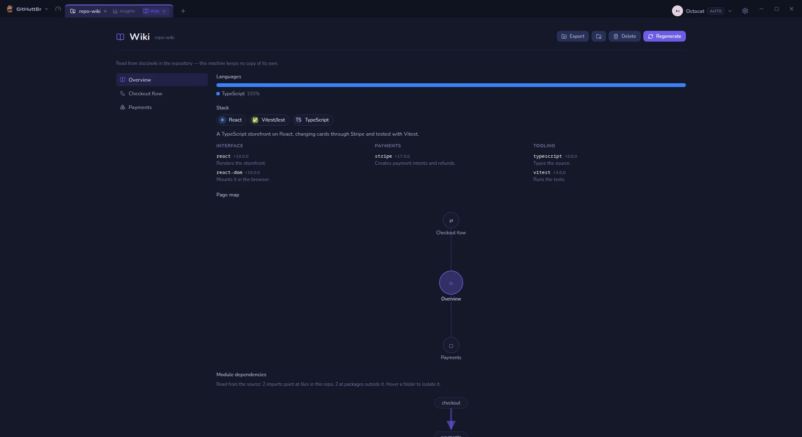

# Repo wiki

Point it at a repository and it writes a short wiki explaining the codebase.

## The repo card

- **Language breakdown** by bytes.
- **The stack** — frameworks shown as badges (Next, Angular, Electron, Tailwind,
  Django…).
- **Dependencies** read straight from your manifests (`package.json`,
  `Cargo.toml`, `go.mod`, `pyproject.toml`, `pubspec.yaml`, `Gemfile`…) and
  grouped by architectural role. Scaffolding — type stubs, loaders, lint plugins
  — is filtered out first, and only packages the project really declares can
  appear.
- **A module dependency graph**, parsed from the source (JS/TS, Python, Go,
  Rust, Dart, Ruby, C/C++, PHP) and resolved against the repo's own files, so a
  package import never becomes a fake edge.

## The written pages

GitHuttBr plans a handful of pages from the files the repository tracks — docs and
manifests first, then whatever churns most — and writes each page from the files
it covers.

**Every statement cites the file it came from**, and a claim no file supports is
rejected rather than published. Pages are written in parallel and stored in one
go, so a failed run never replaces a good wiki. It tells you when the wiki was
written at an older commit.

## Generating in the background

Writing a wiki takes a while — one model call per page. The run belongs to the
app, not to the page: leave the wiki for another tab or repository and it keeps
going. Come back and the page shows where it is (*Planning…*, then each page as
it lands) with **Generate** held off, so a second click cannot start a second,
competing run. The *Wiki generated* toast arrives wherever you are.

**Cancel** stops it. Nothing is lost: the previous wiki is only replaced once
every page is written, so a cancelled run leaves it exactly as it was. Cancel
ends the request in flight — the HTTP call, or the CLI process for a CLI account
— but a provider may still bill the tokens it had already produced.

Closing the window cancels a run that window started.

## Export

**Export** writes the whole thing into `docs/wiki/` as linked Markdown — so it
can be committed, reviewed in a PR, and read on your host. The tooltip names the
folder it writes to.

The folder icon beside it picks **another folder** for this repository — any
folder inside it except the root (where the export's `README.md` would replace
the project's own) and `.git`. Choosing `docs/wiki` again goes back to the
default. Export only ever replaces files it wrote itself: if the folder already
holds a `README.md` or a page of the same name that came from somewhere else, it
writes nothing and names those files.

### A wiki already in the repository

When this machine has no wiki of its own for the repository — it was generated
on a teammate's machine, or before a reinstall — the page reads the one in the
wiki folder instead, and says so. It is judged by the commit stamped in it: up
to date at that commit, behind after it.

What a read-back wiki cannot have: the model that wrote it, and anything from an
export made before this version stamped the stack and the page kinds into it —
those pages read as plain modules, with no stack card. A page edited by hand
shows as edited, but its **Sources** list only keeps the lines still written the
way the export writes them. **Regenerate** writes a fresh one, stored on this
machine, which then takes precedence.

**Delete** on a read-back wiki deletes it from the repository, so it asks first.
It removes only the files the export wrote — they carry its *Generated by* note
— and leaves anything else in the folder. Committed files come back with git;
uncommitted ones do not.

Secret-looking files are never sent.

**See also:** [AI features](ai.md)
