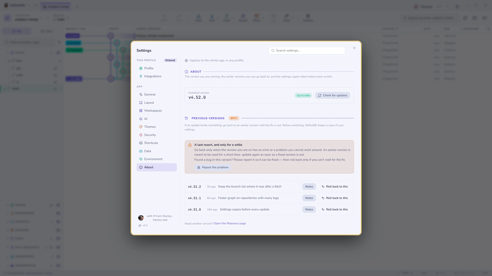

# Going back to an earlier version

An update can break the one thing you needed today. Waiting for the fix is
fine when it is a cosmetic slip; it is not when it is the push button. Going
back used to mean finding the old installer on the Releases page, reinstalling
by hand, and hoping the older build would read the settings the newer one wrote.

**Settings → About → Previous versions** does it from inside the app: pick a
version, confirm, and Gitcito copies your settings, downloads that version,
restarts in it, and stops offering the version you left.

## What happens when you roll back

| Step | What it does |
|------|--------------|
| **Copy the settings** | A copy of the settings file goes into `settings-backups/`, beside the settings. Without it nothing else happens. |
| **Download and install** | The updater downloads the version from its own release, signed and checksummed like any update, and restarts into it. |
| **Skip the version you left** | That version, and anything older, is never offered as an update again. The next update offered is one released *after* it — the one with the fix. |

The confirmation also says what the older version will not understand, and what
may happen to saved tokens (see [Limits](#limits)). Tick **Show the notes** to
open that version's release notes once it starts.

## After going back

The older version opens with a band at the top: *You went back from vX to vY.
vX will not be offered again.* **Report the problem** opens a GitHub issue
already filled in with both versions, so the fix can start from what broke.
Close the band when you have read it.

This works even when you went back without the app — a package manager, an old
installer: at start-up Gitcito compares the version that ran last with the one
running now, and a step back is treated the same way.

## When the fix is out

Once a newer version is offered and installed, Gitcito checks whether your
settings changed while you were on the older one. If they did, it asks once:

| Choice | Result |
|--------|--------|
| **Restore the copy** | Brings back the settings copied just before you went back, with everything they had. |
| **Keep as it is** | Leaves the settings as they are now. |

Nothing changed, nothing is asked.

## Settings copies

A copy is taken before **every** version switch — rollbacks and ordinary
updates alike (when the download finishes, and again when you restart to
install). Settings → About lists them, newest first, with the version that made
each one and where it was going.

- **Restore** asks first, then copies the settings as they are now — so a
  restore can itself be undone — and writes the chosen copy back. Open tabs and
  workspaces stay as they are; the copy brings back preferences, profiles and
  repository settings.
- **Show in folder** opens the copy in your file manager. It is plain JSON.

The newest five are kept. The copy a pending rollback still needs is kept even
when it is older.

**No copy holds a token or key.** Tokens and AI keys live in the system keychain
store, which a version switch never touches; a restored profile gets its tokens
back because they are filed under the profile, not in the settings.

## Why a newer version's settings survive

Every settings key a version does not know is kept as it is when that version
saves, and written back unchanged — so going back and then forward again loses
nothing. The settings file also records a format number (`settingsFormat`),
raised whenever a release adds settings an earlier one would not know.

One exception, on purpose: an unknown key whose name looks like a credential
(`token`, `secret`, `password`, `apiKey`, …) is **dropped**, not kept. No
version writes a credential into the settings file — they go to the keychain —
so such a key could only be a mistake, and a mistake is better lost than kept
in plain text.

## Limits

- **Only versions after 4.50.0.** Earlier versions do not promise to keep
  settings they do not know, and they know nothing of rollbacks: they would
  offer the version you just left as an update straight away. They are listed
  with that reason, and remain on the [Releases page](https://github.com/StarleyDev/githuttbr/releases).
- **Installed builds only.** The AppImage, the `.deb`, the Windows installer
  and the macOS app replace themselves. The `.deb` asks for the administrator
  password, as an update does. Any other package, and a development run, says
  so and points at the Releases page instead.
- **A release without your system's files** (a macOS build not uploaded yet)
  cannot be installed in place; the error says so.
- **Saved tokens.** If the way the keychain store is written changed between the
  two versions, the older one may not read your saved tokens. They show as
  unreadable — [nothing is deleted](security.md#when-the-saved-tokens-cannot-be-read).
  Update again, or type them again.
- **Settings an older version does not know have no effect there.** They come
  back to life when you update. A value an older version does not recognise in
  a setting it *does* know (a new theme, a new column) falls back to its default
  there, as it always has.
- **The list needs GitHub.** It is read from the public releases, without a
  token. Offline or rate-limited, it says so; the Releases page still works.
