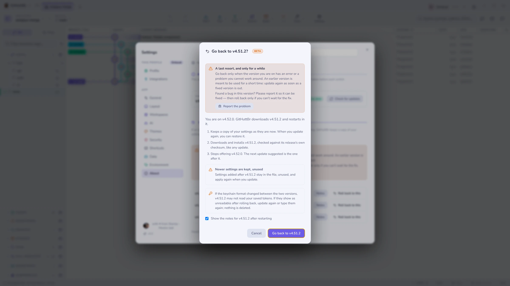

# Going back to an earlier version

An update can break the one thing you needed today. Waiting for the fix is
fine when it is a cosmetic slip; it is not when it is the push button. Going
back used to mean finding the old installer on the Releases page, reinstalling
by hand, and hoping the older build would read the settings the newer one wrote.

**Settings → About → Previous versions** does it from inside the app: pick a
version, confirm, and GitHuttBr copies your settings, downloads that version,
restarts in it, and stops offering the version you left. **Cancel** stops it
while it is still downloading; nothing is installed.

> **Beta.** Going back is new, and marked so in Settings and in the
> confirmation.

## A last resort, and only for a while

Go back only when the version you are on has an error or a problem you cannot
work around. An earlier version is a stopgap, not a place to stay: it misses
the fixes and features that came after it, and the version you left is not
offered again — so update as soon as a fixed version is out.

Before that, **report the bug**. Both the warning above the list and the
confirmation have a **Report the problem** button that opens a GitHub issue
already filled in with the version you are on (and, in the confirmation, the
version you are going back to). A rollback without a report leaves the bug in
place for the next update too.

## Which versions are offered

Only the **three most recent** earlier versions, newest first — published
releases, never a pre-release, never one older than 4.50.0 (see
[Limits](#limits)), and never the version a previous rollback left. A problem in
the latest release is fixed by the next one; going further back than a few
versions trades one problem for many others.

Anything older is a download away: **Need another version? Open the Releases
page** under the list opens the repository's Releases page, where every version
is kept. The app checks the same rule again before it installs anything, so a
version outside these three is refused even if asked for.

## What happens when you roll back

| Step | What it does |
|------|--------------|
| **Copy the settings** | A copy of the settings file goes into `settings-backups/`, beside the settings. Without it nothing else happens. |
| **Download and install** | The updater downloads the version from its own release — checked against the checksum that release published, like any update — and restarts into it. |
| **Skip the version you left** | That version, and anything older, is never offered as an update again. The next update offered is one released *after* it — the one with the fix. |

The confirmation also says what the older version will not understand, and what
may happen to saved tokens (see [Limits](#limits)). Tick **Show the notes** to
open that version's release notes once it starts.

## After going back

The older version opens with a band at the top: *You went back from vX to vY.
vX will not be offered again.* **Report the problem** opens a GitHub issue
already filled in with both versions, so the fix can start from what broke.
Close the band when you have read it.

This works even when you went back without the app — a package manager, an old
installer: at start-up GitHuttBr compares the version that ran last with the one
running now, and a step back is treated the same way.

## When the fix is out

Once a newer version is offered and installed, GitHuttBr checks whether your
settings changed while you were on the older one. If they did, it asks once:

| Choice | Result |
|--------|--------|
| **Restore the copy** | Brings back the settings copied just before you went back, with everything they had. |
| **Keep as it is** | Leaves the settings as they are now. |

Nothing changed, nothing is asked.

## Settings copies

A copy is taken before **every** version switch — rollbacks and ordinary
updates alike (when the download finishes, and again when you restart to
install). Settings → About lists them, newest first, with the version that made
each one and where it was going.

- **Restore** asks first, then copies the settings as they are now — so a
  restore can itself be undone, and is refused if that copy cannot be made —
  and writes the chosen copy back. It brings back preferences, profiles and
  repository settings. Open tabs and workspaces stay as they are, and so do
  profiles, servers and AI accounts added since the copy: their tokens and keys
  are filed under them, and dropping them would lose those for good.
- **Show in folder** opens the copy in your file manager. It is plain JSON.

The newest five are kept. The copy a pending rollback still needs is kept even
when it is older.

**No copy holds a token or key.** Tokens and AI keys live in the system keychain
store, which a version switch never touches; a restored profile gets its tokens
back because they are filed under the profile, not in the settings. Where a
token still sits in the settings file itself (the keychain declined, Linux
without a keyring), a restore writes it back onto its profile untouched.

When GitHuttBr asks whether to restore after an update, it compares the copy
with the settings now, ignoring tokens, key order, and fields only the current
settings have (an older version fills a profile with its own defaults; that is
not your change). Something removed — a shortcut, an alias, a favourite — does
count.

## Why a newer version's settings survive

Every top-level settings key a version does not know — and every field it does
not know on a profile — is kept as it is when that version saves, and written
back unchanged, so going back and then forward again loses no setting. (A
*value* it does not know inside a setting it does is another matter; see
[Limits](#limits).) The settings file also records a format number (`settingsFormat`),
raised whenever a release adds settings an earlier one would not know.

One exception, on purpose: an unknown key that holds something shaped like a
credential — text under a name ending in `token`, `secret`, `password`,
`apiKey` and the like, or an address with a user and password in it or a
`?token=`-style parameter, at any depth — is **dropped whole**, not kept. No version writes a credential into the
settings file — they go to the keychain — so such a key could only be a
mistake, and a mistake is better lost than kept in plain text. A flag such as
`showTokenUsage: true` is not a credential and is kept; a plain word under such
a name (`auth: "oauth"`) is dropped all the same — the rule errs on the safe side.

## Limits

- **Only versions after 4.50.0.** Earlier versions do not promise to keep
  settings they do not know, and they know nothing of rollbacks: they would
  offer the version you just left as an update straight away. They are listed
  with that reason, and remain on the [Releases page](https://github.com/StarleyDev/githuttbr/releases).
- **Installed builds only.** The AppImage, the `.deb`, the Windows installer
  and the macOS app replace themselves. The `.deb` asks for the administrator
  password, as an update does. Any other package, and a development run, says
  so and points at the Releases page instead.
- **A release without your system's files** (a macOS build not uploaded yet)
  cannot be installed in place; the error says so.
- **macOS only installs a signed build.** Squirrel.Mac, which replaces the app,
  refuses a build not signed like the one running; a release published without
  a signature has to be downloaded from the Releases page.
- **Checksums, not signatures, elsewhere.** On Linux and Windows the download is
  checked against the checksum its release published, exactly as an update is;
  the builds themselves are not code-signed.
- **Saved tokens.** If the way the keychain store is written changed between the
  two versions, the older one may not read your saved tokens. They show as
  unreadable — [nothing is deleted](security.md#when-the-saved-tokens-cannot-be-read).
  Update again, or type them again.
- **Settings an older version does not know have no effect there.** They come
  back to life when you update. A value an older version does not recognise in
  a setting it *does* know (a new theme, a new column) falls back to its default
  there, as it always has — and after updating, that reset counts as a change
  when GitHuttBr asks whether to restore the copy.
- **Three versions, no more.** An older version is installed by hand from the
  Releases page, without the settings copy, the skipped version or the banner.
- **The list needs GitHub.** It is read from the public releases, without a
  token. Offline or rate-limited, it says so; the Releases page still works.
