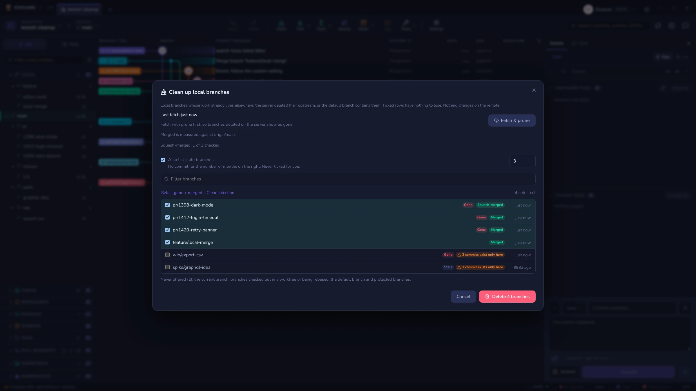

# Очистка веток

Каждый пул-реквест, на который вы делаете чекаут, оставляет после себя локальную
ветку. PR сливают, сервер удаляет его ветку, а локальная остаётся — навсегда. После
нескольких сотен ревью список веток почти целиком состоит из мёртвых веток, и чтобы
найти живые, приходится пролистать их все.

Очистка веток показывает локальные ветки, работа которых уже в безопасности в
другом месте, отмечает те, где нечего терять, и удаляет их за один шаг, который
можно отменить. «В другом месте» означает удалённые отслеживаемые ветки на момент
последнего фетча и ветку по умолчанию.

## Как это работает

1. Инструменты → **Очистить локальные ветки…** (или <kbd>⌘K</kbd>).
2. Сначала нажмите **Fetch и prune**, если последний фетч давний. Пока не прошёл
   фетч с prune, ветка, которую сервер удалил, выглядит здесь живой.
3. Если ваша команда сливает пул-реквесты через squash, нажмите **Проверить
   squash-слияния** (см. ниже).
4. Проверьте отметки, затем **Удалить**. Одно подтверждение говорит, сколько веток
   уйдёт, и называет каждую, в которой есть коммиты, которых нет больше нигде.

Удаление — одна операция с одной записью для отмены: **Отменить** заново создаёт
каждую удалённую ветку ровно на том коммите, на который она указывала, вместе с её
upstream (`branch.<name>.remote` и `.merge`). Если с тех пор на другом коммите
появилась ветка с тем же именем — тот же PR снова взят на чекаут, — отмена её не
трогает и возвращает удалённую рядом, как `<name>-restored-<short sha>`, и говорит
об этом.

Сообщение об успехе и запись для отмены перечисляют каждую ветку с коммитом, на
который она указывала (`feature/x (was abc1234)`), как это печатает `git branch -D`:
история отмен живёт, только пока приложение открыто, а этой строки хватает, чтобы
пересоздать ветку вручную.

## Почему ветка в списке

| Метка | Значит |
|---|---|
| **Пропала** | Ветка отслеживает upstream, который сервер удалил, — обычный след слитого пул-реквеста. |
| **Слита** | Каждый её коммит уже есть в ветке по умолчанию. Подсказка называет копию, где он есть, — `main (local, not pushed)`, когда только ваша локальная. |
| **Squash** | Найдена через **Проверить squash-слияния**: её содержимое есть в ветке по умолчанию, отдельные коммиты — нет. |
| **Заброшена** | Нет коммитов столько месяцев, сколько вы выберете (по умолчанию 3). Показывается, только если отметить **Показывать и заброшенные ветки**. |
| **Коммитов только здесь: N** | Коммиты, которых нет ни на одной удалённой отслеживаемой ветке и в ветке по умолчанию. Удаление ветки удаляет и их. |
| **Пока без коммитов** | Указывает ровно на вершину ветки по умолчанию — вероятно, создана и не использовалась. |

«Слита» измеряется относительно удалённой копии ветки по умолчанию (`origin/main`) и
относительно вашей локальной — локальный `main`, который месяц никто не обновлял, не
спрячет слияния, сделанные с тех пор.

## Squash-слияния

Squash-слияние кладёт изменения пул-реквеста на `main` одним новым коммитом;
собственные коммиты ветки туда так и не попадают. Для git такая ветка выглядит как
брошенная работа: **Пропала**, с *Коммитов только здесь: N*.

Когда в списке есть пропавшие ветки со своими коммитами, **Проверить
squash-слияния** задаёт другой вопрос: изменит ли что-нибудь слияние этой ветки в
`main`? Она запускает один `git merge-tree` в памяти для всех — без чекаута, без
индекса, — и ветка, слияние которой оставляет дерево `main` ровно таким, как есть,
получает метку **Squash** и отмечается как слитая. Подтверждение говорит, что их
содержимое есть в `main`, а коммиты — нет.

Проверка повторяется, под блокировкой, в момент удаления: ветка, которая её больше не
проходит, отклоняется, а не удаляется.

## Что отмечено, а что никогда

Отмечены при открытии диалога: ветки **пропавшие или слитые** без **собственных
коммитов** — плюс слитые через squash после проверки. **Выбрать пропавшие + слитые**
возвращает этот выбор.

Никогда не отмечается за вас и никогда не попадает под **Выбрать все показанные**:
ветка с коммитами, которые есть только здесь. Отмечайте её построчно; тогда
подтверждение становится красным и перечисляет её с числом коммитов. Ветки, которые
только заброшены, и ветка, стоящая на вершине ветки по умолчанию, тоже не
отмечаются. Когда в выбор входят строки, которые список не показывает, — скрытые
фильтром или за пределами первых 400, — подтверждение говорит, сколько их.

Удаление принимает для каждой ветки ровно то число уникальных коммитов, которое
показало подтверждение. Если к тому времени у ветки их больше — или при **Вернуть**
она получила новые после отмены (например, prune убрал удалённую копию), — она
отклоняется и остаётся, а повтор сообщает об этом, а не об успехе.

Никогда не показываются и отклоняются при удалении, даже если попросить:

- текущая ветка;
- ветка, взятая на чекаут в любом рабочем дереве или находящаяся там в ребейзе;
- ветка по умолчанию;
- [защищённые ветки](repo-settings.md), включая шаблоны вроде `release/*` из
  [конфигурации репозитория](repo-config.md).

На удалённом репозитории ничего не меняется. Это удаляет только локальные ветки.

## Ограничения

- **Squash-слияния невидимы для git**, пока вы не проверите. Без **Проверить
  squash-слияния** ветка, слитая через squash, выглядит как **Пропала** с *Коммитов
  только здесь: N* и не отмечается.
- **Проверка squash может промахнуться.** Она отвечает на вопрос «это содержимое
  уже есть в `main`?». Если `main` потом ещё раз изменил те же строки или squash
  правили при слиянии, слияние что-то изменило бы, и ветка остаётся неотмеченной.
  Она никогда не говорит «да» ошибочно так, чтобы потерялось содержимое: содержимое
  по определению есть в `main`. Как и [радар конфликтов](conflict-radar.md), она
  пишет свободные объекты деревьев, которые убирает `git gc`.
- **Не обновлённый фетчем remote устарел.** «Пропала» берётся из последнего фетча.
  Без **Fetch и prune** ветка, удалённая на сервере час назад, всё ещё выглядит
  живой, а свежее слияние ещё не попало в `origin/main`.
- **Заброшенность — это только дата.** Три тихих месяца ничего не говорят о том, в
  безопасности ли работа, поэтому заброшенные строки никогда не отмечаются.
- **«В другом месте» — это удалённые отслеживаемые ссылки на момент последнего
  фетча**, а не сервер прямо сейчас — и не теги. Коммит, который держит только тег,
  считается уникальным, а коммит на чужой удалённой ветке — нет.
- Счётчик уникальных коммитов останавливается на 500 и показывает *500+*. Итог в
  подтверждении — нижняя граница, *не меньше N*, потому что ветки-стопки делят
  коммиты.
- Отмена восстанавливает ветку и её upstream, но не её reflog и другие настройки
  `branch.<name>.*`.
- Диалог показывает первые 400 строк длинного списка; фильтр находит остальные.
  **Выбрать пропавшие + слитые** действует на все строки, показанные или нет.

**См. также:** [Ветки, удалённые репозитории и боковая панель](branching.md) · [Фетч, пул и пуш](syncing.md) · [Страница пул-реквестов](pull-requests.md)
