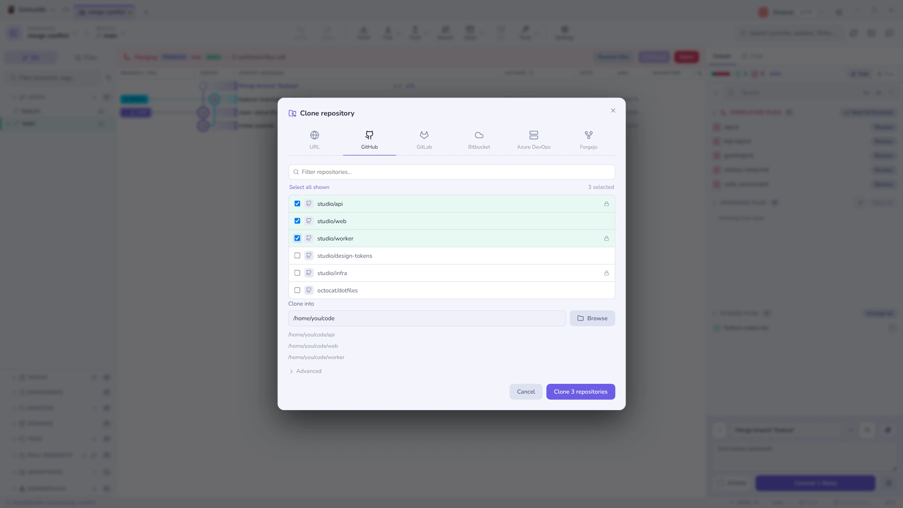
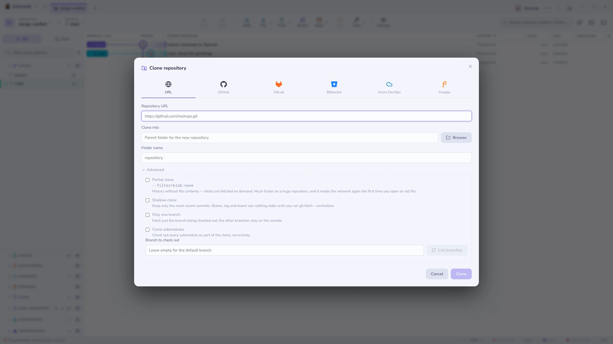

# Клонирование

**Новый репозиторий → Клонировать** или `⌘K` → *Клонировать*. Вставьте URL —
либо войдите в GitHub, GitLab, Bitbucket или Azure DevOps и выберите из
собственных репозиториев: токен выбранного [профиля](profiles.md) используется
для клонирования и затем отбрасывается, в `.git/config` он не попадает никогда.

Выберите родительскую папку и имя; строка под полями показывает, куда именно
ляжет репозиторий. Уже существующая папка будет отвергнута, а не дополнена.

## Несколько репозиториев сразу

Настроить новую машину или скачать все сервисы команды раньше означало открыть
этот диалог отдельно для каждого репозитория. На вкладке хостинга отметьте
флажок у каждого нужного репозитория или нажмите **Выбрать все показанные**,
чтобы взять всё, что подходит под фильтр. Щелчок по строке (не по флажку)
по-прежнему выбирает только её.

Если отмечено больше одного, диалог клонирует их все в одну родительскую папку,
каждый — в папку с именем репозитория. Пути показываются списком до начала. Если
у двух одинаковые имена (`org-a/app` и `org-b/app`), оба получают владельца в
имени папки (`org-a-app`, `org-b-app`), а не соревнуются за одну папку.

Пакет сразу уходит в лоток в углу. Одновременно идут три клонирования, остальные
ждут со статусом *В очереди*; у каждого своя кнопка отмены. Каждый репозиторий
открывается во вкладке, как только готов.

Ограничения:
- **Ветка для переключения** для пакета скрыта: имя ветки ничего не значит для
  разных репозиториев, поэтому каждый получает свою ветку по умолчанию. Остальные
  параметры раздела «Дополнительно» (частичный, поверхностный, одна ветка,
  сабмодули) применяются ко всем.
- Множественный выбор работает только на вкладках хостинга. Вкладка URL
  принимает один URL.
- Одна ошибка не останавливает остальные. Репозиторий, папка которого уже
  существует, завершается своей ошибкой, а остальные продолжают.

## Дополнительно — как сузить клон

Всё под пунктом **Дополнительно** по умолчанию выключено: не трогайте его — и
получите обычный полный клон. Своё место эти настройки оправдывают на
репозиториях, где «полный» означает двадцать минут и несколько гигабайт.

| Параметр | Что делает git | Чего это стоит |
|--------|---------------|---------------|
| **Частичный клон** | `--filter=blob:none` | Вся история, без содержимого файлов. Блобы приходят по требованию, так что для открытия старого файла нужна сеть. |
| **Поверхностный клон** | `--depth=N` | Существуют только N новейших коммитов. Blame, log, bisect и range-diff обрываются на срезе. |
| **Только одна ветка** | `--single-branch` | Остальные ветки остаются на удалённом репозитории, пока вы их не зафетчите. |
| **Клонировать сабмодули** | `--recurse-submodules` | Каждый сабмодуль тоже выгружается — больше времени сейчас, никаких пропавших каталогов потом. |
| **Ветка для переключения** | `--branch <name>` | Начинает с этой ветки, а не с ветки по умолчанию на удалённом репозитории. |

**Частичный раньше поверхностного.** Частичный клон сохраняет все коммиты —
история остаётся доступной для поиска, лениво подтягивается только содержимое
файлов. Поверхностный клон историю действительно выбрасывает: `git log`
обрывается на срезе, и blame не видит дальше него. Если вы клонируете монорепо,
чтобы в нём работать, обычно вам нужен частичный.

Поверхностный обратим: `git fetch --unshallow` в [терминале](terminal.md)
дозаполняет историю обратно.

### Выбор ветки

Введите имя ветки или нажмите **Показать ветки**, чтобы спросить у удалённого
репозитория, что у него есть (`git ls-remote --heads`), и выбрать из списка. Это
один сетевой запрос, выполняемый только по нажатию кнопки, — пока вы печатаете,
ничего не запрашивается.

Если получить список не удалось — приватный URL без токена, опечатка, нет
сети, — поле остаётся обычным текстовым, а само клонирование сообщит настоящую
ошибку.

### Две заметки о флагах

- **`--depth` подразумевает `--single-branch`.** При поверхностном клоне снятый
  флажок *Только одна ветка* — это и есть просьба вернуть остальные ветки
  (`--no-single-branch`), поэтому подсказка под ним меняется.
- **При клонировании локальной папки** `--depth` обычно игнорируется целиком,
  потому что git делает жёсткие ссылки на хранилище объектов вместо загрузки.
  Когда вы просите поверхностную копию локального репозитория, Gitcito клонирует
  через URL вида `file://`, так что запрошенная глубина — это та глубина, которую
  вы получите.

## Прогресс, фоновый режим и отмена

Полоса сообщает то, что сообщает git: подсчёт, сжатие, приём, разрешение,
выгрузка. Этап, который не может сообщить общий объём, показывает
неопределённую полосу, а не выдуманный процент.

Большое клонирование занимает минуты, и случайный щелчок мимо диалога раньше
стоил их все. Теперь закрытие диалога — **Продолжить в фоне**, `Esc`, ✕ или
щелчок снаружи — только прячет его: клонирование продолжается и переезжает в
маленькую карточку в нижнем углу с той же полосой прогресса. Тем временем можно
начать другое клонирование; у каждого своя карточка.

Выбрали не тот репозиторий? **Отменить клонирование** в диалоге или ✕ на его
карточке останавливает git и удаляет недописанную папку. Больше ничего не
затрагивается — папки не было до начала клонирования, и это проверяется заранее.
Отменённое клонирование нельзя возобновить; повторный запуск начинает с нуля.

Когда клонирование завершается, новый репозиторий открывается во вкладке,
закреплённой за профилем, с которым вы клонировали, — открыт диалог или нет.

Клонирование идёт внутри приложения, поэтому выход из Gitcito его прерывает.
Выход не ждёт очистки, так что недописанная папка может остаться — удалите её,
прежде чем снова клонировать туда, ведь диалог отвергает существующую папку.
