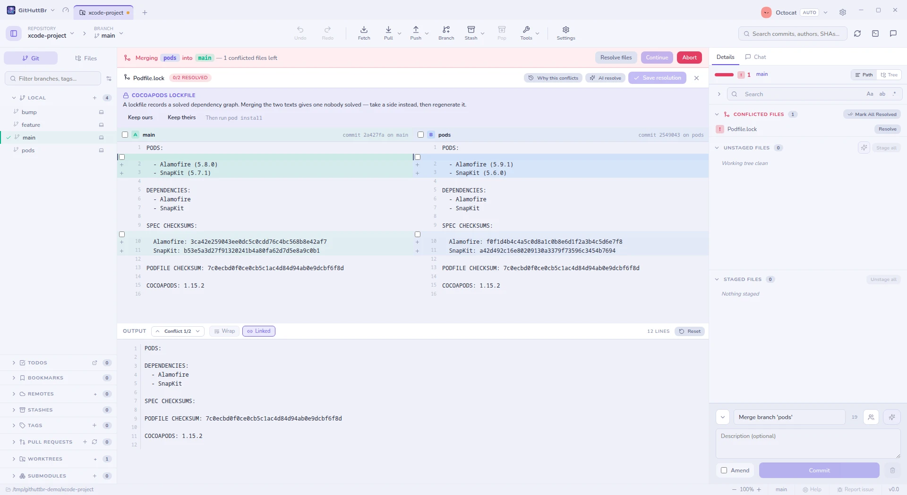

# Разрешение конфликтов

Когда слияние, ребейз, cherry-pick или revert останавливается, резолвер
превращает весь шаг в один экран. Полоса сверху сообщает, **что** остановилось и
**между чем** — «Слияние `feature` в `main`», а не просто «конфликт», — и
насколько вы продвинулись: *2 из 5 файлов решено*, плюс сколько конфликтов ещё
осталось во всех файлах.

## Лента файлов

Под полосой — по одному чипу на каждый файл, на котором остановился этот шаг:

| Чип | Означает |
|---|---|
| Зелёный с ✓ | Решён — в индексе, решать больше нечего |
| С обводкой | Файл, на котором вы сейчас |
| Красное число | Сколько блоков конфликта ещё осталось в файле |
| Метка | Конфликт без текста для слияния: *удалён с одной стороны*, *переименован с обеих сторон*, *добавлен с одной стороны* |

Решённые чипы идут первыми, открытые — после, каждая группа по имени, так что
лента читается как «сделано» слева и «осталось» справа.

**Следующий файл →** переходит к следующему ещё открытому, а отметка файла как
решённого сама переводит вас туда. **Продолжить** в полосе остаётся
неактивной, пока все чипы не станут зелёными; **Прервать** сначала спрашивает и
говорит, что вы теряете.

git забывает файл в момент, когда тот попадает в индекс, поэтому «решён» — это
то, что GitHuttBr видел во время этого шага, плюс файлы, которые git перечислил
в своём сообщении слияния. Файл, проиндексированный в терминале до открытия
резолвера, всё равно считается; после перезапуска посреди ребейза решённая
половина этого одного шага может не учитываться.

## Почему тут конфликт

**Почему здесь конфликт** в шапке файла перечисляет по каждой стороне коммиты,
которые трогали этот файл с момента расхождения веток, — это `git log --merge`,
который есть в git испокон веков и которого никто не находит.

Маркеры говорят, что столкнулось. Это говорит, кто это изменил и зачем, — а
именно это обычно и решает исход. Пусто — значит, ни одна сторона не коммитила
изменение именно этого пути: столкновение пришло из переименования или переноса.

Шапка также говорит, на каком вы конфликте и какого рода конфликт в файле, — по
собственному статусу git: *обе стороны изменили одни и те же строки*, *добавлен
с обеих сторон*.

## Три панели

| Панель | Это |
|---|---|
| **Ваша сторона** | Сторона, на которой вы были; в заголовке — самый новый коммит этой стороны, трогавший файл: sha, тема, автор, как давно |
| **База** | Версия, с которой начинали обе стороны, — общий предок, а для pick или шага ребейза — родитель применяемого коммита. Строки, которые заменил каждый конфликт, затенены |
| **Входящие** | Приходящая сторона, с таким же заголовком, как у вашей |

**Показать базу** в шапке результата скрывает или показывает панель База и
запоминает ваш выбор. Она недоступна, когда базы нет, — обе стороны добавили
файл.

Все панели меняют размер, а в шапке результата живут два переключателя вида:

| Переключатель | Что делает |
|---|---|
| **Перенос** | Переносит длинные строки в боковых панелях вместо прокрутки. Текстовый вид результата держит один ряд на строку — от этого зависят его боковые маркеры, — поэтому он всегда прокручивается |
| **Связать прокрутку** | Прокручивает панели и результат вместе, по вертикали и по горизонтали. Число строк у них разное, поэтому вертикальная позиция подгоняется пропорционально |

Перенос сначала выключен, Связать прокрутку сначала включено, и оба запоминают
своё состояние.

## Результат

Результат — это файл в том виде, в каком он будет записан. Каждый конфликт стоит
на своём месте карточкой с четырьмя ответами:

| Ответ | Что попадает в файл |
|---|---|
| **Взять ваше** | Ваши строки, и только ваши |
| **Взять их** | Их строки, и только их |
| **Оба** | Ваши строки, затем их |
| **Править** | Обе стороны, открытые в текстовом редакторе с выделенным конфликтом, — на случай, когда ответ «оба, но подправить» |

Карточка без ответа показывает обе стороны заранее: каждая строка помечена *←
ваше* или *← их* и пронумерована строкой, на которую она встанет, если её
выбрать, так что решать можно, не поднимая глаз. В файле с очень длинными
строками ответы остаются на виду, пока код прокручивается под ними вбок. **Весь
файл: ваш | их** в шапке файла отвечает на все конфликты разом.

**Править как текст** переключает результат на обычный редактор для свободного
набора, с числом строк файла в шапке. Как только вы что-то набрали, карточки уже
не описывают то, что там есть, поэтому текст остаётся, пока **Сбросить выбор**
не вернёт всё назад.

Подвал считает, что осталось в этом файле; **Отметить *файл* как решённый**
записывает результат и индексирует его и остаётся неактивной, пока у каждого
конфликта нет ответа.

## Как перемещаться

Открыв файл, вы попадаете на его **первый конфликт**, а не в начало файла.
Стрелки ⌃ / ⌄ в шапке результата — или <kbd>Alt+↑</kbd> / <kbd>Alt+↓</kbd> —
проходят по остальным, прокручивая каждую панель к каждому из них.

## Выбор по строкам

Боковые панели по-прежнему выбирают по **строке** и по **фрагменту**, а флажок в
их шапке берёт **всю сторону** — для ответа, которого нет ни на одной карточке,
например двух ваших строк и одной их. Выбор по строкам сразу отражается в
карточках.

## Файлы, в которых нечего сливать

У некоторых конфликтов нет строк для сравнения: одна сторона **удалила** файл,
который другая изменила, или обе стороны **переименовали** его в разные имена.
Три панели, одна из которых пуста, ничего бы не объяснили, поэтому здесь вместо
них карточка — кто что сделал, с коммитом, автором и давностью каждой стороны.

| Случай | Выбор |
|---|---|
| Удалён с одной стороны | **Оставить файл** (с изменениями, которые внесла другая сторона), **Удалить файл** (сначала спрашивает) и **Посмотреть ваши изменения** — diff от базы, чтобы вы знали, что выбрасывает удаление |
| Переименован с обеих сторон | **Оставить** одно имя, другое или **Оставить оба имени** |

git не записывает связи между переименованным оригиналом и двумя его новыми
именами, поэтому карточка сопоставляет их по содержимому. Когда понять нельзя —
несколько переименований сразу, и файлы к тому же изменены, — она так и
говорит, а новые имена появляются отдельными чипами.

## Завершение

Когда последний файл решён, рабочее пространство не заставляет вас искать
**Продолжить**: карточка подводит итог тому, как были отвечены конфликты, даёт
отредактировать сообщение слияния (заранее заполненное сообщением самого git) и
завершает прямо оттуда.

- Итог считает то, что видел, как вы выбирали: ваше, их, оба, правлено вручную.
  Файл, решённый вне резолвера, считается как файл, а не как ответ.
- Шаг **ребейза** сохраняет собственное сообщение повторяемого коммита, поэтому
  поля для сообщения у него нет.
- **Запомнить эти решения (rerere) на следующий раз** — это `rerere.enabled` из
  git, тот же переключатель, что и в настройках. git запоминает только
  конфликты, которые видел, поэтому включение здесь подействует со следующего.
- **Проверить ещё раз** закрывает резолвер, оставляя проиндексированный
  результат.

## Отмена

У каждого решения — файл отмечен решённым, взята сторона, файл оставлен или
удалён, переименование улажено — есть запись отмены. Отмена возвращает конфликт
ровно таким, каким его оставил git: маркеры, обе стороны и база в индексе, файл
на диске. **Прервать** — единственное, что отменить нельзя, поэтому оно и
спрашивает.

## Помощь ИИ

Если ИИ включён, **Разрешить с ИИ** предлагает вариант слияния в результат, в
виде текста. Сам он ничего не применяет: вы читаете, правите и индексируете. См.
[возможности ИИ](ai.md).

## Файлы проектов Xcode

`project.pbxproj` конфликтует чаще любого другого файла в iOS-репозитории — и
почти никогда потому, что кто-то с кем-то не согласился. Это один плоский
словарь объектов с 24-значными шестнадцатеричными ключами, поэтому добавление
одного файла пишет четыре записи: `PBXBuildFile`, `PBXFileReference`, строку в
`children` содержащей группы и строку в фазе сборки цели. Двое, добавивших по
файлу, пишут восемь записей, попадающих в одни и те же несколько строк. Git
видит столкновение; разрешать нечего.

Когда конфликтует именно `project.pbxproj`, редактор конфликтов читает все три
версии как проекты, а не как текст, и предлагает **слить по структуре**:
сопоставить объекты по идентификатору, взять каждое добавление с обеих сторон,
объединить массивы `children` и `files` и остановиться на том, что действительно
разошлось. Полоса над панелями говорит, что добавила каждая сторона и что — если
что-то — осталось на вас.

Как и предложение ИИ, слияние попадает в результат и ничего не
индексирует. Вы читаете его перед сохранением.

### Чего он не делает

**Он никогда не угадывает настройку, которую сдвинули оба.** Если вы поставили
`MARKETING_VERSION` в `1.1`, а они — в `2.0`, это решение, и оно названо в полосе
— настройка, ваше значение, их — вместо того чтобы разрешиться за вашей спиной.
Объект, который не удалось уладить, сохраняет *вашу* версию в точности, чтобы
наполовину применённое слияние никогда не попало на диск.

**Он отказывается от файла целиком, если хоть одна из трёх версий не
разбирается.** `project.pbxproj`, который Xcode не откроет, стоит дороже ручного
слияния, поэтому всё, что нельзя прочитать с уверенностью, остаётся обычным
текстовым конфликтом, и об этом сказано прямо.

**Он не распознаёт два идентификатора, выданных разным объектам.** Редкость, ведь
Xcode выбирает их случайно, — но если это случилось, взять любую сторону значило
бы молча потерять чей-то файл, поэтому о таком сообщают, а не сливают.

### Не `merge=union`

Ходячее средство от этого — `*.pbxproj merge=union` в
[`.gitattributes`](attributes.md). Не надо. Union работает, пока единственные
изменения — независимые добавления, а как только двое правят одну настройку
сборки, он выводит обе строки и порождает файл, который Xcode отказывается
открывать, — ровно тогда, когда вы меньше всего склонны внимательно читать
дифф. Структурное слияние даёт то же удобство без этого отказа.

## Lock-файлы

`Podfile.lock`, `Package.resolved`, `yarn.lock` и их родня фиксируют граф
зависимостей, который чей-то резолвер уже решил. Половина одного решения,
пришитая к половине другого, — это граф, который никто не решал: он может не
установиться, а если установится, установит то, чего не проверяла ни одна из
веток.

Поэтому, когда конфликтует именно lock-файл, полоса называет инструмент,
которому он принадлежит, предлагает тут же **Оставить наше** и **Оставить их**, и
даёт команду, которая создаст файл заново. Взять одну сторону здесь не
компромисс — это и есть весь метод, а правильным его делает пересоздание.

Три панели никуда не деваются: изредка вы и правда хотите прочитать, что
изменилось — узнаваемую контрольную сумму, ожидаемую версию. Именно от правки
руками это и отговаривает.

## Как не доводить до них вообще

[Радар конфликтов](conflict-radar.md) говорит, какие ветки конфликтнут, ещё до
того как вы начнёте их сливать.

## Пусть git запоминает (rerere)

Ребейзите долгоживущую ветку — и встречаете один и тот же конфликт каждый раз.
`rerere` — *reuse recorded resolution* — ответ git на это: он запоминает, как вы
уладили конфликт, и повторяет этот ответ, когда в следующий раз появится точно
такой же.

**Настройки → Git и синхронизация → Запоминать разрешения конфликтов.** Это пишет
`rerere.enabled` в ваш глобальный конфиг git, так что командная строка ведёт
себя так же.

Когда git ответил за вас, резолвер прямо об этом говорит, вместо того чтобы
показывать пустой экран «маркеров конфликта нет», и предлагает **Забыть это
разрешение** — что стирает память *и* возвращает конфликт, чтобы вы могли
уладить его иначе.

Два момента, о которых стоит знать:

- **Повторённое разрешение не индексируется**, если только вы не включите
  *Автоматически индексировать повторённое разрешение*. Оставьте это
  выключенным: смысл паузы в том, что запомненный ответ может быть неверным
  именно для этого слияния, а индексирование не глядя — это ровно то, как он
  доезжает до коммита.

  Именно поэтому повторённый файл **остаётся в списке конфликтных**: git записал
  содержимое, но в индексе он всё ещё несмёрженный, и только индексирование это
  улаживает. Сдвигает его **Проиндексировать как есть** в резолвере или
  **Отметить всё разрешённым** в списке.
- **rerere понимает не всякий конфликт.** Конфликты «добавлено/добавлено» и
  «удалено/изменено» не дают прообраза, поэтому они всегда возвращаются сырыми.
  Счётчик в настройках показывает, сколько разрешений там реально лежит, а
  **Забыть все** его опустошает.

**См. также:** [Радар конфликтов](conflict-radar.md) · [Слияние и ребейз](merging.md)
