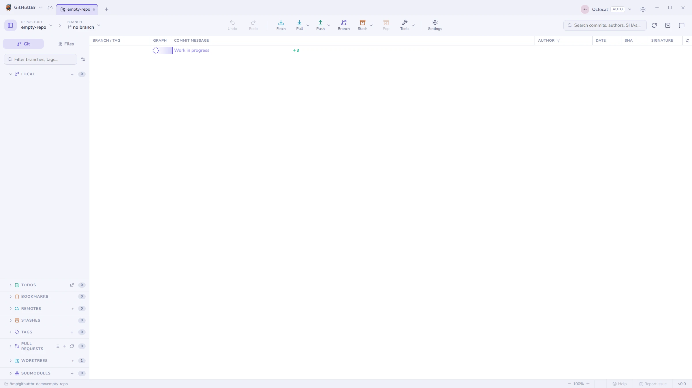

# С чего начать

Gitcito открывает папку и показывает её историю. В ваш репозиторий ничего не
пишется, пока вы сами об этом не попросите.

## Откройте репозиторий

- **Перетащите папку** на окно или нажмите **Открыть репозиторий** на
  приветственном экране. Окно выбора принимает несколько папок сразу: выделите
  их ⌘-щелчком или Shift-щелчком, и каждая откроется в своей вкладке (или
  попадёт в группу, из которой вы открыли окно). Если выбрано несколько папок,
  уже открытый репозиторий или папка, которая не является Git-репозиторием,
  пропускается и называется в сообщении, чтобы остальные всё равно открылись.
  Окно выбора macOS не умеет заранее затенять открытые репозитории: Electron не
  даёт доступа к обработчику панели для отдельных папок, поэтому проверка
  происходит после нажатия «Открыть».
- **Найденные репозитории**, под тремя кнопками, перечисляют все репозитории в
  папках, которые вы поручили Gitcito сканировать, — отметьте несколько и
  откройте их разом или дважды щёлкните по одному. Там же добавляются и
  удаляются эти папки. См. [Репозитории](repositories.md#найденные-репозитории).
- **Нажали не туда?** У «Клонировать», «Создать», «Создать группу» и «Найденные
  репозитории», открытых из «Открыть репозиторий», рядом с заголовком есть
  стрелка **Назад**, которая возвращает туда.
- **Склонируйте** по URL или прямо со своего хостинга — про параметры, которые
  делают клонирование огромного репозитория быстрым, см. [клонирование](cloning.md).
- Из терминала `gitcito .` открывает текущую папку в уже запущенном приложении —
  см. [командную строку](cli.md).
- Одиночная папка, которая пока не является Git-репозиторием, тоже откроется —
  и предложит её инициализировать.

## Три панели

| Панель | Что в ней |
|---|---|
| Слева | Ветки, удалённые репозитории, теги, стеши, рабочие деревья — и вкладка **Файлы** для рабочего дерева |
| В центре | Граф коммитов и то, что вы в нём выбрали |
| Справа | Составитель коммита или подробности выбранного коммита |

## Как найти всё остальное

Два пути, и оба ведут в одни и те же места:

- **`⌘K`** (`Ctrl+K`) — палитра команд. Наберите, что вам нужно; она же
  перепрыгивает к веткам, коммитам и файлам.
- **Инструменты** на панели — тот же набор в пределах репозитория, только меню, с
  длинным хвостом, свёрнутым в группы, чтобы оставалось читаемым.

Когда окно сужается, панель действий перестаёт бороться за место: кнопки, которые уже не помещаются, сворачиваются в меню **Ещё** в её конце — в том же порядке и со своими подменю. Расширьте окно, и они вернутся.

Всё, до чего можно добраться одним способом, достижимо и вторым, так что нет
ничего, что находят только опытные пользователи.

## Ваш первый коммит

1. Отредактируйте файл. Он появится в разделе **Не в индексе**.
2. Добавьте его в индекс — файл целиком, ханк или [отдельные строки](staging.md).
3. Напишите сообщение и нажмите **Коммит**.

Всё остальное в Gitcito необязательно.

