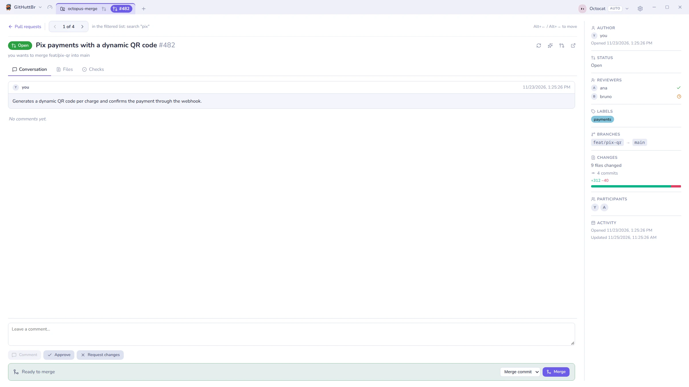

# Страница пул-реквестов

В оживлённом репозитории одновременно открыто двадцать пул-реквестов. Боковая
панель их перечисляет, но одна строка на каждый говорит мало: чей какой, какие
ждут вас, какие покраснели. Чтобы это узнать, приходилось открывать каждый,
читать, возвращаться, открывать следующий. **Страница пул-реквестов** отвечает на
эти вопросы на одном экране, а когда вы открываете пул-реквест, **‹ ›** ведут к
следующему из того же списка без возврата назад.

## Как открыть

- **Значок списка** в заголовке **ПУЛ-РЕКВЕСТЫ** боковой панели (*Все
  пул-реквесты*).
- *Пул-реквесты…* в палитре команд (⌘K) или **Инструменты → Пул-реквесты…**.

Как вики и [запуски CI](ci-runs.md), страница открывается во вкладке
репозитория.

## Вкладки

| Вкладка | Что в ней |
|---|---|
| **Открытые** | Все открытые пул-реквесты, включая черновики |
| **Черновики** | Только открытые, помеченные как черновик |
| **Слитые** | Слитые пул-реквесты, загружаются при первом открытии вкладки |
| **Закрытые** | Закрытые без слияния (отклонённые, заброшенные), загружаются вместе со слитыми |

Счётчики рядом с «Открытыми» и «Черновиками» берутся из списка, который уже есть
у боковой панели. «Слитые» и «Закрытые» запрашиваются, только когда вы открываете
одну из них, и один раз за сеанс; **Обновить** запрашивает заново.

## Фильтры

| Фильтр | Оставляет |
|---|---|
| **Поиск** | Пул-реквесты, у которых заголовок, описание, ветки или номер содержат каждое введённое слово. `#482` или `482` находит этот номер; совпадения подсвечиваются в заголовке |
| **Автор** | Одного автора — у каждого указано, сколько у него пул-реквестов на этой вкладке. **Я** — первым |
| **Ревьюер** | Одного запрошенного ревьюера или **Ждут моего ревью** |
| **Целевая ветка** | Пул-реквесты в эту ветку |
| **Мои** | Сокращение для *Автор: Я* |
| **Ждут моего ревью** | Сокращение для *Ревьюер: ждут моего ревью* |
| **CI падает** | Пул-реквесты, у которых проверки на head упали |

Строка под фильтрами говорит, сколько пул-реквестов вкладки показано и какие
фильтры включены, а **сбросить фильтры** снимает их все.

Фильтры хранятся для каждого репозитория, **пока приложение запущено** — уйдите со
страницы, вернитесь, и они останутся такими, как вы их оставили. Между
перезапусками они намеренно не сохраняются: фильтр «мои, CI падает», молча
вернувшийся через неделю, скрыл бы пул-реквесты, которые вы не просили скрывать.

### Кто такой «я»

«Я» — это учётная запись, под которой вызовы этого репозитория входят на
хостинг: профиль, к которому [привязан](profiles.md) репозиторий, а иначе
активный, — и узнаётся она у самого хостинга. Если токен не может сказать, чей он
(нет пользовательского scope), или токена нет, **Я**, **Мои** и **Ждут моего
ревью** не предлагаются.

## Список

| Столбец | Что показывает |
|---|---|
| **#** | Номер со значком: открыт, черновик, слит или закрыт |
| **Заголовок** | Заголовок, метку *черновик* и тех, у кого ещё запрошено ревью, — акцентным цветом, если это вы |
| **Автор** | Аватар с хостинга, если он его отдаёт, иначе инициал, и **вы** на ваших |
| **Ветки** | Исходная → целевая |
| **Проверки** | Сводка проверок head — `6/6`, `1 с ошибкой`, `2 выполняется`; наведите курсор, чтобы увидеть счётчики |
| **Обновлён** | Как давно он менялся последний раз; наведите курсор, чтобы увидеть дату |

Строки отсортированы по последней активности. Щелчок открывает собственную
страницу пул-реквеста ([Хостинги и пул-реквесты](hosting.md)). На хостинге без
такой страницы строка открывает пул-реквест в браузере.

В [чекауте форка](hosting.md#ваши-pull-requestы-в-родительском-репозитории-форка) перечислены и ваши пул-реквесты в
родительском репозитории, с пометкой *в owner/repo*.

## Как идти по списку из пул-реквеста

Пул-реквест, открытый со страницы, показывает полосу над своим заголовком:

- **← Пул-реквесты** возвращает к списку с фильтрами в том виде, в каком вы их
  оставили.
- **‹ k из n ›** переходит к предыдущему или следующему пул-реквесту списка, из
  которого вы его открыли, — отфильтрованного списка, в его порядке, каким он был
  в момент щелчка. Подсказки называют пул-реквест, к которому ведёт каждая
  стрелка.
- **Alt+← / Alt+→** делают то же с клавиатуры. Их можно переназначить в
  **Настройки → Горячие клавиши**. Они не срабатывают, пока курсор стоит в
  текстовом поле (где Option+← двигает по словам) и пока фокус у терминала.

Переход заменяет страницу на месте, так что просмотр десяти пул-реквестов не
оставляет десяти значков на вкладке; открытие другой строки из списка тоже её
заменяет.

Пул-реквест, открытый **из любого другого места** — из боковой панели, из
уведомления, — ходит по открытым пул-реквестам репозитория в порядке страницы по
умолчанию («Открытые», без фильтров). Тот, которого нет и в этом списке,
например слитый уровень стека, показывает только путь обратно к списку.

## Переход к ветке пул-реквеста

Чтобы работать над пул-реквестом, нужен чекаут его ветки — а в репозитории с
тысячами веток медленнее всего найти её по имени в списке веток. На странице
пул-реквеста это делает за вас поле **Ветки**:

- **Имя ветки — ссылка.** Щелчок делает чекаут этой ветки и переводит вас в граф
  репозитория, к вершине ветки. Страница пул-реквеста остаётся открытой во
  вкладке.
- **Ветка, которая есть только на сервере**, сначала загружается фетчем — только
  она, а не весь remote — и извлекается как локальная ветка, которая её
  отслеживает. На ветку, которая у вас уже есть локально, вы переключаетесь как
  есть — она не обновляется, так что сделайте пул, когда понадобятся последние
  коммиты пул-реквеста.
- **Ветка, на которой вы уже находитесь**, вместо этого помечена как *текущая*.
  Чекаута не происходит.
- **Кнопка копирования** рядом с каждым именем кладёт его в буфер обмена.
- **Отменить** (⌘Z) возвращает на ветку, где вы были, и удаляет локальную
  ветку, созданную чекаутом, — если только вы с тех пор не закоммитили в неё; в
  этом случае её не трогают.

В заголовке те же два действия есть в виде кнопок: **Перейти к исходной ветке**
и **Перейти к целевой ветке**. Они работают и для ветки, на которой вы уже
находитесь, — просто переводят вас в репозиторий. Если включены [цвета значков](themes.md#цвета-значков), у каждой кнопки заголовка свой цвет: обновить — синий, AI-ревью — фиолетовый, предпросмотр — бирюзовый, исходная ветка — зелёный, целевая — оранжевый («Открыть в браузере» остаётся серой).

Ничего не запрашивается до щелчка: открытие пул-реквеста не читает и не
загружает ни одной ветки.

Чего это не делает:

- **Исходная ветка форка** живёт в другом репозитории, поэтому у неё нет ссылки
  (кнопка копирования остаётся). **Посмотреть пул-реквест локально…**, что
  предлагается прямо под ней, — способ запустить его здесь. Целевая ветка
  по-прежнему ссылка.
- **Нет подходящего remote.** Ветку ищут на remote, чей URL — репозиторий
  пул-реквеста. Если ни один настроенный remote туда не указывает, ссылка ничего
  не делает, а её подсказка объясняет почему.
- **Удалённая ветка.** Слитый пул-реквест часто забрал свою ветку с собой; тогда
  фетч сообщает, что ветки на remote больше нет, и вы остаётесь на пул-реквесте.
- **Локальные изменения.** Чекаут не разрушителен, поэтому подтверждения нет, —
  а git отказывается делать чекаут, если ваши незакоммиченные изменения были бы
  перезаписаны. Ошибка называет файлы; закоммитьте их или уберите в stash и
  щёлкните снова.
- **Это окно.** Чекаут происходит в рабочем каталоге этого репозитория. Если
  ветка уже извлечена в другом [рабочем дереве](worktrees.md), вместо этого
  открывается вкладка того рабочего дерева.

## Коммиты

Боковая панель говорила, сколько коммитов в пул-реквесте, но никогда — какие.
Ревью по одному коммиту — а именно так задумано читать большинство пул-реквестов —
отправляло вас в браузер. Вкладка **Коммиты**, между «Обсуждением» и «Обновлениями»,
перечисляет их:

- **Сначала старые**, в том порядке, в каком они применяются, сгруппированные по
  дню, когда были написаны. Коммит, попавший при ребейзе не в порядке дат,
  начинает собственный день, а не переставляется.
- В каждой строке — аватар автора (если хостинг его отдаёт), тема, автор, как
  давно и короткий SHA. Метка **слияние** отмечает коммит с двумя родителями, если
  хостинг об этом сообщает.
- **▸** рядом с коммитом, у которого есть не только тема, показывает остальную
  часть сообщения.
- **Копировать** кладёт полный SHA в буфер обмена; **Открыть в браузере** открывает
  коммит на хостинге — внутри пул-реквеста, где у хостинга есть такая страница
  (GitHub, GitLab, Bitbucket Data Center), иначе на странице коммита в
  репозитории.

**Щёлкните строку** — или перейдите к ней по Tab и нажмите Enter, — чтобы открыть
коммит в приложении, как это сделал бы щелчок в графе: вид репозитория, этот коммит
выбран, его подробности открыты. Это работает, когда в этом клоне коммит **есть**.
Когда его нет, строка говорит об этом, а не молча ломается, и предлагает:

- **Загрузить ветку PR, чтобы его увидеть** — тот же фетч одной ветки, что и при
  [переходе к ветке](#переход-к-ветке-пул-реквеста), но без чекаута. Если коммит пришёл вместе с ней,
  он открывается; если нет (с тех пор его переписал force push), об этом скажет
  уведомление.
- **Получить коммиты пул-реквеста** — для пул-реквеста из **форка**. Его ветка живёт
  в другом репозитории, но большинство хостингов отражают head пул-реквеста в целевом
  репозитории под отдельной ссылкой — `refs/pull/N/head` (GitHub, GitHub Enterprise
  Server, Forgejo), `refs/merge-requests/N/head` (GitLab), `refs/pull-requests/N/from`
  (Bitbucket Data Center). Приложение загружает только эту ссылку, без тегов, в свою
  собственную, `refs/githuttbr/pr/<remote>/N`, и коммит открывается как любой другой:
  граф рисует этот head как дорожку без подписи. Повторный фетч передвигает ссылку на
  head в его тогдашнем виде. Если force push с тех пор выбросил коммит, об этом скажет
  уведомление.
- **Открыть в браузере** — на случай, когда фетч невозможен.

Список читается при первом открытии вкладки, а не вместе со страницей, и заново
при каждом **Обновить**. Пока его нет, счётчик вкладки — тот, что хостинг сообщил
для пул-реквеста. Слитые и закрытые пул-реквесты показывают свои коммиты так же.

Чего это не делает:

- **Не больше 250 коммитов.** Сам GitHub перечисляет для пул-реквеста не больше 250;
  приложение останавливается на том же числе на любом хостинге и пишет *на хостинге
  их больше*, когда это так, со ссылкой на пул-реквест на хостинге. Какие именно
  250 — зависит от порядка, в каком их перечисляет хостинг: приложение оставляет
  первые в списке, а строка над списком говорит, какие:

  | Хостинг | Более длинный пул-реквест показывает |
  |---|---|
  | GitHub | **Первые** 250 (собственный предел GitHub) |
  | GitLab, Azure DevOps, Bitbucket Data Center, bitbucket.org | **250 самых новых** |
  | Forgejo | Тот конец, который сервер отдаёт первым; его порядок не документирован |
- **Head форка там, где хостинг его не отражает.** Azure DevOps публикует только
  результат слияния, но никогда собственный head пул-реквеста, а bitbucket.org — ни то
  ни другое: там строка предлагает лишь браузер. На другом хостинге, который его всё же
  не отражает, об этом скажет фетч. **Посмотреть пул-реквест локально…** подтягивает
  результат слияния из Azure, если нужен он.
- **Загруженные head остаются.** `refs/githuttbr/pr/…` — не ветка: её нельзя взять на
  чекаут или запушить, фетч с prune её не трогает, и git хранит её коммиты. Ничто её и
  не удаляет — ни закрытие страницы, ни [очистка веток](branch-cleanup.md). Чтобы
  избавиться от них, удалите ссылки вручную: `git for-each-ref refs/githuttbr/pr`
  перечисляет их, а `git update-ref -d <ref>` удаляет одну.
- **Remote, в имени которого есть `/`**, не может быть одной частью имени этой ссылки,
  поэтому там фетч отклоняется.
- **Удалённая ветка.** Слитый пул-реквест часто забрал свою ветку с собой: фетч об
  этом скажет. bitbucket.org вообще не показывает коммитов, как только исходной
  ветки не стало.
- **Слияния squash.** Коммиты пул-реквеста, слитого через squash, так и не попали в
  целевую ветку, поэтому после удаления его ветки они есть только на хостинге.
- **Авторы** названы так, как их называют их коммиты. GitLab, Azure DevOps и
  Bitbucket Data Center не отдают аватар без входа, который картинка передать не
  может, поэтому в этих строках — инициал.
- **Длинные сообщения в Azure DevOps** могут быть обрезаны: список Azure усекает
  сообщение коммита, а приложение показывает то, что он присылает.
- Пул-реквесты **bitbucket.org** открываются в браузере — у приложения пока нет для
  них страницы, — так что до этой вкладки там не дойти, хотя список приложение
  прочитать может.

## Обновления

Пул-реквест, который вы ревьюили в понедельник, к четвергу сдвинулся. Вкладка
«Коммиты» показывает, где он сейчас, но не что произошло с тех пор: какие коммиты
пришли с каким пушем, не сделал ли кто-то force push, переписав то, что вы уже
прочитали, и как выглядит код *по сравнению с версией, которую вы видели*. Вкладка
**Обновления**, между «Коммитами» и «Файлами», отвечает на это — как собственная
вкладка Updates в Azure DevOps.

Она перечисляет каждый пуш в пул-реквест, **сначала новые**:

- **Обновление 1 — открытие** — это пуш, с которым пул-реквест был открыт; каждый
  следующий пуш получает следующий номер.
- В каждом показано, **когда**, **кто запушил** (если хостинг это сообщает), и
  **добавленные коммиты** — короткий SHA, тема, автор. Если хостинг сообщает о
  коммитах, которые пуш убрал из ветки, они перечислены под **Удалённые коммиты**,
  зачёркнутыми.
- Force push или ребейз помечен как **история переписана**: коммиты, которые вы
  читали, могли исчезнуть, а перечисленные могут быть новыми копиями старой работы. В
  Azure DevOps пуш, который перевёл пул-реквест на другую целевую ветку, помечен как
  **цель изменена**.

### Что изменилось в одном обновлении

**Показать изменения этого обновления** открывает вкладку «Файлы» только для этого
пуша: дифф от head предыдущего обновления до этого — или, для Обновления 1, от целевой
ветки, относительно которой его открыли, если хостинг указывает эту точку (Azure
DevOps, GitLab). То же дерево файлов и тот же просмотрщик, с плашкой — *Изменения:
Обновление 3 (относительно: Обновление 2)* — и **Показать все изменения**, чтобы
вернуться к пул-реквесту целиком.

Дифф всегда строится **в этом клоне**, когда это возможно: `git diff` между двумя
head, точно и без обращения к хостингу. Если одного из head нет, приложение сначала
загружает оба **по id коммитов** с remote пул-реквеста — никакая ветка, тег или ссылка
не записывается; head, заменённый force push, больше не лежит ни на одной ветке, но
большинство хостингов всё ещё отдают его по id, — и сравнивает здесь. Только если этот
фетч не удаётся, спрашивают хостинг:

| Хостинг | Сравнение хостинга |
|---|---|
| Azure DevOps | Изменения итерации с `$compareTo` — между двумя пушами |
| GitLab | Сравнение репозитория, прямо от одного head к другому |
| Bitbucket Data Center | Сравнение репозитория — **от общей базы** двух head |
| GitHub | API сравнения (`base...head`) — **от общей базы** двух head |
| Forgejo / Gitea | Нет: в их API нет диффа между двумя коммитами |

От общей базы дифф переписывания — это не то, что сделал пуш: то, что он удалил, не
показано, а изменения, которые целевая ветка получила с тех пор, могут выглядеть как
изменения пул-реквеста. Плашка говорит об этом — *Сравнение от общей базы: то, что
удалил этот push, не показано.* — когда обновление с переписанной историей сравнили
так. Если ничего не получается, плашка говорит об этом и предлагает загрузить ветку
(или, из форка, head пул-реквеста) и сравнить здесь.

Комментарии к строкам относятся к диффу всего пул-реквеста, поэтому, пока показано
одно обновление, у строки нет **+**; плашка говорит об этом. Отметка файла как
просмотренного работает как обычно — она отмечает файл в пул-реквесте.

### Новое с вашего последнего визита

Обновления, запушенные с тех пор, как вы последний раз открывали вкладку, несут метку
**Новое**, а сама вкладка говорит, сколько их: *Обновления 5 · новых: 2*. Открытие
вкладки отмечает их как просмотренные (метки остаются, пока вы на ней, чтобы было
видно, какие были новыми); когда **Обновить** приносит ещё при открытой вкладке,
**Отметить как просмотренные** их снимает. Одно лишь открытие страницы пул-реквеста
ничего не отмечает. Когда вы впервые открываете вкладку «Обновления» пул-реквеста,
ничего не новое — нет прошлого визита для сравнения.

Обновления читаются вместе со страницей, ради этого счётчика, и заново по
**Обновить** — не после каждого комментария или ревью, которые вы публикуете.

Что просмотрено, хранится только на этом компьютере, отдельно для репозитория и
пул-реквеста, и никогда не отправляется на хостинг.

### По хостингам

| Хостинг | Откуда берутся обновления | Кто запушил | Удалённые коммиты | Распознавание переписывания |
|---|---|---|---|---|
| Azure DevOps | **Итерации** пул-реквеста — собственная запись Azure о каждом пуше | Да | Нет (не сообщаются) | Да: `forcePush` / `rebase` |
| GitLab | **Версии диффа** merge request; коммиты каждой версии вычисляются по её head | Нет (версии никого не называют) | Да | Да: прежний head, до которого больше не дойти |
| Bitbucket Data Center | Активность пул-реквеста: **OPENED** и каждое **RESCOPED**, сдвинувшее исходную ветку | Да | Да, с итогами хостинга | Да: rescope, удаливший коммиты |
| GitHub | **Выводятся** из коммитов и force push в хронологии — см. ниже | Только force push | Нет | Да: событие force push |
| Forgejo / Gitea | Записи **push** в хронологии, первая — записанная вместе с самим пул-реквестом | Да | Нет | Да: запись force push |
| bitbucket.org | Недоступно | — | — | — |

**GitHub не записывает обычный пуш** — только force push, — поэтому обновления
**выводятся по времени коммитов**. Обновление — это цепочка коммитов, построенных один
на другом, между force push; коммит, который не построен на предыдущем или пришёл
больше чем через десять минут после него, начинает следующее. Коммит, сделанный после
открытия пул-реквеста, не мог быть в открытии. Поэтому один пуш коммитов, сделанных с
разницей в час, выглядит **разделённым** надвое, а два пуша с разницей в несколько
минут — как **один**; вкладка говорит, что группировка приблизительная. Новые коммиты
ребейза, которые хронология может перечислить прямо перед его force push, относятся к
этому force push. Head до и после force push точны, поэтому и его **Показать
изменения** точен.

### Ограничения

- **Лимиты.** Показываются 100 последних обновлений. Хронология GitHub читается с
  самого нового конца, до 500 элементов; активность Bitbucket Data Center (тоже
  сначала новые) до 1 000; версии и коммиты GitLab до 300 каждого вида; хронология
  Forgejo до 500 записей, самые новые, если она длиннее. Если лимит отрезает
  **открытие**, номера уже не совпадают с номерами хостинга: вкладка говорит об этом и
  считает назад от последнего (*Последнее обновление*, *Обновление, за 2 до
  последнего*).
- **Azure DevOps** не сообщает об удалённых коммитах; вместо этого помечается force
  push или ребейз. Итерация, список коммитов которой Azure обрезает, читается
  отдельно (до 500 коммитов), и обновление говорит, если она всё ещё неполная.
- **GitLab** не называет, кто запушил. Версия, head которой был выброшен
  переписыванием, читается отдельно, чтобы найти её коммиты, — для десяти самых новых
  таких версий, — один раз за сеанс: версии никогда не меняются.
- **Forgejo и Gitea** не перечисляют коммиты для force push — только его два head,
  которые и сравнивает **Показать изменения**, — а после force push ничто не говорит,
  что было в открытии, так что оно остаётся пустым, если сервер не записал пуш самого
  открытия. В их API нет диффа между двумя коммитами, поэтому такому сравнению нужны
  оба коммита в этом клоне. Сервер без API хронологии показывает все коммиты в одном
  обновлении.
- **Загрузка по id** требует хостинга, который отдаёт коммит по его id. GitHub делает
  это для любого коммита, который у него ещё есть; другой хостинг или простой
  git-сервер может отказать в коммите, на который не указывает ни одна ветка, — тогда
  используется сравнение хостинга. Загруженные коммиты лежат в этом клоне без ссылки,
  и git со временем их убирает.
- **Сравнение Bitbucket Data Center** читает структурированный дифф сервера и рисует
  его как unified; очень большие файлы могут прийти обрезанными.
- Переписанный head может навсегда **исчезнуть с хостинга** (Azure и GitLab его
  хранят; другие могут убрать). Тогда сравнить не может ни одна сторона, и плашка
  говорит об этом.
- Пул-реквесты **bitbucket.org** открываются в браузере, и вкладки «Обновления» у них
  нет.

## Чтение файлов

Пул-реквест из двухсот файлов трудно читать как двести полных путей. У списка на
вкладке **Файлы** тот же переключатель **Пути / Дерево**, что и на панели коммита,
и выбор общий для всего приложения. В режиме **Дерево** файлы лежат под своими
папками (цепочка вроде `src/main/ipc` — одна строка), и каждая папка показывает
суммарные **+/−** и сколько её файлов просмотрено (*3/5*). Флажок папки отмечает
просмотренными все файлы внутри или снимает отметки со всех; отметки хранятся только
на этом компьютере и никогда не отправляются на хостинг. Отметка запоминает версию
диффа файла: когда пуш меняет просмотренный файл, он снова считается
непросмотренным, с жёлтой точкой (*Изменён с момента просмотра*). Файл без диффа
(двоичный, слишком большой) сравнивается только по статусу и числу строк. У файла с обсуждениями ревью рядом показан счётчик в облачке (папки суммируют свои), так что файлы с комментариями выделяются в длинном списке; устаревшие обсуждения тоже считаются. Щёлкните
папку или нажмите на ней ←/→, чтобы свернуть её; ↑/↓ (или j/k) идут по файлам на
экране и открывают каждый дифф. Свёрнутые папки запоминаются для каждого
пул-реквеста, пока приложение не закрыто, а файл, открытый внутри одной из них,
разворачивает путь к себе. Дерево отсортировано по имени, а не в порядке, в каком
хостинг перечисляет файлы.

**Изображения.** У картинки, которую пул-реквест добавляет, удаляет или меняет (png,
jpg, gif, webp, bmp, ico, avif, svg), нет текстового диффа, поэтому вкладка
показывает вместо него изображение — тот же вид, что и для коммита: новое, старое или
до и после рядом и со слайдером. Переименованное изображение сравнивает старый путь
на базе с новым на head; в диффе одного обновления — два head этого обновления. Байты
берутся из этого клона, когда в нём есть коммиты, — это бесплатно и быстро, — а иначе
с хостинга с профилем репозитория. Ограничения: изображение больше 32 МБ не
показывается в предпросмотре; комментарии к строкам к картинке не относятся (SVG
сохраняет под ней свой текстовый дифф и его комментарии); изображение, хранящееся в
**Git LFS**, читается с хостинга, так как в клоне есть только его указатель, — GitLab,
Azure DevOps и Forgejo его разрешают, а API GitHub отдаёт только указатель, поэтому
там вкладка отправляет вас на хостинг; там, где хостинг не называет базу слияния (он
откатывается на вершину целевой ветки), заметка говорит, что «до» может включать
более поздние изменения в целевой ветке; а когда ни клон, ни хостинг не могут отдать
байты, вкладка говорит об этом и предлагает загрузить ветку пул-реквеста или открыть
его на хостинге.

**Пути и ваш редактор.** На панели над диффом есть кнопка копирования пути файла и меню
**⋯**; правый щелчок по файлу или папке в списке открывает то же меню. Оно копирует
путь, старый путь переименованного файла или путь папки; и открывает файл в вашем
[редакторе](editor.md) (или другом приложении) либо показывает его в файловом
менеджере. Эти два действия работают с **вашей рабочей копией**, а не с версией из
пул-реквеста: они доступны только для файла, который в ней есть (файл, который PR
удаляет, или которого нет в вашей ветке, объясняет почему), а когда взятая на чекаут
ветка — не ветка PR, меню говорит, какую ветку вы откроете.

**Возвращение.** Уйдите с пул-реквеста в репозиторий, на другую вкладку или к
следующему PR — и, вернувшись, вы найдёте его там, где оставили: та же вкладка, тот же
открытый файл, та же прокрутка и весь неотправленный текст — комментарий, ответ,
комментарий к строке, изменение. Это держится, пока вы не закроете пул-реквест или не
выйдете из приложения; хранится только в памяти, для 50 последних пул-реквестов
(сверх того самое старое место отпускается, а текст, который в нём был, переходит на
следующую открытую вами страницу пул-реквеста). Закрытие PR с неотправленным текстом
сначала спрашивает. Если обновление обнаружит, что места черновика больше нет, —
обсуждения, на которое он отвечал, комментария, который он изменял, файла, к которому
относился, — текст не пропадает: он ждёт вверху страницы, чтобы его скопировали или
отбросили.

### Откуда берётся дифф

Ревью хорошо настолько, насколько хорош дифф, который оно читает. API хостинга — не
лучший для этого источник: Azure DevOps не присылает дифф вообще, только список
файлов, и каждый нужно загрузить дважды и сравнить; GitHub останавливается на 3000
файлах и пропускает патч большого файла; GitLab помечает большой дифф как *слишком
большой* и ничего не присылает. Поэтому вкладка «Файлы» на любом хостинге **сначала
читает этот клон**:

1. Она спрашивает у хостинга два коммита пул-реквеста — где он начинается и его head.
   Azure DevOps, GitLab и Forgejo называют базу слияния; Bitbucket Data Center
   называет базу диффа, к которому привязаны его комментарии к строкам; GitHub
   называет только целевую ветку, чья база слияния с head вычисляется тогда здесь
   (или, без коммитов, через сравнение GitHub). Предпросмотр изображений использует
   те же два коммита.
2. Когда оба здесь, `git diff` между ними даёт каждый файл, без ограничения на их
   число. Это те же два коммита, что сравнивает страница самого хостинга, поэтому
   номер строки здесь — это номер строки там, и комментарий к строке оказывается там,
   куда вы его поставили.
3. Когда их здесь нет, они загружаются **по id** с remote пул-реквеста — только
   объекты, никакая ветка не создаётся и не сдвигается, — один раз, при открытии
   страницы (и снова по «Обновить»), а тем временем над списком видно *Получение
   коммитов пул-реквеста…*. Сервер, который не отдаёт коммит по id (некоторые Azure
   DevOps и простые git-серверы), тихо пропускается.
4. Только тогда используется API хостинга, а файл, для которого он не даёт дифф,
   объясняет почему, а не притворяется пустым (ниже).

Файл, прочитанный позже, — открытый, когда он *ещё не загружен*, или после
**Повторить**, — встаёт в список как остальные: тот же просмотрщик и комментарии к
строкам на нём.

В Azure DevOps путь через API читает первые сто файлов при открытии вкладки, по три
сразу и в целом за минуту, а остальные — когда вы открываете каждый. Ограниченный
запрос ставит все чтения на паузу до ожидания, которого требует сервер; запрос,
который всё же не удался, сообщает об этом с причиной. Является ли файл текстом,
решается по его байтам, а не по флагу *binary* Azure, который он ставит и на файлы
UTF-16, и на часть текста не в ASCII. Когда хостинг перечисляет меньше файлов, чем есть
в пул-реквесте (GitHub останавливается на 3000), об этом говорит строка над списком.

### Когда у файла нет диффа

| Что он говорит | Почему | Что можно сделать |
|---|---|---|
| **Двоичный** | Его байты — не текст: изображение, архив. UTF-16 и старый однобайтовый текст распознаются как текст. | Открыть его на хостинге. |
| **Слишком большой для показа** | Больше 20 000 изменённых строк или 8 МБ диффа, или версия больше 4 МБ. Его **+/−** всё равно считается, если клон его прочитал. | Открыть его на хостинге. |
| **Ещё не загружен** | За пределами того, что хранит одно чтение (около 150 000 строк диффа), или, через API Azure DevOps, за пределами первых ста файлов или минуты. | Он загрузится, когда вы его откроете; **Загрузить diff**, если нет. |
| **Не удалось загрузить** | Чтение не удалось — причина показана под ним. | **Повторить**. |
| **Хостинг его пропустил** | API хостинга не прислал дифф, а в этом клоне нет коммитов пул-реквеста. | **Получить пул-реквест, чтобы увидеть его локально** — коммиты по id или head пул-реквеста из форка, — затем дифф строится здесь. |
| **Изменилось только имя или режим** | Переименование или смена прав: содержимое то же. | В содержимом ревьюить нечего. |
| **Изменилась кодировка** | Тот же текст, сохранённый иначе: добавлена или удалена метка порядка байтов, UTF-16 превращён в UTF-8. | Проверить, что изменение намеренное, — некоторым инструментам это важно. |

В списке файл, дифф которого не прочитан, — ещё не загружен, не удалось загрузить,
пропущен хостингом — показывает **—** вместо **+0 −0**, что читалось бы как «ничего не
изменилось». Двоичный файл и чистое переименование показывают свои настоящие
**+0 −0**, а когда хостинг всё равно считает строки (GitHub так делает даже для патча,
который пропускает), показываются эти числа.

## Комментарий к строке

Отвечать на тред ревью здесь уже было можно, а начинать новый — нет, так что
настоящее ревью всё равно отправляло вас в браузер. На вкладке **Файлы**
пул-реквеста любая строка диффа принимает собственный комментарий:

- **Наведите курсор на строку** и нажмите **+**, который появляется над её номером,
  или **щёлкните саму строку** (щелчок, завершающий выделение текста, или двойной
  щелчок, выделяющий слово, не считается — это чтение). В контекстном меню — или по
  клавише контекстного меню — тоже есть *Прокомментировать строку N*.
- **Под этой строкой** открывается поле. Напишите текст, затем **Комментировать** —
  или ⌘/Ctrl+Enter. **Отмена** закрывает поле; **Esc** тоже, но сначала спросит,
  если что-то уже введено. В обоих случаях фокус возвращается на эту строку.
- При успехе новый тред появляется **под своей строкой** и в тредах ревью на
  вкладке «Обсуждение», где его увидят все остальные.

К какой стороне привязан комментарий, зависит от строки:

| Строка | Привязка |
|---|---|
| **Добавленная** (зелёная) | К новой версии файла, по её новому номеру |
| **Удалённая** (красная) | К старой версии, по её старому номеру |
| **Без изменений** | К новой версии (GitLab получает оба номера, как он требует) |

Существующие треды тоже рисуются под своими строками, с полем ответа там, где хостинг
позволяет приложению отвечать внутри треда (Forgejo — нет). Тред рисуется на строке,
только когда хостинг говорит, что он всё ещё относится к показанному диффу; всё
остальное остаётся на вкладке «Обсуждение», а не на угаданной строке:

| Хостинг | Тред, написанный до последнего пуша |
|---|---|
| GitHub | Устарел, если его строка изменилась: только «Обсуждение» |
| GitLab | Написан к более старому head: только «Обсуждение» |
| Azure DevOps | Azure переносит его туда, где теперь его строка |
| Bitbucket Data Center | Осиротел, если его строки больше нет: только «Обсуждение» |
| Forgejo | Forgejo не сообщает, что комментарий устарел, поэтому он рисуется по сохранённому номеру строки — после пуша в этой строке может оказаться другой код |

Комментарий к строке вне показанных ханков на любом хостинге есть только на вкладке
«Обсуждение».

Набранный и не отправленный комментарий остаётся с пул-реквестом, как и текст
основного поля комментария: **‹ ›**, Alt+стрелки или другая вкладка оставляют его на
месте, и он снова у своей строки, когда вы возвращаетесь (см. *Возвращение* выше).
Просмотр другого файла его сохраняет; чтобы начать комментарий к другой строке,
отправьте или отмените первый.

Чего это не делает:

- **Одна строка, отправка сразу.** Нет диапазона строк, нет отложенного ревью, куда
  можно собрать комментарии и отправить позже, и нет предложенных изменений. Каждый
  комментарий публикуется в момент отправки, отдельным тредом (на Forgejo — ревью с
  одним этим комментарием, так как у Forgejo нет вызова для одиночного комментария).
- **Тот дифф, который вы смотрите.** Вкладка «Файлы» запоминает, на каком коммите (в
  Azure DevOps — на какой итерации) был прочитан её дифф, и комментарий отправляется
  к нему. Если пул-реквест с тех пор ушёл вперёд — пуш, новая база слияния, —
  комментарий не публикуется на строку, у которой теперь этот номер: он отклоняется с
  сообщением *пул-реквест изменился после загрузки этого диффа*, а **Обновить**
  показывает новый дифф. На GitHub комментарий вместо этого публикуется к коммиту,
  который вы читали, и GitHub помечает его устаревшим, если строка изменилась.
  Строка, которую хостинг всё равно не принимает, отклоняется как лежащая вне диффа.
- **Отказ.** Без права комментировать (токен только для чтения, учётная запись,
  которой репозиторий не даёт комментировать) хостинг отказывает, и сообщение
  называет это причиной.
- Пул-реквесты **bitbucket.org** открываются в браузере — у приложения пока нет для
  них страницы, — так что комментарий к строке там по-прежнему оставляют на сайте.
- **У файла без диффа** (двоичного или слишком большого, чтобы хостинг его включил)
  нет строк для комментария.

## Написание комментариев

Каждое поле на странице — комментарий внизу, ответ в треде, комментарий к строке —
это один и тот же редактор Markdown: вкладки **Написать / Предпросмотр**, панель
форматирования с горячими клавишами GitHub, списки, которые продолжаются по Enter,
и подсказки по **@** / **#** из людей и пул-реквестов, которые уже есть на экране.
Поле ответа показывает свои инструменты, когда вы щёлкаете в нём, и отправляет по
⌘/Ctrl+Enter, потому что Enter теперь начинает новую строку.
[Написание комментариев](writing-comments.md) — подробности и ограничения.

## Как показываются комментарии

Комментарии пишут в Markdown, поэтому комментарий, показанный как обычный текст,
полон `**`, `- [ ]` и ограждений кода. Описание, обсуждение и треды ревью (на вкладках
«Обсуждение» и «Файлы») рисуются как Markdown: заголовки, списки и списки задач,
таблицы, цитаты, блоки кода с подсветкой языка, указанного в ограждении, ссылки и
изображения. Страница issue рисует свой текст так же. `#123`, `AB#123`, `!123` и
`@user` в тексте по-прежнему становятся ссылками, с [карточкой](#о-чём-123-или-ab123) там, где она
у них была.

Откуда берётся отрисовка:

| Хостинг | Отрисовывает |
|---|---|
| GitHub, GitHub Enterprise Server | Сам GitHub (`body_html`): упоминания и ссылки связаны как на сайте, изображения идут через прокси изображений GitHub, а приватные вложения несут свой подписанный адрес |
| GitLab, Forgejo, Azure DevOps, Bitbucket Data Center | Приложение, из Markdown комментария. Относительная ссылка указывает в репозиторий; на GitLab `/uploads/…` указывает в проект, как это делает GitLab |

Комментарий — это чужое содержимое, поэтому то, что он может содержать, узко, и уже,
чем для ваших собственных файлов: явный список тегов, ссылки и изображения только по
`https:`, `http:` или `mailto:`, никаких скриптов, фреймов, форм, SVG и встроенных
стилей, а ссылки никогда не открываются внутри приложения (они уходят в ваш браузер).
Флажок в списке задач показывается, но не нажимается: отметить его здесь значило бы
ничего не изменить на хостинге.

**Изображения с других сайтов ждут щелчка.** Загрузка изображения — это запрос,
который сайт за ним может отследить, с вашим IP-адресом и моментом, когда вы читаете
комментарий, — любой, кто может комментировать, может поставить туда следящий
пиксель. Поэтому сами по себе загружаются только изображения с самого хостинга: на
github.com его вложения, `*.githubusercontent.com` (включая его прокси изображений) и
его ресурсы; на любом другом хостинге — его собственный адрес. Любое другое
изображение показывает *Изображение с example.net — щёлкните, чтобы загрузить*, и
щелчок загружает именно его. **Настройки → Безопасность → Загружать изображения с
других сайтов в комментариях** это отключает; см. [Безопасность](security.md#изображения-в-комментариях).

**Предпросмотр показывает то, что будет опубликовано.** На этой странице и на странице
issue вкладка **Предпросмотр** каждого поля комментария рисует текст так же: тот же
профиль, те же переносы строк, те же задержанные изображения — вставленная ссылка на
стороннее изображение не загружает его, пока вы пишете. Диалоги нового пул-реквеста и
новой issue сохраняют обычный предпросмотр Markdown приложения.

**Слишком длинное или запутанное показывается текстом.** Markdown отрисовывается в
окне приложения, и некоторый текст стоит при отрисовке гораздо больше, чем можно
подумать по его размеру. Комментарий длиннее **32 000 символов** или устроенный так,
чтобы застопорить отрисовщик (тысячи непарных `_` или `*` в одном абзаце или больше 32
уровней `>` или маркеров списка в одной строке), показывается как обычный текст со
ссылками, под надписью *Длинный комментарий показан как обычный текст.* или
*Комментарий показан как обычный текст: слишком сложен для отображения здесь.*
Комментарий, который всё равно не удаётся отрисовать, сам откатывается так же:
остальная страница не затрагивается.

Чего это не делает:

- **При изменении виден текст в том виде, как он написан.** **Изменить** по-прежнему
  открывает Markdown, а сохранённое изменение рисует приложение, пока страница заново
  не прочитает пул-реквест (на GitHub после этого — GitHub).
- **Приватные вложения GitHub истекают.** GitHub подписывает адрес приватного
  изображения на несколько минут; то, что перестало загружаться, когда страница
  открыта давно, возвращается по **Обновить**.
- **Относительное изображение на GitHub**, которое рисует само приложение (ответ,
  отправленный из приложения, пока страница его заново не прочитала), ищется по адресу
  репозитория на github.com, а это может быть не то место, куда положил бы его GitHub.
- **Видео** в комментарии GitHub показываются ссылкой на файл, а не проигрывателем.
- **Расширений, которые есть только в GitHub**, когда отрисовывает само приложение (на
  других хостингах), нет: нет коротких кодов эмодзи, диаграмм Mermaid, стилей для
  предупреждений, а формулы остаются текстом.
- **Код подсвечивается, только если ограждение называет язык.** Угадывать язык
  значило бы прогонять каждую грамматику по каждому блоку страницы.
- **Сообщения коммитов** на вкладке «Коммиты» остаются обычным текстом: git не
  отрисовывает Markdown, хостинги тоже.

## Изменение и удаление своих комментариев

Опечатка в уже отправленном комментарии или замечание, которое больше не актуально,
раньше означали поход в браузер. Теперь у ваших комментариев в конце заголовка есть
**Изменить** (карандаш) и **Удалить** (корзина): у комментариев обсуждения,
комментариев в тредах ревью и ответов, на вкладках «Обсуждение» и «Файлы». На
странице issue они тоже есть — для её комментариев на GitHub и Forgejo.

Что «ваше», решает сама страница: при каждой загрузке она спрашивает у хостинга, под
кем входят вызовы этого репозитория (его привязанный профиль, а не тот, что активен
сейчас). Большинство хостингов называют автора по логину, который сравнивается без
учёта регистра. Azure DevOps называет авторов по отображаемому имени, которое может быть одинаковым
у двух людей, поэтому там имена никогда не сравниваются: комментарий ваш, когда id его
автора совпадает с id учётной записи, **или** уникальное имя автора (имя учётной
записи, обычно адрес почты) совпадает с её именем без учёта регистра. И то и другое
принадлежит одному человеку; второе покрывает случай, когда id автора не тот, что
сообщает подключение. Когда ни то ни другое сравнить нельзя, ни один комментарий не
показывает действия. Если приложение не может понять, кто вы (токен без пользовательского scope
или хостинг не ответил), их тоже не показывает ни один комментарий; **Обновить**
спрашивает снова. Решает всё равно хостинг: учётной записи, которой он не даёт менять
комментарий, будет отказано, и сообщение так и скажет.

- **Изменить** открывает комментарий на месте, в том же редакторе Markdown, с
  текстом в том виде, в каком он был написан. **Сохранить** (или ⌘/Ctrl+Enter)
  отправляет его; **Отмена** или **Esc** закрывает, сначала спросив, если вы что-то
  изменили. Убираются только пустые строки вокруг текста: код с отступом и перенос
  строки двумя пробелами в конце остаются как набраны. Новый текст появляется сразу,
  и страница заново читает пул-реквест. На странице пул-реквеста несохранённое изменение остаётся с пул-реквестом, когда вы
  идёте дальше по **‹ ›** или переключаете вкладку, а закрытие пул-реквеста сначала
  спрашивает. Страница issue ничего не сохраняет: там ничто не спрашивает перед закрытием
  её вкладки.
- **Удалить** всегда сначала спрашивает, и вопрос говорит, что произойдёт: сервер
  удаляет комментарий для всех, и это нельзя отменить. Записи для отмены нет,
  потому что вернуть его нечем.

Удаление **первого комментария треда**, у которого есть ответы (тред ревью или
комментарий обсуждения, на который ответили другие), зависит от хостинга, и
подтверждение говорит, как именно. Два из этих случаев хостинг не документирует, и
об этом сказано:

| Хостинг | Первый комментарий треда с ответами |
|---|---|
| GitHub | Ответы должны остаться; документация GitHub этого не говорит. Тред сохраняет поле ответа: когда первого комментария нет, ответ отправляется в сам тред через GraphQL API GitHub, найденный по ответу, который в нём ещё есть. Если это не удаётся (старый Enterprise Server, токен, который GraphQL отклоняет, тред, где, по словам GitHub, этой учётной записи отвечать нельзя), тред вместо этого предлагает **Ответить на GitHub**. Если у вас на GitHub есть незавершённое ревью, GitHub может положить ответ в него: тогда об этом скажет уведомление, и никто не увидит ответ, пока вы не отправите это ревью там |
| GitLab | Уходит только эта заметка; тред и его ответы остаются |
| Azure DevOps | Должен быть помечен удалённым и скрыт, а тред и ответы сохранены; документация Azure этого не говорит |
| Bitbucket Data Center | Отказ: Data Center не удаляет комментарий, у которого есть ответы. Сначала удалите ответы или вместо этого измените его |

Некоторые хостинги помечают комментарий как **изменено**. Только Azure DevOps хранит
дату для самого текста; на GitHub, Bitbucket Data Center и Forgejo приложение
сравнивает, когда комментарий был создан и когда в последний раз обновлён, так что
там пометка приблизительна (её может поставить что угодно ещё, что затронуло
комментарий). Дата GitLab меняется и при разрешении треда, поэтому она не
используется.

Чего это не делает:

- **Комментарии ревью в Forgejo** (комментарии к строке) нельзя изменить через его
  API, а удалять их умеют лишь некоторые версии, поэтому у них нет ни одного из двух
  действий: меняйте их на сайте. Комментарии обсуждения работают как везде.
- **Кто-то изменил его тем временем.** Bitbucket Data Center проверяет версию
  комментария: изменение или удаление комментария, который поменялся после загрузки
  страницы, отклоняется, а **Обновить** показывает текущий. Остальные хостинги
  принимают последнюю запись.
- **Не найден**: когда хостинг не находит комментарий, сообщение говорит, что его
  могли удалить или что эта учётная запись его не видит, и страница заново читает
  пул-реквест. Открытое изменение комментария, которого больше нет, отбрасывается.
- Пул-реквесты **bitbucket.org** открываются в браузере, так что страницы для
  изменения их комментариев пока нет, хотя приложение умеет делать этот вызов.
- **Описание** пул-реквеста и сводки его ревью — не комментарии, и здесь они не
  редактируются.

## О чём `#123` или `AB#123`

Коммит с текстом *fixes AB#4821* или комментарий *см. #312* сообщает номер, а не то,
о чём шла речь. Чтобы узнать, приходилось открывать. Теперь **наведение на
ссылку** — или переход к ней по Tab — открывает небольшую карточку с тем, что
говорит о ней хостинг:

- значок её вида и ссылка в том виде, как написана;
- её **заголовок**;
- её **состояние** (открыт, закрыт, слит — в Azure DevOps собственное состояние work
  item, например *Active* или *Resolved*);
- в Azure DevOps — **тип work item** (Bug, User Story, Task…).

Карточки есть на странице пул-реквеста (описание, комментарии, треды ревью и
полное сообщение коммита на вкладке **Коммиты**), на странице issue и в теме в
панели подробностей коммита. На вкладке **Коммиты** в Azure DevOps каждый work item
в теме коммита (`AB#123` или `#123`, там это тот же элемент) ещё и показывает рядом
свой заголовок серым. В Azure DevOps `!123` ведёт на этот пул-реквест, без карточки.

| Ссылка | Хостинг | Откуда читается |
|---|---|---|
| `AB#123`, а также `#123` в репозитории Azure | Azure DevOps | Work items, до 200 за один запрос |
| `#123` | GitHub, GitHub Enterprise Server | Issues и пул-реквесты, до 50 за один запрос GraphQL; по запросу REST на каждую, если GraphQL не сработал |
| `#123` / `!123` | GitLab | Issues / merge requests, по запросу на вид |
| `#123` | Forgejo | Issues (и пул-реквесты), по запросу на каждую, по две сразу |

`#123` считается только отдельным словом: `org/repo#123` (другой репозиторий),
`&#39;`, цвет вроде `#123abc` и `#issuecomment-…` в ссылке не трогаются.

Ничего не запрашивается, пока не открылась карточка. Тогда ссылка, на которой вы, и
ближайшие к ней на странице, ещё неизвестные, уходят одним вызовом, так что
следующая карточка обычно появляется сразу. Ответы хранятся в памяти, пока
приложение запущено, никогда на диске, пять минут; потом они по-прежнему
показываются и перечитываются при следующем наведении. Хранятся они по профилям:
вызов делается от имени профиля, к которому [привязан](profiles.md) репозиторий, и
другой профиль может видеть другие элементы.

Сколько это стоит:

- **GitHub** читает до **50** за один запрос через свой GraphQL API — ту, на которой
  вы, и ближайшие к ней. Если GraphQL не срабатывает по другой причине, чем лимит
  запросов (старый Enterprise Server, токен, который он отклоняет), приложение
  переходит на REST API, где один запрос читает одну issue: тогда запрашиваются только
  первые **10**, по очереди, как GitHub просит приложения; остальные остаются
  неизвестными, и следующее наведение запросит их.
- **Forgejo** не умеет читать несколько issues одним запросом, так что каждая карточка
  стоит одного: наведение запрашивает не больше **10**, по две сразу.
- На GitHub и Forgejo первый ответ *помедленнее* (429, 403, собственная ошибка лимита
  GraphQL, вторичный лимит или ответ, израсходовавший последний запрос лимита)
  останавливает остальные — GitHub тогда не переходит на REST, — и эти ссылки пять
  минут не запрашиваются снова.
- **Azure DevOps** читает до 200 work items одним запросом, а GitLab — по запросу на
  вид, так что там вся страница уходит сразу.

Чего это не делает:

- **У Bitbucket** карточки нет: приложение не читает там issues, а ссылка, как и
  раньше, открывает браузер.
- **Не найдено или нет доступа.** Удалённая issue, work item в проекте, который эта
  учётная запись не видит, или токен Azure без scope *Work Items (Read)* выглядят
  одинаково: карточка так и говорит, а ссылка продолжает работать. Хостинг, который
  ограничивает запросы, недоступен или не имеет учётной записи в этом профиле,
  получает своё сообщение.
- **`AB#123` вне Azure DevOps** — в репозитории GitHub, подключённом к Azure Boards, —
  не становится ссылкой, поэтому карточки у него нет: приложение не знает, к какой
  организации он относится.
- **Состояние «слит» на старых GitHub Enterprise Server**, которые не сообщают, когда
  пул-реквест был слит: он выглядит закрытым.
- Строки коммитов **в графе** карточек не показывают.

## Ограничения

- **Открытые пул-реквесты — это список боковой панели.** GitHub, GitLab и
  bitbucket.org читают первые 30; репозиторий, где их больше, показывает только
  эти, а счётчик «Открытых» показывает **30+**. Azure DevOps, Bitbucket Data
  Center и Forgejo читают все.
- **Слитые и закрытые ограничены**, и вкладка показывает **+**, когда на хостинге
  их больше (на его сайте перечислены все):

  | Хостинг | Что читается |
  |---|---|
  | GitHub, bitbucket.org, Forgejo | 100 последних обновлённых, слитые и закрытые **вместе** |
  | GitLab | 100 последних обновлённых каждого вида |
  | Bitbucket Data Center | По 100 каждого вида в порядке *newest* сервера — его API не говорит, имеется ли в виду открытие или обновление |
  | Azure DevOps | По 100 каждого вида среди завершённых за **последний год**; его API не называет порядка, так что за пределами сотни выбор за сервером |

  Их проверки не читаются — CI завершённого пул-реквеста уже ничего не решает, а
  стоил бы по запросу на строку, — поэтому **CI падает** на этих вкладках не
  действует (его кнопка там скрыта).
- **Нет учётной записи**: без токена, который достаёт до хостинга, «Слитые» и
  «Закрытые» говорят об этом, а не показывают пустой список (GitHub всё равно
  может прочитать публичный репозиторий).
- **Проверки**: GitHub и Bitbucket Data Center отдают их в списке. У GitLab,
  Azure DevOps и Forgejo их спрашивают по одному разу на head при открытии
  страницы, через тот же кеш, что и значки CI в графе. У bitbucket.org их нет.
- **Ревьюеры**: GitHub, GitLab, Forgejo, Bitbucket Data Center и Azure DevOps
  называют, у кого ещё запрошено ревью (Azure: человек, который не проголосовал;
  команда не учитывается). Список bitbucket.org этого не сообщает, поэтому фильтр
  «Ревьюер» там пуст.
- **Поиск по описанию** работает там, где список хостинга содержит описание;
  bitbucket.org может его не отдавать, и тогда ищется только по заголовкам,
  веткам и номерам.
- **«Я» на bitbucket.org и Azure DevOps** сопоставляется по отображаемому имени,
  потому что именно так их списки называют автора.
- **«Обновлён» на Azure DevOps** — это время открытия (или закрытия)
  пул-реквеста: в его списке нет времени последней активности.
- Обход запоминается, пока приложение запущено; после перезапуска пул-реквест,
  открытый из списка, ходит вместо этого по открытым пул-реквестам.
- **Чтение файлов может сделать фетч — один раз.** Если коммитов пул-реквеста нет в
  этом клоне, страница загружает их по id с его remote при открытии и снова по
  **Обновить** — никогда после комментария, ревью или слияния и не чаще одного раза на
  версию пул-реквеста за сеанс (неудачная попытка ждёт «Обновить»). Он пишет только
  объекты: никакой ветки и не `FETCH_HEAD`, так что «загружено … назад» на панели
  инструментов не сдвигается. Он сдаётся через 20 секунд или когда передача 15 секунд
  ползёт медленнее 1 КБ/с и никогда не спрашивает пароль: запрос git отключён, а Git
  Credential Manager получает указание не открывать окно входа, так что remote,
  которому оно нужно, откатывается на API. Remote по ssh использует ваши собственные
  настройки ssh как есть, за исключением того, что окно ввода парольной фразы самого
  ssh не открывается. Если другая операция git держит репозиторий (долгий push) дольше
  пяти секунд, фетч в этот раз пропускается и используется API. Изменения, которые вы
  вносите в рабочую копию, пока он идёт, не теряются: репозиторий обновится, когда он
  закончит. Неглубокий или частичный клон, в котором нет объектов, откатывается на API
  хостинга.
- **Сверх лимитов** файл показывается со своими числами и без диффа: 20 000 изменённых
  строк или 8 МБ диффа, прочитанного из клона, 4 МБ на версию, прочитанную из Azure
  DevOps. Одно чтение хранит около 150 000 строк или 48 МБ диффов; файлы после этого
  **ещё не загружены** и читаются при открытии.
- **Файлы UTF-16**, которые git считает двоичными, перечитываются как текст — до 50 на
  пул-реквест и 2 МБ на версию; сверх того они показываются как двоичные.
- **Переименования** распознаются так, как их распознаёт `git diff -M` (по умолчанию
  50% сходства), что может немного отличаться от сопоставления самого хостинга.
- **Azure DevOps через API** читает свои первые сто файлов в целом за одну минуту;
  файлы, оставшиеся, когда минута вышла, **ещё не загружены**. Ограниченный ответ ставит
  все чтения на паузу до Retry-After сервера. Пул-реквест больше чем на 20 000 изменений
  показывается до этой границы, и вкладка говорит об этом.
