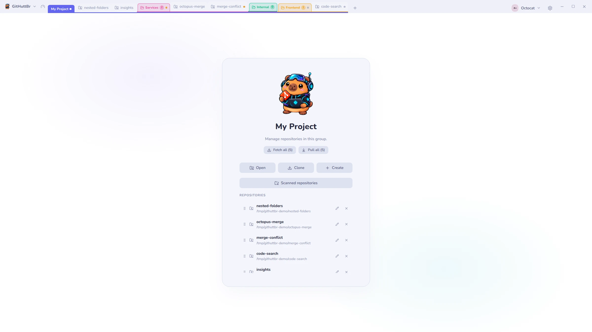

# Рабочие пространства, вкладки и группы

Три уровня, от самого свободного к самому жёсткому.

## Вкладки

Один репозиторий — одна вкладка. <kbd>⌘T</kbd> / <kbd>Ctrl+T</kbd> открывает
выбор новой вкладки, <kbd>⌘W</kbd> / <kbd>Ctrl+W</kbd> закрывает активную.
Вкладки можно перетаскивать, чтобы менять порядок, закрывать средней кнопкой мыши
или нажать <kbd>⌘⇧T</kbd>, чтобы вернуть последнюю закрытую. Правый клик по
вкладке репозитория (или по чипу внутри [группы](#группы)) открывает
[контекстное меню репозитория](repo-menu.md) — псевдоним, рабочие деревья,
GitHub, терминал, показ в файловом менеджере, редактор, а в самом низу **Закрыть
этот репозиторий** и **Закрыть остальные** (чип в группе вместо этого предлагает
удаление). Закройте
последнюю вкладку — и <kbd>⌘W</kbd> закроет уже окно. Точка на вкладке означает
незакоммиченную работу; другая точка — конфликты.

Если появилось предупреждение о закрытии, <kbd>Escape</kbd> всегда отменяет.
<kbd>Enter</kbd> подтверждает только тогда, когда вкладка чистая: при
незакоммиченных изменениях или конфликтах предупреждение намеренно заставляет вас
потянуться к кнопке, чтобы случайное нажатие клавиши после <kbd>⌘W</kbd> не
закрыло работу, которую вы ещё держали в руках.

### Размер вкладок

По умолчанию (**Настройки → Расположение → Размер вкладок → Подгонка**) вкладки
ведут себя как в браузере: когда на полосе не хватает места, они равномерно
сжимаются до минимальной ширины и начинают прокручиваться, только когда достигнут и
этот предел. **Фиксированный** возвращает классическое поведение — каждая вкладка
сохраняет ширину своего содержимого, и полоса прокручивается, как только все не
помещаются.

### Переход к репозиторию

Когда открыто десять репозиториев и больше, найти один на полосе — значит
прокручивать, <kbd>⌘1</kbd>–<kbd>⌘9</kbd> заканчиваются на девятой вкладке, а
[палитра команд](search.md) смешивает открытые репозитории со всеми действиями.
Нажмите <kbd>⌘J</kbd> / <kbd>Ctrl+J</kbd> (или **Вид → Перейти к репозиторию…**)
и наберите несколько букв его имени, папки или ветки, затем <kbd>Enter</kbd>.

В списке только открытые репозитории, включая те, что в группах, в порядке, в каком
вы их смотрели последними. Тот, с которого вы только что ушли, — первый, так что
<kbd>⌘J</kbd> <kbd>Enter</kbd> возвращает к нему. Каждая строка несёт то, что
показывает его вкладка: ветку, точку незакоммиченной работы или конфликта, группу,
в которой он лежит, и его клавишу <kbd>⌘1</kbd>–<kbd>⌘9</kbd>, если она есть.
Репозиторий на экране стоит внизу, приглушённым. За переключателем ничего не
затемняется; щелчок мимо или <kbd>Esc</kbd> его закрывает.

Когда ничего открытого не подходит, последняя строка, **Найти во всех
репозиториях**, переносит поиск на страницу [Репозитории](repositories.md).
Сочетание клавиш можно переназначить в **Настройки → Горячие клавиши**.

*Ограничения:* порядок запоминается только на этот сеанс, так что после перезапуска
он начинается с порядка вкладок. Репозиторий, открытый в двух вкладках, указан один
раз, у первой вкладки. Репозитории из других [рабочих пространств](#рабочие-пространства) не
показываются — сначала переключите рабочее пространство или откройте страницу
Репозитории.

## Группы

Соберите связанные репозитории в именованную **вкладку-группу** со своим цветом.
Внутри группы появляется второй ряд с одним чипом на репозиторий, а сама группа
умеет **Фетчить все** или **Пулить все** одним движением.

Чтобы создать группу, щёлкните правой кнопкой по вкладке репозитория → *Новая
группа…*: вкладка становится группой с этим репозиторием, на том же месте. Когда
группа уже есть, тот же пункт меню называется *Добавить в группу →* и перечисляет
открытые группы. Перетаскивание вкладки репозитория на чип группы делает то же.

*Новая группа…* спрашивает имя и цвет сразу. Цвет начинается со случайного из тех,
что ещё не носит ни одна открытая группа, чтобы группы не начинались одинаково.

Чтобы перекрасить группу, щёлкните по ней правой кнопкой: десять цветов стоят в меню
рядом точек, вокруг текущего — кольцо, и один щелчок его применяет. *Свой цвет…* под
рядом открывает выбор любого другого цвета. Папки и разделы на странице Репозитории
используют тот же ряд.

Чтобы распустить группу, щёлкните по ней правой кнопкой → **Разгруппировать**.
Каждый репозиторий становится обычной вкладкой на месте группы и сохраняет открытые
страницы. **Закрыть группу** закрывает, наоборот, саму группу и все репозитории в
ней. Папки не переживают разгруппировку: они существуют только внутри группы.

Группы могут содержать **папки, вложенные на любую глубину**: правый клик по
группе → *Новая папка…*, затем перетащите репозитории на чип папки. У каждой
папки свой цвет, она сворачивается в чип со счётчиком, агрегирует точки статуса
всего, что внутри, и умеет фетчить или пулить всё своё поддерево.

> Папки только организуют. Удаление папки поднимает её репозитории на уровень
> выше — репозиторий при этом никогда не закрывается.

Чтобы добавить репозиторий, которого ещё нет в группе, нажмите **+** рядом с названием группы. Откроется страница группы — открыть папку, клонировать, создать или выбрать недавний репозиторий, — даже если один из её репозиториев открыт; щелчок по чипу возвращает к нему.

## Страницы, которые принадлежат репозиторию

Некоторые страницы не существуют сами по себе: [вики](repo-wiki.md)
репозитория, его [статистика](insights.md), [дев-инструменты](devtools.md),
о которых объявила сессия запуска. Они не занимают вкладку — они появляются
маленькими чипами на самом репозитории: значок и слово, говорящее, что это за
страница (*CI*, *PR*, *Вики*, *#482* для пул-реквеста, тег релиза). Полное название
— во всплывающей подсказке, а длинный тег или заголовок обрезается многоточием.

- **Щёлкните значок**, чтобы показать страницу. **Щёлкните ещё раз — или
  щёлкните имя репозитория** — чтобы вернуться к репозиторию. Пока страница
  открыта, имя получает курсор-указатель и небольшую подложку при наведении:
  это и есть путь назад.
- **Наведите на значок**, чтобы увидеть ✕, закрывающий только эту страницу.
- Внутри **группы** значки сидят на плашке того репозитория, которому
  принадлежат, и только пока этот репозиторий выбран. Выбрать другой репозиторий
  группы значит показать *его*, а не инструмент соседа.
- Повторное открытие той же страницы зажигает уже существующий значок, а не
  добавляет второй.

Репозиторию, не открытому нигде, нечем нести значок — страница для него
откроется отдельной вкладкой: открыть что-то обязано что-то открыть.

## Рабочие пространства

Рабочее пространство — это **целая сохранённая лента вкладок**. Переключение
меняет сразу все вкладки: `Work` и `Personal` перестают наступать друг другу на
ноги.

Имя рабочего пространства стоит слева вверху, рядом со значком GitHuttBr. Щёлкните
по нему, чтобы переключить, создать, переименовать, переупорядочить или удалить.
Рядом — датчик, который открывает [центр управления](mission-control.md) для
того пространства, в котором вы находитесь.

**См. также:** [Центр управления](mission-control.md) · [Командная строка](cli.md)
