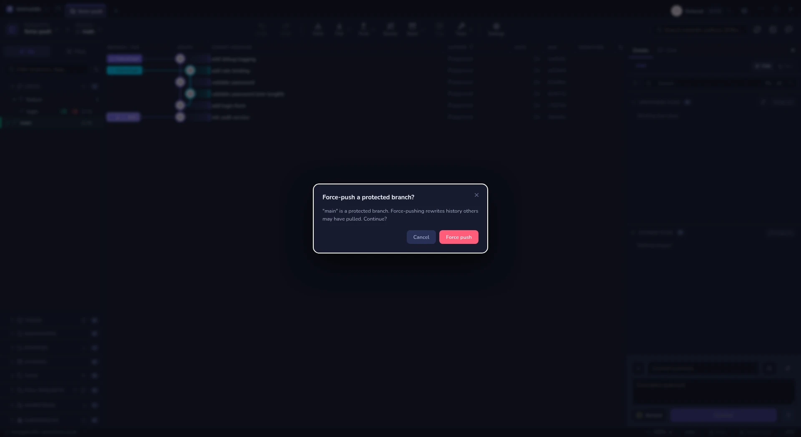
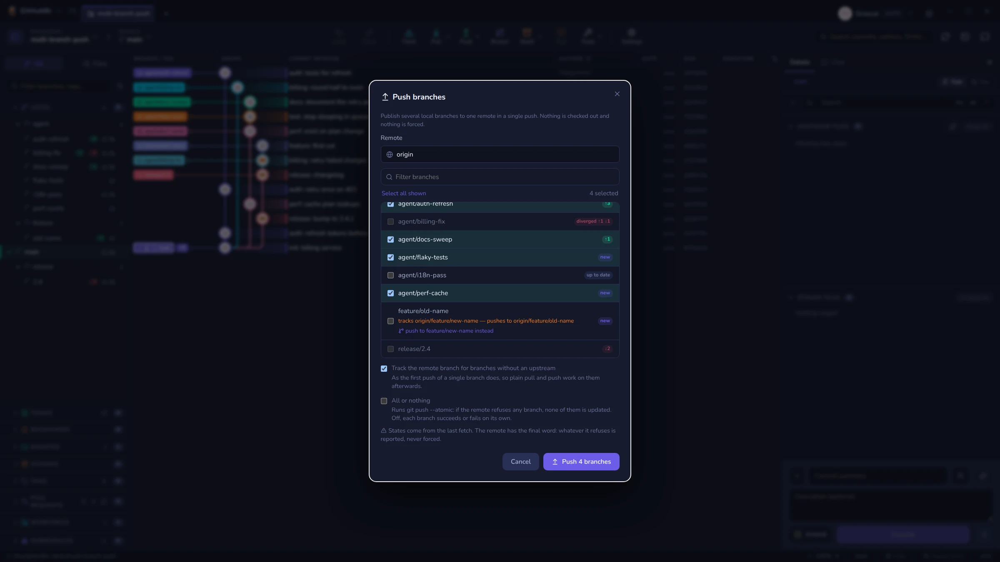

# Fetching, pulling & pushing

## Pull

Three modes, picked from the dropdown: **default**, **fast-forward only**, or
**rebase**. Local changes are auto-stashed and restored around the pull, so a
dirty tree does not block you.

### A branch that tracks nothing

`git pull` is a fetch followed by a merge, and the merge needs to know *what* to
merge into — the branch's upstream. A branch you created locally, or one checked
out without tracking, has none. The fetch still succeeds, a long list of updated
`origin/*` refs scrolls past, and then git stops with *"There is no tracking
information for the current branch"*. Nothing was pulled and nothing was broken:
the second half simply had no target.

GitHuttBr reads that error and offers the repair as a button, picking which one
from whether the remote already carries the branch:

| | |
|---|---|
| **It is on the remote** | **Link & pull** — sets the upstream to `<remote>/<branch>`, then runs the pull you asked for. **Undoable with ⌘Z**, which unsets the tracking again. |
| **It is not there yet** | **Push branch** — an ordinary push, which sets the upstream as it goes. |

The remote offered is `origin` when there is one, otherwise the first in the
list. Which case you are in is read from the remote-tracking refs rather than
the network, so the answer reflects the fetch that has just run.

## Push

Force pushes always use `--force-with-lease` — the safe variant that refuses if
the remote moved since you last looked. Pushing a **protected branch** with force
asks for confirmation (list in the repo-settings gear).

### When the host refuses

Git's own error text is written for a terminal. For the refusals that have one
clear cause, the error toast says what happened and what to do next, in your
language, and stays on screen longer. **Details** shows git's original text, and
copy, report and AI-fix still use the original text.

| Error | What the toast tells you |
|-------|--------------------------|
| Workflow file pushed without the `workflow` scope | The file that triggered it, and the fix. That fix differs for a GitHub CLI / OAuth login (`gh auth refresh -h github.com -s workflow`) and for a personal access token (add the scope). |
| File over GitHub's 100 MB limit | Which file it is, and to remove it from the commits or use Git LFS. |
| Protected branch | Push to a new branch and open a pull request. |
| No credential for the host | Which host it is, and where to connect an account. |
| 403 / permission denied | The active profile's account cannot write here, or its token has expired. |
| Repository not found | The URL is wrong, or the account cannot see the repository. |
| SSH key refused | Check the agent's key and your account. |

The matching recognises these messages by their text. A host that words an error
differently gets the raw message, as before. Non-fast-forward rejections and stale
`.lock` files do not appear here, because they already open their own dialog.

### No remotes

Push, pull and fetch need somewhere to go. A repository with none — a fresh
`git init`, a clone whose origin was removed — used to make those buttons do
nothing, or succeed with an empty fetch. They now open **Add remote** instead,
with a warning, so you can paste a URL or create the repo on the host. Adding
it finishes the action you started: a push publishes the current branch, a
pull fetches then pulls, a fetch just fetches. A host tab acts as the profile in
its picker — the repository's bound one to start with; picking another binds the
repository to it before that push, so it is one account throughout (see
[profiles](profiles.md#per-repository-binding)).

Background auto-fetch stays quiet when there is nothing to fetch. It does not
open a dialog on a timer.

### More than one remote

The **Push** button targets the branch's upstream. The arrow next to it also
offers, once a repository has more than one remote:

| | |
|---|---|
| **Push to one remote** | Pick a single remote — a fork, a mirror, a deploy target |
| **Push to all N remotes** | One push per remote, in order |
| **Push all tags to** | `git push <remote> --tags`, every local tag at once |

The same two actions sit on each remote's own row in the sidebar, which is
usually where you are when the question comes up.

**A rejection does not cancel the rest.** Pushing a fork and its upstream is
exactly the case where one side refuses and the other should still go through,
so each remote reports separately: successes are named in one toast, and each
failure gets its own with git's reason.

Only the **first** remote in the list sets the branch's upstream. A branch has
one upstream, and the last remote pushed to is not automatically the one you
want it tracking.

Both paths run the same checks as an ordinary push — the protected-branch
confirmation and the [secret guard](security.md). Publishing to two remotes is
twice the exposure, not half the caution.

## Branches you are not standing on

`git pull` only ever moves HEAD, which is why most clients make you check a
branch out before you can catch it up. GitHuttBr does not: right-click any local
branch — in the sidebar or on its badge in the [graph](graph.md) — and you get
**Pull <branch>** and **Push <branch>**, both acting on *that* branch rather
than the checked-out one.

| | |
|---|---|
| **Pull `<branch>`** | Fast-forwards the local ref from its upstream, without a checkout. The working tree is not touched. **Undoable with ⌘Z** — the undo puts the branch back where it was. |
| **Push `<branch>`** | An ordinary push of that branch, with the same protected-branch and [secret guards](security.md) as the toolbar button. |

Pull is greyed out for a branch that tracks nothing — there is nowhere to pull
from. On the branch you *are* on, both fall back to the normal pull, which
updates the working tree too.

**The limit worth knowing:** a branch that has **diverged** from its upstream is
refused, with a message saying so. Reconciling a divergence is a merge or a
rebase, and both need a working tree — so that one still costs you a checkout.
Force-pushing a branch you are not on is offered when the remote rejects the
push, but the pull-and-retry route is not, for the same reason.

## Pushing several branches at once

When several people — or several coding agents — each work on their own
branch, publishing them one by one means checking out each branch and pressing
Push, over and over. **Push branches…** lets you tick the branches you want and
send them all to one remote in a single `git push`. Nothing is checked out.

Open it from the arrow next to **Push**, by right-clicking the **Local**
header in the sidebar, or from the command palette (**Push branches…**). To push
only some branches, select them in the sidebar with Ctrl/⌘-click or
Shift-click, then right-click and choose **Push N branches…**. A branch folder's
right-click menu offers the same thing for everything in the folder.

Each local branch shows where it stands against the chosen remote:

| Badge | Meaning | Ticked at first |
|-------|---------|-----------------|
| **↑N** | N commits the remote does not have yet | Yes, unless it tracks another name (below) |
| **new** | The remote has no branch of that name — this push creates it | Yes, unless it tracks another name (below) |
| **up to date** | Nothing to send | No |
| **↓N** | Behind: the remote has commits this branch lacks | Disabled |
| **diverged ↑N ↓M** | Each side has commits the other lacks | Disabled |

Every branch is pushed to **its own name** on the remote, and the badge is
counted against that branch: `feature` goes to `origin/feature`. That is what
plain `git push` does with git's default `push.default=simple`.

**A branch that tracks a branch of another name** is the exception worth a
warning. The usual cause is `git checkout -b feature origin/main`: git makes
`feature` track `origin/main`, so it looks "ahead", and sending it there would
fast-forward `main` with unreviewed commits. Plain `git push` refuses that, and
so does this dialog by default. Such a row:

- says so in amber: **tracks origin/main — pushes to origin/feature**,
- is **never ticked for you**, even when you opened the dialog from a sidebar
  selection that included it,
- offers **push to main instead** on the row. Choose it and the row shows
  **→ origin/main**, with its badge counted against `main`. When you press
  Push, a confirmation lists every `branch → remote branch` pair that would be
  updated. If one of them is a [protected branch](repo-settings.md) or the
  remote's default branch, the confirmation says so: those commits land there
  directly, with no pull request and no review.

Two ticked branches that would update the same remote branch are refused
before git runs, with a message naming both. git would refuse the whole push
anyway.

A lock marks a [protected branch](repo-settings.md).
The filter box, **Select all shown** and the count work as in the
[clone dialog](cloning.md).

**Track the remote branch** (on by default) sets the upstream for each branch
that had none and made it to the remote, as the first push of a single branch
does. It never re-points a branch that already tracks something, even another
remote.

**All or nothing** runs `git push --atomic`. If the remote refuses any branch,
it updates none of them. With it off, which is the default, each branch
succeeds or fails on its own: a refused branch does not hold back the others.

When the push finishes, the dialog lists every branch with its outcome: pushed,
created, already up to date, rejected with git's reason, or held back by the
secret guard. Any `remote:` lines the server sent are shown too, because that is
where GitHub or GitLab explains a protected-branch refusal. **Back to the list**
reloads the states so you can push what is left.

### The guards still apply, branch by branch

- The [secret guard](security.md) checks **each** branch's outgoing commits:
  every file touched by a commit on the branch that the remote's branches do not
  already have. That includes a file that was added and then deleted again,
  because it is still in the history being published. A flagged branch is
  **held back** and the result shows which files caused it. The other branches
  still go. To publish a held-back branch, push it on its own. The single push
  shows you those files and asks you to confirm.
- The repository's own push checklist from `.githuttbr.json` is shown once, as for
  any push.
- Protected branches get no extra confirmation, the same as a normal non-forced
  push. The lock is there so you notice, and the host decides.

### Limits

- **Never forced.** There is no `+` refspec and no `--force`. A behind or
  diverged branch cannot be ticked. If you need to force-push it, do it one
  branch at a time from its own menu, with that action's own confirmation.
- **No undo.** A push cannot be safely reversed, the same as a single push.
- **States come from the last fetch.** The badges are computed from your
  remote-tracking refs, without a network round trip. If someone pushed since
  your last fetch, the remote refuses that branch (*fetch first*). That is
  reported and never forced. Fetch first to get accurate badges.
- **One remote per push.** To publish the same branches to a second remote, run
  the dialog again with that remote picked.
- **Atomic needs server support.** A server without `--atomic` refuses the
  whole push with an error. Turn the option off and try again.
- **A failure before any branch is reached**, such as authentication, a wrong
  URL or the network, fails the whole push with git's error, the same as a single
  push.

## Fetch

**Fetch** has its own toolbar button, next to Pull. It fetches every remote and
prunes, so your `origin/*` refs and every ahead/behind count go current — and it
touches neither your branch nor your working tree. That is the one to reach for
when you want to *see* what everyone else has done without moving your own work.

There is also background **auto-fetch** on an interval you set (Settings →
General). Hover the Fetch button and the age fades in underneath it — *4m ago* —
in amber once a fetch is more than fifteen minutes old. It never takes up room
in the toolbar, because it answers a question you only ask while reaching for
the button. It is read from `FETCH_HEAD`, so a `git fetch` run in a terminal
counts the same as one run here.

A fetch that finds **rewritten history** says so: a toast names the branch, and
its row gains a marker that opens [what changed since](range-diff.md) at exactly
the commit it used to point at.

## Many repositories at once

- A group tab can **Fetch all / Pull all** its whole subtree.
- [Mission control](mission-control.md) does it across the workspace, and can
  pull *only* the repositories that are actually behind.

## Remotes

Add, edit, remove and fetch individual remotes from the sidebar. Branch rows
carry per-remote presence badges, so you can see at a glance which remotes have
a copy of a branch.

**Fetch, pull or push with no remotes** opens that same Add remote dialog,
instead of succeeding at nothing. See [fetching, pulling & pushing](syncing.md).

**See also:** [Mission control](mission-control.md) · [Hosting & pull requests](hosting.md)
