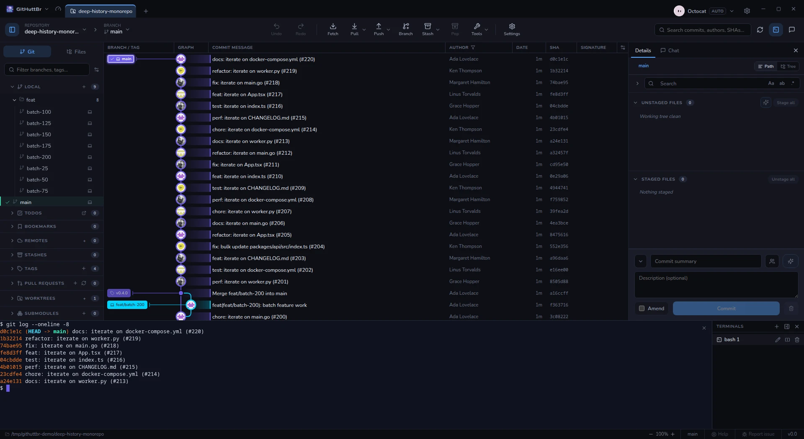
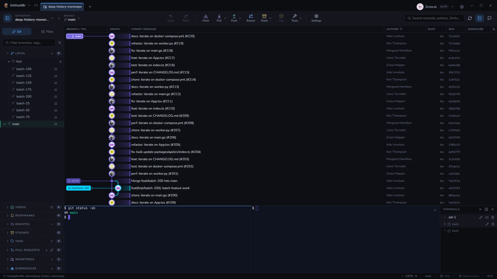
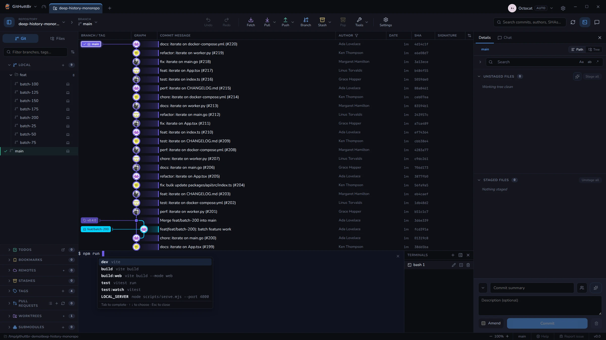
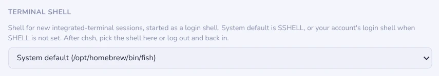

# Integrated terminal

A real PTY (xterm + node-pty), not a command runner. Your shell, your prompt,
your aliases.

- **Multiple tabs per repository**, each starting in that repository's folder.
- It docks **under the graph** by default, with the sidebars keeping the full
  height; Settings → Layout moves it to the **whole bottom edge** or a
  **right-hand column**. The pane remembers its size. Updating to 4.40 moves a
  terminal docked at the bottom to the center once; any placement you pick after
  that stays as you set it.
- **It opens with the repository.** The first time a repository becomes the
  active tab in a session — restored at startup, opened from the welcome screen,
  cloned, or sent by `githuttbr .` — its terminal opens with a shell in that
  folder. Close it and it stays closed for that repository until the next
  launch; switching tabs does not bring it back. Each repository you visit costs
  one shell process, so if you hop across many, turn off **Open the terminal
  when a repository opens** in Settings → Layout.
- Each terminal remembers **where you were reading**: switch terminals, groups
  or repo tabs and the scrollback stays put — pinned to the bottom when it was
  already following output, back on the same line when it was not.
- Terminal visibility is per repository: closing one repository's terminal
  leaves the others as they are. With the option above off, switching to a tab
  that never opened one keeps it closed.
- Tabs name themselves after what is running in them.
- Collapsing the terminal list shrinks it to a **rail**: one icon per terminal
  (split terminals show a mini panel map), click to switch, right-click for the
  usual rename/split/kill menu.
- **Drag one terminal onto another** in the list to merge them into a split
  group. Each terminal keeps its name as a pane; the merged group takes a
  fresh numbered name.

## Keys

| Keys | Does |
|---|---|
| <kbd>⌃`</kbd> | Show or hide the terminal — the physical Control key, on every platform |
| <kbd>⌘T</kbd> / <kbd>Ctrl+T</kbd> | New terminal, while the terminal has focus |
| <kbd>⌘W</kbd> / <kbd>Ctrl+W</kbd> | Close the focused terminal; closing the last one hides the panel |
| <kbd>Ctrl+Shift+C</kbd> | Copy the selection; a bare <kbd>Ctrl+C</kbd> copies too while a selection exists and stays SIGINT when there is none |
| <kbd>Ctrl+V</kbd> / <kbd>Ctrl+Shift+V</kbd> / <kbd>Shift+Ins</kbd> | Paste from the clipboard |
| Right-click | Copy the selection, or paste when nothing is selected |
| <kbd>⌥←</kbd> / <kbd>⌥→</kbd>, <kbd>Alt+←</kbd> / <kbd>Alt+→</kbd> | Jump a word back or forward at the prompt — sent as the word-movement keys the shell already understands. The same bytes reach full-screen programs: a shell inside tmux jumps words, and outside macOS vim reads them as <kbd>Ctrl+←</kbd> / <kbd>Ctrl+→</kbd>, a word move |
| <kbd>Alt+↑</kbd> / <kbd>Alt+↓</kbd> (Windows, Linux) | Sent as <kbd>Ctrl+↑</kbd> / <kbd>Ctrl+↓</kbd>, which is what the shell or program sees. On macOS <kbd>⌥↑</kbd> / <kbd>⌥↓</kbd> go through unchanged |

New and close terminal are scoped to the terminal on purpose: away from it, they still
open and close [workspace tabs](workspaces.md). On macOS the Edit menu's
Copy/Paste work the same way.

## Script suggestions

Type `npm run ` (or `pnpm`, `yarn`, `bun run`) and a list of the project's
scripts appears at the cursor, filtered as you type: `npm run loc` finds
`LOCAL_SERVER`. Each name shows the command it runs.

| Key | Does |
|-----|------|
| **Tab** | Completes the selected script |
| **↑ / ↓** | Choose another |
| **Esc** | Closes the list until you type again |

Other commands get a list of their own:

| Typed | Lists | Read from |
|-------|-------|-----------|
| `composer run ` | Composer scripts | the nearest `composer.json` |
| `make ` | Makefile targets, with the `## text` after a target as its description | the `Makefile` of the current directory, as `make` reads it |
| `git checkout `, `switch`, `merge`, `rebase` | Local branches, then remote ones by their short name | the repository the shell is in |

A Makefile target built from variables or a pattern (`%.o`) is not listed, and
`git checkout -b` gets no list: it names a new branch.

The scripts come from the `package.json` nearest the shell's **current**
directory, so after `cd frontend` you get the frontend's. Names starting with
what you typed come first, then names containing it.

The list only knows the keys you typed since the last Enter. Recalling a command
with ↑, moving the cursor or using the shell's own Tab completion changes the
line out of its sight, so it stays quiet until the next Enter rather than
complete the wrong thing. On Windows the current directory cannot be read, so
the list follows the folder the terminal opened in.

## Which shell starts

**macOS and Linux** start the shell your session runs: `$SHELL`, as the app
inherited it. When `$SHELL` is not set or does not point at a usable shell — a
GUI app can start without one — the account's **login shell** (the one `chsh`
sets, read from the account database; on macOS that is Directory Services)
comes next. The order, first usable one wins:

| Step | Where it comes from |
|------|---------------------|
| 1 | `$SHELL` from the environment the app started in |
| 2 | Your account's login shell (`chsh`, or Users & Groups on macOS) |
| 3 | `/bin/zsh` on macOS, `/bin/bash` on Linux |
| 4 | `/bin/sh` |

`$SHELL` goes first because it is the shell you actually use: an account can
name fish while every session runs zsh, and the terminal should match the rest
of your desktop, not the account record.

**After `chsh`**, an app started from the Dock or a desktop menu still sees the
`$SHELL` of the moment you logged in. Either pick the new shell in Settings
(below), which applies to the next terminal at once, or log out and back in.

"Usable" means an absolute path to an executable file. `nologin` or `false`
are skipped. A shell missing from `/etc/shells` — common for a Homebrew shell —
is still used; the app only notes it in its log.

To pick something else, Settings → Layout → **Terminal shell** lists *System
default* (with the shell it detected), every usable shell in `/etc/shells`, and
**Custom…** for any other path. The choice applies to new terminals; open ones
keep their shell. If a custom path stops existing, the terminal opens your
system default instead and prints a note naming both — once per path and app
run, not in every terminal.

**Windows** picks from PowerShell, PowerShell Core (`pwsh`), `cmd`, Git Bash,
WSL, or a custom executable, in the same place. *System default* there is
`%COMSPEC%`.

## Your PATH

The shell starts as a **login shell**, the same as Terminal.app or iTerm, so
`~/.zprofile`, `~/.zlogin`, `~/.bash_profile` and fish's login configuration all
run. That matters because version managers and `brew shellenv` usually install
themselves there — a tool like `fvm`, `nvm` or `pyenv` that works in your
terminal works here too. Known shells (sh, bash, zsh, ksh, fish, tcsh, nu…) get
the login flag; a custom shell GitHuttBr does not recognise is started with no
arguments, since an unknown flag could stop it starting at all.

GitHuttBr also asks your login shell for its real `PATH` at startup and merges it
into everything it spawns — git hooks, [Run & debug](launch.md) tasks, the
terminal — because a GUI app launched from the Dock inherits almost nothing. It
asks the same shell the terminal opens by default, so a tool that only
`~/.config/fish/config.fish` puts on `PATH` is found by a husky hook too.

The limits:

- The `PATH` is read from your **system default** shell, not from a shell picked
  in Settings, and at startup only: after a `chsh`, hooks see the new shell's
  `PATH` once you have logged out and back in.
- Run & debug tasks are written in POSIX shell syntax (`a && b`, `( … )`), so
  they run in your shell only when it is sh-compatible (bash, zsh, ksh, dash…).
  For fish, nu or tcsh users they run in zsh (macOS) or bash (Linux), with the
  `PATH` read from your own shell — and not as a login shell, so a system
  profile that resets `PATH` (Debian, Ubuntu) does not throw it away.
- tcsh, nu and xonsh cannot be asked for `PATH` the same way; for them it is
  read from zsh or bash, so only what those shells' profiles set is found.

If a command is still not found, check that it is on `PATH` for a login shell
and not only for an interactive one.

## Theme & Oh My Posh

Terminal visuals (theme, font size, font family) live under
Settings → Themes → Terminal theme and apply live to every session.

If [Oh My Posh](https://ohmyposh.dev) is installed, the terminal theme section
also lists every `*.omp.json` under `%POSH_THEMES_PATH%` with a live preview —
choosing one injects it as `POSH_THEME` for new terminals, so a bare
`oh-my-posh init pwsh` in your profile picks it up. A custom `.omp.json` path
works too; leaving the field on Default keeps whatever your shell/profile or
global `POSH_THEME` already sets. Existing sessions keep the theme they were
created with — close and reopen a terminal to apply a new one. Prompt glyphs
need a Nerd Font in the terminal font family (e.g. `CaskaydiaMono Nerd Font`)
or icons render as boxes.

A note on speed: Oh My Posh runs its binary once per prompt — roughly
100–200 ms on Windows, more for themes with a git segment in a large repo —
which is felt as a short pause before each prompt, not as GitHuttBr lag. Themes
without a git segment are the fastest. PowerShell's prediction style matters
too: `-PredictionViewStyle InlineView` repaints a small area per keystroke
while `ListView` redraws a whole block.

Anything you run here is invisible to GitHuttBr's own locking, so a long
`git rebase` typed by hand and a click in the UI can still collide — the app
refreshes from disk when the terminal changes something.

**See also:** [Run & debug](launch.md) · [Hooks](hooks.md)
