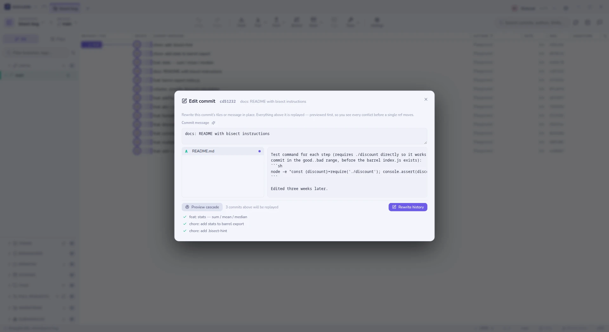
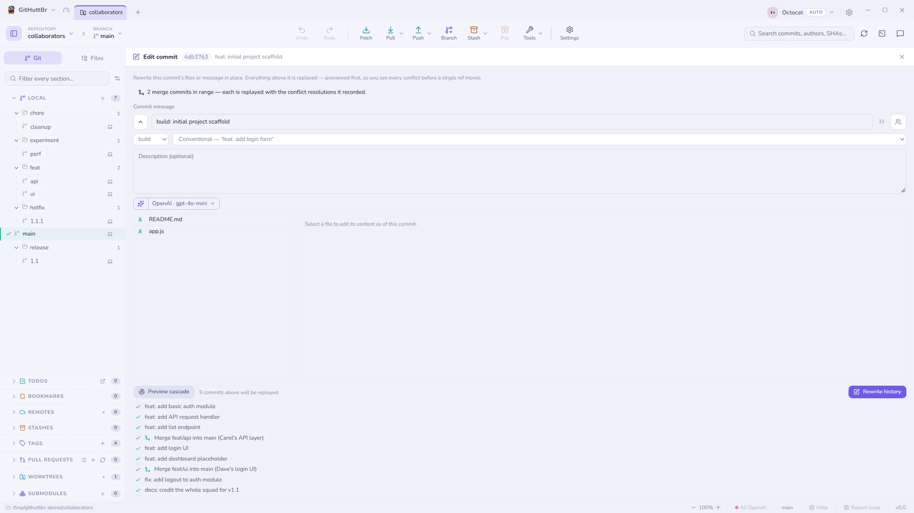

# Herhangi bir commit'i düzenleyin

Yazım hatası üç hafta önceki bir commit'te. Alışıldık çözüm etkileşimli bir
rebase'tir: commit'te dur, düzenle, devam et, dua et. GitHuttBr'nun çözümü ise
şu: commit'e sağ tıklayın, **Bu commit'i düzenle**, metni değiştirin, bitti.
Commit ayrıntıları panelindeki kalem düğmesi de aynı düzenleyiciyi açar.

## Ne yapar

`HEAD`'in atası olan herhangi bir commit'i seçin — geçmiş doğrusal olsun ya da
olmasın. Düzenleyici commit grafiğinin yerine, orta bölmede açılır — çakışma
çözücünün ve dosya görüntüleyicinin açıldığı yerde — ve pencerenin tüm
genişliğini ve yüksekliğini kullanır. **Esc** ya da başlığındaki **×** onu
kapatır. Başka bir depo sekmesine geçip geri döndüğünüzde düzenlemeleriniz
kaybolmaz; uygulanmamış düzenlemelerle kapatmak ise önce onay ister.

Başlık commit'i adlandırır — kısa hash'i, konusu, yazarı ve yaşı — ve bir şeyi
değiştirdiğiniz anda sarı bir etiket **uygulanmamış değişiklikleri** sayar: mesaj
için bir, düzenlediğiniz her dosya için bir.

### Mesaj kartı

Mesaj, [commit düzenleyicisindeki](committing.md) araçların aynısına sahiptir:
özetin önündeki **tür ▾** düğmesi, uzunluk sayacıyla (*56/72*) özet ve altında
açıklama, okun arkasındaki stil satırı (kapsam, bilet anahtarı, commit stili),
gitmoji seçici, ortak yazarlar, commit'in kendi diff'inden yapay zekâyla üretme ve
linter ipuçları. Commit mesajı yüklenirken bölünür — ilk satır özet, geri kalanı
açıklama olur — ve yeniden yazarken tek bir boş satırla tekrar birleştirilir. Eski
bir `add retry` mesajını `fix: add retry` yapmak, tür düğmesinden tek bir
seçimdir.

Mesaj orijinalden farklılaştığı anda kart **değişti** olarak işaretlenir, eski
konu açıklamanın altında *önce: …* olarak görünür kalır ve **Orijinale dön** hem
özeti hem açıklamayı geri getirir.

### Dosyalar kartı

Commit'in dosyaları durum harfleriyle listelenir; değiştirdiğiniz her dosyayı bir
nokta işaretler. Bir dosyayı o commit'teki hâliyle düzenlemek için seçin.
Düzenleyicinin üstündeki anahtar **Düzenle** ile **Orijinalle karşılaştır**
arasında geçiş yapar; ikincisi dosyanın commit'teki hâlinden düzenlediğiniz metne
kadarki diff'ini gösterir — uygulamanın geri kalanının kullandığı diff görünümüyle.

**Dosya ekle**, commit'in dokunmadığı bir dosyayı commit'in kendi anlık
görüntüsünden açar: yolunun bir kısmını yazın ve seçin. Onu düzenlediğinizde,
yeniden yazılan commit o dosyayı da değiştirir. Listede **+** ile işaretlenir.

### Ne olacak

Kartların yanındaki panel — dar bir pencerede altlarındaki — yeniden yazmanın
dokunduğu zinciri gösterir: düzenlenen commit'in üzerindeki her commit, `HEAD`'den
aşağı doğru, ve en altta düzenlenen commit'in kendisi, içinde neyin değiştiğiyle.

1. **Zincirleme önizleme**, düzenlenen commit'in üzerindeki her commit'i
   *bellekte* yeniden oynatır (`merge-tree` cherry-pick'lerinden oluşan bir
   zincir — checkout yok, çalışma ağacı yok, ref yok). Ardından zincirdeki her
   commit **çakışmasız yeniden uygulanır** mı, yoksa adı verilen bir dosyada
   **çakışma** mı var, söyler; böylece düzenlemenin temiz yayılıp yayılmadığını
   veya sonraki bir değişiklikle çarpışıp çarpışmadığını **daha hiçbir şey
   kımıldamadan** bilirsiniz. Sonraki her düzenlemeden sonra kararlar temizlenir;
   **Yeniden önizle** onu yeniden çalıştırır.
2. **Geçmişi yeniden yaz** bunu gerçekten yapar: aynı zincir plumbing
   komutlarıyla kurulur, ardından dal `reset --keep` ile taşınır —
   commit'lenmemiş değişiklikleriniz beraberinde taşınır ya da reset iptal
   edilir ve hiçbir şey olmamış olur. Önce bir
   [koruma anlık görüntüsü](recovery.md) alınır ve **Geri al** eski zinciri geri
   getirir.

Commit zaten bir uzak depodaysa, sarı bir not uzak dalı adlandırır ve bunun ne
anlama geldiğini söyler: bir sonraki push zorlanmak zorundadır. Başka bir not kaç
commit'in yeni hash alacağını söyler.

Yeniden oynatılan her commit'in yazarı ve tarihleri korunur; yalnızca
hash'ler değişir — geçmişi yeniden yazmak zaten budur.

## Aralıktaki merge'ler

Commit ile `HEAD` arasında bir merge olması artık düzenlemeyi devre dışı
bırakmaz. Zincir, bir merge'i **kaydedilmiş sonucunu** — merge'in gerçekten
commit'lediği ağacı, çakışma çözümleri dahil — yeniden yazılmış ebeveynin
üzerine uygulayarak yeniden oynatır; böylece birinin elle yaptığı çözümler
yeniden yazmayı harfi harfine atlatır. rerere yok, yeniden merge yok, çalışma
ağacı yok: zincirin geri kalanıyla aynı bellek içi plumbing komutları, üstelik
her iki ebeveyn işaretçisi de korunur. Düzenlenen commit'i kendisi de içeren
bir yan dal yeniden yazılır ve yeniden yönlendirilir; içermeyen dalın
kimliğine ise hiç dokunulmaz. Yan paneldeki bir not aralığın kaç merge taşıdığını
söyler ve merge commit'leri zincirde bir merge simgesi gösterir.

Dürüst uyarı: yeniden oynatılan bir merge ancak kaydedilmiş sonucu kadar
iyidir. Düzenlemeniz merge'in kendisinin çözdüğü satırlarla çarpışırsa,
önizleme diğer her çakışan adım gibi kırmızıya döner — hiçbir şey tahmin
edilmez.

## Zincir çakıştığında

Sonraki bir commit, düzenlediğiniz satırlara dokunmuş. Önizleme o commit'i
çakışan dosyayla, üzerindeki commit'leri de yeniden uygulanmadı olarak işaretler
ve **Geçmişi yeniden yaz** kapalı kalır — hiçbir şey asla yarım uygulanmaz. Bir
rebase'in aksine düzenleyici, çakışmayı çözmeniz için yarı yolda durmaz: ya
farklı düzenleyin ya da çakışmayı [etkileşimli rebase](rebase.md) ile göğüsleyin.

## Sınırlar

- **Commit, `HEAD`'in atası olmalıdır.** Merge edilmemiş bir yan daldaki
  commit'in, yeniden oynatılabileceği şu anki dalınıza giden bir yolu yoktur.
- İkili dosyalar ve 2 MB'ın üzerindeki dosyalar gösterilir ama düzenlenemez.
- Zaten bir uzak depoda olan bir commit düzenlenebilir, ancak bir sonraki
  push'unuz bir **force push** olmak zorundadır — düzenleyici buna karar vermeden
  önce sizi uyarır.
- Commit'te silinmiş dosyalar düzenlenemez (düzenlenecek içerik yoktur).
- **Dosya ekle** yalnızca commit'in anlık görüntüsünde zaten var olan dosyalara
  ulaşır; yepyeni bir dosya oluşturamaz, bir dosyayı silemez, bir sembolik
  bağlantıya ya da alt modüle dokunamaz.

**Ayrıca bkz.:** [Etkileşimli rebase](rebase.md) · [Kurtarma ve reflog](recovery.md) · [Absorb](absorb.md)
