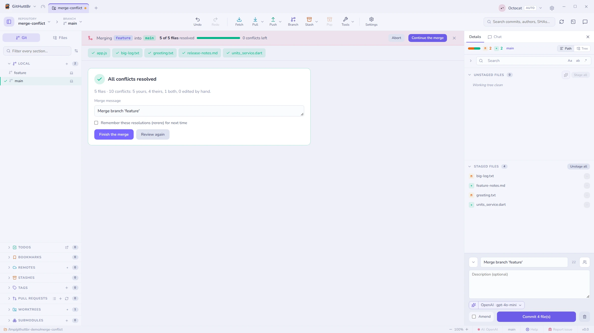

# Çakışmaları çözme

Bir merge, rebase, cherry-pick ya da revert durduğunda çözücü adımın tamamını tek
bir ekrana dönüştürür. Üstteki çubuk **neyin** durduğunu ve **neyle ne arasında**
durduğunu söyler — sadece "çakışma" değil, "`feature`, `main` içine
birleştiriliyor" — ve ne kadar ilerlediğinizi: *5 dosyadan 2 tanesi çözüldü*,
tüm dosyalarda hâlâ kalan çakışmalarla birlikte.

## Dosya şeridi

Çubuğun altında, bu adımın takıldığı her dosya için bir çip vardır:

| Çip | Anlamı |
|---|---|
| ✓ ile yeşil | Çözüldü — hazırlandı, karar verilecek bir şey kalmadı |
| Çerçeveli | Üzerinde bulunduğunuz dosya |
| Kırmızı bir sayı | Dosyada hâlâ kaç çakışma bloğu olduğu |
| Bir etiket | Birleştirilecek metni olmayan bir çakışma: *bir tarafta silindi*, *iki tarafta da yeniden adlandırıldı*, *bir tarafta eklendi* |

Çözülmüş çipler önce, açık olanlar sonra gelir; her grup ada göre sıralıdır.
Böylece şerit solda bitenler, sağda kalanlar olarak okunur.

**Sonraki dosya →** hâlâ açık olan bir sonrakine atlar; bir dosyayı çözüldü
olarak işaretlemek de sizi kendiliğinden oraya götürür. Çubuktaki **Devam et**
her çip yeşil olana kadar devre dışı kalır; **İptal et** önce sorar ve neyi
kaybedeceğinizi söyler.

git bir dosyayı hazırlandığı anda unutur; bu yüzden "çözüldü", GitHuttBr'ın bu
adım sırasında gördükleri ile git'in merge mesajında listelediği dosyalardır.
Çözücüyü açmadan önce terminalde hazırladığınız bir dosya yine sayılır; rebase
ortasında yeniden başlatmadan sonra ise o tek adımın çözülmüş yarısı
sayılmayabilir.

## Bu neden çakışıyor

Dosya başlığındaki **Bu neden çakışıyor**, dallar ayrıldığından beri bu dosyaya
dokunan commit'leri her taraf için ayrı ayrı listeler — `git log --merge` ile;
git'in yıllardır sunduğu ama kimsenin bulamadığı komut.

İşaretçiler neyin çarpıştığını söyler. Bu ise kimin, neden değiştirdiğini söyler
ve çözümü asıl belirleyen genellikle budur. Orada hiçbir şey yoksa, hiçbir taraf
tam olarak bu yola bir değişiklik commit'lememiştir — çarpışma bir yeniden
adlandırmadan ya da taşımadan gelmiştir.

Başlık ayrıca hangi çakışmada olduğunuzu ve dosyanın ne tür bir çakışmada
olduğunu da git'in kendi durumundan okuyarak söyler: *iki taraf da aynı satırları
değiştirdi*, *iki tarafta da eklendi*.

## Üç panel

| Panel | Nedir |
|---|---|
| **Senin tarafın** | Üzerinde bulunduğunuz taraf; başında o tarafta dosyaya dokunan en yeni commit durur: sha, konu, yazar, ne kadar önce |
| **Taban** | İki tarafın da başladığı sürüm — ortak ata ya da bir pick veya rebase adımında uygulanan commit'in ebeveyni. Her çakışmanın yerini aldığı satırlar gölgelidir |
| **Gelen** | Gelen taraf; başlığı Senin tarafın ile aynı biçimdedir |

Sonuç başlığındaki **Tabanı göster**, Taban panelini gizler ya da gösterir ve
seçiminizi hatırlar. Taban olmadığında — iki taraf da dosyayı eklediğinde — soluk
ve devre dışıdır.

Tüm paneller yeniden boyutlandırılabilir ve sonuç başlığı iki görünüm anahtarı
taşır:

| Anahtar | Ne yapar |
|---|---|
| **Satır kaydır** | Yan panellerdeki uzun satırları kaydırmak yerine alt satıra taşır. Sonucun metin görünümü satır başına tek sıra tutar — yan işaretçileri buna dayanır — bu yüzden her zaman kayar |
| **Kaydırmayı bağla** | Panelleri ve sonucu birlikte kaydırır; dikeyde ve yatayda. Satır sayıları farklı olduğundan dikey konum oranla eşleştirilir |

Satır kaydır kapalı başlar, Kaydırmayı bağla açık başlar ve ikisi de durumunu
hatırlar.

## Sonuç

Sonuç, dosyanın yazılacağı hâlidir. Her çakışma yerinde, üzerinde dört yanıt
bulunan bir kart olarak durur:

| Yanıt | Dosyaya ne girer |
|---|---|
| **Seninkini kullan** | Sizin satırlarınız, yalnızca sizinkiler |
| **Onlarınkini kullan** | Onların satırları, yalnızca onlarınkiler |
| **İkisi** | Önce sizin satırlarınız, sonra onlarınkiler |
| **Düzenle** | İkisi birden, metin düzenleyicide çakışma seçili olarak açılır; yanıt "ikisi de, ama biraz düzeltilmiş" olduğunda |

Yanıtlanmamış bir kart iki tarafı da önizler; her satır *← senin* ya da *←
onların* ile etiketlenir ve seçilirse düşeceği satırın numarasını taşır, böylece
başınızı kaldırmadan karar verebilirsiniz. Çok uzun satırlı bir dosyada kod
altlarında yana kayarken yanıtlar görünür kalır. Dosya başlığındaki **Tüm dosya:
seninki | onlarınki** her çakışmayı tek seferde yanıtlar.

**Metin olarak düzenle**, sonucu serbestçe yazmak için düz bir düzenleyiciye
çevirir; başlıkta dosyanın satır sayısı görünür. Bir şey yazdıktan sonra kartlar
artık oradakini anlatmaz; bu yüzden metin, **Seçimleri sıfırla** her şeyi geri
getirene kadar kalır.

Alt bilgi bu dosyada kalanları sayar; ***dosya* dosyasını çözüldü olarak
işaretle** sonucu yazar ve hazırlar; her çakışmanın bir yanıtı olana kadar devre
dışıdır.

## Gezinmek

Bir dosyayı açmak sizi dosyanın başına değil, **ilk çakışmasına** götürür.
Sonuç başlığındaki ⌃ / ⌄ okları — ya da <kbd>Alt+↑</kbd> / <kbd>Alt+↓</kbd> —
kalanlar arasında adım adım ilerleyerek her paneli her birine kaydırır.

## Satır satır seçmek

Yan paneller hâlâ **satır** ve **öbek** bazında seçer, başlıklarındaki onay
kutusu da **tüm tarafı** alır — hiçbir kartın sunmadığı yanıt için, örneğin
sizden iki satır ve onlardan bir satır. Satır düzeyindeki seçimler oldukları anda
kartlarda görünür.

## Birleştirilecek bir şey olmayan dosyalar

Bazı çakışmaların karşılaştırılacak satırı yoktur: bir taraf, diğerinin
değiştirdiği bir dosyayı **silmiştir** ya da iki taraf da dosyayı farklı adlarla
**yeniden adlandırmıştır**. Biri boş üç panel hiçbir şey açıklamaz; bu yüzden
bunlar yerine bir kart alır — kim ne yaptı, her tarafın commit'i, yazarı ve
yaşıyla.

| Durum | Seçenekler |
|---|---|
| Bir tarafta silindi | **Dosyayı tut** (diğer tarafın yaptığı değişikliklerle), **Dosyayı sil** (önce sorar) ve **Ne değiştirdiğini gör** — tabandan farkı gösterir, böylece silmenin neyi attığını bilirsiniz |
| İki tarafta da yeniden adlandırıldı | Bir adı ya da diğerini **tut**, veya **İki adı da tut** |

git, yeniden adlandırılmış bir orijinal ile iki yeni adı arasında hiçbir bağ
kaydetmez; bu yüzden kart onları içeriğe göre eşleştirir. Anlayamadığında — aynı
anda birkaç yeniden adlandırma varsa ve dosyalar da değişmişse — bunu söyler ve
yeni adlar kendi çipleri olarak görünür.

## Bitirmek

Son dosya çözüldüğünde çalışma alanı sizi **Devam et**'i aramaya göndermez: bir
kart çakışmaların nasıl yanıtlandığını özetler, merge mesajını (git'in kendi
mesajıyla önceden doldurulmuş) düzenlemenize izin verir ve oradan bitirir.

- Özet, sizin seçtiğinizi gördüğünü sayar: seninki, onlarınki, ikisi, elle
  düzenlenmiş. Çözücünün dışında çözülen bir dosya yanıt olarak değil, dosya
  olarak sayılır.
- Bir **rebase** adımı yeniden oynatılan commit'in kendi mesajını korur; bu
  yüzden onun için mesaj kutusu yoktur.
- **Bu çözümleri (rerere) bir dahaki sefere hatırla**, git'in
  `rerere.enabled` ayarıdır; Ayarlar'daki anahtarın aynısı. git yalnızca
  gerçekleştiğini gördüğü çakışmaları hatırlar; bu yüzden burada açmak bir
  sonrakinden itibaren etkili olur.
- **Yeniden gözden geçir** çözücüyü hazırlanmış sonuçla kapatır.

## Geri alma

Her çözümün — çözüldü olarak işaretlenen bir dosya, seçilen bir taraf, tutulan ya
da silinen bir dosya, karara bağlanan bir yeniden adlandırma — bir geri alma
kaydı vardır. Geri alma, çakışmayı git'in bıraktığı hâliyle tam olarak geri
getirir: işaretçiler, dizindeki iki taraf ve taban, diskteki dosya. **İptal et**
geri alınamayan tek şeydir; bu yüzden önce sorar.

## Yapay zekâ desteği

Yapay zekâ etkinken **Yapay zekâ ile çöz**, sonuca metin olarak bir birleştirme
önerir. Kendi başına hiçbir şey uygulamaz: siz okur, düzenler ve hazırlarsınız.
Bkz. [Yapay zekâ özellikleri](ai.md).

## Xcode proje dosyaları

`project.pbxproj`, bir iOS deposundaki başka her dosyadan daha çok çakışır — ve
neredeyse hiçbir zaman biri karşı çıktığı için değil. 24 haneli onaltılık
kimliklerle anahtarlanmış tek ve düz bir nesne sözlüğüdür; dolayısıyla tek bir
dosya eklemek dört girdi yazar: bir `PBXBuildFile`, bir `PBXFileReference`,
sahibi olan grubun `children` listesinde bir satır ve hedefin derleme
aşamasında bir satır. Birer dosya ekleyen iki kişi, aynı birkaç satıra düşen
sekiz girdi yazar. Git bir çakışma görür; çözülecek bir şey yoktur.

Çakışan dosya bir `project.pbxproj` olduğunda, çözücü üç sürümü de metin yerine
proje olarak okur ve **yapıya göre birleştirmeyi** önerir: nesneleri kimliğe
göre eşleştir, iki taraftaki her eklemeyi al, `children` ve `files` dizilerini
birleştir ve gerçekten ayrışan yerde dur. Panellerin üstündeki şerit, her
tarafın ne eklediğini ve — varsa — sana ne kaldığını söyler.

Yapay zekâ önerisi gibi, sonuca düşer ve hiçbir şeyi hazırlamaz.
Kaydetmeden önce okursun.

### Yapmayı reddettikleri

**İkinizin de oynadığı bir ayarı asla tahmin etmez.** Sen
`MARKETING_VERSION`'ı `1.1`, onlar `2.0` yaptıysa bu bir karardır ve şeritte
adıyla yazar — ayar, senin değerin, onlarınki — arkandan çözülmek yerine.
Çözemediği bir nesne *senin* sürümünü olduğu gibi korur; böylece yarım
uygulanmış bir birleştirme asla diske ulaşmaz.

**Üç sürümden herhangi biri ayrıştırılamıyorsa dosyanın tamamını reddeder.**
Xcode'un açamadığı bir `project.pbxproj`, elle birleştirmekten pahalıya gelir;
bu yüzden kesin okuyamadığı her şey sıradan bir metin çakışması olarak kalır ve
bunu söyler.

**Farklı nesneler için üretilmiş iki kimliği saptamaz.** Xcode kimlikleri
rastgele seçtiği için nadirdir — ama olduğunda taraflardan birini almak birinin
dosyasını sessizce düşürürdü; bu yüzden birleştirilmek yerine bildirilir.

### `merge=union` değil

Bunun için dolaşan çare `.gitattributes` içinde
[`*.pbxproj merge=union`](attributes.md)'dır. Kullanma. Union, tek değişiklikler
bağımsız eklemeler olduğu sürece işe yarar; iki kişi aynı derleme ayarını
düzenlediği anda iki satırı da yazar ve Xcode'un açmayı reddettiği bir dosya
üretir — hem de diff'i en dikkatsiz okuduğun anda. Yapısal birleştirme aynı
kolaylığı bu arıza olmadan verir.

## Kilit dosyaları

`Podfile.lock`, `Package.resolved`, `yarn.lock` ve kuzenleri, birinin çözücüsünün
çoktan çözdüğü bir bağımlılık grafiğini kaydeder. Bir çözümün yarısını
diğerinin yarısına dikmek, kimsenin çözmediği bir grafik verir: kurulmayabilir,
kurulursa da iki dalın da denemediği bir şeyi kurar.

Bu yüzden çakışan dosya bir kilit dosyasıysa, şerit ona sahip olan aracı adıyla
söyler, **Bizimkini tut** ile **Onlarınkini tut** düğmelerini oracıkta sunar ve
sonrasında onu yeniden üreten komutu verir. Burada bir tarafı seçmek bir uzlaşma
değil — yöntemin tamamı; doğru kılan da yeniden üretmektir.

Üç panel yerinde kalır, çünkü arada bir neyin değiştiğini gerçekten okumak
istersin: tanıdığın bir sağlama, beklediğin bir sürüm. Bu iş, seni onları elle
düzenlemekten caydırmaya çalışıyor.

## Baştan çakışmaya düşmemek

[Çakışma radarı](conflict-radar.md), herhangi birini birleştirmeden önce hangi
dalların çakışacağını söyler.

## git'in hatırlamasına izin vermek (rerere)

Uzun ömürlü bir dalı rebase edin, aynı çakışmayla her seferinde karşılaşırsınız.
`rerere` — *reuse recorded resolution*, yani kaydedilmiş çözümün yeniden
kullanımı — git'in buna yanıtıdır: bir çakışmayı nasıl çözdüğünüzü ezberler ve
aynısı bir daha ortaya çıktığında o yanıtı tekrar oynatır.

**Ayarlar → Git ve eşitleme → Çakışma çözümlerini hatırla.** Bu, genel git yapılandırmanıza
`rerere.enabled` yazar; böylece komut satırı da aynı şekilde davranır.

git sizin yerinize yanıt verdiğinde, çözücü boş bir "çakışma işaretçisi yok"
ekranı göstermek yerine durumu bildirir ve **Bu çözümü unut** seçeneğini sunar —
bu, hafızayı siler *ve* çakışmayı geri getirir, böylece işi farklı
sonuçlandırabilirsiniz.

Bilmeye değer iki şey:

- **Tekrar oynatılan bir çözüm hazırlanmaz**, *Tekrar oynatılan bir çözümü
  otomatik hazırla* seçeneğini açmadıkça. Onu kapalı bırakın: duraklamanın tüm
  anlamı, ezberlenmiş bir yanıtın bu belirli birleştirme için yanlış olabilmesi;
  bakmadan hazırlamak da onun bir commit'e ulaşma yoludur.

  Tekrar oynatılan bir dosyanın **Çakışan dosyalar** listesinde kalmasının nedeni
  budur: git içeriği yazmıştır ama index onu hâlâ birleştirilmemiş olarak tutar
  ve bunu yalnızca hazırlamak çözer. Çözücüdeki **Olduğu gibi hazırla** ya da
  listedeki **Tümünü çözüldü işaretle** onu yerinden oynatan şeydir.
- **rerere her çakışmayı anlamaz.** Ekle/ekle ve sil/değiştir çakışmalarının
  ön görüntüsü (preimage) olmaz, dolayısıyla hep ham hâlde geri gelirler.
  Ayarlar'daki sayı gerçekten tuttuğu kayıt sayısıdır ve **Tümünü unut** onu
  boşaltır.

**Ayrıca bakınız:** [Çakışma radarı](conflict-radar.md) · [Birleştirme ve rebase](merging.md)
