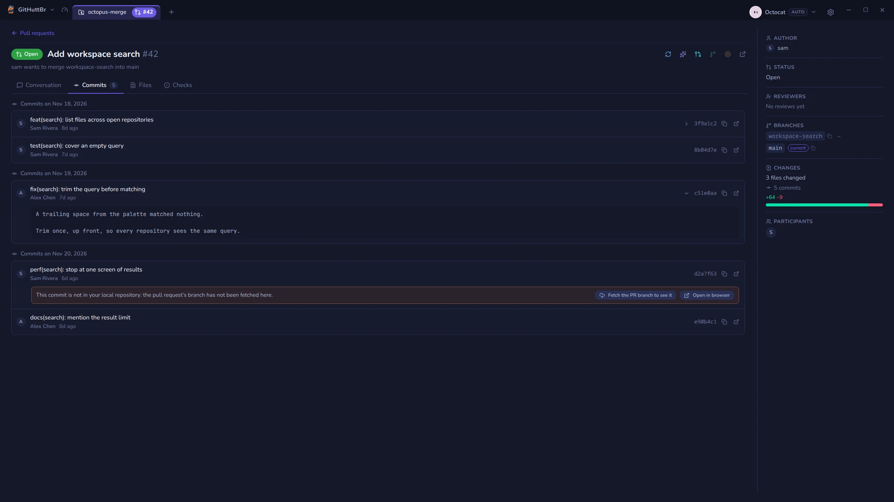

# Pull request sayfası

Yoğun bir depoda aynı anda yirmi pull request açıktır. Kenar çubuğu onları
listeler, ama her birine bir satır pek bir şey söylemez: hangisi kimin, hangileri
sizi bekliyor, hangileri kırmızıya döndü. Bunu öğrenmek için her birini açmak,
okumak, geri dönmek, sonrakini açmak gerekiyordu. **Pull request sayfası** bu
soruları tek ekranda yanıtlar ve bir pull request’i açtığınızda **‹ ›** geri
dönmeden sizi aynı listenin bir sonrakine götürür.

## Açmak

- Kenar çubuğundaki **PULL REQUEST’LER** başlığında **liste simgesi** (*Tüm pull
  request’leri gör*).
- Komut paletinde (⌘K) *Pull request’ler…* ya da **Araçlar → Pull
  request’ler…**.

Wiki ve [CI çalıştırmaları](ci-runs.md) gibi, sayfa deponun sekmesinde açılır.

## Sekmeler

| Sekme | Ne içerir |
|---|---|
| **Açık** | Taslaklar dahil tüm açık pull request’ler |
| **Taslaklar** | Yalnızca taslak olarak işaretlenmiş açık olanlar |
| **Birleştirilen** | Birleştirilmiş pull request’ler, sekmeyi ilk açtığınızda okunur |
| **Kapalı** | Birleştirilmeden kapatılanlar (reddedilen, bırakılan), Birleştirilen ile birlikte okunur |

Açık ve Taslaklar yanındaki sayılar, kenar çubuğunun zaten tuttuğu listeden
gelir. Birleştirilen ve Kapalı yalnızca birini açtığınızda ve oturum başına bir
kez istenir; **Yenile** yeniden ister.

## Filtreler

| Filtre | Bıraktığı |
|---|---|
| **Ara** | Başlığı, açıklaması, dalları veya numarası yazılan her kelimeyi içeren pull request’ler. `#482` ya da `482` o numarayı bulur; eşleşmeler başlıkta vurgulanır |
| **Yazar** | Tek bir yazar — her biri bu sekmede kaç tane olduğuyla listelenir. **Ben** ilk sıradadır |
| **İnceleyen** | İstenen tek bir inceleyen ya da **Benden inceleme istenen** |
| **Hedef dal** | O dala açılan pull request’ler |
| **Benimkiler** | *Yazar: Ben* için kısayol |
| **İncelememi bekleyenler** | *İnceleyen: benden inceleme istenen* için kısayol |
| **CI başarısız** | Head’inin kontrolleri başarısız olan pull request’ler |

Filtrelerin altındaki satır, sekmedeki pull request’lerin kaçının gösterildiğini
ve hangi filtrelerin açık olduğunu söyler; hepsini kaldırmak için **filtreleri
temizle** vardır.

Filtreler depo başına **uygulama çalıştığı sürece** tutulur — sayfadan çıkın,
geri gelin, bıraktığınız gibidirler. Yeniden başlatmalar arasında bilerek
saklanmazlar: bir hafta sonra sessizce geri gelen “benimkiler, CI başarısız”
filtresi, gizlenmesini istemediğiniz pull request’leri gizlerdi.

### “Ben” kim

“Ben”, bu deponun çağrılarının sunucuda oturum açtığı hesaptır — deponun
[bağlı](profiles.md) olduğu profil, yoksa etkin olan — ve sunucunun kendisine
sorulur. Token kime ait olduğunu söyleyemediğinde (kullanıcı kapsamı yoksa) ya da
token yoksa, **Ben**, **Benimkiler** ve **İncelememi bekleyenler** sunulmaz.

## Liste

| Sütun | Ne gösterir |
|---|---|
| **#** | Numara; açık, taslak, birleştirilmiş veya kapalı için bir simgeyle |
| **Başlık** | Başlık, bir *taslak* rozeti ve kimden hâlâ inceleme istendiği — siz olduğunuzda vurgu renginde |
| **Yazar** | Sunucu veriyorsa onun resmi, yoksa baş harf; kendi pull request’lerinizde **sen** |
| **Dallar** | Kaynak → hedef |
| **Kontroller** | Head’in kontrollerinin özeti — `6/6`, `1 başarısız`, `2 çalışıyor`; sayılar için üzerine gelin |
| **Güncellendi** | En son ne kadar önce değiştiği; tarih için üzerine gelin |

Satırlar en son etkinliğe göre sıralanır. Tıklamak pull request’in kendi
sayfasını açar ([Sunucular ve pull request’ler](hosting.md)). Bu sayfası olmayan
bir sunucuda satır pull request’i tarayıcıda açar.

Bir [fork checkout’unda](hosting.md#bir-forkun-üst-deposundaki-pull-requestleriniz) üst depodaki pull request’leriniz de
listelenir, *owner/repo üzerinde* olarak işaretlenir.

## Bir pull request’ten listede ilerlemek

Sayfadan açılan bir pull request, başlığının üstünde bir şerit gösterir:

- **← Pull request’ler** listeye, filtreler bıraktığınız gibi, geri döner.
- **‹ k / n ›** açtığınız listenin önceki veya sonraki pull request’ine geçer —
  süzülmüş liste, kendi sırasıyla, tıkladığınız andaki hâliyle. İpuçları her
  okun götürdüğü pull request’i adlandırır.
- **Alt+← / Alt+→** aynısını klavyeden yapar. **Ayarlar → Kısayollar** içinde
  yeniden atanabilirler. İmleç bir metin alanındayken (Option+← kelime kelime
  ilerlediğinde) ve odak terminaldeyken devre dışı kalırlar.

Geçiş sayfayı yerinde değiştirir; böylece on pull request’te gezinmek sekmede on
simge bırakmaz; listeden başka bir satır açmak da onu değiştirir.

**Başka herhangi bir yerden** — kenar çubuğundan, bir bildirimden — açılan bir
pull request, deponun açık pull request’lerinde sayfanın varsayılan sırasıyla
(Açık, filtresiz) ilerler. O listede de olmayan biri, örneğin bir stack’in
birleştirilmiş bir katmanı, yalnızca listeye dönüş yolunu gösterir.

## Bir pull request’in dalına gitmek

Bir pull request üzerinde çalışmak için onun dalının checkout edilmiş olması
gerekir — ve binlerce dalı olan bir depoda onu dal listesinde adıyla bulmak işin
yavaş kısmıdır. Bir pull request’in sayfasında **Dallar** alanı bunu sizin için
yapar:

- **Dal adı bir bağlantıdır.** Tıklamak o dalı checkout eder ve sizi deponun
  grafiğine, dalın ucuna götürür. Pull request’in sayfası sekmede açık kalır.
- **Yalnızca sunucuda var olan bir dal** önce fetch edilir — yalnızca o dal,
  bütün remote değil — ve onu izleyen yerel bir dal olarak checkout edilir.
  Zaten yerelde olan bir dala olduğu gibi geçilir — güncellenmez, bu yüzden pull
  request’in en son commit’lerini istediğinizde pull yapın.
- **Zaten üzerinde olduğunuz dal** bunun yerine *geçerli* olarak işaretlenir.
  Hiçbir şey checkout edilmez.
- Her adın yanındaki **kopyala düğmesi** onu panoya koyar.
- **Geri al** (⌘Z) bulunduğunuz dala geri döner ve checkout’un oluşturduğu yerel
  dalı siler — ancak o zamandan beri üzerine commit yaptıysanız dala
  dokunulmaz.

Başlıkta aynı iki hareket düğme olarak vardır: **Kaynak dala git** ve **Hedef
dala git**. Zaten üzerinde olduğunuz dalda da çalışırlar — sizi yalnızca depoya
götürürler.

Siz tıklayana kadar hiçbir şeye bakılmaz: bir pull request’i açmak hiçbir dalı
okumaz ya da fetch etmez.

Yapmadıkları:

- **Bir fork’un kaynak dalı** başka bir depodadır, bu yüzden bağlantısı yoktur
  (kopyala düğmesi kalır). Hemen altında sunulan **Pull request’i yerelde
  önizle…**, onu burada çalıştırmanın yoludur. Hedef dal yine bağlantıdır.
- **Eşleşen remote yok.** Dal, URL’si pull request’in deposu olan remote’ta
  aranır. Yapılandırılmış hiçbir remote oraya işaret etmiyorsa bağlantı bir şey
  yapmaz ve ipucu nedenini söyler.
- **Silinmiş bir dal.** Birleştirilmiş bir pull request çoğu zaman dalını da
  götürmüştür; fetch bu durumda dalın remote’ta artık olmadığını söyler ve pull
  request’te kalırsınız.
- **Yerel değişiklikler.** Checkout yıkıcı değildir, bu yüzden onay yoktur — ve
  commit edilmemiş değişikliklerinizin üzerine yazılacaksa git checkout’u
  reddeder. Hata hangi dosyalar olduğunu söyler; onları commit edin ya da stash’e
  koyun ve yeniden tıklayın.
- **Bu pencere.** Checkout bu deponun çalışma ağacında gerçekleşir. Dal zaten
  başka bir [çalışma ağacında](worktrees.md) checkout edilmişse, bunun yerine o
  çalışma ağacının sekmesi açılır.

## Commit’ler

Kenar çubuğu bir pull request’te kaç commit olduğunu söylüyordu, hangileri
olduğunu hiç söylemiyordu. Her seferinde bir commit incelemek — çoğu pull
request’in okunması gereken biçim — sizi tarayıcıya gönderiyordu. Konuşma ile
Dosyalar arasındaki **Commit’ler** sekmesi onları listeler:

- **Önce en eskiler**, uygulandıkları sırayla, yazıldıkları günün altında
  gruplanmış. Tarih sırasının dışında rebase ile gelen bir commit taşınmak yerine
  kendine ait bir gün başlatır.
- Her satırda yazarın resmi (sunucu veriyorsa), konu, yazar, ne kadar önce olduğu
  ve kısa SHA vardır. **birleştirme** rozeti, sunucu söylüyorsa iki ebeveynli bir
  commit’i işaretler.
- Konudan fazlası olan bir commit’in yanındaki **▸**, mesajının geri kalanını
  gösterir.
- **Kopyala** tam SHA’yı panoya koyar; **Tarayıcıda aç** commit’i sunucuda açar —
  sunucunun böyle bir sayfası varsa pull request’in içinde (GitHub, GitLab,
  Bitbucket Data Center), yoksa deponun commit sayfasında.

Commit’i uygulamada açmak için **bir satıra tıklayın** — ya da Tab ile ona gelip
Enter’a basın —; grafikte bir tıklamanın yapacağı gibi: deponun görünümü, o commit
seçili, ayrıntıları açık. Bu, bu klonda commit **varsa** çalışır. Yoksa satır,
sessizce başarısız olmak yerine bunu söyler ve şunları sunar:

- **Görmek için PR dalını getir** — [dala gitmek](#bir-pull-requestin-dalına-gitmek) ile aynı tek dallık
  fetch, checkout olmadan. Commit onunla geldiyse açılır; gelmediyse (o zamandan
  beri bir force push onu yeniden yazdıysa) bildirim bunu söyler.
- **Tarayıcıda aç**, fetch bir seçenek olmadığında.

Liste sayfayla birlikte değil, sekmeyi ilk açtığınızda okunur, ve her **Yenile**’de
yeniden. Gelene kadar sekmedeki sayı, sunucunun pull request için verdiği sayıdır.
Birleştirilmiş ve kapalı pull request’ler commit’lerini aynı şekilde listeler.

Yapmadıkları:

- **En fazla 250 commit.** GitHub’ın kendisi bir pull request için 250’den fazlasını
  listelemez; uygulama her sunucuda aynı sayıda durur ve öyleyse *barındırıcıda daha
  fazlası var* der, pull request’in sunucudaki bağlantısıyla birlikte. Hangi 250
  olduğu, sunucunun onları listeleme sırasına bağlıdır — uygulama önce listelenenleri
  tutar ve listenin üstündeki satır hangileri olduğunu söyler:

  | Sunucu | Daha uzun bir pull request gösterir |
  |---|---|
  | GitHub | **İlk** 250 (GitHub’ın kendi sınırı) |
  | GitLab, Azure DevOps, Bitbucket Data Center, bitbucket.org | **En yeni 250** |
  | Forgejo | Sunucu hangi ucu önce listelerse; sırası belgelenmemiştir |
- **Bir fork’un dalı** buradan getirilemez — başka bir depodadır —, bu yüzden
  yalnızca fork’ta olan bir commit yalnızca tarayıcıyı sunar. **Pull request’i
  yerelde önizle…** onu getirmenin yoludur.
- **Silinmiş bir dal.** Birleştirilmiş bir pull request çoğu zaman dalını da
  götürmüştür: fetch bunu söyler. bitbucket.org, kaynak dal gidince hiç commit
  listelemez.
- **Squash birleştirmeleri.** Squash ile birleştirilmiş bir pull request’in
  commit’leri hiçbir zaman hedef dala ulaşmamıştır, bu yüzden dalı silindikten sonra
  yalnızca sunucuda bulunurlar.
- **Yazarlar**, commit’lerinin onları adlandırdığı gibi adlandırılır. GitLab, Azure
  DevOps ve Bitbucket Data Center, bir resmin gönderemeyeceği bir oturum açma
  olmadan resim vermez, bu yüzden bu satırlar baş harfi gösterir.
- **Azure DevOps’taki uzun mesajlar** kısalmış olabilir: Azure’un listesi bir
  commit’in mesajını keser ve uygulama ne gönderiyorsa onu gösterir.
- **bitbucket.org** pull request’leri tarayıcıda açılır — uygulamanın onlar için
  henüz bir sayfası yok —, bu yüzden uygulama listeyi okuyabilse de orada bu
  sekmeye ulaşılmaz.

## Bir satıra yorum yapmak

Burada bir inceleme konuşmasına yanıt vermek mümkündü, ama yenisini başlatmak değil;
bu yüzden gerçek bir inceleme sizi yine tarayıcıya gönderiyordu. Bir pull request’in
**Dosyalar** sekmesinde diff’in her satırı kendi yorumunu alabilir:

- **Bir satırın üzerine gelin** ve numarasının üstünde beliren **+** düğmesine
  basın ya da **satırın kendisine tıklayın** (bir metin seçimini bitiren tıklama ya
  da bir kelimeyi seçen çift tıklama sayılmaz — bu okumaktır). Sağ tık menüsünde —
  ya da klavyenin bağlam menüsü tuşunda — da *N. satıra yorum yap* vardır.
- **O satırın altında** bir kutu açılır. Yazın, ardından **Yorum yap** — ya da
  ⌘/Ctrl+Enter. **Vazgeç** kutuyu kapatır; **Esc** de kapatır, bir şey yazılmışsa
  önce sorar. Her iki durumda da odak o satıra döner.
- Başarılı olursa yeni konuşma **kendi satırının altında** ve herkesin göreceği
  Konuşma sekmesinin inceleme konuşmalarında görünür.

Yorumun hangi tarafa düştüğü satıra bağlıdır:

| Satır | Bağlandığı yer |
|---|---|
| **Eklenen** (yeşil) | Dosyanın yeni sürümü, yeni numarasıyla |
| **Silinen** (kırmızı) | Eski sürüm, eski numarasıyla |
| **Değişmeyen** | Yeni sürüm (GitLab’e, istediği gibi, iki numara da gönderilir) |

Var olan konuşmalar da kendi satırlarının altında gösterilir; sunucu uygulamanın bir
konuşma içinde yanıt vermesine izin veriyorsa yanıt kutusuyla birlikte (Forgejo
izin vermez). Bir konuşma ancak sunucu onun gösterilen diff’e hâlâ ait olduğunu
söylüyorsa bir satırda gösterilir; geri kalanı tahmin edilmiş bir satır yerine
Konuşma sekmesinde kalır:

| Sunucu | Son push’tan önce yazılmış bir konuşma |
|---|---|
| GitHub | Satırı değiştiyse eskimiş: yalnızca Konuşma |
| GitLab | Daha eski bir head’e karşı yazılmış: yalnızca Konuşma |
| Azure DevOps | Azure onu satırının şimdi olduğu yere taşır |
| Bitbucket Data Center | Satırı yok olduysa sahipsiz: yalnızca Konuşma |
| Forgejo | Forgejo bir yorumun eskidiğini söylemez, bu yüzden kayıtlı satır numarasında gösterilir — bir push’tan sonra o satırda artık başka kod olabilir |

Gösterilen hunk’ların dışındaki bir satıra yapılan yorum, her sunucuda yalnızca
Konuşma sekmesindedir.

Yazılmış ama gönderilmemiş bir yorum gönderilmemiş metin sayılır: **‹ ›** ve
Alt+oklar, ana yorum kutusunda olduğu gibi, ondan ayrılmadan önce sorar. Başka bir
dosyaya bakmak onu korur; başka bir satırda yorum başlatmak için önce ilkini
gönderin ya da vazgeçin.

Yapmadıkları:

- **Tek satır, hemen gönderilir.** Satır aralığı yoktur; yorumları toplayıp sonra
  göndereceğiniz bekleyen bir inceleme yoktur; önerilen değişiklik yoktur. Her yorum
  gönderdiğiniz anda kendi konuşması olarak yayımlanır (Forgejo’da, tek yorum için
  bir çağrısı olmadığından, yalnızca o yorumu içeren bir inceleme olarak).
- **Baktığınız diff.** Dosyalar sekmesi diff’inin hangi commit’te (Azure DevOps’ta
  hangi yinelemede) okunduğunu hatırlar ve yorum ona göre gönderilir. Pull request o
  zamandan beri ilerlediyse — bir push, yeni bir birleştirme tabanı — yorum şimdi o
  numarayı taşıyan satıra yazılmaz: *bu diff yüklendiğinden beri pull request
  değişti* diyerek reddedilir ve **Yenile** yeni diff’i gösterir. GitHub’da ise yorum
  okuduğunuz commit’e göre gönderilir ve o satır değiştiyse GitHub onu eskimiş
  olarak işaretler. Sunucunun yine de kabul etmediği bir satır, diff’in dışında
  olduğu gerekçesiyle reddedilir.
- **Reddedildi.** Yorum yapma izni olmadan (salt okunur bir token, deponun yorum
  yapmasına izin vermediği bir hesap) sunucu reddeder ve mesaj nedenin bu olduğunu
  söyler.
- **bitbucket.org** pull request’leri tarayıcıda açılır — uygulamanın onlar için
  henüz bir sayfası yok —, bu yüzden orada satır yorumu hâlâ web sitesinde yapılır.
- **Diff’i olmayan bir dosyada** (ikili ya da sunucunun eklemeyeceği kadar büyük)
  yorum yapılacak satır yoktur.

## Yorum yazmak

Sayfadaki her kutu — alttaki yorum, bir konuşmadaki yanıt, bir satıra yorum —
aynı Markdown düzenleyicisidir: **Yaz / Önizleme** sekmeleri, GitHub’ın
kısayollarıyla bir biçimlendirme çubuğu, Enter’da devam eden listeler ve ekranda
zaten olan kişiler ve pull request’lerden **@** / **#** tamamlama. Bir yanıt kutusu
içine tıkladığınızda araçlarını gösterir ve Enter artık yeni bir satır başlattığı
için ⌘/Ctrl+Enter ile gönderir. Ayrıntılar ve sınırlar
[Yorum yazmak](writing-comments.md) sayfasında.

## Sınırlar

- **Açık pull request’ler kenar çubuğunun listesidir.** GitHub, GitLab ve
  bitbucket.org ilk 30’u okur; daha fazlası olan bir depo yalnızca bunları
  gösterir ve Açık sayısı **30+** olur. Azure DevOps, Bitbucket Data Center ve
  Forgejo hepsini okur.
- **Birleştirilen ve kapalı olanlar sınırlıdır**, sunucuda daha fazlası olduğunda
  sekme **+** gösterir (sunucunun web sitesi hepsini listeler):

  | Sunucu | Ne okunur |
  |---|---|
  | GitHub, bitbucket.org, Forgejo | En son güncellenen 100 tane, birleştirilen ve kapalı **birlikte** |
  | GitLab | Her birinden en son güncellenen 100 tane |
  | Bitbucket Data Center | Sunucunun *newest* sırasına göre her birinden 100 — API’si bunun açılma mı güncellenme mi olduğunu söylemez |
  | Azure DevOps | **Son bir yılda** sonuçlananlar arasından her birinden 100; API’si bir sıra belirtmez, bu yüzden yüzün ötesinde hangilerinin geleceğini sunucu seçer |

  Kontrolleri okunmaz — bitmiş bir pull request’in CI’ı hiçbir şeye karar
  vermez ve satır başına bir istek maliyeti olurdu — bu yüzden **CI başarısız** bu
  sekmelerde uygulanmaz (çipi orada gizlidir).
- **Hesap yok**: sunucuya ulaşan bir token olmadan Birleştirilen ve Kapalı boş
  bir liste göstermek yerine bunu söyler (GitHub yine de herkese açık bir depoyu
  okuyabilir).
- **Kontroller**: GitHub ve Bitbucket Data Center bunları listede taşır. GitLab,
  Azure DevOps ve Forgejo’ya sayfa açıldığında head başına bir kez, grafiğin CI
  rozetleriyle aynı önbellek üzerinden sorulur. bitbucket.org’da yoktur.
- **İnceleyenler**: GitHub, GitLab, Forgejo, Bitbucket Data Center ve Azure
  DevOps kimden hâlâ istendiğini belirtir (Azure: oy vermemiş bir kişi; ekipler
  dışarıda kalır). bitbucket.org’un listesi bunu söylemez, bu yüzden orada
  İnceleyen filtresi boştur.
- **Açıklamada arama**, sunucunun listesinin açıklamayı taşıdığı yerde çalışır;
  bitbucket.org onu atlayabilir, o zaman yalnızca başlıklar, dallar ve numaralar
  aranır.
- **bitbucket.org ve Azure DevOps’ta “Ben”** görünen ada göre eşleştirilir,
  çünkü listeleri yazarı böyle adlandırır.
- **Azure DevOps’ta Güncellendi**, pull request’in açıldığı (ya da kapandığı)
  zamandır: listesinde son etkinlik zamanı yoktur.
- Gezinme uygulama çalıştığı sürece hatırlanır; yeniden başlatmadan sonra
  listeden açılan bir pull request bunun yerine açık pull request’lerde ilerler.
