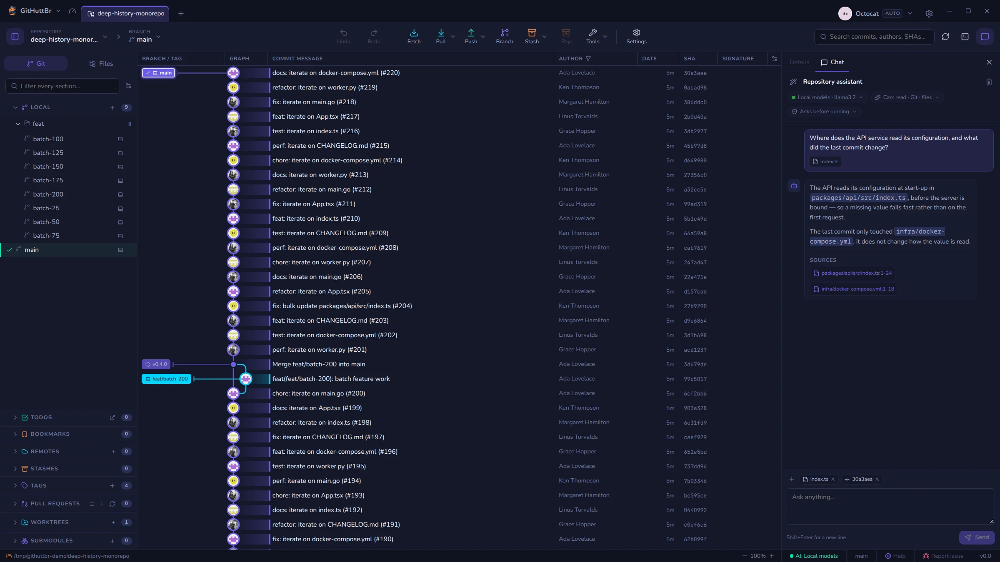

# Depo sohbeti

Bazı soruları sormak, aramaktan hızlıdır. *Token yenileme aslında nerede
oluyor? Bu commit tek cümleyle neyi değiştirdi? Bu dosya neden var?* Depo
sohbeti bunları açık depo üzerinden yanıtlar ve dayandığı satırları gösterir.

Sıradan bir yapay zekâ sohbeti de olur. Bir selam, genel bir programlama
sorusu ya da başka herhangi bir şey, depo okunmadan modelden doğrudan yanıt
alır — dosyalara yalnızca soru onlarla ilgiliyse bakar.

Sağ sütunu **Ayrıntılar** ile paylaşır: üstteki sekmeler ikisi arasında geçiş
yapar, böylece bir şey sorduğunuzda grafik seçimini kaybetmez.

## Ne okur

Her sohbet gibi çalışır: **gönderilen sizin mesajınızdır**, yanında da yalnızca
deponun adı ve dalı — Git durumu yok, dosya listesi yok, dosya içeriği yok — ve
yanıt düz metin olarak gelir. Bir selam ya da depoyla ilgili olmayan bir soru
orada, tek bir çağrıda yanıtlanır ve depodan hiçbir şey makinenizden çıkmaz.

**Depo ne zaman devreye girer.** Model için üç durumda açılır:

| Siz… | Ne olur |
|------|--------------|
| İzlenen bir dosyanın adını verirseniz (`config.json`, `src/app.ts`) | Model yanıtlamadan önce o dosya okunur |
| Bunu sözcüklerle söylerseniz — “bu depo”, “değişikliklerim”, “commit edilmemiş”, “geçerli dal” | Git durumu ve izlenen dosya listesi gönderilir |
| Modelin depoya ihtiyaç duyduğuna karar verdiği bir şey sorarsanız | Model tek satırlık bir `@repo` ile yanıt verir ve uygulama depoyu onun için açar |

Oradan sonra model tahmin etmek yerine başka neye ihtiyacı olduğunu ister:
listeden tam yolları, birebir aramaları ya da yakın geçmişten commit
özetlerini. Uygulama bunları okur ve soruyu bulunanlarla yeniden sorar. Bu en
çok dört kez olur — her tur beklediğiniz bir model çağrısı daha demektir — ve
sonuncusunda elindekiyle yanıt vermek zorundadır. Bu yanıtlar kullandıkları
alıntılara kaynak gösterir; uydurulmuş bir dosya ya da satır, makul görünen bir
yanıt değil, bir doğrulama hatasıdır.

Siz beklerken mesajınızın altındaki satır ne olduğunu söyler: model çalışırken
**Düşünüyor…**, yalnızca uygulama istenenleri gerçekten okurken **Dosyalar
okunuyor (N)…** ya da **Depoda aranıyor…**.

| Dahil | Hariç |
|---|---|
| İzlenen dosyalar, çalışma ağacındaki hâlleriyle | İzlenmeyen dosyalar |
| İzlenen dosyaların hazırlanmış ve hazırlanmamış diff’leri | Bir yoksayma kuralına uyan her şey, izleniyor olsa bile |
| Dal, ileri/geri sayısı ve değişen yollar listesi | [Sır gibi görünen dosyalar](security.md), ikili dosyalar, üretilmiş yollar |

Çalışma ağacını okuması, işlenmemiş düzenlemeleri konuşabilmeniz demektir. Aynı
zamanda o düzenlemelerin soru sorarken makineden çıkması demektir:
[Yapay zekâ özellikleri](ai.md) altında ayarladığınız sağlayıcı onları alır.

Bir ince ayrıntı: [eylem önerileri](#sohbetten-eylem-çalıştırma) açıkken
izlenmeyen dosyaların **adları** depo durumuna dahil edilir — "yeni dosyayı
hazırla" bunlara ihtiyaç duyar — ama içerikleri yine de asla okunmaz.

## Bağlam sabitleme

Neyin okunacağına model karar verir. Sabitleme, bunu geçersiz kılmanın yoludur:
sabitlenen **önce** okunur ve bağlam bütçesinin büyük payını alır.

Dört yol, hepsi mesaj kutusunun üstündeki aynı çip sırasına gider:

| Şunu yapın | Şunu alırsınız |
|---|---|
| Önerilen bir çipe tıklayın | Görüntüleyicide açık dosya ya da grafikte seçili commit |
| **Dosyalar** sekmesinden bir satır sürükleyin | O dosya |
| **Commit grafiğinden** bir satır sürükleyin | O commit — iletisi ve diff’i parça parça |
| **+** → *Dosya seç…* ya da Finder/Dosya Gezgini’nden sürükleyin | Diskteki herhangi bir dosya, deponun dışı dahil |

Çipler sonraki sorular için sabit kalır; `×` birini kaldırır, konuşmayı temizlemek
hepsini. Sınır sekiz.

Sabitlenen bir commit, iletisini ve en fazla on iki diff parçasını katar. Hariç
tutulan bir yola dokunan parçalar o diff’ten düşer, commit’in tamamı değil.

## Ayarlar

**Ayarlar → Yapay zekâ → Depo sohbeti** — genel yapay zekâda ya da varsa bir
profilin kendi yapay zekâsında (hangisi olduğunu **Düzenlenen** çubuğu seçer,
bkz. [Her profil için tek yapay zekâ](ai.md#her-profil-için-tek-yapay-zekâ)):

| Ayar | Ne yapar |
|---|---|
| **Depo hakkında soru sorun** | Kapalıyken sekmeyi, araç çubuğu düğmesini ve kısayol hedefini kaldırır. Diğer yapay zekâ özellikleri çalışmaya devam eder |
| **Yalnızca işlenmiş içerik** | Çalışma ağacı yerine son commit üzerinden yanıtlar: işlenmemiş düzenlemeler makineden hiç çıkmaz |
| **Sohbette dosya ve Git eylemleri önerilsin** | Kapalıyken sohbet yeniden salt okunur olur: eylem kartı da onay menüsü de yok |
| **Dosyalar için salt okunur kip** | Açıkken dosya oluşturma, düzenleme, değiştirme ve silmeyi engeller; Git eylemleri kullanılabilir kalır. Varsayılan olarak açıktır |
| **Önerilen eylemler nasıl çalıştırılır** | Onay modu — bkz. [Onay modları](#onay-modları). Yıkıcı eylemler her durumda onay ister |
| **Sohbet uzak eylemler önerebilsin** | Varsayılan olarak kapalı. Açıkken getirme, çekme, gönderme, pull request açma ve yığın gönderme eklenir |

Sohbete hangi sağlayıcının ve modelin cevap vereceği **Yapay zekâ** sayfasında,
**Göreve göre model** altında ayarlanır — bkz. [Yapay zekâ özellikleri](ai.md#göreve-göre-model).
Soru sormak incelemeden ucuzdur, bu yüzden küçük bir model çoğu zaman yeter.

Yapay zekâ tümüyle kapalıysa sohbet de onunla birlikte kaybolur — kimsenin
yanıtlayamayacağı bir şeyi öneren panel kalmaz.

Sohbet modeli, panelin kendi başlığından da değiştirilebilir; sağlayıcı adının
yanındadır — aynı ayar, Ayarlar’ı açmadan.

Panel başlığının yanındaki sihirli değnek düğmesi **yapay zekâ yapılandırma
sihirbazını** açar — bu depo için asistan yapılandırma dosyaları (talimatlar,
ajanlar, hook’lar) üreten rehberli bir akış. Bkz.
[Yapay zekâ özellikleri](ai.md).

## Mesajlarla çalışma

Mesajlar sıradan metindir. Herhangi bir bölümünü seçip kopyalayın ya da bir
baloncuğa sağ tıklayın: **Kopyala** seçimi, **Mesajı kopyala** mesajın
tamamını alır — bir yanıt Markdown kaynağı olarak kopyalanır — ve tıklama bir
bağlantıya denk geldiyse **Bağlantıyı kopyala** adresini alır.

Bağlantılar her zaman varsayılan tarayıcınızda açılır, asla GitHuttBr içinde
değil — yanıtlardaki Markdown bağlantıları da kendi mesajlarınızdaki düz
`https://` adresleri de.

Bir mesaj bir görselden söz ettiğinde — `docs/logo.png` gibi bir depo yolu ya
da görsel uzantısıyla biten bir URL — imleci sözün üzerine getirmek küçük bir
önizleme gösterir. Depo yolları çalışma ağacınızdan okunur; okunabilir bir
görsele karşılık gelmeyen bir söz hiçbir şey göstermez.

## Sohbetten eylem çalıştırma

Bir olgu yerine bir değişiklik isteyin — *markdown dosyalarını hazırla, bunu
düzeltme olarak commit’le, derleme çıktısını yoksayma listesine ekle* — ve
yanıt bir **eylem kartıyla** gelir. Boş bir konuşma, giriş metninin altında
birkaç örnek isteği çip olarak sunar; birine tıklamak yazma kutusunu doldurur,
göndermeden önce düzenleyebilirsiniz. Kart, asistanın atmak istediği somut
adımları listeler: her
eyleme bir satır, **Çalıştır** ve **Reddet** düğmeleriyle. Karttaki hiçbir şey
henüz olmuş değildir; model yalnızca önerebilir ve her öneri siz görmeden önce
çalışma ağacıyla karşılaştırılır — var olmayan bir dosyayı anan eylem
reddedilir, gösterilmez.

Depo sohbeti tam düzenlemeler, dosya oluşturma veya bütünüyle değiştirme ve
silme önerebilir; ardından Git eylemleri gelir: yok sayma desenleri, hazırlama,
hazırlıktan çıkarma, commit, zula, değişiklikleri atma, dal, dal değiştirme,
etiket ve — dal listesi ile son commit’ler kendisine gösterildiği için — merge,
rebase, revert ve cherry-pick. Açılır diff’i GitHuttBr yerelde hesaplar. Var olan
dosyalar okunan kanıttan gelmelidir; güvensiz, gizli, yok sayılan, üretilmiş,
ikili, bayatlamış, fazla büyük ve sembolik bağla erişilen hedefler reddedilir.
Reset, geçmişi yeniden yazma, dal silme ve her türlü zorlamalı işlem yalnızca
kendi arayüzünde kalır.

**Konuşmadaki bir metin dosyaya dönüşebilir.** Bir metin isteyin, ardından
*dosyayı oluştur* deyin: önceki yanıt içeriktir ve dosyaya ad vermezseniz
asistan bir ad seçip kartta gösterir. Dosya eylemleri açıkken modele
yazabileceği söylenir; böylece erişimi olmadığını iddia eden önceki bir yanıt
tekrarlanmaz. Yapılandırılmış yanıt yine de başarısız olursa, yanıt değişikliğin
bu kez hazırlanamadığını ve isteği yeniden göndermenin tekrar deneyeceğini
söyler; dosyanın yazıldığını asla iddia etmez.

Bir merge veya rebase çakışmada durabilir. Durduğunda çalıştırma orada biter,
kart o satırı başarısız işaretler ve o ana dek çalışanların sayısını korur;
çakışma şeridi, aynı işlem araç çubuğundan başlatılmış gibi devreye girer.

Dosya grubunun tamamı ilk yazmadan önce yeniden doğrulanır ve bir adım başarısız
olursa geri alınır. Commit öncesinde GitHuttBr stage’de değişiklik bulunduğunu da
denetler. Kart tamamlanan, başarısız ve atlanan her eylemi ve kısmi sonucu
gösterir. Ardından eylemsiz ayrı bir model çağrısı gerçek sonucu özetler.

**`.githuttbr.json` dosyasını da yazabilir.** Sohbete
[deponun kendi yapılandırma dosyasının](repo-config.md) biçimi verilir; böylece
*JIRA-1234 için bilet bağlantıları ekle* ya da *release dallarını koru*,
yükleyicinin reddedeceği makul görünen anahtarlar yerine gerçek şemaya göre
yazılmış bir dosya eylemine dönüşür. Dosya eylemlerinin açık olmasını ister —
aynı dosya salt-okunur anahtarı.

**Resim isteyen satırlar resmini alır.** Tek satırlık özet “iki dosyayı
hazırla” için yeter, “bir yığın üzerinde dört pull request aç” için hiç yetmez;
bu yüzden biçim anlatan satırlar o biçimi çizer: bir gönderimin yayımladığı dal
ve ne kadar ilerde olduğu, bir merge veya rebase’in iki referansı, bir revert
ya da cherry-pick’in yeniden oynatacağı commit’ler konularıyla birlikte, pull
request’in alacağı hâl ve bir yığın — her seviyenin tabanıyla ve gönderimin onu
açacağı mı, yeniden hedefleyeceği mi, yoksa olduğu gibi mi bırakacağıyla —
merdiven olarak.

### Makineden çıkan eylemler

Getirme, çekme, gönderme, pull request açma ve yığın gönderme **varsayılan
olarak kapalıdır**; **Sohbet uzak eylemler önerebilsin** ayarının ardındadır.
İşi yayımlamak bilinçli bir karardır ve ayar kapalıyken modele bu eylemlerin
varlığı bile söylenmez: birini önerip reddedilemez — insanlara ayarları
okumadan açmayı öğreten kusur tam olarak budur.

Açıkken:

| Eylem | Yapar |
|---|---|
| **Getir** / **Çek** | Araç çubuğundakiyle aynı fetch ve pull; çekme kipi (merge, yalnızca fast-forward, rebase) önerinin parçasıdır |
| **Gönder** | Bir dalı bir uzak depoya yayımlar. **Asla zorlamalı değil**: zorlamalı gönderme bir önerinin söz dağarcığında yoktur, dolayısıyla önerilemez |
| **PR aç** | Deponun kendi origin’ine karşı bir pull request açar, taslak olsun olmasın. Kart bağlantıyı sonrasında saklar |
| **Yığını gönder** | Tam [yığın PR gönderimi](stacks.md): her seviyeyi gönder, seviye başına bir pull request aç veya yeniden hedefle, gezinme bölümünü yaz, GitHub yığınını kaydet |

Önerilen bir gönderim, araç çubuğunun gönderimiyle aynı korumalardan önce geçer:
korumalı dal onayı, [kimlik bilgisi görünümlü dosyaları](security.md) yayımlama
uyarısı ve deponun kendi gönderim öncesi kontrol listesi. Bunlar iletişim
kutularıdır; dolayısıyla plan başlamadan önce yanıtlanır, planın içinden değil.

### Bir planı geri alma

Plan toplu onaylanır, dolayısıyla toplu geri alınır. Bir şeyi değiştirebilecek
ilk eylemden önce GitHuttBr dalın nerede olduğunu kaydeder ve çalışma ağacının
anlık görüntüsünü alır; biten kart bunun üzerine **Planı geri al** sunar. Dalı o
commit’e döndürür ve ağacı geri yükler; bu, planın ürettiği her şeyi atmak
demektir, bu yüzden önce onay ister ve dönülecek commit’i adıyla söyler. Açılan
pull request’ler açık kalır: uzak bir depoyu yerel bir anlık görüntü geri
alamaz.

**Tüm eylemleri otomatik çalıştır** ile geçerli bir dosya değişikliği hemen
çalışır ve kart tamamlanan eylemi kaydeder:

**Her zaman sor** ile aynı tür değişiklik, siz **Çalıştır** ya da **Reddet**
seçene kadar bekler:

### Onay modları

Yazma kutusunun altındaki kalkan menüsü (ayrıca **Ayarlar → Yapay zekâ → Depo
sohbeti** içinde) bir kartın nasıl çalışacağına karar verir — aynı yapay
zekâdaki her profil için:

| Mod | Çalıştırdığı |
|---|---|
| **Her zaman sor** | Kartta **Çalıştır**’a basana kadar hiçbir şey |
| **Güvenli eylemleri otomatik çalıştır** | Yalnızca geri alınabilir düzen işlerinden — stage, unstage, yoksayma, dal, etiket — oluşan öneriler gelir gelmez çalışır; gerisi düğmeyi bekler |
| **Tüm eylemleri otomatik çalıştır** | Her öneri gelir gelmez çalışır; yıkıcı olanlar hariç |

**İşlenmemiş değişiklikleri atacak bir öneri her modda önce sorar** ve onay
iletişim kutusu kaybolacak dosyaları adlarıyla sayar. Kart gerçekte olanı
bildirir — kaç eylemin çalıştığını ya da onları durduran hatayı — ve sonuç
asistana iletilir; böylece bir sonraki soru, planının çalıştırıldığını mı yoksa
reddedildiğini mi bilir.

### Hataları asistanla düzeltme

Bir git işlemi başarısız olduğunda ve yapay zekâ sohbeti kullanılabilirken hata
bildirimi bir parıltı düğmesi kazanır: sohbeti, hata metni yazma kutusuna
yapıştırılmış hâlde açar; "bu neden başarısız oldu, ne yapmalıyım" tek tıktır.
Taslak düzenlenebilir — Gönder’e basana kadar hiçbir şey gönderilmez.

## Neyi reddeder

- **Sır gibi görünen dosyalar hiçbir zaman okunmaz**, sabitlenmiş olsa bile: çip
  gerekçesiyle birlikte atlandı olarak döner. Sabitlemek
  [sır maskelemeyi](security.md) atlatmanın yolu değildir.
- **İkili dosyalar ve 512 KB’ı aşanlar**, depo dışından geldiklerinde aynı
  şekilde atlanır. Depo içinde her zamanki kurallar geçerlidir.
- **Bir soru öneri almaz.** Eylemler modele yalnızca mesajınız bir şeyin
  yapılmasını istediğinde sunulur — "hazırlanan dosyaları commit et", "faça um
  stash", "dalı oluştur". Sürümün ne olduğunu ya da commit’in ne olduğunu sormak
  asla çalıştırılacak bir planla dönmez. Hemen önceki isteği yineleyen kısa bir
  yanıt — "evet", "erişim verdim" — o istek sayılır; bir soru ya da teşekkür
  sayılmaz.
- **Kendi başına asla yazmaz.** Modelin aracı yok, yalnızca metni var: bir
  değişiklik öneri kartı olarak gelir, yalnızca
  [sizin onay kurallarınıza](#onay-modları) göre çalışır ve yıkıcı bir adım her
  zaman onay ister. **Sohbette git eylemleri önerilsin** kapalıyken önermez
  bile.
- **Konuşmalar yalnızca bellekte yaşar.** Her depo kendi başlığını tutar;
  GitHuttBr’dan çıkınca silinirler.
- **Küçük yerel modeller depo sorularında daha zayıftır.** 3B bir modelle
  ölçüldü: genel soruları kendi terminalindeki kadar iyi yanıtlar, ama
  gerektiğinde depoyu istemeyebilir ve dosyalardan kurulan uzun bir yanıt
  yarıda kesilmiş gelebilir. Dosyanın adını vermek ya da “bu depo” demek,
  uygulamanın depoyu her durumda açmasını sağlar. 7B ve üzeri bir model
  belirgin biçimde daha iyi iş çıkarır.

## Nasıl açılır

| Tuşlar | Ne yapar |
|---|---|
| Araç çubuğundaki konuşma balonu düğmesi | Sohbet sekmesini açıp kapatır |
| <kbd>⌘⌥B</kbd> / <kbd>Ctrl+Alt+B</kbd> | Sağ panelin tamamını açıp kapatır |
| <kbd>Enter</kbd> | Mesajı gönderir |
| <kbd>Shift+Enter</kbd> | Yeni bir satır ekler |

Panel anahtarlarının yeniden atanması dahil geri kalanı için
[Klavye ve kısayollar](keyboard.md) sayfasına bakın.

**Ayrıca bakın:** [Yapay zekâ özellikleri](ai.md) · [Güvenlik ve sırlar](security.md) ·
[Depo wiki’si](repo-wiki.md)
