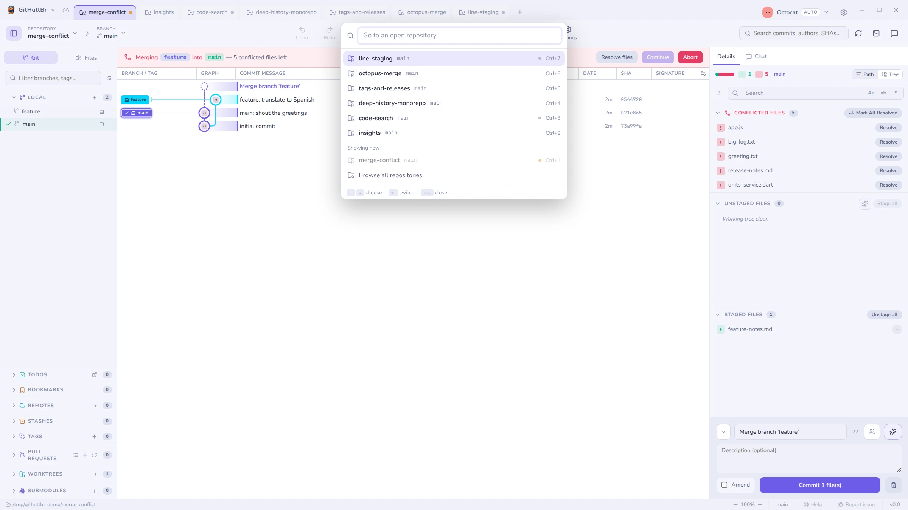

# Çalışma alanları, sekmeler ve gruplar

En gevşekten en sıkıya üç düzey.

## Sekmeler

Bir depo, bir sekme. Yeni sekme seçicisini açmak için <kbd>⌘T</kbd> /
<kbd>Ctrl+T</kbd>, etkin sekmeyi kapatmak için <kbd>⌘W</kbd> / <kbd>Ctrl+W</kbd>
kullanın. Ayrıca sürükleyerek sıralayabilir, orta tıkla kapatabilir ya da en son
kapattığınızı yeniden açmak için <kbd>⌘⇧T</kbd> tuşuna basabilirsiniz. Bir depo
sekmesine (ya da bir [grup](#gruplar) içindeki çipe) sağ tıklamak
[depo bağlam menüsünü](repo-menu.md) getirir — takma ad, worktree'ler, GitHub,
terminal, gösterme, düzenleyici ve en altta **Bu depoyu kapat** ile
**Diğerlerini kapat** (bir grup içindeki çip bunun yerine kaldırmayı sunar). Son
sekmeyi kapatın; <kbd>⌘W</kbd> bu kez pencereyi kapatır. Sekmedeki bir nokta
commit'lenmemiş çalışma, farklı bir nokta ise çakışma anlamına gelir.

Bir kapatma uyarısı çıkarsa <kbd>Escape</kbd> her zaman iptal eder.
<kbd>Enter</kbd> yalnızca sekme temizken onaylar — commit'lenmemiş değişiklikler
veya çakışmalar varken uyarı sizi bilerek düğmeye uzanmaya zorlar; böylece
<kbd>⌘W</kbd> sonrası yanlışlıkla basılan bir tuş, hâlâ elinizde tuttuğunuz
çalışmayı kapatamaz.

### Sekme boyutu

Varsayılan olarak (**Ayarlar → Yerleşim ve terminal → Sekme boyutu → Sığdır**) sekmeler bir
tarayıcınınkiler gibi davranır: şerit yer kalmayınca eşit olarak bir en küçük
genişliğe kadar daralırlar ve ancak o sınıra da ulaşılınca kaydırılırlar. **Sabit**
klasik davranışı geri getirir — her sekme içeriğinin genişliğini korur ve hepsi
sığmadığı anda şerit kaydırılır.

### Bir depoya gitmek

On ya da daha fazla depo açıkken şeritte birini bulmak kaydırmak demektir,
<kbd>⌘1</kbd>–<kbd>⌘9</kbd> dokuzuncu sekmede durur ve [komut paleti](search.md) açık
depoları tüm eylemlerle karıştırır. <kbd>⌘J</kbd> / <kbd>Ctrl+J</kbd> tuşlarına (ya
da **Görünüm → Depoya git…**) basın ve adından, klasöründen ya da dalından birkaç harf
yazın, sonra <kbd>Enter</kbd>.

Listede yalnızca açık depolar vardır, grup üyeleri dahil, en son baktığınız sırayla.
Az önce ayrıldığınız en baştadır, bu yüzden <kbd>⌘J</kbd> <kbd>Enter</kbd> sizi ona
geri götürür. Her satır sekmesinin gösterdiğini taşır: dal, commit’lenmemiş çalışma
ya da çakışma noktası, bulunduğu grup ve varsa <kbd>⌘1</kbd>–<kbd>⌘9</kbd> tuşu.
Ekrandaki depo altta soluk durur. Değiştiricinin arkasında hiçbir şey kararmaz;
dışarı bir tıklama ya da <kbd>Esc</kbd> onu kapatır.

Açık hiçbir şey eşleşmediğinde son satır, **Tüm depolarda ara**, aramanızı
[Depolar](repositories.md) sayfasına taşır. Kısayol **Ayarlar → Kısayollar** içinde
yeniden atanabilir.

*Sınırlar:* sıra yalnızca bu oturum için hatırlanır, bu yüzden yeniden başlattıktan
sonra sekme sırasından başlar. İki sekmede açık bir depo bir kez, ilk sekmesinde
listelenir. Başka [çalışma alanlarındaki](#çalışma-alanları) depolar listelenmez — önce çalışma
alanını değiştirin ya da Depolar sayfasını kullanın.

## Gruplar

İlgili depoları adlandırılmış, renk kodlu bir **grup sekmesinde** toplayın. Bir
grubun içinde depo başına bir çipin bulunduğu ikinci bir satır elde edersiniz ve
grubun kendisi tek seferde **Tümünü fetch et** veya **Tümünü pull et**
yapabilir.

Bir tane başlatmak için bir depo sekmesine sağ tıklayın → *Yeni grup…*: sekme, aynı
yerde o depoyu içeren bir gruba dönüşür. Bir grup var olduğunda aynı menü *Gruba ekle
→* der ve açık grupları listeler. Bir depo sekmesini bir grup çipinin üzerine
sürüklemek de aynısını yapar.

*Yeni grup…* adı ve rengi birlikte sorar. Renk, grupların hepsi aynı başlamasın diye,
henüz hiçbir açık grubun taşımadığı rastgele bir renkten başlar.

Bir grubun rengini değiştirmek için ona sağ tıklayın: on renk menüde bir nokta
sırası olarak durur, geçerli olanın çevresinde bir halka vardır ve bir tıklama onu
uygular. Sıranın altındaki *Özel renk…* başka herhangi bir renk için bir seçici açar.
Klasörler ve Depolar sayfasındaki bölümler aynı sırayı kullanır.

Bir grubu dağıtmak için ona sağ tıklayın → **Grubu dağıt**. Her depo, açık
sayfalarını koruyarak grubun yerinde sıradan bir sekme olur. **Grubu kapat** ise
grubu ve içindeki her depoyu kapatır. Klasörler dağıtmadan sağ çıkmaz: yalnızca bir
grubun içinde var olurlar.

Gruplar **istenen derinlikte iç içe klasörler** tutabilir: gruba sağ tıklayın →
*Yeni klasör…*, sonra depoları bir klasör çipinin üzerine sürükleyin. Her klasör
bir renk alır, sayılı bir çipe katlanır, içindeki her şeyin durum noktalarını
toplar ve tüm alt ağacını fetch ya da pull edebilir.

> Klasörler yalnızca düzenler. Birini silmek, içindeki depoları üst düzeye
> taşır — hiçbir depoyu kapatmaz.

Grupta henüz olmayan bir depoyu eklemek için grup adının yanındaki **+** düğmesine tıklayın. Grubun kendi sayfasını gösterir — klasör açma, klonlama, oluşturma ya da son kullanılan bir depoyu seçme — depolarından biri açıkken bile; bir çipe tıklamak sizi ona geri götürür.

## Bir depoya ait sayfalar

Bazı sayfalar başlı başına bir şey değildir: bir deponun [wiki](repo-wiki.md)
sayfası, [içgörüleri](insights.md), bir başlatma oturumunun duyurduğu
[geliştirme araçları](devtools.md). Sekme işgal etmezler — deponun kendisinde
küçük çipler olarak belirirler: bir simge ve hangi sayfa olduğunu söyleyen bir
kelime (*CI*, *PR’lar*, *Wiki*, bir pull request için *#482*, bir sürümün etiketi).
Tam ad ipucundadır ve uzun bir etiket ya da başlık üç noktayla kısaltılır.

- **Bir simgeye tıkla**, o sayfa görünsün. **Tekrar tıkla — ya da deponun adına
  tıkla** — depoya dönersin. Bir sayfa açıkken ad, işaretçi imleci ve üstüne
  gelince küçük bir hap alır: dönüş yolu odur.
- **Bir simgenin üstüne gel**, bir sekmenin kendi ✕'i gibi yanında bir ✕ açılır;
  yalnızca o sayfayı kapatır.
- Bir deponun açık sayfaları varken **kendi ✕'i gizlenir**: sayfa simgelerinin
  yanında bir sayfayı kapatıyormuş gibi okunuyordu. Deponun kendisini kapatmak
  için sekmeye orta tıkla ya da sağ tık menüsünü kullan.
- Bir **grup** içinde simgeler, ait oldukları deponun rozetinde durur ve
  yalnızca o depo seçiliyken. Gruptan başka bir depo seçmek *o* depoyu gösterir,
  komşusunun aracını değil.
- Aynı sayfayı yeniden açmak, ikinci bir simge eklemek yerine var olanı yakar.

Hiçbir yerde açık olmayan bir deponun taşıyacak simgesi yoktur; ona ait bir
sayfa o zaman kendi sekmesinde açılır — açmak her zaman bir şey açmalıdır.

## Çalışma alanları

Bir çalışma alanı, **kaydedilmiş bütün bir sekme şerididir**. Geçiş yapmak her
sekmeyi bir anda değiştirir: `Work` ile `Personal` birbirinin ayağına basmayı
bırakır.

Çalışma alanının adı sol üstte, GitHuttBr işaretinin yanında durur. Geçiş yapmak,
oluşturmak, yeniden adlandırmak, sıralamak veya silmek için ona tıklayın.
Yanında ise içinde bulunduğunuz çalışma alanı için
[Komuta merkezi](mission-control.md)'ni açan gösterge vardır.

**Ayrıca bakınız:** [Komuta merkezi](mission-control.md) · [Komut satırı](cli.md)
