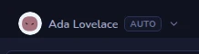
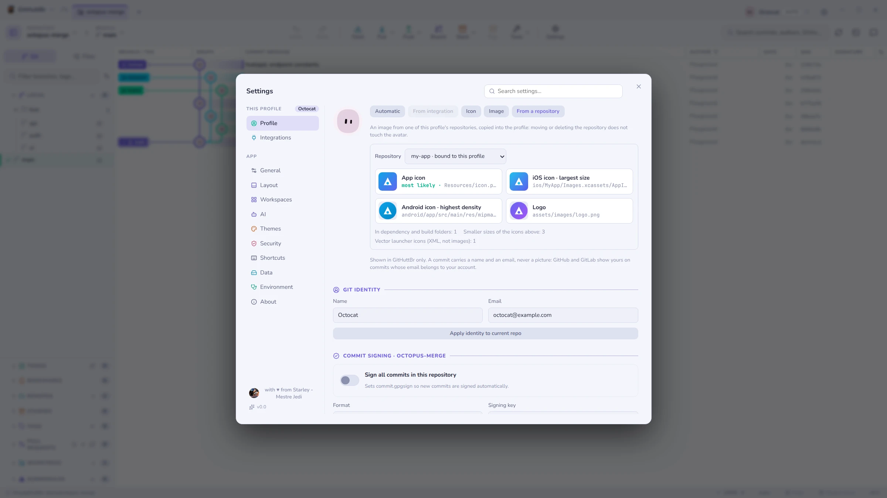

# Аватари авторів

Список комітів — це стіна імен, а імена читаються повільно. Зображення поруч із кожним
перетворює «хто це написав» на питання, на яке відповідаєш одним поглядом. GitHuttBr
дає його кожному показаному авторові: у стовпці автора в графі, у деталях коміту біля
автора й кожного співавтора, у виборі співавторів під час написання, у перемикачі
профілів і поряд із кожним профілем у налаштуваннях.

## Звідки береться зображення

Два джерела, у такому порядку:

| Джерело | Коли використовується |
|---|---|
| **Gravatar** | Пошта коміту має акаунт Gravatar. Завантажується через HTTPS, за хешем SHA-256 від адреси в нижньому регістрі. |
| **Згенерований аватар** | Усе інше — немає Gravatar, немає мережі або запит вимкнено. Малюється локально з адреси, ніколи не завантажується. |

Згенерований аватар — це маленьке створіння, а не кольоровий квадрат: та сама пошта
завжди дає ту саму форму й ті самі кольори, тож автор залишається пізнаваним між
репозиторіями та між запусками. Дві різні адреси практично ніколи не збігаються. Його
малює [blobatar](https://github.com/Alain00/blobatar) (MIT), і мережі він не потребує
взагалі: репозиторій, повний авторів без Gravatar, усе одно отримує повний набір
розрізнюваних облич, офлайн, під час першого малювання.

Оскільку основою є **пошта коміту**, автор, який комітить із двох адрес, отримує два
аватари. Це зроблено свідомо — це той самий сигнал, що дає стовпець автора в графі, і
зазвичай саме так помічають машинний акаунт або неправильно налаштований `user.email`.
Виправте це [атрибутами автора](attributes.md), якщо дві адреси справді одна людина.

## Обличчя в заголовку вікна

Аватар поруч з іменем вашого профілю — єдиний аватар у GitHuttBr, що означає **вас, у
цьому репозиторії, зараз**, тому він єдиний реагує на стан репозиторію. Він робить
обличчя, коли щось стається, і залишається нейтральним увесь інший час.

На що воно реагує, від найгіршого: файли, що залишилися в конфлікті; merge, rebase,
cherry-pick чи revert, якому ніхто не сказав, чим закінчитися; відокремлений HEAD —
злякано, якщо під ним є незакомічена робота, і просто розгублено, якщо немає; коміти,
що накопичуються без надсилання або без отримання з віддаленого; зміни, що
накопичуються без коміту; шухляда стешів, яку ніхто не відкриває; і репозиторій, куди
за місяць нічого не приїхало.

Перемагає найгірше: репозиторій із конфліктами *і* сорока ненадісланими комітами
носить конфлікти. Наведіть курсор на аватар, і підказка скаже, що саме спричинило це
обличчя: зображення, що змінюється без названої причини, — загадка, а не сигнал.
Читають підказку; обличчя лише змушує подивитися.

Пороги навмисно високі. Обличчя, що тривожиться на першому ненадісланому коміті,
тривожне завжди, а постійний сигнал — це сигнал, який перестають читати. Гілка без
upstream залишається нейтральною, а не задоволеною: «синхронна» — не твердження, яке
можна зробити про гілку, якої ніхто не надсилав.

**Це оздоблення, а не вимірювальний прилад.** Справжні числа несе рядок стану, і вірити
слід йому. Обличчя лише каже *щось відбувається*, одним поглядом.

### Рух

Аватар у заголовку вікна сам дихає та блимає. Вимкніть це в
**Налаштування → Теми → Граф → Анімувати аватар профілю** — вираз і далі відповідає
стану репозиторію, він просто перестає рухатися. Рух також автоматично пропускається,
якщо система просить зменшити анімацію.

Анімується лише цей аватар. Анімований аватар доводиться малювати живим SVG, а не
кешованим зображенням: нормально для одного й марнотратно для кількох сотень, які граф
малює під час прокручування.

## Зображення вашого профілю

Аватар у заголовку вікна та в списку профілів — ваш, тож його можна вибрати.
**Налаштування → Профіль → Аватар** пропонує п’ять джерел:

| Джерело | Що показує |
|---|---|
| **Автоматично** | Типово: ваш Gravatar для git-пошти профілю або згенероване обличчя — те, що реагує на репозиторій. |
| **З інтеграції** | Фото облікового запису GitHub або GitLab, підключеного до цього профілю в «Інтеграціях». Недоступно, доки його немає. |
| **Значок** | Один із 24 значків на вибраному кольорі. |
| **Зображення** | Вибраний вами файл — PNG або JPEG. Зменшується до 256 px і зберігається на цьому комп’ютері, у теці даних GitHuttBr, а не у файлі налаштувань. |
| **З репозиторію** | Значок або логотип з одного з репозиторіїв профілю — застосунку чи компанії, — скопійований у профіль як зображення. |

Зображення потрапляє в **Налаштування → Дані → Експортувати налаштування** і повертається під час
імпорту; видалення профілю видаляє і його.

### Значок із репозиторію

Робочий профіль часто вже має готове зображення: значок застосунку чи компанії,
що лежить у його репозиторії. **З репозиторію** перелічує найімовірніші з
репозиторіїв, **прив’язаних до профілю** (або, якщо таких немає, — з відкритого
зараз):

- спершу сам значок застосунку (`icon.png`, `Resources/icon.png`);
- `AppIcon.appiconset` для iOS у **найбільшому** розмірі, значок запуску Android
  (`mipmap-*/ic_launcher.png`) у **найвищій** щільності;
- далі логотипи та інші зображення, у назві яких є «icon».

Під списком підраховано й пояснено, що не ввійшло: зображення в теках
залежностей і збірки (`node_modules`, `Pods`, `build`…), менші розміри вже
показаних значків і значки запуску у вигляді векторного XML. Вибраний значок
копіюється в профіль зі зменшенням до 256 px — переміщення, перейменування чи
видалення репозиторію аватара не зачіпає.

Поки профіль у режимі **Автоматично**, сторінка один раз пропонує найімовірніший
значок: *Використати значок my-app?* — **Використати**, **Вибрати інший** або
**Не зараз**, після чого для цього профілю вона більше не питає. Нічого не
змінюється, доки ви не виберете.

Чого це не вміє: пропонує лише зображення, які репозиторій зберігає як файли
(PNG, JPEG, WebP, SVG тощо), а не значки, згенеровані під час збірки; і не
стежить за репозиторієм — новий значок там доведеться вибрати знову вручну.

**Коміт ніколи не містить зображення.** У ньому лише ім’я та пошта. GitHub і GitLab
показують фото вашого облікового запису біля коміту, чия пошта належить вашому
обліковому запису. Якщо не хочете публікувати справжню адресу, git-ідентичність
профілю після підключення пропонує **Використати мою noreply-адресу GitHub** —
адресу, яку сервіс тримає прихованою і яка однаково пов’язує коміти з вами.

Це стосується лише ваших профілів. Решта авторів і далі отримує зображення своєї
пошти з коміту, як описано вище. Вибране зображення, як і фото з Gravatar, не має
виразу обличчя: на репозиторій реагує лише автоматичний аватар.

## Як вимкнути запит

**Налаштування → Теми → Граф → Показувати аватари.**

Вимкнено означає:

- жодного запиту до `gravatar.com`, ніколи — ні відкладеного, ні кешованого з
  повторенням;
- аватари все одно показуються, усі згенеровані локально.

Отже, це перемикач приватності, а не «сховати зображення». Налаштування, яке прибирає
аватари повністю, немає.

## Обмеження

- **Запит до Gravatar повідомляє gravatar.com, що цю адресу дивилися.** Хеш не є
  таємницею: будь-хто з адресою-кандидатом може її захешувати й порівняти. Якщо список
  авторів репозиторію — те, що ви віддали б третій стороні неохоче, вимкніть запит до
  його відкриття.
- **Лише Gravatar.** Аватари, завантажені на GitHub, GitLab чи Bitbucket, не читаються:
  це вимагало б автентифікованого виклику API хостингу на кожного автора — надто багато
  мережі заради оздоби.
- **Жодних перевизначень.** Не можна закріпити за автором вибране зображення й не можна
  змінити стиль генерації. Аватар — функція адреси пошти й нічого більше.
- **Фото з Gravatar не має виразу.** Якщо пошта вашого профілю його має, заголовок
  показує фото й жодного обличчя — фотографія не вміє кривлятися. Вимкніть запит, якщо
  волієте виразного блоба.
- **Обличчя стежить лише за активним репозиторієм.** На вкладці, що не є репозиторієм,
  реагувати ні на що, тому воно залишається нейтральним.
- **Одне прочитання за раз.** Обличчя показує лише найгірше зі знайденого, тож
  репозиторій може бути неохайним одразу по-різному й усе одно носити один вираз. Це
  не список стану — цим опікуються рядок стану та підказка.
- **Маленьке залишається маленьким.** У стовпці автора в графі аватар — 16px, що несе
  колір і силует, але не деталі. Деталі коміту малюють автора в 38px, і там обличчя
  видно по-справжньому.

**Дивіться також:** [Теми та оформлення](themes.md) · [Граф комітів](graph.md) ·
[Атрибути автора](attributes.md) · [Профілі](profiles.md)
