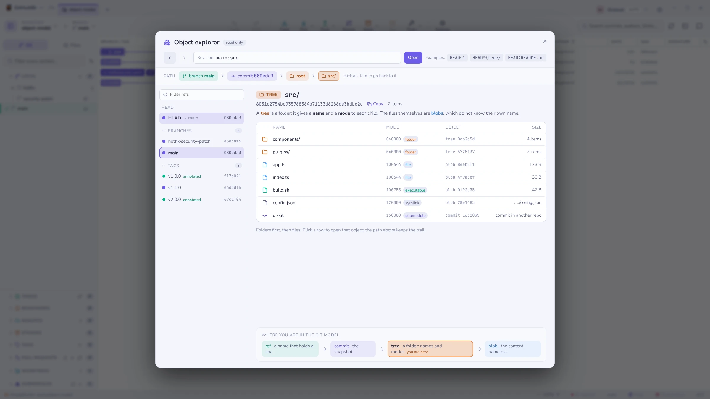

# Оглядач об’єктів

Git має репутацію складного. Майже вся вона походить із того, що модель ніколи
не показують: **чотири види об’єктів і вказівники**. Щойно ви зможете клацнути
коміт, потрапити на його дерево і виявити, що ваш файл *є* блобом, якому ім’я
дало дерево, порцеляна перестане бути магією.

`⌘K` → **Оглядач об’єктів**. Ніщо на цій сторінці не може змінити жодного
байта — кожен виклик за нею це читання.

## Чотири об’єкти

| Об’єкт | Це | Знає |
|--------|----|-------|
| **blob** | *Вміст* файлу | Нічого. Ні свого імені, ні шляху, ні історії |
| **tree** | Перелік каталогу | Імена, режими і sha кожного дочірнього блоба чи дерева |
| **commit** | Один знімок | Своє дерево, своїх батьків, автора, комітера, повідомлення |
| **tag** | Анотований тег | Об’єкт, на який вказує, того, хто теґував, і повідомлення |

Найбільша несподіванка для більшості — перший рядок. **У блоба немає імені.**
Два файли з однаковим вмістом будь-де у вашій історії — це той самий блоб,
збережений один раз. Ім’я живе в дереві, яке на нього вказує — саме тому git
відстежує вміст, а не файли, і саме тому перейменування виявляються, а не
записуються.

**Реф** — `refs/heads/main`, `refs/tags/v1.0`, `HEAD` — це просто файл, що
містить sha. Ось і вся «дешевизна гілкування».

## Прогулянка

Ліва колонка перелічує всі посилання, згруповані так, як їх групує git: HEAD (з
`→ main`, коли він на гілці), Гілки, Теги й Віддалені, кожна група з лічильником.
Віддалені спочатку згорнуті. Квадратна позначка — посилання на коміт, кругла
зелена — **анотований** тег. Фільтр звужує всі групи одразу. Натисніть на
посилання, щоб потрапити на об’єкт, який воно називає; цей рядок лишається
підсвіченим, поки ви йдете від нього.

Далі все — двері:

- **Коміт** показує, на що він **вказує**, — кореневе дерево з кількістю
  елементів і кожного батька з його заголовком, — потім автора й комітера
  (*той самий, що автор*, якщо збігаються) та повідомлення.
- **Дерево** — це таблиця: ім’я, режим, об’єкт, розмір, теки спершу. Кожен режим
  названо словами: *файл*, *виконуваний*, *тека*, *симлінк*, *підмодуль*. Тека
  каже, скільки в ній елементів; симлінк — куди він вказує.
- **Blob** показує текст із номерами рядків (для великого — лише початок) або
  прямо каже, що він двійковий. Якщо ви дійшли до нього через дерево, смуга
  каже, як він там називається, — *Називається src/app.ts у коміті 07c6f3d,
  режим 100644 (звичайний файл)* — з посиланням на історію файлу.
- **Анотований тег** вказує на об’єкт, який називає, і зберігає автора тегу.

### Шлях

Смуга під полем ревізії — пройдений **шлях**:
`гілка main → коміт 07c6f3d → корінь → src/ → app.ts`. Дерево коміту — це
**корінь**; файл чи тека отримує ім’я рядка, на який ви натиснули. Натисніть на
будь-який елемент, щоб повернутися до нього. Введення ревізії, вибір посилання
чи одного з прикладів біля **Відкрити** починає новий шлях.

**Назад** і **Вперед** проходять усім, що ви відкрили, як у браузері: після
кроку назад «Вперед» повертає, доки ви не відкриєте звідти щось нове. Поле
ревізії йде за прогулянкою, тож `main:src/app.ts` завжди можна скопіювати.

### Кольори

Кожен вид зберігає один колір усюди, де з’являється, — значок, елемент шляху,
картка, рядок: коміт в акцентному кольорі теми, дерево в її жовтому, blob синім,
тег і посилання зеленим. Під заголовком об’єкта одне речення пояснює, чим цей
вид *є*.

### Де ви в моделі

Смуга внизу панелі — ланцюг git: **ref → commit → tree → blob**, а для
анотованого тегу — **tag** між ref і commit; вид на екрані підсвічено як *ви тут*.

## Введення ревізії

Поле приймає все, що приймає `git rev-parse`, і саме тут це перестає бути
браузером і стає способом вчитися:

| Введіть це | Щоб отримати |
|-----------|--------|
| `HEAD` | Поточний коміт |
| `HEAD~3` | Три коміти назад |
| `HEAD^{tree}` | Дерево того коміта, очищене |
| `HEAD:src/app.ts` | Блоб для того шляху, напряму |
| `v1.0^{}` | Те, на що вказує анотований тег, а не сам об’єкт тега |
| `a1b2c3d` | Будь-який об’єкт за sha — скорочення працюють |

Цифри режиму в переліку дерева варто знати: `100644` — файл, `100755` —
виконуваний, `040000` — піддерево, `120000` — символічне посилання, `160000` —
gitlink підмодуля; останнє і є всім, що зберігає підмодуль.

## Обмеження, про які варто знати

- **Лише читання, і це навмисно.** Тут нема чим писати. Створення об’єктів
  руками — це вправа з `git hash-object`, і їй місце в терміналі.
- **Великі блоби обрізаються** після перших 200 КБ — досить, щоб побачити, що
  це, і недосить, щоб підвісити вікно.
- **Розміри — це розмір вмісту об’єкта**, як його повідомляє `git cat-file -s`,
  а не те, скільки він коштує на диску після пакування. Про це див.
  [обслуговування](maintenance.md).
- **Недосяжні об’єкти — теж об’єкти.** Вставте sha зі звіту `git fsck` про
  висячі об’єкти, і він відкриється; часто це найшвидший спосіб побачити, що
  містив загублений коміт, перш ніж вирішувати, чи відновлювати його.
- **Рядок підмодуля не відкривається.** Його gitlink називає коміт іншого
  репозиторію, якого тут немає.
- **Лічильники й цілі симлінків мають межу.** Дерево з понад 300 підтеками
  показує їх без лічильника, і ціль показують лише перші 50 симлінків.
- **Шлях закінчується разом із вікном.** Закрийте його — наступне почне знову з
  гілки HEAD.

Дивіться також: [Граф](graph.md) · [Обслуговування репозиторію](maintenance.md) ·
[Відновлення](recovery.md)
