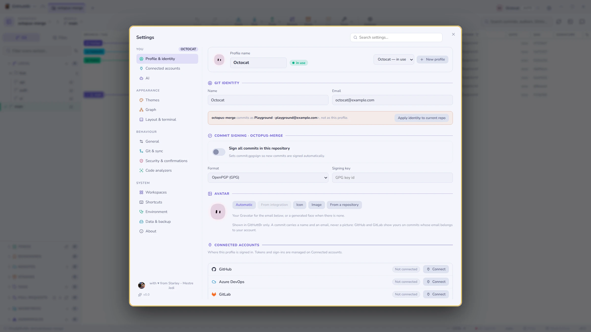

# Профілі

Профіль зв’язує **особистість Git** (ім’я та пошту) з її **токенами
інтеграцій**. Перемкніть профіль — і зміниться і те, і те разом: коміти
підписані правильним автором, а виклики API йдуть від правильного акаунта.

Корисно, коли та сама машина працює і з робочими, і з особистими
репозиторіями, або коли у вас два акаунти GitHub.

## Редагувати профіль, використовувати профіль

Налаштування ділять свої сторінки на дві групи. **Цей профіль** містить
сторінки, що змінюються разом із профілем, — **Профіль** та **Інтеграції**.
**Застосунок** містить усе інше: воно діє в будь-якому профілі, і про це сказано
вгорі сторінки.

Обидві сторінки профілю відкриваються смугою: *Редагується профіль* і вибір
профілю. Вибір визначає, який профіль ви **редагуєте**; він не змінює того,
який **використовує** застосунок. Коли вони різні, про це каже бурштинова смуга —
*Ви редагуєте Робота. Застосунок використовує Особистий* — з кнопкою
**Використовувати цей профіль** для перемикання. Саме тоді найлегше прив’язати
обліковий запис не до того профілю, тож сторінка Інтеграції ще й називає профіль
на кожній картці та на самій кнопці: **Прив’язати до профілю Робота**, і
підтвердження це повторює. Створення й видалення — у тій самій смузі; видалення
спершу перепитує.

## Спільний ШІ

Профілю не потрібен власний ШІ: один [загальний
ШІ](ai.md#один-ші-для-всіх-профілів) обслуговує всі профілі, а профіль
переходить на власний лише тоді, коли мусить. Цей вибір стосується всього:
профіль на загальному ШІ й пише так, як налаштовано загальний ШІ, — стиль
комітів, додаткові правила для комітів, чат репозиторію. Профіль, якому потрібен інший
стиль, отримує власний ШІ — копію загального, яку потім може змінювати. Усе це
редагується на сторінці **ШІ**; сторінка Профіль лише каже, який ШІ використовує
профіль, і веде туди.

## У кожного профілю свої облікові записи

Окрім токена, профіль може **прив'язати** вхід, який уже є на комп'ютері, — з
credential helper git або GitHub CLI — у Налаштування → Інтеграції. Прив'язка
належить одному профілю: новий профіль починає без підключення, а обліковий
запис, який уже має інший профіль, відхиляється. Тож два профілі можуть мати два
облікові записи GitHub (або Azure DevOps) одночасно. Див. [Хостинг](hosting.md).

## Прив’язка до репозиторію

Репозиторій можна **прив’язати до профілю**, щоб фоновий фетч для нього завжди
автентифікувався від правильного акаунта — навіть поки ви дивитеся на
репозиторій, що належить іншому.

Токени живуть у [ключниці вашої ОС](security.md), а не у файлі налаштувань.

**Дивіться також:** [Безпека та секрети](security.md) · [Хостинг](hosting.md)
