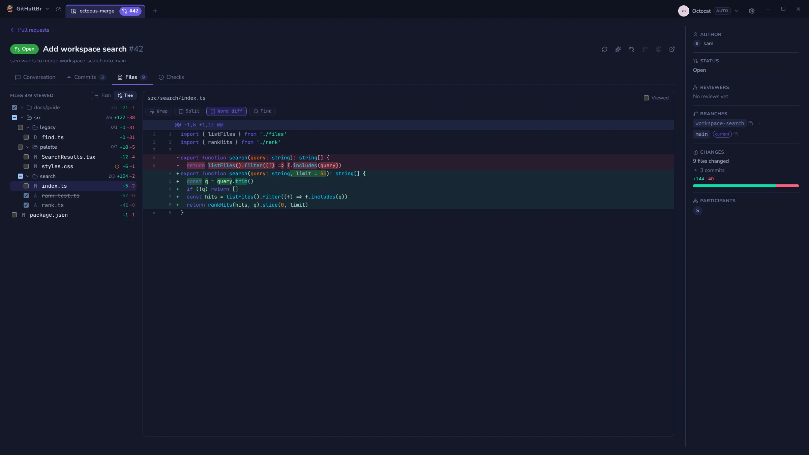

# Сторінка pull requests

У жвавому репозиторії одночасно відкрито двадцять pull request’ів. Бічна панель
їх перелічує, але один рядок на кожен каже мало: чий який, які чекають на вас,
які почервоніли. Щоб це дізнатися, доводилося відкривати кожен, читати,
повертатися, відкривати наступний. **Сторінка pull requests** відповідає на ці
питання на одному екрані, а коли ви відкриваєте pull request, **‹ ›** ведуть до
наступного з того самого списку без повернення назад.

## Як відкрити

- **Значок списку** в заголовку **PULL REQUESTS** бічної панелі (*Усі pull
  requests*).
- *Pull requests…* у палітрі команд (⌘K) або **Інструменти → Pull requests…**.
- **Чип pull requests** у рядку репозиторію в [Центрі
  керування](mission-control.md). Відкрита звідти сторінка починається з **← Назад
  до Центру керування** і зберігає цю кнопку, коли ви відкриваєте один з її pull
  request’ів і повертаєтеся через **← Pull requests**.

Як вікі та [запуски CI](ci-runs.md), сторінка відкривається у вкладці
репозиторію.

## Стани

Сегментований перемикач ліворуч від пошуку містить чотири стани, у кожного —
скільки в ньому pull request’ів.

| Стан | Що в ньому |
|---|---|
| **Відкриті** | Усі відкриті pull request’и, включно з чернетками |
| **Чернетки** | Лише відкриті, позначені як чернетка |
| **Злиті** | Злиті pull request’и, завантажуються під час першого відкриття вкладки |
| **Закриті** | Закриті без злиття (відхилені, покинуті), завантажуються разом зі злитими |

Лічильники біля «Відкритих» і «Чернеток» беруться зі списку, який уже має бічна
панель. «Злиті» та «Закриті» запитуються, лише коли ви відкриваєте одну з них, і
один раз за сеанс; **Оновити** запитує знову.

## Фільтри

| Фільтр | Залишає |
|---|---|
| **Пошук** | Pull request’и, у яких заголовок, опис, автор, гілки або номер містять кожне введене слово. `#482` або `482` знаходить цей номер; збіги підсвічуються в заголовку |
| **Автор** | Одного автора — у кожного вказано, скільки в нього pull request’ів на цій вкладці. **Я** — першим |
| **Рецензент** | Одного запитаного рецензента або **Чекають мого рев'ю** |
| **Цільова гілка** | Pull request’и в цю гілку |
| **Чекають мого рев'ю** | Скорочення для *Рецензент: чекають мого рев'ю* |
| **Мої** | Скорочення для *Автор: Я* |
| **CI падає** | Pull request’и, у яких перевірки на head упали |

Пошук і три чипи стоять в одному ряду; кожен чип каже, скільки pull request’ів
поточного стану він залишить. **Автор**, **Рецензент** і **Цільова гілка**
сховано під **Більше фільтрів ▾**, який підсвічується, поки задано один із них.

Поки ввімкнено хоч один фільтр, рядок над списком каже, скільки pull request’ів
стану показано і які фільтри ввімкнено, а **скинути фільтри** знімає їх усі.

Фільтри зберігаються для кожного репозиторію, **поки застосунок запущено** —
підіть зі сторінки, поверніться, і вони будуть такими, як ви їх залишили. Між
перезапусками вони навмисно не зберігаються: фільтр «мої, CI падає», що мовчки
повернувся через тиждень, сховав би pull request’и, які ви не просили ховати.

### Хто такий «я»

«Я» — це обліковий запис, під яким виклики цього репозиторію входять на хостинг:
профіль, до якого [прив’язано](profiles.md) репозиторій, а інакше активний, — і
дізнаються його в самого хостингу. Якщо токен не може сказати, чий він (немає
користувацького scope), або токена немає, **Я**, **Мої** та **Чекають мого
рев'ю** не пропонуються.

## Список

«Відкриті» та «Чернетки» поділено на три розділи — у тому порядку, у якому ви їх
розбираєте:

| Розділ | Що в ньому |
|---|---|
| **Чекають вашого рев'ю** | Pull request’и, рев’ю яких у вас хтось запитав, — заголовок жовтим |
| **Ваші pull request'и** | Ті, що написали ви |
| **Інші** | Усе інше, згорнуте за **показати**, поки у двох розділах вище щось є; пошук або фільтр його розгортає |

Якщо хостинг не може сказати, хто ви, сортувати нічого, і список — одна картка.
«Злиті» та «Закриті» — це історія: одна картка, без розділів.

Кожен рядок читається зліва направо:

| Частина | Що показує |
|---|---|
| **Крапка** | Pull request змінився відтоді, як ви востаннє пішли з його сторінки. У того, який ви жодного разу не відкривали, крапки немає — порівнювати нема з чим |
| **#** | Номер — зелений, поки відкритий, сірий у чернетки |
| **Заголовок** | Заголовок, його тип [Conventional Commits](committing.md) кольоровим чипом (`feat`, `fix`, `docs`…), позначка *чернетка*. Під ним: автор (у ваших пропущено), вихідна → цільова і **Коментарів: N** — або **Нових коментарів: N**, якщо з вашого останнього візиту хтось інший щось написав |
| **Розмір** | `+48 −12 · Файлів: 4` — додані й вилучені рядки, зачеплені файли; лише `Файлів: 4`, де хостинг не рахує рядків |
| **Рев’ю** | Чинний вердикт кожного рецензента — **✓ bruno схвалив(ла)**, **✕ ana попросив(ла) змін**, — далі ті, у кого рев’ю ще запитано, **● чекає на вас** жовтим. **✓ готовий до злиття**, коли хостинг каже, що рев’ю завершено, а перевірки не впали; **немає рецензентів**, коли нікого не просили або ніхто не відповів |
| **Перевірки** | Перевірки head — `✓ 6/6`, `✕ 1 з помилкою`, `● 2 виконується`; наведіть курсор, щоб побачити лічильники |
| **Оновлено** | Як давно він востаннє змінювався; наведіть курсор, щоб побачити дату |

### Що дає кожен хостинг

Розмір, коментарі та вердикти є не в списку кожного хостингу, а сторінка не
відкриває кожен pull request окремо, щоб їх знайти, — за одним винятком, про
нього нижче: чого немає в списку, лишається порожнім, а не нулем.

| Хостинг | Розмір | Коментарі | Вердикти рев’ю |
|---|---|---|---|
| **GitHub** | ✓ | ✓, і які з них нові | ✓, і *готовий до злиття* — один додатковий запит GraphQL на весь список |
| **GitLab** | — | ✓ (лише кількість) | У кого запитано; *готовий до злиття* — зі статусу злиття GitLab |
| **Azure DevOps** | Лише файли, читаються під час відкриття сторінки | — | ✓ за голосами рецензентів |
| **Bitbucket Data Center** | — | ✓ (лише кількість) | ✓ |
| **Bitbucket Cloud** | — | ✓ (лише кількість) | — |
| **Forgejo** | ✓ якщо сервер його заповнює | ✓ (лише кількість) | У кого запитано |

**Azure DevOps: лише файли.** Його API не дає кількості рядків для pull request’а — для цього знадобився б diff кожного файлу, — тож у клітинці `Файлів: 4`, без +/−. Кількості файлів у його списку теж немає, тож ця сторінка читає її сама — для відкритих і чернеткових рядків, які вона малює. Злиті та закриті лишаються порожніми: повний їх список коштував би сотень запитів заради числа, за яким ніхто не робить рев’ю. Два запити на pull request (його ітерації, потім зміни останньої — та сама кількість, що на його вкладці «Файли»), по чотири одночасно. Кількості зберігаються, доки хтось не запушить у цей pull request, тож оновлення або повернення на сторінку питає лише про ті, що змінилися. Періодичне оновлення бічної панелі їх ніколи не читає. Кількість, яку не вдалося прочитати — немає прав, сервер обмежує запити, — лишає клітинку порожньою, без помилки; pull request із понад 20 000 змін не рахується.

Кількість коментарів — це коментарі обговорення; коментарі до рядка диффа до неї не
входять. Без токена запит до GitHub пропускається, і ці стовпці лишаються порожніми.

Усередині розділу рядки відсортовано за останньою активністю, а **‹ ›** усередині
pull request’а проходять їх у тому порядку, у якому їх намальовано. Клацання
відкриває власну сторінку pull request’а ([Хостинг та pull-реквести](hosting.md)).
На хостингу без такої сторінки рядок відкриває pull request у браузері.

У [чекауті форка](hosting.md#ваші-pull-requestи-в-батьківському-репозиторії-форка) перелічено й ваші pull request’и в
батьківському репозиторії, з позначкою *у owner/repo*.

## Як іти списком із pull request’а

Pull request, відкритий зі сторінки, показує смугу над своїм заголовком:

- **← Pull requests** повертає до списку з фільтрами в тому вигляді, у якому ви
  їх залишили.
- **‹ k з n ›** переходить до попереднього або наступного pull request’а списку,
  з якого ви його відкрили, — відфільтрованого списку, у його порядку, яким він
  був у момент клацання. Підказки називають pull request, до якого веде кожна
  стрілка.
- **Alt+← / Alt+→** роблять те саме з клавіатури. Їх можна перепризначити в
  **Налаштування → Скорочення**. Вони не спрацьовують, поки курсор стоїть у
  текстовому полі (де Option+← рухає по словах) і поки фокус у терміналу.

Перехід замінює сторінку на місці, тож перегляд десяти pull request’ів не
залишає десяти значків на вкладці; відкриття іншого рядка зі списку теж її
замінює.

Pull request, відкритий **з будь-якого іншого місця** — з бічної панелі, зі
сповіщення, — ходить відкритими pull request’ами репозиторію в типовому порядку
сторінки («Відкриті», без фільтрів). Той, якого немає і в цьому списку,
наприклад злитий рівень стека, показує лише шлях назад до списку.

## Перехід до гілки pull request’а

Щоб працювати над pull request’ом, потрібен чекаут його гілки — а в репозиторії
з тисячами гілок найповільніше знайти її за назвою у списку гілок. На сторінці
pull request’а це робить за вас поле **Гілки**:

- **Назва гілки — посилання.** Клацання робить чекаут цієї гілки і переводить
  вас у граф репозиторію, до вершини гілки. Сторінка pull request’а лишається
  відкритою у вкладці.
- **Гілка, яка є лише на сервері**, спершу завантажується фетчем — лише вона, а
  не весь remote — і витягується як локальна гілка, що її відстежує. На гілку,
  яка у вас уже є локально, ви перемикаєтеся як є — вона не оновлюється, тож
  зробіть пул, коли знадобляться останні коміти pull request’а.
- **Гілка, на якій ви вже перебуваєте**, натомість позначена як *поточна*.
  Чекауту не відбувається.
- **Кнопка копіювання** біля кожної назви кладе її в буфер обміну.
- **Скасувати** (⌘Z) повертає на гілку, де ви були, і видаляє локальну гілку,
  створену чекаутом, — якщо тільки ви відтоді не закомітили в неї; у такому разі
  її не чіпають.

У заголовку ті самі дві дії є у вигляді кнопок: **Перейти до вихідної гілки** і
**Перейти до цільової гілки**. Вони працюють і для гілки, на якій ви вже
перебуваєте, — просто переводять вас у репозиторій. Якщо ввімкнено [кольори значків](themes.md#кольори-значків), кожна кнопка заголовка має свій колір: оновити — синій, AI-рев’ю — фіолетовий, попередній перегляд — бірюзовий, вихідна гілка — зелений, цільова — помаранчевий («Відкрити у браузері» лишається сірою).

Нічого не запитується до клацання: відкриття pull request’а не читає і не
завантажує жодної гілки.

Чого це не робить:

- **Вихідна гілка форка** живе в іншому репозиторії, тому в неї немає посилання
  (кнопка копіювання лишається). **Переглянути pull request локально…**, що
  пропонується просто під нею, — спосіб запустити його тут. Цільова гілка й далі
  посилання.
- **Немає відповідного remote.** Гілку шукають на remote, чия URL — репозиторій
  pull request’а. Якщо жоден налаштований remote туди не вказує, посилання
  нічого не робить, а його підказка пояснює чому.
- **Видалена гілка.** Злитий pull request часто забрав свою гілку з собою; тоді
  фетч повідомляє, що гілки на remote більше немає, і ви лишаєтеся на pull
  request’і.
- **Локальні зміни.** Чекаут не руйнівний, тому підтвердження немає, — а git
  відмовляється робити чекаут, якщо ваші незакомічені зміни було б перезаписано.
  Помилка називає файли; закомітьте їх або заховайте в stash і клацніть знову.
- **Це вікно.** Чекаут відбувається в робочому каталозі цього репозиторію. Якщо
  гілку вже витягнуто в іншому [робочому дереві](worktrees.md), натомість
  відкривається вкладка того робочого дерева.

## Коміти

Бічна панель казала, скільки комітів у pull request’і, але ніколи — які. Рев’ю по
одному коміту — а саме так задумано читати більшість pull request’ів — відправляло
вас у браузер. Вкладка **Коміти**, між «Обговоренням» і «Оновленнями», перелічує їх:

- **Рядок зведення** вгорі: скільки комітів, від скількох авторів, **+/−**
  pull request’а й по одному кольоровому чипу на кожен тип
  [Conventional Commit](https://www.conventionalcommits.org/) з його кількістю —
  *feat 2 · fix 1 · test 1* каже, що це за зміна, ще до того, як ви прочитаєте з
  неї бодай рядок. Фічі зелені, виправлення й відкати червоні, тести — кольору
  акценту, продуктивність жовта, решта сіра.
- **Спершу старіші**, у тому порядку, в якому вони застосовуються, згруповані за
  днем, коли їх написано. Коміт, що потрапив під час ребейзу не в порядку дат,
  починає власний день, а не переставляється.
- У кожному рядку — фото автора (де хостинг його дає), тема — її тип тим самим
  кольоровим чипом, а область приглушено, якщо тема дотримується Conventional
  Commits, — автор, скільки часу минуло і, для коміту, який є в цьому клоні, його
  **+/−** та скільки файлів він зачепив. Далі точка **CI** (зелена — пройшло,
  червона — впало, жовта — триває), якщо хостинг повідомляє про запуск для цього
  коміту, короткий SHA й **Показати diff**. Значок **злиття** позначає коміт із
  двома батьками, якщо хостинг це повідомляє.
- У коміту, де є не лише тема, решта повідомлення показана під рядком.
- Під час наведення **Копіювати** кладе повний SHA в буфер обміну, а **Відкрити
  у браузері** відкриває коміт на хостингу — всередині pull request’а, якщо в
  хостингу є така сторінка (GitHub, GitLab, Bitbucket Data Center), інакше на
  сторінці коміту в репозиторії.

Коміти, зроблені після того, як ви востаннє пішли з pull request’а, стоять під
лінією **Нове з останнього візиту** — та сама позначка, що й у вкладці
«Обговорення», від того самого візиту.

**Показати diff** — або клацання по рядку, або перехід до нього через Tab і Enter
— відкриває коміт у застосунку, як клацання в графі: вигляд репозиторію, цей коміт
вибрано, його деталі відкрито. Це працює, коли в цьому клоні коміт **є**. Коли
його немає, рядок каже *ще немає у вашому репозиторії*, і його кнопка змінюється:

- **Отримати гілку** — той самий фетч однієї гілки, що й під час
  [переходу до гілки](#перехід-до-гілки-pull-requestа), але без чекауту. Кожен коміт, що прийшов із
  нею, після цього відкривається; якщо цей не прийшов (відтоді його переписав
  force push), про це скаже сповіщення.
- **Отримати коміти пул-реквесту** — для pull request’а з **форка**. Його гілка живе в
  іншому репозиторії, але більшість хостингів віддзеркалюють head pull request’а в
  цільовому репозиторії під окремим посиланням — `refs/pull/N/head` (GitHub, GitHub
  Enterprise Server, Forgejo), `refs/merge-requests/N/head` (GitLab),
  `refs/pull-requests/N/from` (Bitbucket Data Center). Застосунок завантажує лише це
  посилання, без тегів, у власне, `refs/githuttbr/pr/<remote>/N`, і коміт
  відкривається як будь-який інший: граф малює цей head як доріжку без підпису.
  Повторний фетч пересуває посилання на head у тодішньому вигляді. Якщо force push
  відтоді викинув коміт, про це скаже сповіщення.
- **Відкрити у браузері** — на випадок, коли фетч неможливий.

**Порівняти два коміти** просить позначити два рядки, а потім відкриває
[порівняння](merging.md#порівняти-два-будь-які-рефи) між ними у вигляді репозиторію:
старіший — база, тож ви бачите, що сталося від одного до іншого, — коміти між ними
та їхній спільний diff. Обидва мають бути в цьому клоні; доки їх немає, кнопка
неактивна.

Список читається під час першого відкриття вкладки, а не разом зі сторінкою, і
знову за кожного **Оновити**. Поки його немає, лічильник вкладки — той, що
хостинг повідомив для pull request’а. Злиті й закриті pull request’и показують свої
коміти так само.

Чого це не робить:

- **Не більше 250 комітів.** Сам GitHub перелічує для pull request’а не більше 250;
  застосунок зупиняється на тому самому числі на будь-якому хостингу і пише *на
  хостингу їх більше*, коли це так, із посиланням на pull request на хостингу. Які
  саме 250 — залежить від порядку, у якому їх перелічує хостинг: застосунок лишає
  перші в списку, а рядок над списком каже, які:

  | Хостинг | Довший pull request показує |
  |---|---|
  | GitHub | **Перші** 250 (власна межа GitHub) |
  | GitLab, Azure DevOps, Bitbucket Data Center, bitbucket.org | **250 найновіших** |
  | Forgejo | Той кінець, який сервер віддає першим; його порядок не задокументовано |
- **Head форка там, де хостинг його не віддзеркалює.** Azure DevOps публікує лише
  результат злиття, ніколи власний head pull request’а, а bitbucket.org — ні те, ні
  інше: там рядок пропонує лише браузер. На іншому хостингу, який його все ж не
  віддзеркалює, про це скаже фетч. **Переглянути pull request локально…** підтягує
  результат злиття з Azure, якщо потрібен саме він.
- **Завантажені head лишаються.** `refs/githuttbr/pr/…` — не гілка: її не можна взяти
  на чекаут чи запушити, фетч із prune її не чіпає, і git зберігає її коміти. Ніщо її
  й не видаляє — ні закриття сторінки, ні [прибирання гілок](branch-cleanup.md). Щоб
  позбутися їх, видаліть посилання вручну: `git for-each-ref refs/githuttbr/pr`
  перелічує їх, а `git update-ref -d <ref>` видаляє одне.
- **Remote, у назві якого є `/`**, не може бути однією частиною назви цього
  посилання, тому там фетч відхиляється.
- **Видалена гілка.** Злитий pull request часто забрав свою гілку з собою: фетч про
  це скаже. bitbucket.org узагалі не показує комітів, щойно вихідної гілки не
  стало.
- **Злиття squash.** Коміти pull request’а, злитого через squash, так і не потрапили
  в цільову гілку, тож після видалення його гілки вони є лише на хостингу.
- **Числа за комітами беруться з вашого клону.** **+/−** і кількість файлів
  читаються з git і ніколи не запитуються в хостингу, тому в ще не отриманого
  коміту їх немає, як і в злиття (його зміна — відносно двох батьків). Частковий
  клон, у якому немає файлів коміту, нічого не показує, замість того щоб їх
  завантажувати.
- **CI лише для 40 останніх комітів**, без шуму: по запиту на коміт у довгому pull
  request’і набігало б багато, а CI зазвичай і так запускалася на надісланих head.
  Немає облікових даних для хостингу — немає точок, і вхід ніколи не просять.
- **Чипи типів читають тему.** Команда, яка не пише Conventional Commits, не
  отримує ні чипів, ні підрахунку типів — ніщо не вгадується.
- **Автори** названі так, як їх називають їхні коміти. GitLab, Azure DevOps і
  Bitbucket Data Center не віддають аватар без входу, який зображення передати не
  може, тому в цих рядках — ініціал.
- **Довгі повідомлення в Azure DevOps** можуть бути обрізані: список Azure усікає
  повідомлення коміту, а застосунок показує те, що він надсилає.
- Pull request’и **bitbucket.org** відкриваються в браузері — застосунок поки не має
  для них сторінки, — тож до цієї вкладки там не дійти, хоча список застосунок
  прочитати може.

## Оновлення

Pull request, який ви рев’юїли в понеділок, до четверга посунувся. Вкладка «Коміти»
показує, де він зараз, але не що сталося відтоді: які коміти прийшли з яким пушем, чи
не зробив хтось force push, переписавши те, що ви вже прочитали, і який вигляд має код
*порівняно з версією, яку ви бачили*. Вкладка **Оновлення**, між «Комітами» і
«Файлами», відповідає на це — як власна вкладка Updates в Azure DevOps.

Вона перелічує кожен пуш у pull request, **спершу новіші**:

- **Оновлення 1 — відкриття** — це пуш, з яким pull request відкрили; кожен
  наступний пуш отримує наступний номер.
- У кожному показано, **коли**, **хто запушив** (якщо хостинг це повідомляє), і
  **додані коміти** — короткий SHA, тема, автор. Якщо хостинг повідомляє про коміти,
  які пуш прибрав із гілки, вони перелічені під **Вилучені коміти**, закресленими.
- Force push чи ребейз позначено як **історію переписано**: коміти, які ви читали,
  могли зникнути, а перелічені можуть бути новими копіями старої роботи. В Azure
  DevOps пуш, який переніс pull request на іншу цільову гілку, позначено як **ціль
  змінено**.

### Що змінилося в одному оновленні

**Показати зміни цього оновлення** відкриває вкладку «Файли» лише для цього пушу:
дифф від head попереднього оновлення до цього — або, для Оновлення 1, від цільової
гілки, відносно якої його відкрили, якщо хостинг указує цю точку (Azure DevOps,
GitLab). Те саме дерево файлів і той самий переглядач, із плашкою — *Зміни: Оновлення
3 (відносно: Оновлення 2)* — і **Показати всі зміни**, щоб повернутися до всього pull
request’а.

Дифф завжди будується **в цьому клоні**, коли це можливо: `git diff` між двома head,
точно й без звертання до хостингу. Якщо одного з head немає, застосунок спершу
завантажує обидва **за id комітів** з remote pull request’а — жодна гілка, тег чи
посилання не записується; head, замінений force push, більше не лежить на жодній
гілці, але більшість хостингів досі віддають його за id, — і порівнює тут. Лише якщо
цей фетч не вдається, питають хостинг:

| Хостинг | Порівняння хостингу |
|---|---|
| Azure DevOps | Зміни ітерації з `$compareTo` — між двома пушами |
| GitLab | Порівняння репозиторію, прямо від одного head до іншого |
| Bitbucket Data Center | Порівняння репозиторію — **від спільної бази** двох head |
| GitHub | API порівняння (`base...head`) — **від спільної бази** двох head |
| Forgejo / Gitea | Немає: в їхньому API немає диффа між двома комітами |

Від спільної бази дифф переписування — це не те, що зробив пуш: те, що він вилучив,
не показано, а зміни, які цільова гілка отримала відтоді, можуть виглядати як зміни
pull request’а. Плашка каже про це — *Порівняно від спільної бази: те, що вилучив цей
push, не показано.* — коли оновлення з переписаною історією порівняли так. Якщо нічого
не виходить, плашка каже про це й пропонує завантажити гілку (або, з форка, head pull
request’а) і порівняти тут.

Коментарі до рядків належать до диффа всього pull request’а, тому, поки показано одне
оновлення, біля рядка немає **+**; плашка каже про це. Позначка файлу як
переглянутого працює як завжди — вона позначає файл у pull request’і.

### Нове з вашого останнього візиту

Оновлення, запушені відтоді, як ви востаннє відкривали вкладку, мають позначку
**Нове**, а сама вкладка каже, скільки їх: *Оновлення 5 · нових: 2*. Відкриття
вкладки позначає їх як переглянуті (позначки лишаються, поки ви на ній, щоб було видно,
які були новими); коли **Оновити** приносить ще при відкритій вкладці, **Позначити як
переглянуті** їх знімає. Саме лише відкриття сторінки pull request’а нічого не
позначає. Коли ви вперше відкриваєте вкладку «Оновлення» pull request’а, нічого не
нове — немає попереднього візиту для порівняння.

Оновлення читаються разом зі сторінкою, задля цього лічильника, і знову за
**Оновити** — не після кожного коментаря чи рев’ю, які ви публікуєте.

Що переглянуто, зберігається лише на цьому комп’ютері, окремо для репозиторію і pull
request’а, і ніколи не надсилається на хостинг.

### За хостингами

| Хостинг | Звідки беруться оновлення | Хто запушив | Вилучені коміти | Розпізнавання переписування |
|---|---|---|---|---|
| Azure DevOps | **Ітерації** pull request’а — власний запис Azure про кожен пуш | Так | Ні (не повідомляються) | Так: `forcePush` / `rebase` |
| GitLab | **Версії диффа** merge request; коміти кожної версії обчислюються за її head | Ні (версії нікого не називають) | Так | Так: попередній head, до якого вже не дійти |
| Bitbucket Data Center | Активність pull request’а: **OPENED** і кожне **RESCOPED**, що зсунуло вихідну гілку | Так | Так, із підсумками хостингу | Так: rescope, що вилучив коміти |
| GitHub | **Виводяться** з комітів і force push у хронології — див. нижче | Лише force push | Ні | Так: подія force push |
| Forgejo / Gitea | Записи **push** у хронології, перший — записаний разом із самим pull request’ом | Так | Ні | Так: запис force push |
| bitbucket.org | Недоступно | — | — | — |

**GitHub не записує звичайний пуш** — лише force push, — тому оновлення **виводяться
за часом комітів**. Оновлення — це ланцюжок комітів, побудованих один на одному, між
force push; коміт, який не побудований на попередньому або прийшов більш ніж через
десять хвилин після нього, починає наступне. Коміт, зроблений після відкриття pull
request’а, не міг бути у відкритті. Тож один пуш комітів, зроблених із різницею в
годину, виглядає **розділеним** надвоє, а два пуші з різницею в кілька хвилин — як
**один**; вкладка каже, що групування приблизне. Нові коміти ребейзу, які хронологія
може перелічити просто перед його force push, належать до цього force push. Head до і
після force push точні, тож і його **Показати зміни** точний.

### Обмеження

- **Ліміти.** Показуються 100 останніх оновлень. Хронологія GitHub читається з
  найновішого кінця, до 500 елементів; активність Bitbucket Data Center (теж спершу
  новіші) до 1 000; версії й коміти GitLab до 300 кожного виду; хронологія Forgejo до
  500 записів, найновіші, якщо вона довша. Якщо ліміт відрізає **відкриття**, номери
  вже не збігаються з номерами хостингу: вкладка каже про це й рахує назад від
  останнього (*Останнє оновлення*, *Оновлення, за 2 до останнього*).
- **Azure DevOps** не повідомляє про вилучені коміти; натомість позначається force
  push чи ребейз. Ітерація, список комітів якої Azure обрізає, читається окремо (до
  500 комітів), і оновлення каже, якщо вона досі неповна.
- **GitLab** не називає, хто запушив. Версія, head якої викинуло переписування,
  читається окремо, щоб знайти її коміти, — для десяти найновіших таких версій, — один
  раз за сеанс: версії ніколи не змінюються.
- **Forgejo і Gitea** не перелічують коміти для force push — лише його два head, які
  й порівнює **Показати зміни**, — а після force push ніщо не каже, що було у
  відкритті, тож воно лишається порожнім, якщо сервер не записав пуш самого відкриття.
  В їхньому API немає диффа між двома комітами, тож такому порівнянню потрібні обидва
  коміти в цьому клоні. Сервер без API хронології показує всі коміти в одному
  оновленні.
- **Завантаження за id** потребує хостингу, що віддає коміт за його id. GitHub робить
  це для будь-якого коміту, який у нього ще є; інший хостинг чи простий git-сервер
  може відмовити в коміті, на який не вказує жодна гілка, — тоді використовується
  порівняння хостингу. Завантажені коміти лежать у цьому клоні без посилання, і git
  згодом їх прибирає.
- **Порівняння Bitbucket Data Center** читає структурований дифф сервера й малює його
  як unified; дуже великі файли можуть прийти обрізаними.
- Переписаний head може назавжди **зникнути з хостингу** (Azure і GitLab його
  зберігають; інші можуть прибрати). Тоді порівняти не може жодна сторона, і плашка
  каже про це.
- Pull request’и **bitbucket.org** відкриваються в браузері, і вкладки «Оновлення» в
  них немає.

## Читання файлів

Pull request із двохсот файлів важко читати як двісті повних шляхів і важко
дочитати, не загубивши місце. Над списком і диффом рядок веде лік —
*Переглянуто файлів: 4 з 9*, зі смужкою, — а **Попередній непереглянутий** /
**Наступний непереглянутий** переходять до найближчого файлу, який ви ще не
позначили, вгору або вниз, по колу; коли переглянуто все у списку, кнопки неактивні.
Увімкніть **Позначати переглянутим під час переходу**, і **Наступний
непереглянутий** сам позначить відкритий файл, перш ніж перейти далі, — читаючи
підряд, ви взагалі не торкаєтеся прапорців; вибір запам’ятовується. **Показати**
звужує список до **Непереглянуті** або **З коментарями** (з будь-яким обговоренням
рев’ю) і назад до **Усі**.

Список на вкладці **Файли** має той самий перемикач **Шлях / Дерево**, що й панель коміту, і
вибір спільний для всього застосунку. У режимі **Дерево** файли лежать під своїми
теками (ланцюжок на зразок `src/main/ipc` — один рядок), і кожна тека показує
сумарні **+/−** і скільки її файлів переглянуто (*3/5*). Прапорець теки позначає
переглянутими всі файли всередині або знімає позначки з усіх; позначки зберігаються
лише на цьому комп’ютері й ніколи не надсилаються на хостинг. Позначка пам’ятає
версію диффа файлу: коли пуш змінює переглянутий файл, він знову вважається
непереглянутим, із плашкою **змінено** (*змінено відтоді, як ви переглянули*). Файл без
диффа (двійковий, завеликий) порівнюється лише за статусом і кількістю рядків. Файл з обговореннями рев’ю показує лічильник у хмаринці одразу після назви, тож файли з коментарями вирізняються в довгому списку; застарілі обговорення теж рахуються, як і розв’язані — списки хостингів, які читає застосунок, не кажуть, які з них розв’язані.
Клацніть теку або натисніть на ній ←/→, щоб згорнути її; ↑/↓ (або j/k) ідуть
файлами на екрані й відкривають кожен дифф. Згорнуті теки запам’ятовуються для
кожного pull request’а, доки застосунок не закрито, а файл, відкритий усередині
однієї з них, розгортає шлях до себе. Дерево відсортовано за назвою, а не в порядку,
в якому хостинг перелічує файли.

**Зображення.** У картинки, яку pull request додає, вилучає чи змінює (png, jpg, gif,
webp, bmp, ico, avif, svg), немає текстового диффа, тож вкладка натомість показує
зображення — той самий вигляд, що й для коміту: нове, старе або до і після поруч і зі
слайдером. Перейменоване зображення порівнює старий шлях на базі з новим на head; у
диффі одного оновлення — два head цього оновлення. Байти беруться з цього клону, коли
в ньому є коміти, — це безкоштовно й швидко, — а інакше з хостингу з профілем
репозиторію. Обмеження: зображення понад 32 МБ не показується в попередньому перегляді;
коментарі до рядків до картинки не застосовуються (SVG зберігає під нею свій текстовий
дифф і його коментарі); зображення, що зберігається в **Git LFS**, читається з
хостингу, бо в клоні є лише його вказівник, — GitLab, Azure DevOps і Forgejo його
розв’язують, а API GitHub віддає лише вказівник, тож там вкладка відсилає вас на
хостинг; там, де хостинг не називає базу злиття (він відкочується на вершину цільової
гілки), примітка каже, що «до» може містити пізніші зміни в цільовій гілці; а коли ні
клон, ні хостинг не можуть віддати байти, вкладка каже про це й пропонує завантажити
гілку pull request’а або відкрити його на хостингу.

**Шляхи й ваш редактор.** На панелі над диффом є кнопка копіювання шляху файлу і меню
**⋯**; клацання правою кнопкою на файлі чи теці у списку відкриває те саме меню. Воно
копіює шлях, старий шлях перейменованого файлу або шлях теки; і відкриває файл у
вашому [редакторі](editor.md) (чи іншому застосунку) або показує його у файловому
менеджері. Ці дві дії працюють із **вашою робочою копією**, а не з версією з pull
request’а: вони доступні лише для файлу, який у ній є (файл, який PR вилучає, або
якого немає у вашій гілці, пояснює чому), а коли взята на чекаут гілка — не гілка PR,
меню каже, яку гілку ви відкриєте.

**Повернення.** Залиште pull request заради репозиторію, іншої вкладки чи наступного
PR — і, повернувшись, знайдете його там, де залишили: та сама вкладка, той самий
відкритий файл, та сама прокрутка й увесь ненадісланий текст — коментар, відповідь,
коментар до рядка, редагування. Це тримається, доки ви не закриєте pull request або не
вийдете із застосунку; зберігається лише в пам’яті, для 50 останніх pull request’ів
(понад те найстаріше місце відпускається, а текст, що в ньому був, переходить на
наступну відкриту вами сторінку pull request’а). Закриття PR із ненадісланим текстом
спершу питає. Якщо оновлення виявить, що місця чернетки більше немає, — обговорення, на
яке вона відповідала, коментаря, який вона редагувала, файлу, до якого належала, —
текст не пропадає: він чекає вгорі сторінки, щоб його скопіювали або відкинули.

### Звідки береться дифф

Рев’ю добре настільки, наскільки добрий дифф, який воно читає. API хостингу — не
найкраще джерело для цього: Azure DevOps не надсилає дифф узагалі, лише список файлів,
і кожен треба завантажити двічі й порівняти; GitHub зупиняється на 3000 файлах і
пропускає патч великого файлу; GitLab позначає великий дифф як *завеликий* і нічого не
надсилає. Тому вкладка «Файли» на будь-якому хостингу **спершу читає цей клон**:

1. Вона питає в хостингу два коміти pull request’а — де він починається та його head.
   Azure DevOps, GitLab і Forgejo називають базу злиття; Bitbucket Data Center називає
   базу диффа, до якого прив’язані його коментарі до рядків; GitHub називає лише
   цільову гілку, чия база злиття з head обчислюється тоді тут (або, без комітів,
   через порівняння GitHub). Попередній перегляд зображень використовує ті самі два
   коміти.
2. Коли обидва тут, `git diff` між ними дає кожен файл, без обмеження на їхню кількість.
   Це ті самі два коміти, що порівнює сторінка самого хостингу, тож номер рядка тут —
   це номер рядка там, і коментар до рядка опиняється там, куди ви його поставили.
3. Коли їх тут немає, вони завантажуються **за id** з remote pull request’а — лише
   об’єкти, жодна гілка не створюється й не зсувається, — один раз, під час відкриття
   сторінки (і знову за «Оновити»), а тим часом над списком видно *Отримання комітів
   пул-реквесту…*. Сервер, який не віддає коміт за id (деякі Azure DevOps і прості
   git-сервери), тихо пропускається.
4. Лише тоді використовується API хостингу, а файл, для якого він не дає дифф, пояснює
   чому, а не вдає порожнього (нижче).

Файл, прочитаний пізніше, — відкритий, коли він *ще не завантажений*, або після
**Спробувати знову**, — стає до списку, як решта: той самий переглядач і коментарі до
рядків на ньому.

В Azure DevOps шлях через API читає перші сто файлів під час відкриття вкладки, по три
одночасно й загалом за хвилину, а решту — коли ви відкриваєте кожен. Обмежений запит
ставить усі читання на паузу до очікування, якого вимагає сервер; запит, який усе ж не
вдався, повідомляє про це з причиною. Чи є файл текстом, вирішується за його байтами, а
не за прапорцем *binary* Azure, який він ставить і на файли UTF-16, і на частину тексту
не в ASCII. Коли хостинг перелічує менше файлів, ніж є в pull request’і (GitHub
зупиняється на 3000), про це каже рядок над списком.

### Коли файл не показує дифф

| Що він каже | Чому | Що можна зробити |
|---|---|---|
| **Двійковий** | Його байти — не текст: зображення, архів. UTF-16 і старий однобайтовий текст розпізнаються як текст. | Відкрити його на хостингу. |
| **Завеликий для показу** | Понад 20 000 змінених рядків або 8 МБ диффа, або версія понад 4 МБ. Його **+/−** однаково рахується, якщо клон його прочитав. | Відкрити його на хостингу. |
| **Ще не завантажено** | Поза тим, що зберігає одне читання (близько 150 000 рядків диффа), або, через API Azure DevOps, поза першими ста файлами чи хвилиною. | Він завантажиться, коли ви його відкриєте; **Завантажити diff**, якщо ні. |
| **Не вдалося завантажити** | Читання не вдалося — причину показано під ним. | **Спробувати знову**. |
| **Хостинг його пропустив** | API хостингу не надіслав дифф, а в цьому клоні немає комітів pull request’а. | **Отримати пул-реквест, щоб побачити його локально** — коміти за id або head pull request’а з форка, — тоді дифф будується тут. |
| **Змінилося лише ім’я чи режим** | Перейменування чи зміна прав: вміст той самий. | У вмісті рев’ювати нічого. |
| **Змінилося кодування** | Той самий текст, збережений інакше: додано чи вилучено мітку порядку байтів, UTF-16 перетворено на UTF-8. | Перевірити, що зміна навмисна, — декому з інструментів це важливо. |

У списку файл, дифф якого не прочитано, — ще не завантажено, не вдалося завантажити,
пропущено хостингом — показує **—** замість **+0 −0**, що читалося б як «нічого не
змінилося». Двійковий файл і чисте перейменування показують свої справжні **+0 −0**, а
коли хостинг однаково рахує рядки (GitHub так робить навіть для патча, який пропускає),
показуються ці числа.

## Коментар до рядка

Відповідати на тред рев’ю тут уже було можна, а починати новий — ні, тож справжнє
рев’ю все одно відправляло вас у браузер. На вкладці **Файли** pull request’а будь-який
рядок диффа приймає власний коментар:

- **Наведіть курсор на рядок** і натисніть **+**, що з’являється над його номером,
  або **клацніть сам рядок** (клацання, що завершує виділення тексту, чи подвійне
  клацання, що виділяє слово, не рахується — це читання). У контекстному меню — або
  за клавішею контекстного меню — теж є *Прокоментувати рядок N*.
- **Під цим рядком** відкривається поле. Напишіть текст, потім **Коментувати** — або
  ⌘/Ctrl+Enter. **Скасувати** закриває поле; **Esc** теж, але спершу запитає, якщо
  щось уже введено. В обох випадках фокус повертається на цей рядок.
- У разі успіху новий тред з’являється **під своїм рядком** і в тредах рев’ю на
  вкладці «Обговорення», де його побачать усі інші.

До якої сторони прив’язано коментар, залежить від рядка:

| Рядок | Прив’язка |
|---|---|
| **Доданий** (зелений) | До нової версії файлу, за її новим номером |
| **Видалений** (червоний) | До старої версії, за її старим номером |
| **Без змін** | До нової версії (GitLab отримує обидва номери, як він вимагає) |

Наявні треди теж малюються під своїми рядками, з полем відповіді там, де хостинг
дозволяє застосунку відповідати всередині треду (Forgejo — ні). Тред малюється на
рядку, лише коли хостинг каже, що він досі належить до показаного диффа; усе інше
лишається на вкладці «Обговорення», а не на вгаданому рядку:

| Хостинг | Тред, написаний до останнього пушу |
|---|---|
| GitHub | Застарів, якщо його рядок змінився: лише «Обговорення» |
| GitLab | Написаний до старішого head: лише «Обговорення» |
| Azure DevOps | Azure переносить його туди, де тепер його рядок |
| Bitbucket Data Center | Осиротів, якщо його рядка більше немає: лише «Обговорення» |
| Forgejo | Forgejo не повідомляє, що коментар застарів, тому він малюється за збереженим номером рядка — після пушу в цьому рядку може опинитися інший код |

Коментар до рядка поза показаними ханками на будь-якому хостингу є лише на вкладці
«Обговорення».

Набраний і не надісланий коментар лишається з pull request’ом, як і текст основного
поля коментаря: **‹ ›**, Alt+стрілки чи інша вкладка залишають його на місці, і він
знову біля свого рядка, коли ви повертаєтеся (див. *Повернення* вище). Перегляд іншого
файлу його зберігає; щоб почати коментар до іншого рядка, надішліть або скасуйте
перший.

Чого це не робить:

- **Один рядок, надсилання одразу.** Немає діапазону рядків, немає відкладеного
  рев’ю, куди можна зібрати коментарі й надіслати пізніше, і немає запропонованих
  змін. Кожен коментар публікується в момент надсилання, окремим тредом (на Forgejo —
  рев’ю з одним цим коментарем, бо Forgejo не має виклику для одиночного коментаря).
- **Той дифф, який ви дивитеся.** Вкладка «Файли» пам’ятає, на якому коміті (в Azure
  DevOps — на якій ітерації) було прочитано її дифф, і коментар надсилається до нього.
  Якщо pull request відтоді пішов уперед — пуш, нова база злиття, — коментар не
  публікується на рядок, який тепер має цей номер: його відхиляють із повідомленням
  *pull request змінився після завантаження цього диффа*, а **Оновити** показує новий
  дифф. На GitHub коментар натомість публікується до коміту, який ви читали, і GitHub
  позначає його застарілим, якщо рядок змінився. Рядок, якого хостинг усе одно не
  приймає, відхиляється як такий, що лежить поза диффом.
- **Відмова.** Без права коментувати (токен лише для читання, обліковий запис, якому
  репозиторій не дає коментувати) хостинг відмовляє, і повідомлення називає це
  причиною.
- Pull request’и **bitbucket.org** відкриваються в браузері — застосунок поки не має
  для них сторінки, — тож коментар до рядка там і далі залишають на сайті.
- **У файлу без диффа** (двійкового або завеликого, щоб хостинг його включив) немає
  рядків для коментаря.

## Обговорення

Історія pull request’а розкидана: опис угорі, коментарі в одному списку, треди до
рядків в іншому, вердикти лише в бічній панелі, пуші — на окремій вкладці. Щоб
наздогнати, доводилося читати все це й складати порядок назад у голові. Вкладка
**Обговорення** розповідає це однією **стрічкою**, уздовж лінії, у тому порядку, в
якому все відбувалося.

| На стрічці | Що показує |
|---|---|
| **Опис** | Завжди першим, з тим, хто відкрив pull request і коли |
| **Коментарі** | Обговорення, у кожного — роль автора: **Автор** або **Рецензент** |
| **Пуші** | *sam надіслав(ла) комітів: 2*, далі по рядку на коміт; клацання по хешу відкриває вкладку «Коміти» |
| **Треди до рядків** | На своєму місці, біля першого коментаря: файл і рядок, рядки диффа, про які йдеться, відповіді й поле відповіді. Шлях і **Переглянути у «Файлах» →** відкривають цей файл на вкладці «Файли» |
| **Вердикти рецензій** | **схвалив(ла)** зеленим, **попросив(ла) змін** червоним із тим, що написав рецензент, або власний коментар рецензії |

Тред, який хостинг позначає як **відкритий**, має бурштинову плашку, а панель над
стрічкою їх рахує: **Відкритих гілок: 1** показує лише їх — ті, що ще чекають на
відповідь. **Розв’язаний** тред згортається в один рядок — *Розв’язана гілка в
src/palette.tsx:18 · коментарів: 2* — і розгортається клацанням. **Коментарі ·
Рецензії · Коміти · Усе** звужують стрічку до одного виду; відкривається вона на
**Коментарі**, а **Усе** повертає все назад.

**Рецензенти** в бічній панелі називають вердикт кожного словами — **✓ схвалив(ла)**
або **попросив(ла) змін** — а біля того, хто ще не відповів, стоїть годинник.

### Нове з останнього візиту

Коли ви йдете зі сторінки pull request’а (інша сторінка, інша вкладка, закриття,
вихід із застосунку або його перезавантаження), застосунок запам’ятовує час.
Наступного разу лінія позначає, де ви зупинилися, — **Нове з останнього візиту**,
— а панель каже, скільки записів з’явилося після неї. Позначка ставиться, коли ви
йдете, а не коли відкриваєте, тож вона лишається на місці, поки ви читаєте. Під
час першого відкриття pull request’а нічого не позначається як нове.

Те, що написали ви самі, для вас ніколи не нове: ваші коментарі, відповіді та
рецензії не рахуються й не зсувають лінію. Тред, що почався до вашого візиту й
відтоді отримав відповідь від когось іншого, теж вважається новим — він лишається
у стрічці там, де почався, тож шукайте його вище лінії.

Час має вигляд *2 дн. тому*; наведіть курсор, щоб побачити повну дату.

*Обмеження:*

- **Коли коміт було надіслано**, хостинги не повідомляють. Пуші відновлюються зі
  списку комітів: послідовні коміти одного автора, кожен у межах години від
  попереднього, вважаються одним пушем і ставляться на дату останнього. Ребейз, що
  переписав дати, їх зсуває. Вкладка «Оновлення» — це власний запис хостингу там, де
  він є.
- **Відкритий чи розв’язаний** — це надходить від GitHub (один зайвий запит GraphQL
  на читання) і GitLab. Треди Azure DevOps, Bitbucket Data Center і Forgejo не мають
  плашки й не рахуються.
- **Вердиктам на стрічці** потрібна дата: GitHub, GitLab (схвалення, датоване
  приміткою, яку GitLab для нього пише) і Forgejo її дають. Голоси Azure DevOps і
  схвалення Bitbucket Data Center її не мають, тож вони видні лише в бічній панелі.
- Рецензія GitHub без власного тексту — конверт, під яким подається кожна пачка
  коментарів до рядків, — рядка не отримує; її треди й так видно.
- Ваші останні візити зберігаються для 300 останніх pull request’ів, лише на цьому
  комп’ютері. Збій або примусове завершення застосунку візит не записує.
- **Ваше** визначається за вашим обліковим записом на хостингу. Там, де хостинг
  називає авторів лише відображуваним іменем і не дає id для зіставлення, ваші
  записи рахуються як будь-чиї.

## Написання коментарів

Кожне поле на сторінці — коментар унизу, відповідь у треді, коментар до рядка — це
той самий редактор Markdown: вкладки **Написати / Попередній перегляд**, панель
форматування зі скороченнями GitHub, списки, що продовжуються за Enter, і підказки
за **@** / **#** з людей і pull request’ів, які вже є на екрані. Відповідь у
треді — виняток: однорядкове поле без панелі інструментів, де Enter надсилає, а
Shift+Enter додає рядок. [Написання коментарів](writing-comments.md) —
подробиці та обмеження.

## Як показуються коментарі

Коментарі пишуть у Markdown, тож коментар, показаний як звичайний текст, повний `**`,
`- [ ]` і огорож коду. Опис, обговорення й треди рев’ю (на вкладках «Обговорення» і
«Файли») малюються як Markdown: заголовки, списки й списки завдань, таблиці, цитати,
блоки коду з підсвічуванням мови, названої в огорожі, посилання й зображення. Сторінка
issue малює свій текст так само. `#123`, `AB#123`, `!123` і `@user` у тексті й далі
стають посиланнями, з [карткою](#про-що-123-або-ab123) там, де вона в них була.

Звідки береться відображення:

| Хостинг | Відображає |
|---|---|
| GitHub, GitHub Enterprise Server | Сам GitHub (`body_html`): згадки й посилання пов’язані, як на сайті, зображення йдуть через проксі зображень GitHub, а приватні вкладення несуть свою підписану адресу |
| GitLab, Forgejo, Azure DevOps, Bitbucket Data Center | Застосунок, з Markdown коментаря. Відносне посилання вказує в репозиторій; на GitLab `/uploads/…` вказує в проєкт, як це робить GitLab |

Коментар — це чужий вміст, тож те, що він може містити, вузьке, і вужче, ніж для
ваших власних файлів: явний список тегів, посилання й зображення лише через `https:`,
`http:` або `mailto:`, жодних скриптів, фреймів, форм, SVG і вбудованих стилів, а
посилання ніколи не відкриваються всередині застосунку (вони йдуть у ваш браузер).
Прапорець у списку завдань показується, але не натискається: позначити його тут
означало б нічого не змінити на хостингу.

**Зображення з інших сайтів чекають клацання.** Завантаження зображення — це запит,
який сайт за ним може відстежити, з вашою IP-адресою й моментом, коли ви читаєте
коментар, — будь-хто, хто може коментувати, може поставити туди стежувальний піксель.
Тому самі завантажуються лише зображення з самого хостингу: на github.com його
вкладення, `*.githubusercontent.com` (включно з його проксі зображень) і його ресурси;
на будь-якому іншому хостингу — його власна адреса. Будь-яке інше зображення показує
*Зображення з example.net — клацніть, щоб завантажити*, і клацання завантажує саме
його. **Налаштування → Безпека → Завантажувати зображення з інших сайтів у
коментарях** це вимикає; див. [Безпеку](security.md#зображення-в-коментарях).

**Попередній перегляд показує те, що буде опубліковано.** На цій сторінці й на
сторінці issue вкладка **Попередній перегляд** кожного поля коментаря малює текст так
само: той самий профіль, ті самі переноси рядків, ті самі затримані зображення —
вставлене посилання на стороннє зображення не завантажує його, поки ви пишете. Діалоги
нового pull request’а й нової issue зберігають звичайний попередній перегляд Markdown
застосунку.

**Задовге чи заплутане показується текстом.** Markdown відображається у вікні
застосунку, і деякий текст коштує при відображенні значно більше, ніж можна подумати
з його розміру. Коментар довший за **32 000 символів** або влаштований так, щоб
застопорити відображувач (тисячі непарних `_` чи `*` в одному абзаці або понад 32
рівні `>` чи маркерів списку в одному рядку), показується як звичайний текст із
посиланнями, під написом *Довгий коментар показано як звичайний текст.* або *Коментар
показано як звичайний текст: надто складний, щоб відобразити його тут.* Коментар, який
усе одно не вдається відобразити, сам відкочується так само: решта сторінки не
зачіпається.

Чого це не робить:

- **Під час редагування видно текст, як його написано.** **Редагувати** й далі
  відкриває Markdown, а збережене редагування малює застосунок, доки сторінка заново
  не прочитає pull request (на GitHub після цього — GitHub).
- **Приватні вкладення GitHub спливають.** GitHub підписує адресу приватного
  зображення на кілька хвилин; те, що перестало завантажуватися, коли сторінка давно
  відкрита, повертається через **Оновити**.
- **Відносне зображення на GitHub**, яке малює сам застосунок (відповідь, надіслана із
  застосунку, доки сторінка її заново не прочитала), шукається за адресою репозиторію
  на github.com, а це може бути не те місце, куди поклав би його GitHub.
- **Відео** в коментарі GitHub показуються посиланням на файл, а не програвачем.
- **Розширень, які є лише в GitHub**, коли малює сам застосунок (на інших хостингах),
  немає: немає коротких кодів емодзі, діаграм Mermaid, стилю для попереджень, а
  формули лишаються текстом.
- **Код підсвічується, лише якщо огорожа називає мову.** Вгадувати мову означало б
  проганяти кожну граматику по кожному блоку сторінки.
- **Повідомлення комітів** на вкладці «Коміти» лишаються звичайним текстом: git не
  відображає Markdown, хостинги теж.

## Редагування та видалення своїх коментарів

Друкарська помилка в уже надісланому коментарі чи зауваження, яке втратило сенс,
раніше означали похід у браузер. Тепер ваші коментарі мають у кінці заголовка
**Редагувати** (олівець) і **Видалити** (кошик): коментарі обговорення, коментарі в
тредах рев’ю та відповіді, на вкладках «Обговорення» і «Файли». На сторінці issue
вони теж є — для її коментарів на GitHub і Forgejo.

Що «ваше», вирішує сама сторінка: під час кожного завантаження вона питає хостинг,
під ким входять виклики цього репозиторію (його прив’язаний профіль, а не той, що
активний зараз). Більшість хостингів називають автора за логіном, який порівнюється
без урахування регістру. Azure DevOps називає авторів за відображуваним ім’ям, яке може бути однаковим у двох
людей, тому там імена ніколи не порівнюються: коментар ваш, коли id його автора
збігається з id облікового запису, **або** унікальне ім’я автора (ім’я облікового
запису, зазвичай адреса пошти) збігається з його ім’ям без урахування регістру. І те,
і те належить одній людині; друге покриває випадок, коли id автора не той, що
повідомляє підключення. Коли ні те, ні те порівняти не можна, жоден коментар не
показує дій. Якщо
застосунок не може з’ясувати, хто ви (токен без користувацького scope або хостинг не
відповів), їх теж не показує жоден коментар; **Оновити** питає знову. Вирішує все
одно хостинг: обліковому запису, якому він не дає змінювати коментар, буде
відмовлено, і повідомлення так і скаже.

- **Редагувати** відкриває коментар на місці, у тому самому редакторі Markdown, з
  текстом у тому вигляді, в якому його написано. **Зберегти** (або ⌘/Ctrl+Enter)
  надсилає його; **Скасувати** або **Esc** закриває, спершу запитавши, якщо ви щось
  змінили. Прибираються лише порожні рядки довкола тексту: код із відступом і
  перенос рядка двома пробілами в кінці лишаються як набрано. Новий текст з’являється
  одразу, і сторінка заново читає pull request. На сторінці pull request’а незбережене редагування лишається з pull request’ом, коли ви
  йдете далі через **‹ ›** чи перемикаєте вкладку, а закриття pull request’а спершу
  питає. Сторінка issue нічого не зберігає: там ніщо не питає перед закриттям її вкладки.
- **Видалити** завжди спершу питає, і питання каже, що станеться: сервер видаляє
  коментар для всіх, і це не можна скасувати. Запису для скасування немає, бо
  повернути його нічим.

Видалення **першого коментаря треду**, що має відповіді (тред рев’ю або коментар
обговорення, на який відповіли інші), залежить від хостингу, і підтвердження каже,
як саме. Два з цих випадків хостинг не документує, і про це сказано:

| Хостинг | Перший коментар треду з відповідями |
|---|---|
| GitHub | Відповіді мають лишитися; документація GitHub цього не каже. Тред зберігає поле відповіді: коли першого коментаря немає, відповідь надсилається в сам тред через GraphQL API GitHub, знайдений за відповіддю, що ще в ньому є. Якщо це не вдається (старий Enterprise Server, токен, який GraphQL відхиляє, тред, де, за словами GitHub, цьому обліковому запису відповідати не можна), тред натомість пропонує **Відповісти на GitHub**. Якщо у вас на GitHub є незавершене рев’ю, GitHub може покласти відповідь у нього: тоді про це скаже сповіщення, і ніхто не побачить відповідь, доки ви не надішлете це рев’ю там |
| GitLab | Зникає лише ця нотатка; тред і його відповіді лишаються |
| Azure DevOps | Має бути позначений видаленим і прихований, а тред і відповіді збережені; документація Azure цього не каже |
| Bitbucket Data Center | Відмова: Data Center не видаляє коментар, що має відповіді. Спершу видаліть відповіді або натомість відредагуйте його |

Деякі хостинги позначають коментар як **змінено**. Лише Azure DevOps зберігає дату
для самого тексту; на GitHub, Bitbucket Data Center і Forgejo застосунок порівнює,
коли коментар було створено і коли востаннє оновлено, тож там позначка приблизна
(її може поставити будь-що інше, що торкнулося коментаря). Дата GitLab змінюється й
під час розв’язання треду, тому вона не використовується.

Чого це не робить:

- **Коментарі рев’ю в Forgejo** (коментарі до рядка) не можна редагувати через його
  API, а видаляти їх уміють лише деякі версії, тому вони не мають жодної з двох дій:
  змінюйте їх на сайті. Коментарі обговорення працюють як усюди.
- **Хтось змінив його тим часом.** Bitbucket Data Center перевіряє версію коментаря:
  редагування чи видалення коментаря, що змінився після завантаження сторінки,
  відхиляється, а **Оновити** показує поточний. Решта хостингів приймають останній
  запис.
- **Не знайдено**: коли хостинг не знаходить коментар, повідомлення каже, що його
  могли видалити або що цей обліковий запис його не бачить, і сторінка заново читає
  pull request. Відкрите редагування коментаря, якого більше немає, відкидається.
- Pull request’и **bitbucket.org** відкриваються в браузері, тож сторінки для
  редагування їхніх коментарів поки немає, хоча застосунок уміє зробити цей виклик.
- **Опис** pull request’а і підсумки його рев’ю — не коментарі, і тут вони не
  редагуються.

## Про що `#123` або `AB#123`

Коміт із текстом *fixes AB#4821* чи коментар *див. #312* повідомляє номер, а не те,
про що йшлося. Щоб дізнатися, доводилося відкривати. Тепер **наведення на
посилання** — або перехід до нього через Tab — відкриває невелику картку з тим, що
каже про нього хостинг:

- значок його виду і посилання так, як його написано;
- його **заголовок**;
- його **стан** (відкритий, закритий, злитий — в Azure DevOps власний стан work item,
  наприклад *Active* або *Resolved*);
- в Azure DevOps — **тип work item** (Bug, User Story, Task…).

Картки є на сторінці pull request’а (опис, коментарі, треди рев’ю і повне
повідомлення коміту на вкладці **Коміти**), на сторінці issue і в темі на панелі
подробиць коміту. На вкладці **Коміти** в Azure DevOps кожен work item у темі коміту
(`AB#123` або `#123`, там це той самий елемент) ще й показує поруч свій заголовок
сірим. В Azure DevOps `!123` веде на цей pull request, без картки.

| Посилання | Хостинг | Звідки читається |
|---|---|---|
| `AB#123`, а також `#123` у репозиторії Azure | Azure DevOps | Work items, до 200 за один запит |
| `#123` | GitHub, GitHub Enterprise Server | Issues і pull request’и, до 50 за один запит GraphQL; по запиту REST на кожну, якщо GraphQL не спрацював |
| `#123` / `!123` | GitLab | Issues / merge requests, по запиту на вид |
| `#123` | Forgejo | Issues (і pull request’и), по запиту на кожну, по дві одночасно |

`#123` рахується лише як окреме слово: `org/repo#123` (інший репозиторій), `&#39;`,
колір на зразок `#123abc` і `#issuecomment-…` у посиланні не чіпаються.

Нічого не запитується, доки не відкрилася картка. Тоді посилання, на якому ви, і
найближчі до нього на сторінці, ще невідомі, ідуть одним викликом, тож наступна
картка зазвичай з’являється одразу. Відповіді зберігаються в пам’яті, поки
застосунок запущено, ніколи на диску, п’ять хвилин; потім їх і далі показують і
перечитують під час наступного наведення. Зберігаються вони за профілями: виклик
робиться від імені профілю, до якого [прив’язано](profiles.md) репозиторій, і інший
профіль може бачити інші елементи.

Скільки це коштує:

- **GitHub** читає до **50** за один запит через свій GraphQL API — ту, на якій ви, і
  найближчі до неї. Якщо GraphQL не спрацьовує з іншої причини, ніж ліміт запитів
  (старий Enterprise Server, токен, який він відхиляє), застосунок переходить на REST
  API, де один запит читає одну issue: тоді запитуються лише перші **10**, по черзі,
  як GitHub просить застосунки; решта лишаються невідомими, і наступне наведення
  запитає їх.
- **Forgejo** не вміє читати кілька issues одним запитом, тож кожна картка коштує
  одного: наведення запитує не більше **10**, по дві одночасно.
- На GitHub і Forgejo перша відповідь *повільніше* (429, 403, власна помилка ліміту
  GraphQL, вторинний ліміт або відповідь, що витратила останній запит ліміту) зупиняє
  решту — GitHub тоді не переходить на REST, — і ці посилання п’ять хвилин не
  запитуються знову.
- **Azure DevOps** читає до 200 work items одним запитом, а GitLab — по запиту на
  вид, тож там уся сторінка йде одразу.

Чого це не робить:

- **У Bitbucket** картки немає: застосунок не читає там issues, а посилання, як і
  раніше, відкриває браузер.
- **Не знайдено або немає доступу.** Видалена issue, work item у проєкті, якого цей
  обліковий запис не бачить, чи токен Azure без scope *Work Items (Read)* виглядають
  однаково: картка так і каже, а посилання й далі працює. Хостинг, що обмежує запити,
  недоступний або не має облікового запису в цьому профілі, отримує власне
  повідомлення.
- **`AB#123` поза Azure DevOps** — у репозиторії GitHub, під’єднаному до Azure Boards,
  — не стає посиланням, тому картки не має: застосунок не знає, до якої організації
  воно належить.
- **Стан «злитий» на старих GitHub Enterprise Server**, які не повідомляють, коли pull
  request було злито: він виглядає закритим.
- Рядки комітів **у графі** карток не показують.

## Обмеження

- **Відкриті pull request’и — це список бічної панелі.** GitHub, GitLab і
  bitbucket.org читають перші 30; репозиторій, де їх більше, показує лише ці, а
  лічильник «Відкритих» показує **30+**. Azure DevOps, Bitbucket Data Center і
  Forgejo читають усі.
- **Злиті та закриті обмежено**, і вкладка показує **+**, коли на хостингу їх
  більше (на його сайті перелічено всі):

  | Хостинг | Що читається |
  |---|---|
  | GitHub, bitbucket.org, Forgejo | 100 останніх оновлених, злиті та закриті **разом** |
  | GitLab | 100 останніх оновлених кожного виду |
  | Bitbucket Data Center | По 100 кожного виду в порядку *newest* сервера — його API не каже, чи йдеться про відкриття, чи про оновлення |
  | Azure DevOps | По 100 кожного виду серед завершених за **останній рік**; його API не називає порядку, тож понад сотню вибір за сервером |

  Їхні перевірки не читаються — CI завершеного pull request’а вже нічого не
  вирішує, а коштував би по запиту на рядок, — тому **CI падає** на цих вкладках
  не діє (його кнопку там приховано).
- **Немає облікового запису**: без токена, що дістає до хостингу, «Злиті» та
  «Закриті» кажуть про це, а не показують порожній список (GitHub усе одно може
  прочитати публічний репозиторій).
- **Перевірки**: GitHub і Bitbucket Data Center віддають їх у списку. У GitLab,
  Azure DevOps і Forgejo їх запитують по одному разу на head під час відкриття
  сторінки, через той самий кеш, що й значки CI у графі. У bitbucket.org їх
  немає.
- **Рецензенти**: GitHub, GitLab, Forgejo, Bitbucket Data Center і Azure DevOps
  називають, у кого ще запитано рев’ю (Azure: людина, яка не проголосувала;
  команда не враховується). Список bitbucket.org цього не повідомляє, тому фільтр
  «Рецензент» там порожній.
- **Пошук в описі** працює там, де список хостингу містить опис; bitbucket.org
  може його не віддавати, і тоді пошук іде лише за заголовками, гілками та
  номерами.
- **«Я» на bitbucket.org і Azure DevOps** зіставляється за відображуваним
  ім’ям, бо саме так їхні списки називають автора.
- **«Оновлено» на Azure DevOps** — це час відкриття (або закриття) pull
  request’а: у його списку немає часу останньої активності.
- Обхід запам’ятовується, поки застосунок запущено; після перезапуску pull
  request, відкритий зі списку, натомість ходить відкритими pull request’ами.
- **Читання файлів може зробити фетч — один раз.** Якщо комітів pull request’а немає в
  цьому клоні, сторінка завантажує їх за id з його remote під час відкриття й знову за
  **Оновити** — ніколи після коментаря, рев’ю чи злиття й не частіше одного разу на
  версію pull request’а за сеанс (невдала спроба чекає «Оновити»). Він пише лише
  об’єкти: жодної гілки й не `FETCH_HEAD`, тож «завантажено … тому» на панелі
  інструментів не зсувається. Він здається через 20 секунд або коли передавання 15
  секунд повзе повільніше за 1 КБ/с і ніколи не питає пароль: запит git вимкнено, а Git
  Credential Manager отримує вказівку не відкривати вікно входу, тож remote, якому воно
  потрібне, відкочується на API. Remote через ssh використовує ваші власні налаштування
  ssh як є, за винятком того, що вікно введення парольної фрази самого ssh не
  відкривається. Якщо інша операція git тримає репозиторій (довгий push) понад п’ять
  секунд, фетч цього разу пропускається й використовується API. Зміни, які ви вносите в
  робочу копію, поки він триває, не губляться: репозиторій оновиться, щойно він
  завершиться. Неглибокий чи частковий клон, у якому немає об’єктів, відкочується на
  API хостингу.
- **Понад ліміти** файл показується зі своїми числами й без диффа: 20 000 змінених
  рядків або 8 МБ диффа, прочитаного з клону, 4 МБ на версію, прочитану з Azure DevOps.
  Одне читання зберігає близько 150 000 рядків або 48 МБ диффів; файли після цього
  **ще не завантажено**, і вони читаються під час відкриття.
- **Файли UTF-16**, які git вважає двійковими, перечитуються як текст — до 50 на pull
  request і 2 МБ на версію; понад те вони показуються як двійкові.
- **Перейменування** розпізнаються так, як їх розпізнає `git diff -M` (типово 50%
  схожості), що може трохи відрізнятися від зіставлення самого хостингу.
- **Azure DevOps через API** читає свої перші сто файлів загалом за одну хвилину;
  файли, що лишилися, коли хвилина вийшла, **ще не завантажено**. Обмежена відповідь
  ставить усі читання на паузу до Retry-After сервера. Pull request на понад 20 000
  змін показується до цієї межі, і вкладка каже про це.
