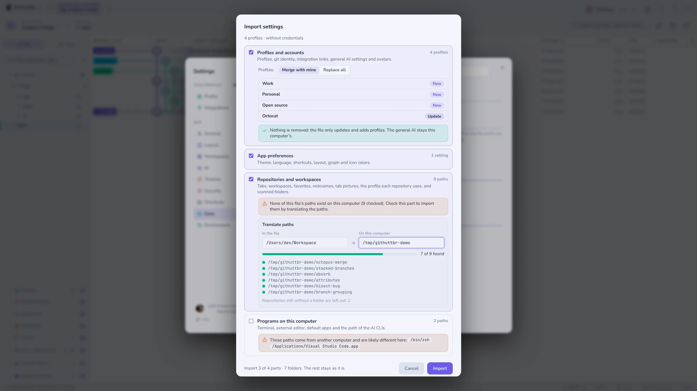

# Безпека та секрети

У Gitcito **немає бекенду**. Єдині мережеві виклики — до вашого Git-хостингу і,
якщо ви це увімкнули, до вашого AI-провайдера.

## Маскування секретів

Значення в `.env*`, `*.pem`, `*.key`, `id_rsa`, `credentials.*` і подібних
відображаються як `KEY=••••••` у діфах, перегляді файлів і blame, тож демонстрація
екрана чи скриншот не зможуть їх злити.
Матеріал підпису Apple теж рахується: `*.mobileprovision`,
`*.provisionprofile`, `*.p12` та ключі `*.p8` для App Store Connect. А `*.cer` —
ні: сертифікат публічний за задумом.

Це **суто відображення**: воно ніколи не змінює файл і ніколи не змінює того, що
ви індексуєте. Перемикач-око розкриває значення для кожного подання окремо.
`.env.example`, `.sample` і `.template` вважаються шаблонами, а не секретами.

## Запобіжники, доки ви не наробили шкоди

| Запобіжник | Коли спрацьовує |
|---|---|
| **Файл із секретом** | Коміт чогось, що схоже на облікові дані, — з *Ігнорувати та припинити відстеження* в один клік |
| **Великий файл** | Коміт завеликого блоба (поріг у Налаштуваннях → Безпека) |
| **Сміття збірки** | Коміт `xcuserdata/`, `DerivedData/` чи `.DS_Store` — з тим самим *Ігнорувати й зняти з відстеження* в один клік |
| **Захищена гілка** | Коміт напряму в `main`/`master` або примусовий пуш такої гілки |
| **Відстежувані секрети** | Пуш репозиторію, який *відстежує* файл із секретом — попередження раз на сесію |

## Keychain операційної системи

Токени та записи [сейфа](vault.md) шифруються keychain вашої ОС (Electron
`safeStorage`), а не ключем, покладеним у файл налаштувань.

**Ніщо не торкається keychain, доки ви не дозволите.** Перш ніж з’явиться власний
діалог дозволу від системи, Gitcito пояснює, що саме зберігається, чого він не
може (застосунок завжди читає лише той запис, який сам створив, — до інших ваших
паролів він не дотягнеться) і що відмовитися — цілком нормально: тоді токени
живуть у пам’яті лише протягом сесії, сейф лишається закритим, а увімкнути це
можна згодом у **Налаштування → Безпека → Keychain ОС**.

Свіжовстановлений застосунок робить **нуль** звернень до keychain, доки щось
справді не потребує збереження.

Поки її вимкнено, поле токена в «Інтеграціях» про це повідомляє — *Зберігається лише до закриття Gitcito: ключницю ОС вимкнено.* — з кнопкою **Увімкнути** поруч. Увімкнення, звідти чи звідси, також зберігає токени, вже введені в цій сесії, тож вставляти їх знову не треба.

### Linux без зв’язки ключів

У Linux keychain — це служба секретів: GNOME Keyring або KWallet. Коли жодна
зв’язка ключів не запущена, система все одно «шифрує», але фіксованим паролем,
однаковим на всіх машинах: токени й ключі перемішані, а не захищені.
Налаштування → Безпека повідомляють про це під статусом keychain — *Зв’язка
ключів не запущена…* — щоб слово *keychain* ніколи не означало захисту, якого
немає.

Щоб нічого нового не потрапляло до сховища, яке будь-хто може розшифрувати,
токен, введений, поки зв’язка ключів не запущена, зберігається **лише до
закриття застосунку**. Поле токена так і каже — *Збережено лише до закриття
Gitcito: зв’язка ключів не запущена…* — без кнопки повтору, бо повтор не
допоможе; допоможе лише зв’язка ключів. Токени, збережені раніше, лишаються
читабельними — доступу до них ви не втрачаєте, — а очищення чи заміна токена
так само видаляє старе значення з диска. Два обмеження: ключ загального ШІ не
переноситься до спільного місця (кожен профіль далі читає свій), а сейф і далі
зберігає в простому сховищі, бо не має режиму «лише на сесію». Встановіть або
розблокуйте зв’язку ключів і перезапустіть Gitcito, щоб знову зберігати нові
токени.

## Імпорт налаштувань

**Налаштування → Імпорт / експорт** переносить налаштування, профілі й теми між
машинами. Типовий експорт **не містить токенів і API-ключів**, а імпорт такого
файлу ніколи не чіпає збережених у вас — порожній токен у файлі означає «у
цьому файлі його немає», а не «видаліть мій».

### Вибір того, що імпортувати

Файл налаштувань містить два види даних: те, що йде за *вами* (профілі, тема,
комбінації клавіш), і те, що має сенс лише на машині, яка його записала (теки,
де лежать ваші репозиторії, шлях до вашого термінала). Якщо застосувати все на
новому комп’ютері, бічна панель заповниться вкладками, що ведуть у нікуди. Тому
після вибору файлу (і введення пароля, якщо він є) діалог питає, які частини
перенести. Нічого не застосовується, доки ви не натиснете **Імпортувати**;
**Скасувати** лишає все як було.

| Частина | Що в ній |
|------|-----------------|
| **Профілі та облікові записи** | Профілі, Git-ідентичність, прив’язки інтеграцій, загальні налаштування ШІ та зображення профілів — а також облікові дані й [сейф](vault.md), якщо вони є у файлі |
| **Налаштування застосунку** | Тема, мова, комбінації клавіш, розкладка вікна, кольори графа й значків |
| **Репозиторії та робочі простори** | Вкладки, робочі простори, обране, псевдоніми, зображення вкладок, який профіль використовує кожен репозиторій, скановані теки, а також нотатки й вікі кожного репозиторію |
| **Програми цього комп’ютера** | Термінал, зовнішній редактор, типові застосунки та шлях до CLI ШІ |

Кожна частина показує, скільки записів для неї є у файлі. Частина, яку ви не
позначили, лишається на цій машині точно такою самою.

**Профілі об’єднуються з вашими.** У файлі з іншого комп’ютера рідко є всі
профілі, що є на цьому, — обліковий запис, доданий на ноутбуці з Linux,
клієнтський профіль, який існує лише на Mac. Тому **Профілі та облікові
записи** додає профілі з файлу до ваших, а не замінює список. Перед імпортом
частина перелічує кожен профіль і що з ним станеться:

| Позначка | Значення |
|-----|---------|
| **Оновиться** | Профіль є в обох: ідентичність, ШІ та зображення з файлу замінюють ваші, а його сервери додаються до ваших |
| **Новий** | Він є лише у файлі: додається після ваших |
| **Залишиться** | Він є лише на цьому комп’ютері: лишається точно таким самим |

Два профілі вважаються «тим самим», якщо в них спільний id — так у першого
профілю кожної інсталяції. Якщо жоден id не збігся, порівнюється назва (без
урахування регістру й пробілів по краях), і профіль зберігає **id цього
комп’ютера**: прив’язані до нього репозиторії, активний профіль, його збережені
облікові дані й зображення лишаються на місці. Який профіль активний, не
змінюється.

**Замінити всі** й далі є — для резервної копії, яку треба повернути точно
такою, якою вона була: лишаються тільки профілі з файлу, а ті, що є лише на
цьому комп’ютері, показано закресленими з позначкою **Видалено**. Натискання
**Імпортувати** тоді ще раз питає, називаючи їх, — вони підуть разом зі
збереженими обліковими даними й зображенням, і це не можна скасувати. Із
**Замінити всі** активним стає активний профіль із файлу.

Обмеження: зіставлення йде лише за id або точною назвою — профіль,
перейменований з одного боку, вважається новим, і зрештою у вас будуть обидва.
Зіставлений профіль отримує поля з файлу, з трьома винятками, щоб не загубилося
те, що є лише на цьому комп’ютері: його сервери GitHub Enterprise, GitLab і
Bitbucket **додаються** до ваших (для сервера, який є в обох, перемагає запис із
файлу); токен, який у файлі порожній, зберігає ваш — але лише для того самого
екземпляра, тож токен ніколи не йде до іншого Forgejo, іншого видавця GitLab чи
іншої організації Azure; а логіни, взяті з credential helper цієї машини,
лишаються логінами цієї машини.

**Типові значення — це здогадка за вашим диском.** Перед показом діалогу
Gitcito перевіряє, чи існують тут теки репозиторіїв із файлу. Якщо жодної
немає, файл з іншого комп’ютера: **Репозиторії** та **Програми** спочатку не
позначені, кожна з причиною, — шляхи програм перелічено, щоб було видно, що
вони з іншої машини. Якщо теки є, це той самий комп’ютер (наприклад, відновлена
резервна копія): усе спочатку позначено, і про це каже зелена примітка. Файл
зовсім без репозиторіїв оцінюється за шляхами його програм: **Програми**
спочатку позначені, лише якщо кожен із них тут існує.

Якщо сама перевірка не вдалася, нічого не вгадується: **Репозиторії** та
**Програми** спочатку не позначені й без вердикту, кнопка **Перевірити знову**
ще раз опитує диск, а **Репозиторії** не можна імпортувати, доки перевірка не
вдасться. Інші частини — можна.

**Переклад шляхів.** Позначте **Репозиторії** для файлу, чиїх тек немає, і
відкриється блок **Перекласти шляхи**. Ліворуч — тека, спільна для репозиторіїв
із файлу (`/home/you/code`); праворуч — де ця тека на цьому комп’ютері, наперед
заповнено з вашої домашньої теки (`/Users/you/code`). Обидва поля можна
редагувати — здогадка може бути хибною, а якщо Gitcito не знаходить спільної
теки, він лишає обидва порожніми, щоб ви їх ввели. Смуга під час введення
рахує, скільки репозиторіїв тепер мають тут теку, і показує кілька з них —
зеленим знайдені, червоним ті, яких досі немає. Заміна переносить разом із
репозиторієм його псевдонім, зображення вкладки й профіль, а також нотатки, вікі
та записи сейфа, тож вручну нічого заново налаштовувати не треба.

Нижній рядок підсумовує — *Імпортувати 3 з 4 частин · тек: 31* (рахуються також
корені сканування й остання тека клонування, тому сказано «тек», а не
«репозиторіїв»), — і кнопка **Імпортувати** недоступна, доки не позначено хоча б одну
частину.

**Кнопка «Імпортувати» недоступна й тоді, коли переклад нічого не знаходить.** Якщо
**Репозиторії** позначено, а під новим префіксом не знайдено жодної теки,
імпорт лишив би ваші репозиторії порожніми; виправте шляхи або зніміть позначку
з цієї частини.

Обмеження перекладу:

- Це **один префікс, замінений іншим**. Репозиторії, які у файлі лежать в іншій
  теці або тут розкладені інакше, не знаходяться; зіставлення для окремих
  репозиторіїв немає.
- Коли переклад діє, **імпортуються лише репозиторії, які після нього мають
  теку**. Решта пропускається — не додається зламаними вкладками, — і діалог
  каже, скільки їх.
- Програми ніколи не перекладаються: `/usr/bin/code` не має надійного
  відповідника в іншій системі. Лиште цю частину непозначеною й виберіть їх у
  Налаштуваннях.
- Якщо очистити будь-який із префіксів, шляхи імпортуються так, як вони записані
  у файлі.

**Під час імпорту** діалог не можна закрити. Якщо якийсь наступний крок не
вдався — нотатки репозиторіїв, сейф, зображення профілів, — діалог лишається
відкритим, називає крок, і **Продовжити імпорт** відновлює роботу з цього
місця, не записуючи попередні кроки заново.

### Облікові дані у файлі

Файл, експортований з увімкненою опцією, містить облікові дані. Об’єднання
профілів завжди їх **додає**: дані з файлу зберігаються під відповідним
профілем, замінюючи дані того самого облікового запису, а всі інші збережені
облікові дані лишаються — їх видалення суперечило б збереженню ваших профілів.
Якщо для профілів вибрано **Замінити всі**, такий файл також показує вибір одразу
під **Профілі та облікові записи**:

| Варіант | Ваші збережені облікові дані |
|--------|------------------------|
| **Додати до моїх** | Дані з файлу додаються, замінюючи дані того самого облікового запису; усі інші зберігаються |
| **Замінити все** | Стають точно такими, як у файлі, — кожен збережений токен і API-ключ, якого немає у файлі, видаляється |

Вибір застосовується разом із профілями: якщо **Профілі та облікові записи** не
позначено, жодні облікові дані не імпортуються й не видаляються. Файлу,
експортованому без опції, нічого запропонувати, хоч би що ви позначили.
**Замінити все** ще раз питає при натисканні **Імпортувати**, попереджаючи, що
кожен збережений токен і API-ключ, якого немає у файлі, буде видалено;
**Скасувати** там лишає діалог як був.

**Для «Замінити все» потрібен keychain.** Коли keychain вимкнено або він
недоступний, старі токени лишилися б у зашифрованому сховищі й повернулися б
під час наступного запуску, тому Gitcito відмовляється: повідомляє про це, і
нічого не імпортується. Те саме — поки збережені токени не вдається прочитати:
вони повернулися б, щойно це стало б можливо. **Додати до моїх** і далі працює
та зберігає токени з файлу на час сесії.

**Обмеження:** облікові дані належать профілю. Профіль, який імпорт видаляє,
забирає із собою свої збережені токени, хоч би що ви вибрали.

## Безпечний обмін

[Безпечний обмін](secure-share.md) експортує налаштування, записи сейфа або цілі
робочі простори як **зашифрований пакунок** — секрети потрапляють туди лише тоді,
коли ви поставили галочку.

**Дивіться також:** [Сейф](vault.md) · [Безпечний обмін](secure-share.md)
