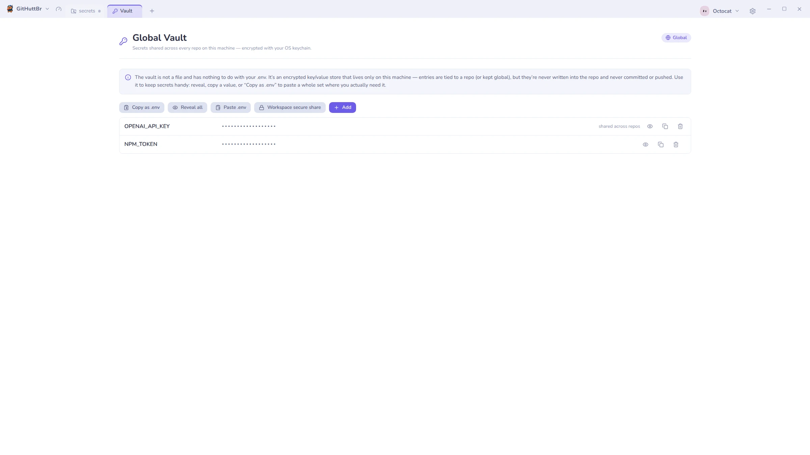

# Vault

The `.env` values a project needs have to live somewhere. The vault is that
somewhere, without them ending up in the repository.

- **Encrypted at rest** with your OS keychain.
- **Two scopes**: entries attached to a repository, and a **global** set you can
  reference from anywhere.
- **Not a file, and nothing to do with your `.env`.** Entries are *associated*
  with a repository but never written into it, never committed, never pushed.
- **Nothing ever leaves your machine.** No sync, no cloud.

## Using it

Open with <kbd>⌘⇧V</kbd>, from the tools menu, from Settings, or the command
palette. Switch between any known repository, reveal or copy a value, or **Copy
as .env** a whole set straight to the clipboard.

## When the vault cannot be read

If the keychain is locked, you turned its prompt away, or the vault was saved by
another copy of Gitcito (a development build, a re-signed one), the page says
*Gitcito could not read your vault* — and **leaves it untouched**. Nothing can be
added or removed meanwhile: saving would replace every secret in it with the one
you just typed.

### Imports and exports never drop it silently

The same holds when the vault cannot be opened at all — the keychain is off, you
turned its question away, or (on Linux) it did not answer in time: the vault is
then *unavailable*, and the message says so instead.

| Flow | What happens when the vault is unreadable or unavailable |
|------|------|
| Settings → Export | Stops before writing the file, and says why: a backup without the vault would look complete. |
| Settings → Import | The other parts are imported — settings and repository notes before the vault, profile pictures after it — and the vault is skipped and reported at the end. |
| Onboarding import | The rest is imported; the vault is reported afterwards. |
| [Secure share](secure-share.md) export | Refused, with the reason. |
| Secure share import | Refused **before any file of the bundle is written**, so the files never land without their secrets. |

Each message offers to open the Vault page, where you can retry or start a new vault.

| Button | What it does |
|--------|--------------|
| **Retry** | Reads the vault again — unlock the keychain first. |
| **Start a new vault** | Asks first. Gitcito stops waiting for the old vault and starts an empty one. The old file stays beside it as a backup named `githuttbr-vault.enc.bak-<date>`, one per replacement, and Gitcito never deletes it. For a vault that is gone for good, not a prompt you dismissed. |

## Moving it between machines

[Secure share](secure-share.md) can pack the vault into an encrypted bundle —
and only when you explicitly ask for secrets to be included.

**See also:** [Security & secrets](security.md) · [Secure share](secure-share.md)
