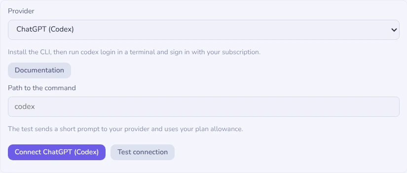

# AI 功能

每一项 AI 功能都是**可选的**，在你配置好一个服务商之前它们全是关着的。在你明确
提出某个请求之前，什么都不会被发到任何地方去。

## 所有配置档案共用一个 AI

AI 只需在 **设置 → AI** 中设置一次，每个[配置档案](profiles.md)都会使用它：之后
新建的配置档案已经带有 AI，无需再添加账户。该页面列出每个配置档案，以及它是否跟随
这个 **通用 AI**。

配置档案也可以改用 **自有 AI**——比如出于成本或数据政策，必须走公司账户的工作配置
档案。在该配置档案的 **配置档案** 页面，*此配置文件的 AI* 下，把 **通用** 切换为
**自有**：它以通用 AI 的副本起步，此后它的提供商和密钥只属于它自己。切回 **通用**
会在确认后删除它们，通用 AI 保持原样。

所有 AI 都在这一个页面上设置。顶部的 **正在编辑** 栏选择是谁的：通用 AI，还是某个
配置档案的自有 AI（*工作 的自有 AI*）。配置档案页面上的 **设置自有 AI**，或配置档案
列表中的 **编辑自有 AI**，会直接打开到那一个。配置档案页面本身只显示该配置档案用
哪个 AI、由什么来回答——编辑器从不放在那里。

无论哪种情况，AI **怎样写** 都按配置档案区分：提交信息风格、解释风格、冲突和分支
命名风格、自定义指令、合著者行和仓库聊天。它们在 **配置档案** 页面的 *AI 写作偏好*
下，所以工作配置档案可以写 `ticket` 风格的提交，个人配置档案写 `conventional`
风格的，两者用的是同一个 AI。

从每个配置档案各有 AI 的版本升级不会丢失任何东西：正在使用的配置档案的 AI 成为
通用 AI，其他 AI 不同的配置档案则把它保留为自有 AI。

## 提供商

**账户**是抵达某个模型的一条路径：哪个服务商、从哪里连接、如何鉴权。你可以配置
多个账户，它们并存——工作密钥、个人密钥、本地模型，以及一个你已经登录的 CLI。

预设覆盖 **OpenAI、Anthropic、Google Gemini、OpenRouter、Groq、Mistral** 和
**Ollama**（完全本地），也支持任何兼容 OpenAI 的端点。

Anthropic 使用自己的 `/v1/messages` 接口，而不是 OpenAI 形状的调用，所以 Claude
模型是真的能用，而不只是看起来能用。Gemini 通过 Google 的 OpenAI 兼容端点调用。

### 用订阅代替 API 密钥

在初始设置或「设置 → AI」中选择「**使用我的订阅**」。选择 ChatGPT 或 Claude，在终端使用对应的命令登录。连接测试成功后，添加账号。通用 AI 的第一个账户会成为默认账户。

安装 CLI 后，点击连接按钮打开提供商的登录页面。等待连接时可以取消。

- ChatGPT (Codex) — `codex login`
- Claude (Claude Code) — `claude auth login`

测试会向提供商发送一条简短请求，并消耗套餐额度。 已达到套餐上限。请在额度重置后重试。

选择 **本地 CLI** 服务商，让本机上已安装并已登录的智能体 CLI 来作答——`claude`、
`gemini` 或 `codex`。GitHuttBr 把提示词交给该可执行文件运行并读取回复；没有 API
密钥要粘贴，也不会保存任何令牌。

GitHuttBr 只会运行你自己配置为账户的命令，而且始终以参数数组而非 shell 传递，因此
diff 或分支名里的任何内容都不可能被当成命令执行。

> **这并不比 API 密钥更私密。** 你的提示词仍会以你自己的账户送达同一家厂商，
> 和使用密钥时完全一样。变的是计费和配置方式，而不是文本的去向。

如果该命令不在你的 `PATH` 中，就在账户里填写它的完整路径。

### 按任务选择模型

在**按任务选择模型**下，提交信息、聊天、解释代码、PR 审查、冲突解决、
仓库 Wiki、主题生成等每一项都可以指向各自的账户和模型。保持默认即跟随默认账户。
提交信息用便宜模型、聊天用强力模型，是最常见的分工。

### 升级提示

从账户功能之前的版本升级时，这条提示只出现一次。你原有的服务商和密钥会成为第一个账户，无需手动重新配置。

## 模型

模型列表来自服务商本身，并缓存一天；**获取模型**可立即刷新其中一份。列表下方
GitHuttBr 会说明它的来源——实时、缓存（含获取时间），还是内置的兜底列表以及原因。

列表会筛选为能够回答聊天请求的模型，因此嵌入、语音和图像模型不会出现。每个模型
输入框同时接受自由文本，所以预览版模型、私有部署或刚拉取的 Ollama 标签始终可用，
即便服务商并未列出。

尚未填写密钥、或无法连接的服务商，会回退到一份小的内置列表，而不是空白下拉框。

没有任何服务商发布排过序或精选过的列表，所以这份整理出自 GitHuttBr：带日期的快照会折叠回它所快照的模型（`gpt-4o` 涵盖 `gpt-4o-2024-08-06`），剩下的按发布时间从新到旧排列，而不是按字母。列表底部的**显示全部模型**会把服务商返回的一切都找回来。

## 它能做什么

| 功能 | 你会得到什么 |
|---|---|
| **提交消息** | 依据你已暂存的差异，按你选定的风格生成摘要（以及可选的正文） |
| **解释这个文件** | 在侧边面板里用大白话讲解——普通、简洁、ELI5……甚至还有海盗腔 |
| **悬停即解释** | 按住 <kbd>⇧</kbd> 指向一个标识符，得到一行解释，外加它所依据的那些行 |
| **冲突解决** | 把一份合并方案提议到可编辑的输出里——绝不自动套用 |
| **PR 评审** | 概括一份差异并指出风险，每一条都锚定到真实的 `path:line` |
| **PR 描述** · **分支名** | 依据该分支的提交和差异起草 |
| **主题** · **提交图配色** | 由一段提示词生成 |
| **智能暂存** | 建议哪些东西该进这一次提交 |
| **AI 配置向导** | 为仓库生成助手配置文件（指令、代理、钩子）——聊天面板顶部的魔法棒按钮 |

## 有依据，不是瞎猜

评审看到的差异是**带标号的变更块**，而且它只被允许引用这些标号；随后由 GitHuttBr
把每个标号还原成真实的文件和行号。凭空编造位置的模型会被**驳回并重新提问**，
所以结论指向的永远是真实存在的代码。

悬停即解释只读取标识符周围一扇带行号的窗口——在差异里，只读屏幕上可见的那些变更
块——所以当某个定义在别处时，它会直说，而不是编一个出来。答案按文件版本缓存。

**被遮蔽的密钥文件绝不会被发送。** 密钥遮蔽规则覆盖到的文件同样不会。

## 当模型很慢，或者不再回应时

笔记本上的本地模型写一条提交消息可能要花一分钟，先“思考”再作答的模型还要更久—
—但一个在请求中途被关掉的服务器，不该让你一直盯着转圈的图标。

| 发生了什么 | 你会看到什么 |
|---|---|
| 30 秒后仍无回复 | *“{账户} 的回复时间比预期长。”*，附带 **继续等待**、**使用 {另一个账户}** 和 **取消**。选择继续等待后，如果仍在运行，一分钟后会再问一次 |
| 本地服务器（Ollama、LM Studio、llama.cpp…）在工作中被关闭 | 几秒之内：*“{账户} 没有响应。它还在运行吗？”*，为每个可用的其他账户各提供一个按钮，外加 **取消** |
| 你发出请求时服务器就已经关闭 | 同样的提示，立即出现 |

**使用 {另一个账户}** 会取消当前请求，并把同一个请求发给那个账户，使用它
的默认模型——提交消息、评审或聊天回复就像你一开始就在那里提问一样送达。它不会改
动你的设置：下一个请求仍会发往你为该任务选择的账户。

这覆盖所有 AI 功能——提交消息、聊天、评审、解释、冲突、主题、wiki——因
为它们都经过同一个调用。

## 限制

- **只有本地服务器会被监测是否已关闭。** 宕机的云服务商会以它自己的错误失败；
  仅仅是慢的云端调用，和其他调用一样会收到*时间比预期长*的提示。忙碌而非关闭的本
  地服务器被视为仍然存活：只有被拒绝或中断的连接才会提前结束调用。

- 内置兜底列表会在版本之间过时。实时获取正是为此存在；兜底只覆盖无法获取的情形。
- 把服务商列表筛选为聊天模型是按名称进行的，因此名称不寻常的聊天模型可能被滤掉。
  这时手动输入即可。
- 除非 CLI 自己上报，CLI 账户无法报告 token 用量，所以设置里的用量与费用数字会
  少算这些调用。
- CLI 回答比直接调用 API 慢：每次请求都要完整启动一次会话。
- 密钥按账户分别存放在系统钥匙串中。删除账户会一并删除它的密钥。
- 退回到通用 AI 出现之前的版本，会丢失通用 AI 的密钥：那个版本不知道它们存放在
  哪里，保存时会把它们丢掉。账户会保留，重新输入密钥即可。配置档案的自有 AI 不受
  影响。

**另请参阅：** [仓库百科](repo-wiki.md) · [安全与机密](security.md)
