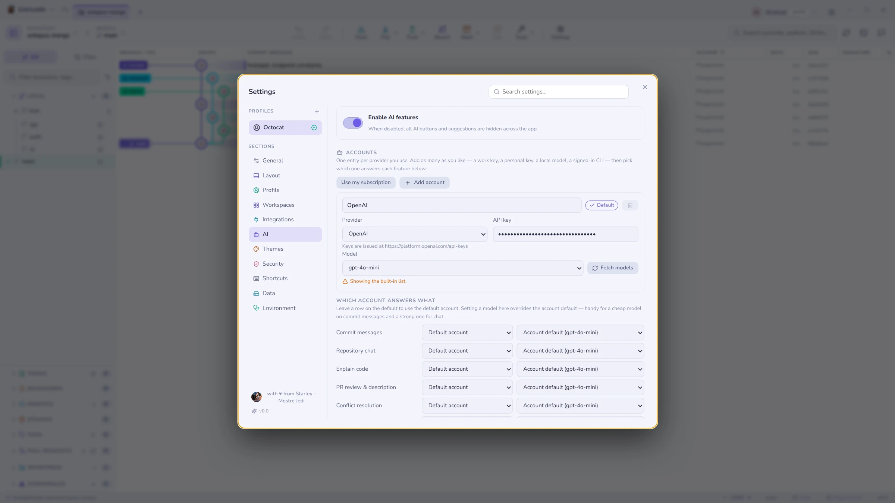

# AI 功能

每一项 AI 功能都是**可选的**，在你配置好一个服务商之前它们全是关着的。在你明确
提出某个请求之前，什么都不会被发到任何地方去。

## 所有配置档案共用一个 AI

AI 只需在 **设置 → AI** 中设置一次，每个[配置档案](profiles.md)都会使用它：之后
新建的配置档案已经带有 AI，无需再添加账户。该页面列出每个配置档案，以及它是否跟随
这个 **通用 AI**。

配置档案也可以改用 **自有
AI**——比如出于成本或数据政策必须走公司账户的工作配置档案，
或者提交写法不同的配置档案。在该配置档案的 **配置档案**
页面，*此配置文件的 AI* 下，把 **通用** 切换为 **自有**：
它以整个通用 AI（账户、密钥和偏好）的副本起步，此后这一切只属于它自己。切回
**通用** 会在确认后删除它，通用 AI 保持原样。

一个配置档案 **完整地** 使用一个 AI：通用的或自有的，从不混用。
账户和模型，*以及* AI 怎样写、聊天能做什么，都来自同一处，所以在通用 AI
上修改提交风格，会改变所有跟随它的配置档案。

所有 AI 都在这一个页面上设置。顶部的 **正在编辑** 栏选择是谁的：通用
AI，还是某个配置档案的自有 AI（*工作 的自有 AI*）。配置档案页面上的
**设置自有 AI**，或配置档案列表中的 **编辑自有 AI**，
会直接打开到那一个。配置档案页面本身只显示该配置档案用哪个 AI、
由什么来回答——编辑器从不放在那里，也没有任何属于它自己的 AI 选项。

在账户下方，同一页面按分区保存该 AI **怎样写** 以及它可以做什么：

| 分区 | 包含 |
|---|---|
| **提交信息** | 提交风格——Conventional、Gitmoji 和工单以带示例行的卡片显示，其余在“更多风格”中——“生成提交描述”、合著者行、**提交的额外规则**，以及预览 |
| **解释与悬停** | 解释风格、*悬停时解释代码* 及其修饰键 |
| **冲突与分支** | 冲突解决风格、分支命名风格，每项都附结果示例 |
| **仓库聊天** | 聊天是否开启、它读取什么、它可以提议的操作——见[仓库聊天](repo-chat.md#设置) |

各部分上方有一行，说明你正在编辑谁的 AI、它适用于谁：*通用 AI · 适用于 工作、个人*，或者某个配置档案自己的 AI。

**提交的额外规则**（4.60 之前叫“自定义指令”）只会加入提交信息的生成：聊天、解释、审查和分支名都不会读取它们。预览是固定示例，不调用模型：它展示所选风格的样子，而不是 AI 会为你的更改写出的内容。

编辑框里的风格切换，以及聊天的模型和批准选择器，都写入配置档案读取的同一个
AI：通用 AI，或该配置档案的自有 AI。

从每个配置档案各有 AI 的版本升级不会丢失任何东西：正在使用的配置档案的 AI 成为
通用 AI，其他 AI 不同的配置档案则把它保留为自有 AI。

**从 4.59 或更早版本升级**（那时写作偏好保存在每个配置档案上）：
只进行一次，正在使用的配置档案的偏好（如果它有自有 AI，则取使用通用 AI
的第一个配置档案的偏好）会移到通用 AI 上。拥有自有 AI
的配置档案保留自己的。**限制：** 如果使用通用 AI
的两个配置档案原本写法不同（一个是 `ticket` 风格的工作配置档案，一个是
`conventional` 风格的个人配置档案），
现在两者都会按被移过去的那个来写。要保留差异，给其中一个配置自有 AI，
并在那里重新设置它的风格。

## 提供商

**账户**是抵达某个模型的一条路径：哪个服务商、从哪里连接、如何鉴权。你可以配置
多个账户，它们并存——工作密钥、个人密钥、本地模型，以及一个你已经登录的 CLI。

预设覆盖 **OpenAI、Anthropic、Google Gemini、OpenRouter、Groq、Mistral** 和
**Ollama**（完全本地），也支持任何兼容 OpenAI 的端点。

**密钥绝不会未加密地离开这台机器。** 带密钥的账户通过 `https://` 访问其端点，只有在本机（`localhost`、`127.x`、`::1`）上才使用普通的 `http://`。会通过 `http://` 把密钥发往其他主机的调用，会在任何内容发出前被拒绝，并说明原因。不带密钥的端点——比如你网络中另一台机器上的 Ollama——仍可通过 `http://` 使用。

Anthropic 使用自己的 `/v1/messages` 接口，而不是 OpenAI 形状的调用，所以 Claude
模型是真的能用，而不只是看起来能用。Gemini 通过 Google 的 OpenAI 兼容端点调用。

### 提供商列表

每个已保存的提供商都是一张卡片：提供商的首字母、名称，以及名称下方它实际使用的内容 —— 这样同一提供商的两个账户无需打开就能区分。

| 提供商类型 | 第二行 |
| --- | --- |
| 订阅或本地 CLI | `CLI claude · sonnet` — 命令，然后是模型 |
| Ollama 或自定义服务器 | `http://localhost:11434 · qwen3:8b` — 地址，然后是模型 |
| 托管 API | `gpt-4o-mini · 41 个模型` — 模型，以及提供商列出的数量 |

只有在提供商列出模型之后才会显示模型数量；GitHuttBr 作为后备的内置列表只是猜测，不是计数。状态徽章在右侧。正在编辑的卡片有强调色边框；不响应的卡片有红色边框，名称下方显示原因，并以 **重新测试** 结尾。点击卡片即可在列表下方的编辑器中打开它。

### 添加和编辑提供商

只填了一半就被保存的提供商曾是个无声的陷阱：空密钥可能成为使用中的那一个，结果什么都不响应。
所以这张卡片上的内容不会在你输入时保存。

**添加提供商** 会打开一张虚线边框、标着 **草稿 · 未保存** 的卡片。填写提供商、
密钥、端点和模型，然后选择 **测试并保存**。GitHuttBr 会先用这个密钥列出
提供商的模型（与 **模型** 旁边的刷新按钮 发出的请求相同），只有得到响应才保存。你会看到
**已连接 · N 个模型**，提供商以 **就绪** 状态加入列表。

测试失败时，卡片显示 **无法连接** 和提供商给出的原因（密钥被拒绝，
`401`；服务器没有运行），以及 **没有保存任何内容。** 修正字段后再测一次，或选择
**仍然保存** 按原样保留（之后会显示为 **无响应**），或选择
不留任何痕迹的 **取消**。

编辑已保存的提供商也是一样。横幅会显示 **有未保存的更改 — 保存之前不会有任何变化**，你改过的每个字段
都标有 **· 已更改**。**放弃更改** 恢复已保存的值；
**测试并保存** 测试并保存。有未保存的更改时选择另一个提供商、添加提供商或打开
**使用我的订阅**，会询问 **保存对“…”的更改？** —— **保存**、**放弃更改**
或 **继续编辑**。关闭设置会把草稿保留在内存中，回来时仍在；它从不写入磁盘。

密钥的保存方式与以前完全相同：存入钥匙串，且只在保存时写入。提供商的错误显示时，
密钥以及任何像令牌的内容都会被遮盖。

| 提供商类型 | **测试并保存** 检查什么 |
| --- | --- |
| API 密钥或本地服务器（Ollama、自定义端点） | 列出模型；成功表示端点用这个密钥作出了响应 |
| 订阅（Codex、Claude Code） | 发送下文所述的简短测试提示，占用你套餐的额度 |
| 本地 CLI | 在 `PATH` 中查找命令；手动输入的路径不经检查直接保存 |

### 状态徽章

列表中的每个提供商都带一个徽章，依据页面已经知道的信息得出——最近一次测试，或页面本来就
获取的模型列表。后台不会轮询任何东西。

| 徽章 | 含义 |
| --- | --- |
| **就绪** | 最近一次测试或模型列表获取成功 |
| **无响应** | 最近一次尝试失败；原因在下一行，旁边有 **重新测试** |
| **没有密钥** | 提供商需要 API 密钥但还没有 |
| **未检查** | 还没有任何请求问过它——测试前的订阅，或尚未获取的列表 |

**限制：**徽章只与最近一次检查一样新。一个小时前就不再响应的提供商，在再次被询问之前
仍显示 **就绪**——要确认，请在它的卡片上选择 **测试连接**。
手动输入路径的 **本地 CLI** 会一直是 **未检查**，因为证明它可用需要
花费一次提示。

### 使用中的提供商

在**按任务选择模型**中没有单独指定提供商的任务，都由一个提供商回应。它的
卡片末尾是绿色的**使用中**（其他卡片在这个位置是**使用**），并且在列表中的位置不变。绿色只表示
正在使用：能响应但未在使用的提供商会以柔和的灰蓝色显示**就绪**。
通用 AI 和拥有自己 AI 的配置档案各有自己的使用中提供商；列表改的是你正在编辑
的那一个。

其他每个已保存的提供商，在行的右侧、状态徽章旁边都有一个**使用**按钮。点一下
就会让它成为使用中并立即保存：由哪个提供商回应是一次选择，而不是一次编辑，
所以不必等**测试并保存**。它不会打开那个提供商的卡片，有未保存更改的卡片也会
保留这些更改。

**限制：** **使用**不做任何测试。标为**没有密钥**或**无响应**的提供商也可以设
为使用中 —— 比如在修好密钥之前有意这样做 —— 它的徽章会继续显示这一状态；下一
个 AI 任务会因为该提供商的原因而失败。草稿没有**使用**：保存之前它还不是提供商。

### 从状态栏查看正在使用的 AI

有自己 AI 的配置文件会忽略通用 AI 正在使用的提供商:在通用 AI 上换用另一个提供商,对这个配置文件毫无影响,而在设置之外没有任何地方说明这一点。现在仓库底部的状态栏会说明。它的 **AI:** _提供商_ 按钮显示为当前配置文件作答的提供商,并用一个圆点表示状态 —— 绿色**就绪**、红色**无响应**、琥珀色**没有密钥**、灰色**未检查**。提供商为**就绪**时，整个按钮都会变成绿色，这样正常工作的 AI 不会看起来像是关着的。

点击它会打开一个小面板:

| 部分 | 显示内容 |
| --- | --- |
| 标题 | 当前配置文件,以及它是**使用通用 AI** 还是**有自己的 AI** |
| 每个提供商一行 | 该 AI 中保存的每个提供商及其模型和状态;无响应的提供商在第二行显示原因 |
| **使用中** / **使用** | 现在作答的提供商,以及在其他每个提供商上一键切换 |
| **配置 AI** | 打开**设置 → AI** |
| **用量与费用** | 打开仓库设置的*统计*标签页 |

**使用**会写入配置文件读取其 AI 的地方。在使用通用 AI 的配置文件上,它修改通用 AI —— 也就是所有使用它的配置文件;在有自己 AI 的配置文件上,只修改它自己的。指定了自己提供商的任务保持不变。按 **Esc** 关闭面板;AI 关闭时按钮会隐藏。

**限制:** 圆点根据应用本来就获取的模型列表(最多保留一天)得出,从不做任何测试,所以一个已停止响应的提供商仍可能显示**就绪** —— 要确认,请在设置中测试连接。在打开设置之前,窗口并不持有密钥本身,因此没有密钥的提供商可能显示为**未检查**或**无响应**,而不是**没有密钥**。与设置中的**使用**一样,这一切换不会测试被设为使用中的提供商。

### 用订阅代替 API 密钥

在 **设置 → AI** 中选择 **使用我的订阅**。[首次启动](first-run.md) 时，AI 步骤中的 **我的订阅** 卡片会找到 Claude Code 或 Codex 并一步完成测试；两者都找不到时，会回到这里的同一套设置。选择你使用的套餐，然后打开 **文档** 查看提供商的安装说明。安装后，选择 **连接 ChatGPT (Codex)** 或 **连接 Claude (Claude Code)**。提供商的 CLI 会在浏览器中打开登录页面，并保存自己的会话。已有的订阅会话会被复用。**取消** 会停止等待中的连接。登录超过三分钟会停止，可以重试。

| 套餐 | 所需 CLI | 在终端中登录 |
| --- | --- | --- |
| 可使用 Codex 的 ChatGPT | Codex CLI | `codex login`，然后选择 ChatGPT |
| 可使用 Claude Code 的 Claude | Claude Code | `claude auth login`，然后选择你的订阅账户 |

连接时也会测试会话。如果你是在终端中登录的，选择 **测试连接**。GitHuttBr 会检查 CLI 的登录方式，并从一个空的临时目录发送一条简短的测试提示。该请求会计入提供商的额度。显示 **已连接** 后，选择 **添加提供商**。通用 AI 的第一个账户会设为 **使用中**。对于已有的设置，在其所在行选择 **使用**，或在下方为各项功能单独指定。若要在首次启动时跳过设置，选择 **跳过，不用 AI**，准备好后再回到设置。

如果 GitHuttBr 找不到 CLI，请安装它或输入其可执行文件的完整路径，然后重新测试。如果登录已过期，或 CLI 正在使用 API 密钥，请用订阅账户登录。如果达到用量上限，请等待提供商的额度重置。

手动设置时，选择 **本地 CLI** 服务商，让本机上已安装并已登录的智能体 CLI 来作答——`claude`、`gemini`、`codex` 或 `devin`。GitHuttBr 把提示词交给该可执行文件运行并读取回复；没有 API 密钥要粘贴，也不会保存任何令牌。

GitHuttBr 只会运行你自己配置为账户的命令，而且始终以参数数组而非 shell 传递，因此
diff 或分支名里的任何内容都不可能被当成命令执行。

每次调用都以仓库为工作目录启动 CLI，这样像 Devin 这样的智能体 CLI 就能打开你询问的文件，而不是凭空作答。没有仓库的功能（主题生成）会从应用自己的目录运行它。

> **这并不比 API 密钥更私密。** 你的提示词仍会以你自己的账户送达同一家厂商，
> 和使用密钥时完全一样。变的是计费和配置方式，而不是文本的去向。

如果该命令不在你的 `PATH` 中，就在账户里填写它的完整路径。

### 按任务选择模型

在**按任务选择模型**下，提交信息、聊天、解释代码、PR 审查、冲突解决、
仓库 Wiki、主题生成等每一项都可以指向各自的账户和模型。保持为**使用中的提供商**
即跟随标有**使用中**的提供商。提交信息用便宜模型、聊天用强力模型，是最常见的分工。

### 升级提示

从账户功能之前的版本升级时，这条提示只出现一次。你原有的服务商和密钥会成为第一个账户，无需手动重新配置。

## 模型

模型列表来自服务商本身，并缓存一天；**模型** 旁边的刷新按钮可立即刷新其中一份。列表下方
GitHuttBr 会说明它的来源——实时、缓存（含获取时间），还是内置的兜底列表以及原因。

列表会筛选为能够回答聊天请求的模型，因此嵌入、语音和图像模型不会出现。每个模型
输入框同时接受自由文本，所以预览版模型、私有部署或刚拉取的 Ollama 标签始终可用，
即便服务商并未列出。

尚未填写密钥、或无法连接的服务商，会回退到一份小的内置列表，而不是空白下拉框。

没有任何服务商发布排过序或精选过的列表，所以这份整理出自 GitHuttBr：带日期的快照会折叠回它所快照的模型（`gpt-4o` 涵盖 `gpt-4o-2024-08-06`），剩下的按发布时间从新到旧排列，而不是按字母。列表底部的**显示全部模型**会把服务商返回的一切都找回来。

## 它能做什么

| 功能 | 你会得到什么 |
|---|---|
| **提交消息** | 依据你已暂存的差异，按你选定的风格生成摘要（以及可选的正文） |
| **解释这个文件** | 在侧边面板里用大白话讲解——普通、简洁、ELI5……甚至还有海盗腔 |
| **悬停即解释** | 按住 <kbd>⇧</kbd> 指向一个标识符，得到一行解释，外加它所依据的那些行 |
| **AI 编辑选中内容** | 在文件中选中几行，描述要做的修改，模型只改写这些行，并放入编辑器草稿 |
| **冲突解决** | 把一份合并方案提议到可编辑的输出里——绝不自动套用 |
| **PR 评审** | 概括一份差异并指出风险，每一条都锚定到真实的 `path:line` |
| **PR 描述** · **分支名** | 依据该分支的提交和差异起草 |
| **主题** · **提交图配色** | 由一段提示词生成 |
| **智能暂存** | 建议哪些东西该进这一次提交 |
| **[仓库聊天](repo-chat.md)** | 有依据的问答，加上经过审阅的文件修改，随后是经过校验的 Git 操作 |
| **AI 配置向导** | 为仓库生成助手配置文件（指令、代理、钩子）——聊天面板顶部的魔法棒按钮 |

### 只编辑你选中的行

在文件视图中拖选要修改的行，然后按 **AI 编辑…**（或右键单击某一行，从菜单中选择）。底部的栏会显示所选范围，并接收你的指令——“重命名这个变量”“添加 null 检查”“翻译这些字符串”。模型会看到所选的行和周围少量上下文，只返回该范围的替换内容，结果进入 **编辑器草稿**，而不是直接写入磁盘。你在那里审阅，再通过正常的编辑流程保存或放弃，所以在你决定之前不会写入任何内容。由于回答是文本而不是工具调用，它适用于所有已配置的后端，而不仅是智能体 CLI。限制：一次只改写一个连续范围，不能创建或删除整个文件，跨越 diff 多个 hunk 的选择会被拒绝——请改在文件视图中选择。

## 有依据，不是瞎猜

评审看到的差异是**带标号的变更块**，而且它只被允许引用这些标号；随后由 GitHuttBr
把每个标号还原成真实的文件和行号。凭空编造位置的模型会被**驳回并重新提问**，
所以结论指向的永远是真实存在的代码。

悬停即解释只读取标识符周围一扇带行号的窗口——在差异里，只读屏幕上可见的那些变更
块——所以当某个定义在别处时，它会直说，而不是编一个出来。答案按文件版本缓存。

[仓库聊天](repo-chat.md) 也是同样的方式：它只能引用交给它的摘录，而两轮请求是从 Git 自己的已跟踪文件列表中挑选这些摘录，而不是根据模型写出的任何内容。当它提出修改时，GitHuttBr 会校验精确的文件操作，在本地计算它们的 diff，然后按配置的审批策略执行后续的 Git 操作。

**被遮蔽的机密文件永远不会被发送。** 机密遮蔽规则覆盖的文件也不会——包括你手动固定到聊天中的文件，它会被拒绝并说明原因，而不会被读取。

## 当模型很慢，或者不再回应时

笔记本上的本地模型写一条提交消息可能要花一分钟，先“思考”再作答的模型还要更久—
—但一个在请求中途被关掉的服务器，不该让你一直盯着转圈的图标。

| 发生了什么 | 你会看到什么 |
|---|---|
| 30 秒后仍无回复 | *“{账户} 的回复时间比预期长。”*，附带 **继续等待**、**使用 {另一个账户}** 和 **取消**。选择继续等待后，如果仍在运行，一分钟后会再问一次 |
| 本地服务器（Ollama、LM Studio、llama.cpp…）在工作中被关闭 | 几秒之内：*“{账户} 没有响应。它还在运行吗？”*，为每个可用的其他账户各提供一个按钮，外加 **取消** |
| 你发出请求时服务器就已经关闭 | 同样的提示，立即出现 |

**使用 {另一个账户}** 会取消当前请求，并把同一个请求发给那个账户，使用它
的默认模型——提交消息、评审或聊天回复就像你一开始就在那里提问一样送达。它不会改
动你的设置：下一个请求仍会发往你为该任务选择的账户。

这覆盖所有 AI 功能——提交消息、聊天、评审、解释、冲突、主题、wiki——因
为它们都经过同一个调用。

## 限制

- **只有本地服务器会被监测是否已关闭。** 宕机的云服务商会以它自己的错误失败；
  仅仅是慢的云端调用，和其他调用一样会收到*时间比预期长*的提示。忙碌而非关闭的本
  地服务器被视为仍然存活：只有被拒绝或中断的连接才会提前结束调用。

- 内置兜底列表会在版本之间过时。实时获取正是为此存在；兜底只覆盖无法获取的情形。
- 把服务商列表筛选为聊天模型是按名称进行的，因此名称不寻常的聊天模型可能被滤掉。
  这时手动输入即可。
- 除非 CLI 自己上报，CLI 账户无法报告 token 用量，所以设置里的用量与费用数字会
  少算这些调用。
- CLI 回答比直接调用 API 慢：每次请求都要完整启动一次会话。
- 密钥按账户保存在系统钥匙串中。删除账户会同时删除其密钥——会先询问，且无法撤销。
- **唯一**的账户也可以删除——一个不再响应的提供商，不该要求你先凭空造出第二个账户。在
  你配置好新账户之前，会有一个空白账户顶替它，确认对话框也会说明这一点。只有那个未动
  过的空白账户没有可删除的内容。
- 退回到通用 AI 出现之前的版本，会丢失通用 AI 的密钥：那个版本不知道它们存放在
  哪里，保存时会把它们丢掉。账户会保留，重新输入密钥即可。配置档案的自有 AI 不受
  影响。

**另请参阅：** [仓库聊天](repo-chat.md) · [仓库百科](repo-wiki.md) · [安全与机密](security.md)
