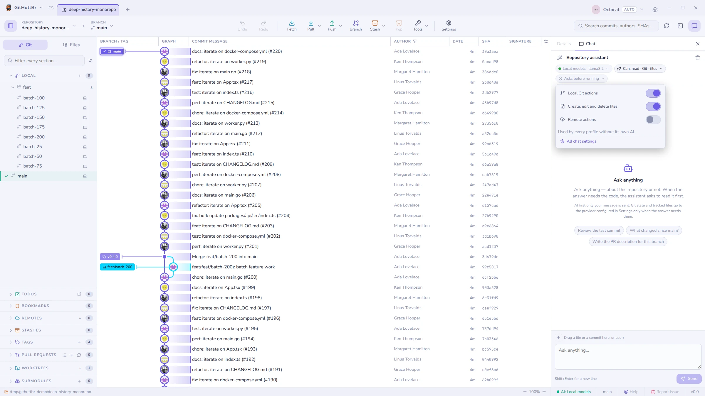

# 仓库聊天

有些问题，问一句比翻半天更快。*令牌刷新到底发生在哪里？这个提交一句话说改了什么？
这个文件为什么存在？* 仓库聊天基于当前打开的仓库作答，并给出它所依据的代码行。

它也是一个普通的 AI 聊天。打招呼、一般的编程问题或其他任何事情，模型都会直接作答，
不读取仓库——只有当问题与文件有关时，它才会去看文件。

它与**详情**共用右侧栏：顶部的标签在两者之间切换，所以提问时提交图不会丢掉选中项。

## 它读什么

它像任何聊天一样工作：**发送的就是你的消息**，旁边只附上仓库的名称和分支——没有 Git 状态，
没有文件清单，也没有文件内容——回复以纯文本返回。打招呼或与仓库无关的问题，在一次调用里
就直接作答，仓库里的任何内容都不会离开你的电脑。

**仓库何时进入对话。** 在三种情况下，仓库会向模型打开：

| 你… | 会发生什么 |
|------|--------------|
| 提到一个已跟踪文件（`config.json`、`src/app.ts`） | 模型作答前先读取该文件 |
| 用文字点明——“这个仓库”“我的改动”“未提交”“当前分支” | 发送 Git 状态和已跟踪文件清单 |
| 问了模型认为需要仓库的问题 | 它只回复一行 `@repo`，应用随即为它打开仓库 |

此后模型会提出它还需要什么，而不是硬猜：清单里的确切路径、字面搜索，或最近历史里的提交
哈希。应用读取这些内容，再带着查到的结果重新提问。这最多发生四次——每一轮都是一次你要等待
的模型调用——最后一轮必须用手头的材料作答。这些回答会引用它们用到的片段；凭空捏造的文件或
行号是校验错误，而不是听起来合理的答案。

等待时，你的消息下方那一行会说明正在发生什么：模型工作时显示 **正在思考…**，只有在应用
真正读取它要求的内容时，才显示 **正在读取文件 (N)…** 或 **正在搜索仓库…**。

| 包含 | 不包含 |
|---|---|
| 已跟踪文件，按工作区中的样子 | 未跟踪文件 |
| 已跟踪文件的暂存与未暂存差异 | 命中忽略规则的一切，即便仍被跟踪 |
| 分支、领先/落后、以及变更路径清单 | [疑似机密的文件](security.md)、二进制文件、生成路径 |

读取工作区意味着你可以讨论尚未提交的修改；同时也意味着提问时这些修改会离开本机，
接收方是你在 [AI 功能](ai.md)中配置的提供方。

有一处细节：启用操作提议（见下文“从聊天中运行操作”）后，未跟踪文件的**文件名**
会包含在仓库状态里——“暂存那个新文件”需要它们——但其内容依旧永不读取。

## 固定上下文

读什么由模型决定。固定就是推翻这个决定的办法：被固定的内容**优先**读取，并占据
上下文预算中更大的一份。

四种固定方式，都会进入输入框上方的同一排标签：

| 这样做 | 得到 |
|---|---|
| 点击建议标签 | 查看器中打开的文件，或提交图中选中的提交 |
| 从**文件**标签页拖一行过来 | 该文件 |
| 从**提交图**拖一行过来 | 该提交——提交信息，以及按块拆分的差异 |
| **+** →“选择文件…”，或从访达/资源管理器拖入 | 磁盘上的任意文件，包括仓库之外的 |

标签会为后续提问保持固定；`×` 移除单个，清空对话则全部移除。上限为八个。

被固定的提交会贡献提交信息和至多十二个差异块。触及被排除路径的块会从该差异中剔除，
而不是丢掉整个提交。

## 设置

**设置 → AI → 仓库聊天**——在通用 AI 上，或在配置档案有自有
AI 时在它的自有 AI 上（由 **正在编辑** 栏选择是哪一个，
见[所有配置档案共用一个 AI](ai.md#所有配置档案共用一个-ai)）：

| 设置 | 作用 |
|---|---|
| **就仓库提问** | 关闭后标签页、工具栏按钮与快捷键目标都会消失，其余 AI 功能照常 |
| **读取仓库** | 读取文件、历史和差异来回答你。看起来像机密的文件永远不会被读取 |
| **仅已提交的内容** | 基于最后一次提交而非工作区作答，未提交的修改绝不离开本机 |
| **本地 Git 操作** | 暂存、提交、分支、贮藏、合并等，以供你审阅的卡片提出。关闭时聊天只回答问题 |
| **创建、编辑和删除文件** | 精确编辑、新文件、替换和删除，每项都在卡片上附带差异。需要本地 Git 操作。默认关闭。它以相反的含义取代“文件只读模式”：这里开启即那个模式关闭，已保存的设置读起来与之前一致 |
| **当 AI 提议操作时** | 批准模式——见下文“批准模式”。破坏性操作无论选哪种都会先确认 |
| **远程操作** | 默认关闭。开启后会加入获取、拉取、推送、创建拉取请求和提交堆栈 |

列表上方用一句话概括在当前设置下 AI 能做什么。它描述的是设置，而不是模型：提议仍会被检查，违反规则时会被拒绝。

由哪个提供商和模型回答聊天，在 **AI** 页面的 **按任务选择模型** 下设置——见
[AI 功能](ai.md#按任务选择模型)。提问比审查便宜，较小的模型通常够用。

如果整个 AI 都关闭，聊天也随之消失：不会留下一个无人能应答却仍在邀请提问的面板。

### 标题栏中的胶囊按钮

面板标题下方的三个胶囊按钮说明聊天会如何处理你的下一条消息，每一个都能在不打开
设置的情况下直接修改：

| 胶囊 | 显示 | 点击可以 |
|---|---|---|
| **账户 · 模型** | 由谁回答，并用一个圆点表示账户状态——就绪、无响应、没有密钥或尚未检查 | 从按账户分组的菜单中选择另一个模型，或回到配置档案的模型。与**按任务选择模型 → 聊天**是同一项设置 |
| **可以：…** | 聊天被允许做的事——*读取*，开启时还有 *Git*、*文件* 和 *远程* | 切换**本地 Git 操作**、**创建、编辑和删除文件**和**远程操作**，或打开**所有聊天设置** |
| **审批** | *运行前询问*、*运行安全操作* 或 *运行所有操作* | 从三种审批模式（见下文）中选择一种。本地 Git 操作关闭时不会有任何提议，因此隐藏 |

这些与**设置 → AI → 仓库聊天**中的设置相同，写入同一个 AI，所以两者永远不会
不一致。把单个问题交给更强的模型只需点一下，不会影响应用的其他部分。状态圆点
读取的是面板本来就已获取的模型列表——它从不自行发送请求，所以*未检查*只表示
目前还没有任何东西验证过该账户。

面板标题旁的魔法棒按钮会打开 **AI 配置向导**——一个引导式流程，为当前仓库生成
助手配置文件（指令、代理、钩子）。见 [AI 功能](ai.md)。

## 处理消息

消息就是普通文本。选中任意部分即可复制,也可以右键点击气泡:**复制**复制选中
内容,**复制消息**复制整条消息(回答会以其 Markdown 源文本复制),如果点击落在
链接上,**复制链接**复制其地址。

链接始终在默认浏览器中打开,绝不会在 GitHuttBr 内部打开——回答中的 Markdown
链接和你消息里的 `https://` 地址都一样。

当消息提到图片时——比如 `docs/logo.png` 这样的仓库路径,或以图片扩展名结尾的
URL——把鼠标悬停在该处会显示一个小预览。仓库路径从工作树读取;无法解析为可读
图片的提及不会显示任何内容。

## 从聊天中运行操作

不问事实、改提要求——*暂存那些 Markdown 文件，把这个作为修复提交，把构建产物
加进忽略列表*——回复就会附带一张**操作卡片**。空白对话以**随便问**和三个建议开始——*审查最近一次提交*、*自 main 以来有哪些变化？*（仓库有默认分支时使用其名称）和*为此分支编写 PR 描述*。点击其一只会填入输入框，不会发送任何内容，你可以先编辑。卡片列出助手想执行的具体
步骤，一行一个操作，配有**运行**与**忽略**按钮。卡片里的一切都尚未发生；模型只能提议，而且
每个提议在你看到之前都会先对照工作区检查——提到不存在的文件的操作会被直接拒绝，
根本不会显示。

仓库聊天可以提议精确编辑、创建或整体替换文件以及删除文件，随后是 Git 操作：忽略规则、
暂存、取消暂存、提交、贮藏、丢弃、分支、切换、标签，以及——因为分支列表和最近的提交都会
展示给它——merge、rebase、revert 和 cherry-pick。可展开的 diff 由 GitHuttBr 在本地计算。
现有文件必须来自读过的证据；不安全、含机密、被忽略、生成、二进制、已过期、过大或经符号
链接访问的目标都会被拒绝。reset、重写历史、删除分支以及任何强制操作仍然只留在各自的
专用界面里。

**对话中的文本可以变成文件。**先要一段文本，再说*创建文件*：上一条回复就是内容；如果你没有给文件命名，助手会选一个名字并显示在卡片上。文件操作开启时，模型会被明确告知它可以写入，因此之前声称没有权限的回复不会重复。如果结构化回答仍然失败，回复会说明这次未能准备好更改、再次发送请求即可重试；它从不声称文件已写入。

merge 或 rebase 可能停在冲突上。一旦如此，本次执行就停在那里，卡片把该行标记为失败并
保留已执行的计数，冲突横幅接管——与从工具栏发起同一操作时完全一样。

整批文件会在第一次写入前重新验证；任一步失败都会回滚。提交前，GitHuttBr 还会确认有
已暂存的更改。卡片会标记每项已完成、失败或跳过的操作并保留部分结果。随后，另一次
禁止操作的模型调用只负责总结实际结果。

**它也能写 `.githuttbr.json`。** 聊天会拿到[仓库自己的配置文件](repo-config.md)的结构，
所以“为 JIRA-1234 这类工单加链接”或“保护 release 分支”会变成一次按真实模式书写的文件
操作，而不是加载器会拒绝的、看起来像那么回事的键。这需要开启文件操作——就是文件只读
模式那个开关。

**需要图的行就有图。** 一行摘要足以说明“暂存两个文件”，却远远说不清“在一个堆栈上开
四个拉取请求”。因此描述形状的行会把形状画出来：推送要发布的分支以及领先多少、merge 或
rebase 涉及的两个引用、revert 或 cherry-pick 会重放的提交及其标题、拉取请求将有的样子，
以及把堆栈画成一架梯子——标明每一层的基底，以及提交会创建它、改基它，还是原样不动。

### 会离开本机的操作

获取、拉取、推送、创建拉取请求和提交堆栈 **默认关闭**，位于 **远程操作**
之后。发布工作值得一次明确的选择；开关关闭时，模型甚至不会被告知这些操作的存在——它无法
提议一个再被拒绝，而那正是教人不读说明就打开开关的失败方式。

开启后：

| 操作 | 作用 |
|---|---|
| **获取** / **拉取** | 与工具栏相同的 fetch 与 pull；拉取方式（合并、仅快进、变基）是提议的一部分 |
| **推送** | 把一个分支发布到一个远程。**绝不使用 force**：强制推送不在提议的词汇表里，因此根本无法被提议 |
| **创建 PR** | 针对仓库自己的 origin 创建一个拉取请求，可为草稿。卡片随后保留其链接 |
| **提交堆栈** | 完整的[堆栈 PR 提交](stacks.md)：推送每一层，为每层创建或改基一个拉取请求，写入导航小节，并注册 GitHub 堆栈 |

被提议的推送会先通过与工具栏推送相同的护栏：受保护分支确认、发布
[疑似凭据文件](security.md)的警告，以及仓库自己的推送前检查清单。它们是对话框，所以在
计划开始之前回答，而不是从计划内部回答。

### 撤销一个计划

计划是整批批准的，所以也整批撤销。在第一个可能改变什么的操作之前，GitHuttBr 会记录分支的
位置并给工作区拍一张快照；完成后的卡片随即提供 **撤销此计划**。它把分支移回那个提交并
恢复工作区，这会丢弃计划产生的一切，因此先确认，并说明要回到哪个提交。它创建的拉取请求
仍然保持打开——本地快照收不回一个远程。

在 **自动运行所有操作** 模式下，有效的文件改动会立即运行，卡片记录已完成的操作：

在 **每次都询问** 模式下，同样的改动会一直等待，直到你选择 **运行** 或 **忽略**：

### 批准模式

面板标题栏中的审批胶囊按钮（也在**设置 → AI → 仓库聊天**中）
决定卡片如何运行，对使用同一个 AI 的所有配置档案都适用：

| 模式 | 运行方式 |
|---|---|
| **每次都询问** | 在你按下卡片上的**运行**之前什么都不做 |
| **自动运行安全操作** | 只由可逆的日常整理组成的提议——暂存、取消暂存、忽略、建分支、打标签——到达即运行；其余仍等按钮 |
| **自动运行所有操作** | 每个提议到达即运行，破坏性操作除外 |

会**放弃未提交修改**的提议在任何模式下都会先询问，且确认框会列出将丢失的文件。
卡片会汇报实际发生了什么——运行了多少项操作，或是让它们停下的错误——助手也会
得知结果，因此后续提问知道它的计划究竟是执行了还是被忽略了。

### 让助手修复错误

当某个 Git 操作失败且 AI 聊天可用时，错误提示上会多出一个星光按钮：点击它会打开
聊天，并把失败信息粘贴进输入框，于是“为什么失败、我该怎么办”只需一次点击。草稿
可以编辑——在你按下发送之前什么都不会发出。

## 它拒绝什么

- **疑似机密的文件永不读取**，固定与否都一样：对应标签会带着原因作为“已跳过”返回。
  固定不是绕开[机密遮蔽](security.md)的办法。
- **二进制文件与超过 512 KB 的文件**来自仓库之外时同样被跳过。仓库之内则适用常规规则。
- **提问不会得到提议。**只有当你的消息要求做某件事时，操作才会提供给模型——“提交已暂存的文件”“faça um stash”“创建分支”。询问版本是多少，或者提交是什么，永远不会带回一个待执行的计划。坚持前一条请求的简短回复——“是的”“我已经给你权限了”——算作那条请求；提问或道谢则不算。
- **它从不自行写入。**模型没有工具，只有文本：改动以提议卡片的形式出现，只在你的
  批准规则（见上文“批准模式”）之下运行，破坏性步骤总会先确认。关闭**在聊天中提议
  Git 操作**后，它连提议都不会给出。
- **对话只存在于内存中。**每个仓库各有独立会话；退出 GitHuttBr 即丢弃。
- **小型本地模型在仓库问题上较弱。**用 3B 模型实测：一般问题的回答和在它自己的终端里
  一样好，但该请求仓库时它可能不请求，基于文件写出的长回答也可能被截断。提到文件名，
  或写出“这个仓库”，应用都会照样打开仓库。7B 及以上的模型明显更好。

## 如何打开

| 按键 | 作用 |
|---|---|
| 工具栏上的对话气泡按钮 | 切换“聊天”标签 |
| <kbd>⌘⌥B</kbd> / <kbd>Ctrl+Alt+B</kbd> | 切换整个右侧面板 |
| <kbd>Enter</kbd> | 发送消息 |
| <kbd>Shift+Enter</kbd> | 插入新行 |

其余内容（包括如何重新绑定面板开关）见[键盘与快捷键](keyboard.md)。

**另见：** [AI 功能](ai.md) · [安全与机密](security.md) · [仓库百科](repo-wiki.md)
