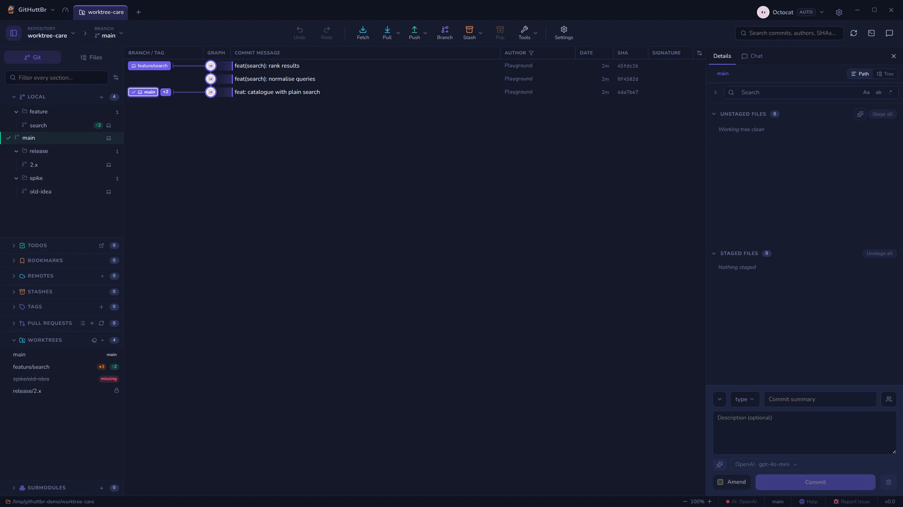
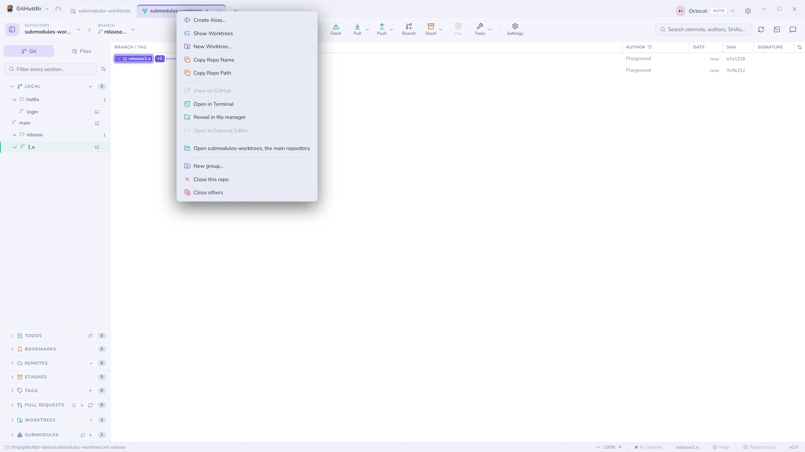

# 工作树与子模块

## 工作树

工作树（worktree）是同一个仓库的第二份检出，各自待在自己的文件夹里——于是你可以去看 `main`，而 `feature/x` 原封不动地停在你离开时的样子，一次贮藏都不用。

- 在侧边栏里创建和删除工作树。**双击**其中一个，它会作为自己的标签页打开；右键菜单里有*打开工作树*、*在文件夹中显示*和移除。
- 右键点任意一个本地分支 → **在工作树中打开**，就能在同级文件夹里开出一份，并作为一个标签页打开它。
- 一个分支同一时间只能待在一个工作树里，所以检出另一个工作树已经持有的分支根本不可能成功 —— git 会以 *already used by worktree at …* 拒绝。GitHuttBr 改为带你过去：分支菜单写着*前往 `x` 所在的工作树*，双击该行会打开那个工作树的标签页，而不是报错。

### 照料工作树

上个月建的工作树很容易被遗忘，问题总在清理时冒出来：里面还有工作吗？那个文件夹还在吗？每一行都会在你开口前给出答案。

| 行上显示 | 含义 |
|---|---|
| **●3** | 该工作树中有 3 个文件存在未提交的更改 |
| **↑2 ↓1** | 其分支比 upstream 领先 2 个提交、落后 1 个 |
| 🔒 | 已锁定 — 悬停可查看锁定时填写的原因 |
| **缺失**，名称带删除线 | 文件夹已不存在；git 中只剩下它的记录 |

这些数字在展开该区域、该工作树的提交变化、以及窗口重新获得焦点时读取 — 而不是每次刷新都读，因为每个数字都意味着在另一个文件夹里运行一次 `git status`。

右键单击一行可以：

| 操作 | 作用 |
|---|---|
| **锁定工作树** | 阻止 git（以及其他客户端）清理、移动或删除它。填写原因（如*在外置硬盘上*），它会显示在锁图标上。适用于存放在不常连接的介质上的工作树。 |
| **解锁工作树** | 与上面相反。撤销会以相同原因重新锁定。 |
| **移动工作树…** | 移动文件夹，并双向更新 git 的关联。工作树被锁定或在标签页中打开时不可用：标签页及其布局按路径记忆，标签页会指向空处。请先关闭标签页。撤销会把它移回原处。 |
| **移除工作树** | 先向 git 确认会丢失什么。干净的工作树弹出普通确认，撤销会在同一分支、同一文件夹重新创建它。有未提交更改的会弹出单独的确认 *放弃并移除*，注明文件数量，且无法撤销。 |
| **重新关联已移动的文件夹…** | 仅用于*缺失*的行：指出文件夹被移到了哪里（你用文件管理器移动了它），git 会通过 `git worktree repair` 重新关联。 |
| **清理缺失的工作树** | 也就是有缺失行时出现在区域标题上的橡皮擦按钮。会运行 `git worktree prune`。 |

这些操作**不会**做的事：

- **移除工作树也会删除其中被忽略的文件** — `.env`、`node_modules`、构建输出。git 不把它们算作更改，所以即使是“干净”的确认也会提示，撤销也无法恢复。
- **清理只删除 git 的记录。** 没有文件可删 — 文件夹已经不在了 — 已锁定的工作树会被跳过，因为拔掉的硬盘上的锁定工作树看起来和被删除的一模一样。
- 锁定是 git 客户端之间的约定，而不是文件保护：它无法阻止 git 之外的任何东西删除该文件夹。
- 主工作树（仓库本身）不能被锁定、移动或移除。
- 移除工作树永远不会删除它的分支。用完后请在分支列表中删除。

### 在标题栏中为工作树分组

工作树标签页以 `root · branch` 作为标签打开，很快就会变得很宽。

**放在分组里的项目会收纳自己的工作树。** 当仓库——或它的某个工作树——已经在一个分组中时，
新的工作树会在那个分组里、紧挨着它打开，无需勾选任何东西：添加工作树对话框只会说明是哪个
分组，分支菜单中的**在工作树中打开**也会不经询问地这样做。之后从**最近**或某个文件夹打开的
工作树同样会加入该分组。想让它单独存在，就把徽章拖出分组。

对于独占一个标签页的仓库，在添加工作树对话框中勾选**提示将共享同一根仓库的 worktree 分组**
（默认关闭，和 codegraph 选项一样会被记住）：如果根仓库以独立标签页打开，会出现**组名称**
字段（预填为根仓库的文件夹名），两者一起进入一个新分组；如果家族中没有成员打开，它只会说明
工作树将以独立标签页打开。在分组内，徽章会缩短为只显示末段（`main`、`feature/x`），因为分组
已经说明了它们属于哪个仓库——如果你更喜欢完整的 `root · branch` 名称，可以在设置 → 布局与终端
中用**组内缩短 worktree 名称**开关保留。这项提示只会合并共享同一根仓库的工作树——绝不会合并
不相关的仓库。

**辨认工作树标签页。** 关联工作树是仓库的第二个检出，否则它的标签页看起来会和仓库本身的
标签页一模一样。所以工作树标签页显示的是绿色的**分叉**图标而不是文件夹图标——图片标签页则在
图片角上显示一个小分叉——它的提示写着 *… 的工作树*，并附上它所在的文件夹。右键点击它可选择
**打开主仓库 …**，聚焦已经打开主检出的那个标签页，或者打开它——如果工作树在分组里，就在该
分组内打开。无论工作树是怎么打开的都有效：从它的家族、从**打开仓库**，或从扫描列表；子模块的
工作树指向该子模块。限制：这个标记关乎检出所在的位置，而不是它的分支；裸仓库的工作树不会被
标记，因为没有可打开的主检出；通过符号链接文件夹打开的主仓库不会被识别为已打开，所以菜单会
以它的真实路径再打开一次。

## 子模块

添加、更新（初始化并检出）、同步 URL、删除子模块，每一个都带实时状态：

| 状态 | 含义 |
|---|---|
| **已同步** | 检出在父仓库所记录的那个提交上 |
| **已修改** | 检出在别的地方，或者是脏的 |
| **未初始化** | 已记录，但从未检出过 |

**另请参阅：** [LFS 与稀疏检出](lfs-sparse.md) · [获取、拉取与推送](syncing.md)
