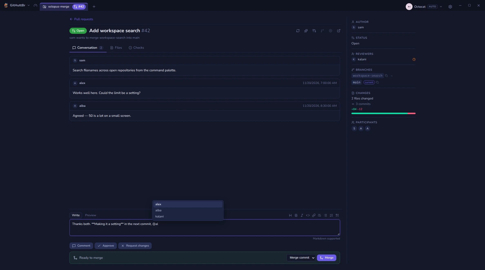

# 撰写评论

发送到 GitHub 的评论是 Markdown，而一个光秃秃的文本框只能让你手动敲出每个 `**` 和
`- [ ]`，再到浏览器里去看表格有没有显示对。应用中每个向托管平台写入的输入框，现在都是同一个
编辑器，拥有 GitHub 自己评论框的那些工具：

- 拉取请求的评论框、讨论回复和行评论（[拉取请求页面](pull-requests.md)）；
- issue 的评论框；
- 新拉取请求的描述和新 issue 的正文（[托管与拉取请求](hosting.md)）。



## 编写与预览

**预览** 按最终呈现的样子显示文本，使用与应用其他部分相同的 Markdown 渲染器绘制。它是
只读的；**编写** 会带回输入框，文本和光标都在你离开时的位置，所以 ⌘/Ctrl+Z 仍能撤销你在
查看之前输入的内容。

这两个标签是一个标签列表：其中一个获得焦点时，← 和 → 在它们之间切换。

## 工具栏

| 工具 | 快捷键 | 作用 |
|---|---|---|
| **标题** | — | 为所选行设置 H1、H2 和 H3 的菜单；选择某行已有的级别会将其移除 |
| **粗体** | ⌘/Ctrl+B | `**文本**` |
| **斜体** | ⌘/Ctrl+I | `_文本_` |
| **代码** | ⌘/Ctrl+E | 行内为 `` `代码` ``；选区跨多行时为用 ```` ``` ```` 围起来的代码块 |
| **链接** | ⌘/Ctrl+K | `[文本](url)`——选中的 URL 成为地址，其他文本成为链接文字 |
| **引用** | — | 在每个所选行前加 `> ` |
| **无序列表** | ⌘/Ctrl+Shift+8 | 在每个所选行前加 `- ` |
| **有序列表** | ⌘/Ctrl+Shift+7 | 在每个所选行前加 `1. `、`2. `… |
| **任务列表** | — | 在每个所选行前加 `- [ ] ` |

每个工具都是开关：作用于已有该格式的文本时，会将其去掉。没有选中任何内容时，粗体、斜体、
代码和链接会插入一段占位文字并选中它，方便直接覆盖输入。列表工具会替换另一种列表，而不是
叠加在上面。

这些编辑经由文本框自身的编辑完成，所以 **⌘/Ctrl+Z 可以撤销工具操作**，就像撤销输入的
一个词一样，重做也能恢复。

工具栏在 Tab 键顺序中只占一站；← → 在其按钮间移动，↓ 打开标题菜单。在评论框内，⌘/Ctrl+K
会创建链接，而不是打开命令面板。在 Mac 上快捷键只用 ⌘，因此 Ctrl+B、Ctrl+E 和 Ctrl+K 仍
执行 macOS 文本框中的原有功能。在字母不是拉丁字母的键盘布局上，快捷键跟随物理的 B、I、E
和 K 键。

## 列表

在列表项末尾按 **Enter** 会开始下一项——同样的符号、下一个编号、任务则是空的 `- [ ]`——
缩进保持不变。在标记之后没有内容的项上按 Enter 会结束列表并移除标记。Shift+Enter 是普通的
换行。

## 提及与引用

输入 **@** 会打开一个简短的人员列表，随输入逐步缩小；**#** 按编号和标题列出拉取请求和
issue（`#42`，或用 `#搜索词` 搜标题中的词）。↑ ↓ 选择，Enter 或 Tab 插入，Esc 关闭列表——
只关闭列表，而不是输入框或它所在的对话框。

列表取自应用已有的内容，不会再次询问托管平台：

| 输入框 | @ 提供 | # 提供 |
|---|---|---|
| 拉取请求 | 其作者、评审者、负责人以及所有评论过的人 | 仓库中打开的拉取请求和 issue，即侧边栏已加载的那些 |
| Issue | 其作者、负责人和评论者 | 同上 |
| 新拉取请求 | 其评审者和负责人选择器读取的人，以及已加载拉取请求的作者 | 同上 |
| 新 issue | 已加载的拉取请求和 issue 的作者 | 同上 |

单词中间的 **@** 或 **#**（电子邮件地址）、标题的 `#`，以及代码中的任何内容都不受影响。

## 发送

⌘/Ctrl+Enter 可从任何输入框发送：拉取请求或 issue 评论、讨论回复、行评论，以及新 issue 的
描述。不仅在输入框中，在标签、工具栏和预览中也有效。Esc 在同样的位置取消行评论。**讨论回复**
以前是按 Enter 发送的单行输入框；现在是一个小文本框，所以 Enter 是换行（或下一个列表项），
⌘/Ctrl+Enter 才发送。回复框在你点进去后才显示标签和工具，这样长对话不会在每个讨论下面都长出
一个工具栏。

## 速查表

每个输入框下方的 **支持 Markdown** 会就地打开一张速查表：每种格式、要输入什么以及它的
快捷键。按 Esc 或点击别处即可关闭。你正在写的内容不会移动。

底部的 **打开完整指南** 会打开本页。手册是一个独立的标签页，因此前往那里会离开输入框所在的
页面，未发送的文本会丢失：只要有这样的文本——在这个输入框或拉取请求页面的其他任何输入框中——
应用都会先询问。在新拉取请求和新 issue 对话框中，速查表没有这个链接，因为手册会在对话框背后
打开。

## 限制

- **不支持附件。** 把文件拖进输入框或粘贴图片都不会上传：GitHub 没有用于评论附件的公开 API，
  所以文件无处可放。请在网站上传，再粘贴链接。
- **只有已加载的人和条目。** @ 不搜索托管平台的用户，# 也不搜索所有 issue——没有参与对话的人，
  或侧边栏没有读取的已关闭 issue，都不会出现在候选中。你仍可以完整地输入名称或编号。
- **没有建议修改、已保存回复或表情选择器。**
- **预览使用应用的渲染器。** 它按应用的绘制方式显示 Markdown；托管平台自己的呈现可能在
  细节上不同（GitHub 特有的扩展、变成链接的提及）。
- **预览是应用的绘制，而不是托管平台的。** 在拉取请求和 issue 页面上，预览按发布后的评论在
  应用中显示的样子绘制文本（[评论如何显示](pull-requests.md#评论如何显示)）：同样严格的规则、
  保留换行，以及一张等待点击的其他网站图片。在 GitHub 上，发布后的评论随后由 GitHub 绘制，
  所以应用不认识的扩展可能看起来不同。新建拉取请求和新建 issue 对话框使用应用普通的 Markdown
  预览。
- 快捷键是固定的：它们不在快捷键设置中，也不会跟随那里的重新绑定。
